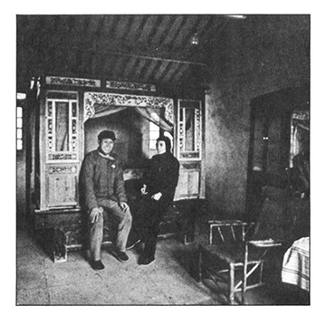
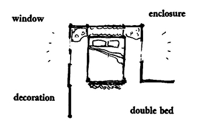

<section class="pattern-plate" aria-labelledby="t-marriage-bed">
<a href="/patterns">A Pattern Language</a> · <a href="/patterns#buildings">Buildings</a> · Pattern 187 · p. 864
<h1 class="pattern-title" id="t-marriage-bed">Marriage Bed</h1><figure class="pattern-figure pl-figure"></figure><nav class="pattern-links" aria-label="Connections"><h2>Links to</h2><ul><li><a href="/patterns/couples-realm">136 Couple’s Realm</a></li><li><a href="/patterns/bed-alcove">188 Bed Alcove</a></li><li><a href="/patterns/dressing-rooms">189 Dressing Rooms</a></li><li><a href="/patterns/ceiling-height-variety">190 Ceiling Height Variety</a></li><li><a href="/patterns/the-shape-of-indoor-space">191 The Shape Of Indoor Space</a></li><li><a href="/patterns/ornament">249 Ornament</a></li></ul><h2>Linked from</h2><ul><li><a href="/patterns/life-cycle">26 Life Cycle</a></li><li><a href="/patterns/couples-realm">136 Couple’s Realm</a></li><li><a href="/patterns/sleeping-to-the-east">138 Sleeping To The East</a></li><li><a href="/patterns/compost">178 Compost</a></li><li><a href="/patterns/communal-sleeping">186 Communal Sleeping</a></li><li><a href="/patterns/bed-alcove">188 Bed Alcove</a></li><li><a href="/patterns/dressing-rooms">189 Dressing Rooms</a></li></ul></nav></section><article class="pattern-text" aria-label="The text of Marriage Bed">
865… the pattern <a class="pl-ref" href="/patterns/couples-realm">couple’s realm (136)</a> gives emphasis to the importance of the couple’s private life together within a household. Within that couple’s realm, the placing and nature of the bed is naturally the most important thing.

◆ ◆ ◆

<strong>The bed is the center of a couple’s life together: the place where they lie together, talk, make love, sleep, sleep late, take care of each other during illness. But beds and bedrooms are not often made in ways which intensify their meaning, and these experiences cannot take hold.</strong>

It is true that there are extra wide beds, special bedspreads and frames, water beds, soft lighting, and all kinds of accessories on the night table. But these are all essentially gadgets. They still don’t make a bed which nourishes intimacy and love.

There are three far more basic points which go to establish the marriage bed.

1. The space around the bed is <em>shaped</em> around the bed. There is a low ceiling, or a partial ceiling, over the bed. The walls and windows are made to contain the bed. See <a class="pl-ref" href="/patterns/bed-alcove">bed ALCOVE (188)</a>.

2. It is crucial that the couple choose the right time to build the bed, and not buy one at the drop of the hat. It is unlikely that the bed can come to have the right feeling until a couple has weathered some hard times together and there is some depth to their experience.

3. Find a way of adding to the bed and the space around it, so that it will become more personal and unique over the years; for example, a headboard that can be carved, painted, repainted, or a cloth ceiling that can be changed, embroidered.

The importance of the bed as an anchor point in a couple’s life is brought home in this passage from Homer. Odysseus is home after 20 years of wandering and misadventure. His wife, Penelope, does not recognize him—there have been so many imposters, and he has been away so long. He pleads with her to believe it is him, but she is unsure. Frustrated, Odysseus turns away from her. Penelope speaks:

866“Strange man, I am not proud, or contemptuous, or offended, but I know what manner of man you were when you sailed away from Ithaca. Come Eurycleia, make the bed outside the room which he built himself * put the fine bedstead outside, and lay out the rugs and blankets and fleeces.”

This was a little trap for her husband. He burst into a rage:

“Wife, that has cut me to the heart! Who has moved my bed? That would be a difficult job for the best workman, unless God himself should come down and move it. It would be easy for God, but no man could easily prize it up, not the strongest man living! There is a great secret in that bed. I made it myself, and no one else touched it. There was a strong young olive tree in full leaf growing in an enclosure, the trunk as thick as a pillar. Round this I built our bridal chamber; I did the whole thing myself, laid the stones and built a good roof over it, jointed the doors and fitted them in their places. After that I cut off the branches and trimmed the trunk from the root up, smoothed it carefully with the adze and made it straight to the line. This tree I made the bedpost. That was the beginning of my bed; I bored holes through it, and fitted the other posts about it, and inlaid the framework with gold and silver and ivory, and I ran through it leather straps coloured purple. Now I have told you my secret. And I don’t know if it is still there, wife, or if some one has cut the olive at the root and moved my bed!”

She was conquered, she could hold out no longer when Odysseus told the secret she knew so well. She burst into tears and ran straight to him, throwing her arms about his neck. She kissed his head, and cried:

“Don’t be cross with me, my husband, you were always a most understanding man! The gods brought affliction upon us because they grudged us the joy of being young and growing old together! Don’t be angry, don’t be hurt because I did not take you in my arms as soon as I saw you! My heart has been frozen all this time with a fear that some one would come and deceive me with a false tale; there were so many imposters! But now you have told me the secret of our bed, that settles it.” (From <em>The Odyssey</em>, translated by W. H. D. Rouse. Reprinted by arrangement with The New American Library, Inc., New York, New York.)

The translator footnotes this incident as follows: “This is the first time in all the eventful tale when Odysseus speaks on impulse; he has been prepared for everything, but this unexpected trifle unlocks his heart.”

Quite honestly, we are not certain whether or not this pattern makes sense. On the one hand, it does: it is a beautiful idea; idyllic almost. Yet, face to face with cold hard fact and with the 867dissolution and struggles in the marriages around us, it seems hard to hope that it could ever be quite real. We have decided to leave it in, just because it is a beautiful idea. But we ask you to treat it like Oblomov’s dream, a picture more real than reality, an impossible dream of perfect and idyllic circumstances, which may help perhaps, to make a little more sense of our muddled everyday reality—but only if we take it with a pinch of salt.

Therefore:

<strong>At the right moment in a couple’s life, it is important that they make for themselves a special bed—an intimate anchor point for their lives; slightly enclosed, with a low ceiling or a canopy, with the room shaped to it; perhaps a tiny room built around the bed with many windows. Give the bed some shape of its own, perhaps as a four-poster with head board that can be hand carved or painted over the years.</strong>

<figure class="pl-figure"></figure>
◆ ◆ ◆

Make two separate dressing rooms or alcoves near the bed—<a class="pl-ref" href="/patterns/dressing-rooms">DRESSING ROOMS (189)</a>; for more details on the space around the bed, see <a class="pl-ref" href="/patterns/bed-alcove">BED ALCOVE (188)</a>; lower the ceiling over the bed—<a class="pl-ref" href="/patterns/ceiling-height-variety">CEILING HEIGHT VARIETY (190)</a>, and provide some way of creating special ornament all around it—<a class="pl-ref" href="/patterns/ornament">ORNAMENT (249)</a>. For the detailed shape of the space around the bed, see <a class="pl-ref" href="/patterns/the-shape-of-indoor-space">the shape of INDOOR SPACE (191)</a>….
</article>

Christopher Alexander, Sara Ishikawa and Murray Silverstein, with Max Jacobson, Ingrid Fiksdahl-King and Shlomo Angel, <cite>A Pattern Language</cite> (Oxford University Press, 1977), pattern 187, pp. 864–867. Text and illustrations from the <a href="https://github.com/natureoforder/sources">Nature of Order sources</a> reading edition, transcribed from the 1977 printing; report errors on <a href="https://github.com/natureoforder/alexander-wiki/issues">GitHub</a>.

<a href="/patterns/communal-sleeping">← 186 Communal Sleeping</a> · <a href="/patterns">All 253 patterns</a> · <a href="/patterns/bed-alcove">188 Bed Alcove →</a>

