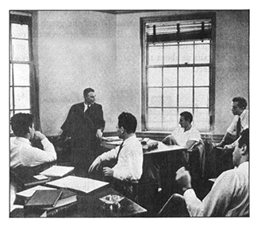
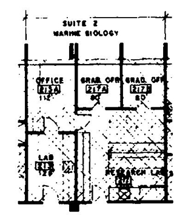
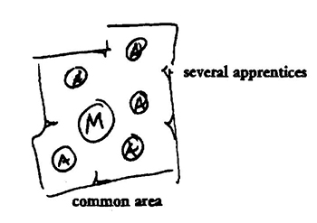

<section class="pattern-plate" aria-labelledby="t-master-and-apprentices">
<a href="/patterns">A Pattern Language</a> · <a href="/patterns#towns">Towns</a> · Pattern 83 · p. 412 · *
<h1 class="pattern-title" id="t-master-and-apprentices">Master And Apprentices</h1><figure class="pattern-figure pl-figure"></figure><nav class="pattern-links" aria-label="Connections"><h2>Links to</h2><ul><li><a href="/patterns/network-of-learning">18 Network Of Learning</a></li><li><a href="/patterns/self-governing-workshops-and-offices">80 Self-Governing Workshops And Offices</a></li><li><a href="/patterns/common-areas-at-the-heart">129 Common Areas At The Heart</a></li><li><a href="/patterns/communal-eating">147 Communal Eating</a></li><li><a href="/patterns/small-work-groups">148 Small Work Groups</a></li><li><a href="/patterns/small-meeting-rooms">151 Small Meeting Rooms</a></li><li><a href="/patterns/half-private-office">152 Half-Private Office</a></li><li><a href="/patterns/workspace-enclosure">183 Workspace Enclosure</a></li></ul><h2>Linked from</h2><ul><li><a href="/patterns/network-of-learning">18 Network Of Learning</a></li><li><a href="/patterns/life-cycle">26 Life Cycle</a></li><li><a href="/patterns/university-as-a-marketplace">43 University As A Marketplace</a></li><li><a href="/patterns/your-own-home">79 Your Own Home</a></li><li><a href="/patterns/teen-age-society">84 Teen-Age Society</a></li><li><a href="/patterns/wings-of-light">107 Wings Of Light</a></li><li><a href="/patterns/small-work-groups">148 Small Work Groups</a></li><li><a href="/patterns/small-meeting-rooms">151 Small Meeting Rooms</a></li></ul></nav></section><article class="pattern-text" aria-label="The text of Master And Apprentices">
413… the <a class="pl-ref" href="/patterns/network-of-learning">NETWORK OF LEARNING (18)</a> in the community relies on the fact that learning is decentralized, and part and parcel of every activity—not just a classroom thing. In order to realize this pattern, it is essential that the individual workgroups, throughout industry, offices, workshops, and work communities, are all set up to make the learning process possible. This pattern, which shows the arrangement needed, therefore helps greatly to form <a class="pl-ref" href="/patterns/self-governing-workshops-and-offices">SELF-GOVERNING WORKSHOPS AND OFFICES (80)</a> as Well as the <a class="pl-ref" href="/patterns/network-of-learning">NETWORK OF LEARNING (18)</a>.

◆ ◆ ◆

<strong>The fundamental learning situation is one in which a person learns by helping someone who really knows what he is doing.</strong>

It is the simplest way of acquiring knowledge, and it is powerfully effective. By comparison, learning from lectures and books is dry as dust. But this situation has all but disappeared from modern society. The schools and universities have taken over and abstracted many ways of learning which in earlier times were always closely related to the real work of professionals, tradesmen, artisans, independent scholars. In the twelfth century, for instance, young people learned by working beside masters—helping them, making contact directly with every comer of society. When a young person found himself able to contribute to a field of knowledge, or a trade—he would prepare a master “piece”; and with the consent of the masters, become a fellow in the guild.

An experiment by Alexander and Goldberg has shown that a class in which one person teaches a small group of others is most likely to be successful in those cases where the “students” are actually helping the “teacher” to do something or solve some problem, which he is working on anyway—not when a subject of abstract or general interest is being taught. (Report to the Muscatine Committee, on experimental course ED. 10X, Department of Architecture, University of California, 1966.)

If this is generally true—in short, if students can learn best when they are acting as apprentices, and helping to do something 414interesting—it follows that our schools and universities and offices and industries must provide physical settings which make this master-apprentice relation possible and natural: physical settings where communal work is centered on the master’s efforts and where half a dozen apprentices—not more—have workspace closely connected to the communal work of the studio.

We know of an example of this pattern, in the Molecular Biology building of the University of Oregon. The floors of the building are made up of laboratories, each one under the direction of a professor of biology, each with two or three small rooms opening directly off the lab for graduate students working under the professor’s direction.

<figure class="pl-figure"><figcaption><em>Master-apprentice relationship for a biology laboratory</em>.</figcaption></figure>

We believe that variations of this pattern are possible in many different work organizations, as well as the schools. The practice of law, architecture, medicine, the building trades, social services, engineering—each discipline has the potential to set up its ways of learning, and therefore the environments in which its practitioners work, along these lines.

Therefore:

<strong>Arrange the work in every workgroup, industry, and office, in such a way that work and learning go forward hand in hand. Treat every piece of work as an opportunity for learning. To this end, organize work around a tradition of masters and apprentices: and support this form of 415social organization with a division of the workspace into spatial clusters—one for each master and his apprentices—where they can work and meet together.</strong>

<figure class="pl-figure"></figure>
◆ ◆ ◆

Arrange the workspaces as <a class="pl-ref" href="/patterns/half-private-office">HALF-PRIVATE OFFICES (152)</a> or <a class="pl-ref" href="/patterns/workspace-enclosure">WORKSPACE ENCLOSURES (183)</a>. Keep workgroups small, and give every group a common area, a common meeting space, and a place where they can eat together—<a class="pl-ref" href="/patterns/common-areas-at-the-heart">COMMON AREAS AT THE HEART (129)</a>, <a class="pl-ref" href="/patterns/communal-eating">COMMUNAL EATING (147)</a>, <a class="pl-ref" href="/patterns/small-work-groups">SMALL WORK GROUPS (148)</a>, <a class="pl-ref" href="/patterns/small-meeting-rooms">SMALL MEETING ROOMS (151)</a>….
</article>

Christopher Alexander, Sara Ishikawa and Murray Silverstein, with Max Jacobson, Ingrid Fiksdahl-King and Shlomo Angel, <cite>A Pattern Language</cite> (Oxford University Press, 1977), pattern 83, pp. 412–415. Text and illustrations from the <a href="https://github.com/natureoforder/sources">Nature of Order sources</a> reading edition, transcribed from the 1977 printing; report errors on <a href="https://github.com/natureoforder/alexander-wiki/issues">GitHub</a>.

<a href="/patterns/office-connections">← 82 Office Connections</a> · <a href="/patterns">All 253 patterns</a> · <a href="/patterns/teen-age-society">84 Teen-Age Society →</a>

