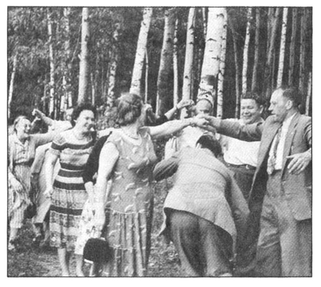
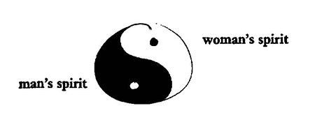

<section class="pattern-plate" aria-labelledby="t-men-and-women">
<a href="/patterns">A Pattern Language</a> · <a href="/patterns#towns">Towns</a> · Pattern 27 · p. 146
<h1 class="pattern-title" id="t-men-and-women">Men And Women</h1><figure class="pattern-figure pl-figure"></figure><nav class="pattern-links" aria-label="Connections"><h2>Links to</h2><ul><li><a href="/patterns/scattered-work">9 Scattered Work</a></li><li><a href="/patterns/community-of-7000">12 Community Of 7000</a></li><li><a href="/patterns/identifiable-neighborhood">14 Identifiable Neighborhood</a></li><li><a href="/patterns/life-cycle">26 Life Cycle</a></li><li><a href="/patterns/eccentric-nucleus">28 Eccentric Nucleus</a></li><li><a href="/patterns/density-rings">29 Density Rings</a></li><li><a href="/patterns/activity-nodes">30 Activity Nodes</a></li><li><a href="/patterns/promenade">31 Promenade</a></li><li><a href="/patterns/shopping-street">32 Shopping Street</a></li><li><a href="/patterns/night-life">33 Night Life</a></li><li><a href="/patterns/interchange">34 Interchange</a></li><li><a href="/patterns/a-room-of-ones-own">141 A Room Of One’s Own</a></li></ul><h2>Linked from</h2><ul><li><a href="/patterns/mini-buses">20 Mini-Buses</a></li><li><a href="/patterns/work-community">41 Work Community</a></li><li><a href="/patterns/home-workshop">157 Home Workshop</a></li></ul></nav></section><article class="pattern-text" aria-label="The text of Men And Women">
147… and just as a community or neighborhood must have a proper balance of activities for people of all the different ages—<a class="pl-ref" href="/patterns/community-of-7000">COMMUNITY OF 7000 (12)</a>, <a class="pl-ref" href="/patterns/identifiable-neighborhood">IDENTIFIABLE NEIGHBORHOOD (14)</a>, <a class="pl-ref" href="/patterns/life-cycle">LIFE CYCLE (26)</a>—so it must also adjust itself and its activities to the balance of the sexes, and provide, in equal part, the things which reflect the masculine and feminine sides of life.

◆ ◆ ◆

<strong>The world of a town in the 1970’s is split along sexual lines. Suburbs are for women, workplaces for men; kindergartens are for women, professional schools for men; supermarkets are for women, hardware stores for men.</strong>

Since no aspect of life is purely masculine or purely feminine, a world in which the separation of the sexes is extreme, distorts reality, and perpetuates and solidifies the distortions. Science is dominated by a masculine, and often mechanical mentality; foreign diplomacy is governed by war, again the product of the masculine ego. Schools for young children are swayed by the world of women, as are homes. The house has become the domain of woman to such a ridiculous extreme that home builders and developers portray an image of homes which are delicate and perfectly “nice,” like powder rooms. The idea that such a home could be a place where things are made or vegetables grown, with sawdust around the front door, is almost inconceivable.

The pattern or patterns which could resolve these problems are, for the moment, unknown. We can hint at the kinds of buildings and land use and institutions which would bring the problem into balance. But the geometry cannot be understood until certain social facts are realized, and given their full power to influence the environment. <em>In short, until both men and women are able to mutually influence each part of a town’s life, we shall not know what kinds of physical patterns will best co-exist with this social order</em>.

Therefore:

148<strong>Make certain that each piece of the environment—each building, open space, neighborhood, and work community—is made with a blend of both men’s and women’s instincts. Keep this balance of masculine and feminine in mind for every project at every scale, from the kitchen to the steel mill.</strong>

<figure class="pl-figure"></figure>
◆ ◆ ◆

No large housing areas without workshops for men; no work communities which do not provide for women with part-time jobs and child care—<a class="pl-ref" href="/patterns/scattered-work">SCATTERED WORK (9)</a>. Within each place which has a balance of the masculine and feminine make sure that individual men and women also have room to flourish, in their own right, distinct and separate from their opposites—<a class="pl-ref" href="/patterns/a-room-of-ones-own">A ROOM OF ONE’S OWN (141)</a>….

149<strong><em>both in the neighborhoods and the communities, and in between them, in the boundaries, encourage the formation of local centers:</em></strong>

<a class="pl-ref" href="/patterns/eccentric-nucleus">28. ECCENTRIC NUCLEUS</a>

<a class="pl-ref" href="/patterns/density-rings">29. DENSITY RINGS</a>

<a class="pl-ref" href="/patterns/activity-nodes">30. ACTIVITY NODES</a>

<a class="pl-ref" href="/patterns/promenade">31. PROMENADE</a>

<a class="pl-ref" href="/patterns/shopping-street">32. SHOPPING STREET</a>

<a class="pl-ref" href="/patterns/night-life">33. NIGHT LIFE</a>

<a class="pl-ref" href="/patterns/interchange">34. INTERCHANGE</a>
</article>

Christopher Alexander, Sara Ishikawa and Murray Silverstein, with Max Jacobson, Ingrid Fiksdahl-King and Shlomo Angel, <cite>A Pattern Language</cite> (Oxford University Press, 1977), pattern 27, pp. 146–149. Text and illustrations from the <a href="https://github.com/natureoforder/sources">Nature of Order sources</a> reading edition, transcribed from the 1977 printing; report errors on <a href="https://github.com/natureoforder/alexander-wiki/issues">GitHub</a>.

<a href="/patterns/life-cycle">← 26 Life Cycle</a> · <a href="/patterns">All 253 patterns</a> · <a href="/patterns/eccentric-nucleus">28 Eccentric Nucleus →</a>

