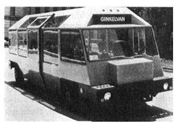
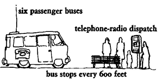

<section class="pattern-plate" aria-labelledby="t-mini-buses">
<a href="/patterns">A Pattern Language</a> · <a href="/patterns#towns">Towns</a> · Pattern 20 · p. 110 · *
<h1 class="pattern-title" id="t-mini-buses">Mini-Buses</h1><nav class="pattern-links" aria-label="Connections"><h2>Links to</h2><ul><li><a href="/patterns/local-transport-areas">11 Local Transport Areas</a></li><li><a href="/patterns/web-of-public-transportation">16 Web Of Public Transportation</a></li><li><a href="/patterns/four-story-limit">21 Four-Story Limit</a></li><li><a href="/patterns/nine-per-cent-parking">22 Nine Per Cent Parking</a></li><li><a href="/patterns/parallel-roads">23 Parallel Roads</a></li><li><a href="/patterns/sacred-sites">24 Sacred Sites</a></li><li><a href="/patterns/access-to-water">25 Access To Water</a></li><li><a href="/patterns/life-cycle">26 Life Cycle</a></li><li><a href="/patterns/men-and-women">27 Men And Women</a></li><li><a href="/patterns/interchange">34 Interchange</a></li><li><a href="/patterns/bus-stop">92 Bus Stop</a></li></ul><h2>Linked from</h2><ul><li><a href="/patterns/neighborhood-boundary">15 Neighborhood Boundary</a></li><li><a href="/patterns/web-of-public-transportation">16 Web Of Public Transportation</a></li><li><a href="/patterns/interchange">34 Interchange</a></li><li><a href="/patterns/bus-stop">92 Bus Stop</a></li></ul></nav></section><article class="pattern-text" aria-label="The text of Mini-Buses">
…this pattern helps complete the <a class="pl-ref" href="/patterns/local-transport-areas">LOCAL TRANSPORT AREAS (11)</a>and the <a class="pl-ref" href="/patterns/web-of-public-transportation">WEB OF PUBLIC TRANSPORTATION (16)</a>. The local transport areas rely heavily on foot traffic, and on bikes and carts and horses. The web of public transportation relies on trains and planes and buses. Both of these patterns need a more flexible kind of public transportation to support them.

◆ ◆ ◆

<strong>Public transportation must be able to take people from any point to any other point within the metropolitan area.</strong>

Buses and trains, which run along lines, are too far from most origins and destinations to be useful. Taxis, which can go from point to point, are too expensive,

To solve the problem, it is necessary to have a kind of vehicle which is half way between the two—half like a bus, half like a taxi—a small bus which can pick up people at any point and take them to any other point, but which may also pick up other passengers on the way, to make the trip less costly than a taxi fare.

Recent research, and full-scale experiments, have shown that a system of mini-buses, on call by telephone, can function in this fashion, taking people from door to door in 15 minutes, for no more than <em>50</em> cents a ride (1974) : and that the system is efficient enough to support itself. It works just like a taxi, except that it picks up and drops off other passengers while you are riding; it goes to the nearest corner to save time—not to your own front door; and it costs a quarter of an average taxi fare.

The system hinges, to a certain extent, on the development of sophisticated new computer programs. As calls come in, the computer examines the present movements of all the various minibuses, each with its particular load of passengers, and decides which bus can best afford to pick up the new passenger, with the least detour. Two-way radio contact keeps the mini-buses in communication with the dispatcher at the computer switchboard. All this, and other details, are discussed fully in a review of current 111dial-a-bus research: <em>Summary Report-The Dial-a-Ride Transportation System</em>, M.I.T. Urban Systems Laboratory, Report # USL-TR-70-10, March 1971.

<figure class="pl-figure"><figcaption><em>Canadian mini-bus</em>.</figcaption></figure>

Dial systems for buses are actually coming into existence now because they are economically feasible. While conventional fixed-route public transport systems are experiencing a dangerous spiral of lower levels of service, fewer passengers, and increased public subsidies, over 30 working dial-a-bus systems are presently in successful operation throughout the world. For example, a dial-a-bus system in Regina, Saskatchewan, is the <em>only</em> part of the Regina Transit System which supports itself (<em>Regina Telebus Study: Operations Report, and Financial Report</em>, W. G. Atkinson et al., June 1972). In Batavia, New York, dial-a-bus is the sole means of public transport, serving a population of 16,000 at fares of 40 to 60 cents per ride.

We finish this pattern by reminding the reader of two vital problems of public transportation, which underline the importance of the mini-bus approach.

First, there are very large numbers of people in cities who cannot drive; we believe the mini-bus system is the only realistic way of meeting the needs of all these people.

Their numbers are much larger than one would think. They are, in effect, a silent minority comprising the uncomplaining old and physically handicapped, the young and the poor. In 1970, over 20 percent of U.S. households did not own a car. Fifty-seven and fivetenths percent of all households with incomes under $1000 did not own a car. For households headed by persons <em>65</em> years of age or older, 44.9 percent did not own a car. Of the youths between 10 and 18 years of age, 80 percent are dependent on others, including public transit, 112for their mobility. Among the physically disabled about <em>5.7</em> million are potential riders of public transportation if the system could take them door-to-door. (Sumner Myers, “Turning Transit Subsidies into ‘Compensatory Transportation,’” <em>City</em>, Vol. 6, No. 3, Summer 1972, p.20.)

Second, quite apart from these special needs, the fact is that a web of public transportation, with large buses, boats, and trains, will not work anyway, without a mini-bus system. The large systems need feeders: some way of getting to the stations. If people have to get in their cars to go to the train, then, once in the car, they stay in it and do not use the train at all. The mini-bus system is essential for the purpose of providing feeder service in the larger web of public transportation.

Therefore:

<strong>Establish a system of small taxi-like buses, carrying up to six people each, radio-controlled, on call by telephone, able to provide point-to-point service according to the passengers’ needs, and supplemented by a computer system which guarantees minimum detours, and minimum waiting times. Make bus stops for the mini-buses every 6oo feet in each direction, and equip these bus stops with a phone for dialing a bus.</strong>

<figure class="pl-figure"></figure>
◆ ◆ ◆

Place the bus stops mainly along major roads, as far as this can be consistent with the fact that no one ever has to walk more than 600 feet to the nearest one—<a class="pl-ref" href="/patterns/parallel-roads">PARALLEL ROADS (23)</a>; put one in every <a class="pl-ref" href="/patterns/interchange">INTERCHANGE (34)</a>; and make each one a place where a few minutes’ wait is pleasant—<a class="pl-ref" href="/patterns/bus-stop">BUS STOP (92)</a>….

<strong><em>113establish community and neighborhood policy to control the character of the local environment according to the fallowing fundamental principles:</em></strong>

<a class="pl-ref" href="/patterns/four-story-limit">21. FOUR-STORY LIMIT</a>

<a class="pl-ref" href="/patterns/nine-per-cent-parking">22. NINE PER CENT PARKING</a>

<a class="pl-ref" href="/patterns/parallel-roads">23. PARALLEL ROADS</a>

<a class="pl-ref" href="/patterns/sacred-sites">24. SACRED SITES</a>

<a class="pl-ref" href="/patterns/access-to-water">25. ACCESS TO WATER</a>

<a class="pl-ref" href="/patterns/life-cycle">26. LIFE CYCLE</a>

<a class="pl-ref" href="/patterns/men-and-women">27. MEN AND WOMEN</a>
</article>

Christopher Alexander, Sara Ishikawa and Murray Silverstein, with Max Jacobson, Ingrid Fiksdahl-King and Shlomo Angel, <cite>A Pattern Language</cite> (Oxford University Press, 1977), pattern 20, pp. 110–113. Text and illustrations from the <a href="https://github.com/natureoforder/sources">Nature of Order sources</a> reading edition, transcribed from the 1977 printing; report errors on <a href="https://github.com/natureoforder/alexander-wiki/issues">GitHub</a>.

<a href="/patterns/web-of-shopping">← 19 Web Of Shopping</a> · <a href="/patterns">All 253 patterns</a> · <a href="/patterns/four-story-limit">21 Four-Story Limit →</a>

