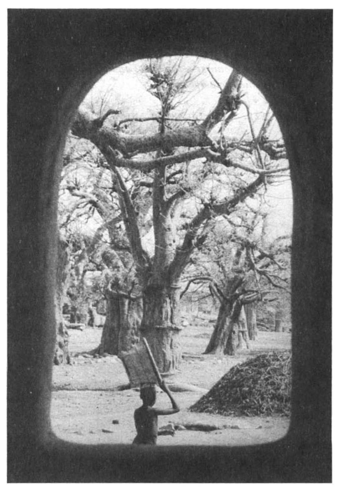
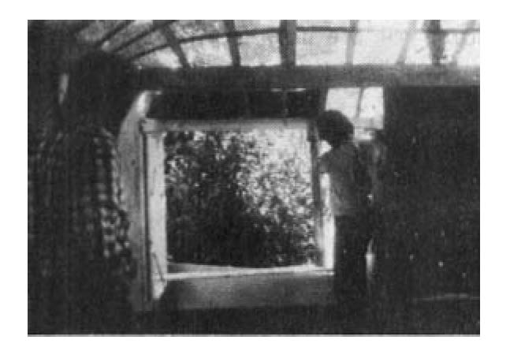
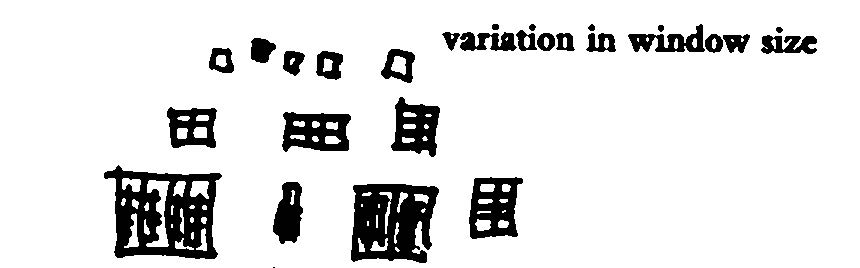

<section class="pattern-plate" aria-labelledby="t-natural-doors-and-windows">
<a href="/patterns">A Pattern Language</a> · <a href="/patterns#construction">Construction</a> · Pattern 221 · p. 1046 · **
<h1 class="pattern-title" id="t-natural-doors-and-windows">Natural Doors And Windows</h1><figure class="pattern-figure pl-figure"></figure><nav class="pattern-links" aria-label="Connections"><h2>Links to</h2><ul><li><a href="/patterns/zen-view">134 Zen View</a></li><li><a href="/patterns/street-windows">164 Street Windows</a></li><li><a href="/patterns/windows-overlooking-life">192 Windows Overlooking Life</a></li><li><a href="/patterns/corner-doors">196 Corner Doors</a></li><li><a href="/patterns/box-columns">216 Box Columns</a></li><li><a href="/patterns/perimeter-beams">217 Perimeter Beams</a></li><li><a href="/patterns/low-sill">222 Low Sill</a></li><li><a href="/patterns/deep-reveals">223 Deep Reveals</a></li><li><a href="/patterns/small-panes">239 Small Panes</a></li></ul><h2>Linked from</h2><ul><li><a href="/patterns/zen-view">134 Zen View</a></li><li><a href="/patterns/sleeping-to-the-east">138 Sleeping To The East</a></li><li><a href="/patterns/light-on-two-sides-of-every-room">159 Light On Two Sides Of Every Room</a></li><li><a href="/patterns/window-place">180 Window Place</a></li><li><a href="/patterns/bed-alcove">188 Bed Alcove</a></li><li><a href="/patterns/windows-overlooking-life">192 Windows Overlooking Life</a></li><li><a href="/patterns/roof-vaults">220 Roof Vaults</a></li><li><a href="/patterns/low-sill">222 Low Sill</a></li><li><a href="/patterns/low-doorway">224 Low Doorway</a></li><li><a href="/patterns/frames-as-thickened-edges">225 Frames As Thickened Edges</a></li><li><a href="/patterns/filtered-light">238 Filtered Light</a></li></ul></nav></section><article class="pattern-text" aria-label="The text of Natural Doors And Windows">
1047… imagine that you are now standing in the built-up frame of a partly constructed building, with the columns and beams in place <a class="pl-ref" href="/patterns/box-columns">BOX COLUMNS (216)</a>, <a class="pl-ref" href="/patterns/perimeter-beams">PERIMETER BEAMS (217)</a>. You know roughly where you want doors and windows from <a class="pl-ref" href="/patterns/zen-view">ZEN VIEW (134)</a>, <a class="pl-ref" href="/patterns/street-windows">STREET WINDOWS (164)</a>, WINDOW PLACE (l80), <a class="pl-ref" href="/patterns/windows-overlooking-life">WINDOWS OVERLOOKING LIFE (192)</a>, <a class="pl-ref" href="/patterns/corner-doors">CORNER DOORS (196)</a>. Now you can settle on the exact positions of the frames.

◆ ◆ ◆

<strong>Finding the right position for a window or a door is a subtle matter. But there are very few ways of building which take this into consideration.</strong>

In our current ways of building, the delicacy of placing a window or a door has nearly vanished. But it is just this refinement, down to the last foot, even to the last inch or two, which makes an immense difference. Windows and doors which are just right are always like this. Find a beautiful window. Study it. See how different it would be if its dimensions varied a few inches in either direction.

Now look at the windows and doors in most buildings made during the last 20 years. Assume that these openings are in roughly the right place, but notice how they could be improved if they were free to shift around, a few inches here and there, each one taking advantage of its own special circumstances—the space immediately inside and the view outside.

It it almost always a rigid construction system, combined with a formal aesthetic, which holds these windows in such a. death grip. There is nothing else to this regularity, for it is possible to relax the regularity without losing structural integrity.

It is also important to realize that this final placing of windows and doors can only be done on site, with the rough frame of the building in position. It is impossible to do it on paper. But on the site it is quite straightforward and natural: mock up the openings with scraps of lumber or string and move them around until they feel right; pay careful attention to the organization of the view and the kind of space that is created inside.

1048

<figure class="pl-figure"><figcaption><em>Getting it just right</em>.</figcaption></figure>

As we shall see in a later pattern—<a class="pl-ref" href="/patterns/small-panes">SMALL PANES (239)</a>, it is not necessary to make the windows any special dimensions, or to try and make them multiples of any standard pane size. Whatever dimensions this pattern gives each window, it will then be possible to divide it up, to form small panes, which will be different in their exact shape and size, according to the window they are in.

However, although there is no constraint on the exact dimension of the windows, there is a general rule of thumb, which will make window sizes vary: Windows, as a rule, should become smaller as you get higher up in the building.

1 The area of windows needed for light and ventilation depends on the size of rooms, and rooms are generally smaller on upper stories of the building—the communal rooms are generally on the ground floor and more private rooms upstairs.

2 The amount of daylight coming through a window depends on the area of open sky visible through the window. The higher the window, the more open sky is visible (because nearby trees and buildings obscure less)—so less window area is needed to get sufficient daylight in.

3 To feel safe on the upper stories of a building, one wants more enclosure, smaller windows, higher sills—and the higher off the ground one is, the more one needs these psychological protections.

Therefore:

<strong>On no account use standard doors or windows. Make each window a different size, according to its place.</strong>

<strong>Do not fix the exact position or size of the door and window 1049frames until the rough framing of the room has actually been built, and you can really stand inside the room and judge, by eye, exactly where you want to put them, and how big you want them. When you decide, mark the openings with strings.</strong>

<strong>Make the windows smaller and smaller, as you go higher in the building.</strong>

<figure class="pl-figure"></figure>
Fine tune the exact position of each edge, and mullion, and sill, according to your comfort in the room, and the view that the window looks onto—<a class="pl-ref" href="/patterns/low-sill">LOW SILL (222)</a>, <a class="pl-ref" href="/patterns/deep-reveals">DEEP REVEALS (223)</a>. As a result, each window will have a different size and shape, according to its position in the building. This means that it is obviously impossible to use standard windows and even impossible to make each window a simple multiple of standard panes. But it will still be possible to glaze each window, since the procedure for building the panes makes them divisions of the whole, instead of making up the whole as a multiple of standard panes—<a class="pl-ref" href="/patterns/small-panes">SMALL PANES (239)</a>….
</article>

Christopher Alexander, Sara Ishikawa and Murray Silverstein, with Max Jacobson, Ingrid Fiksdahl-King and Shlomo Angel, <cite>A Pattern Language</cite> (Oxford University Press, 1977), pattern 221, pp. 1046–1049. Text and illustrations from the <a href="https://github.com/natureoforder/sources">Nature of Order sources</a> reading edition, transcribed from the 1977 printing; report errors on <a href="https://github.com/natureoforder/alexander-wiki/issues">GitHub</a>.

<a href="/patterns/roof-vaults">← 220 Roof Vaults</a> · <a href="/patterns">All 253 patterns</a> · <a href="/patterns/low-sill">222 Low Sill →</a>

