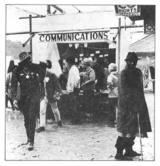
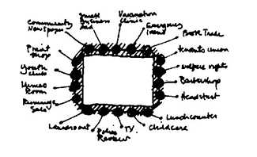

<section class="pattern-plate" aria-labelledby="t-necklace-of-community-projects">
<a href="/patterns">A Pattern Language</a> · <a href="/patterns#towns">Towns</a> · Pattern 45 · p. 242
<h1 class="pattern-title" id="t-necklace-of-community-projects">Necklace Of Community Projects</h1><figure class="pattern-figure pl-figure"></figure><nav class="pattern-links" aria-label="Connections"><h2>Links to</h2><ul><li><a href="/patterns/university-as-a-marketplace">43 University As A Marketplace</a></li><li><a href="/patterns/local-town-hall">44 Local Town Hall</a></li><li><a href="/patterns/health-center">47 Health Center</a></li><li><a href="/patterns/individually-owned-shops">87 Individually Owned Shops</a></li><li><a href="/patterns/building-edge">160 Building Edge</a></li></ul><h2>Linked from</h2><ul><li><a href="/patterns/old-people-everywhere">40 Old People Everywhere</a></li><li><a href="/patterns/local-town-hall">44 Local Town Hall</a></li><li><a href="/patterns/small-services-without-red-tape">81 Small Services Without Red Tape</a></li><li><a href="/patterns/rooms-to-rent">153 Rooms To Rent</a></li><li><a href="/patterns/opening-to-the-street">165 Opening To The Street</a></li></ul></nav></section><article class="pattern-text" aria-label="The text of Necklace Of Community Projects">
243… <a class="pl-ref" href="/patterns/local-town-hall">local town hall (44)</a> calls for small centers of local government at the heart of every community. This pattern embellishes the local town hall and other public institutions like it <a class="pl-ref" href="/patterns/university-as-a-marketplace">UNIVERSITY AS A MARKETPLACE (47)</a> and <a class="pl-ref" href="/patterns/health-center">HEALTH CENTER (47)</a>—with a ground for community action.

◆ ◆ ◆

<strong>The local town hall will not be an honest part of the community which lives around it, unless it is itself surrounded by all kinds of small community activities and projects, generated by the people for themselves.</strong>

A lively process of community self-government depends on an endless series of ad hoc political and service groups, functioning freely, each with a proper chance to test its ideas before the townspeople. The spatial component of this idea is crucial: this process will be stymied if people cannot get started in an office on a shoestring.

We derive the geometry of this pattern from five requirements:

1. Small, grass roots movements, unpopular at their inception, play a vital role in society. They provide a critical opposition to established ideas; their presence is a direct correlate of the right to free speech; a basic part of the self-regulation of a successful society, which will generate counter movements whenever things get oS the track. Such movements need a place to manifest themselves, in a way which puts their ideas directly into the public domain. At this writing, a quick survey of the East Bay shows about 30 or 40 bootstrap groups that are suffering for lack of such a place: for example, Alcatraz Indians, Bangla Desh Relief, Solidarity Films, Tenant Action Project, November 7th Movement, Gay Legal Defense, No on M, People’s Translation Service….

2. But as a rule these groups are small and have very little money. To nourish this kind of activity, the community must provide minimal space to any group of this sort, rent free, with some limit on the duration of the lease. The space must be like a 244small storefront and have typewriters, duplicating machines, and telephones; and access to a meeting room.

3. To encourage the atmosphere of honest debate, these storefront spaces must be near the town hall, the main crossroads of public life. If they are scattered across the town, away from the main town hall, they cannot seriously contend with the powers that be.

4. The space must be highly visible. It must be built in a way which lets the group get their ideas across, to people on the street. And it must be physically organized to undermine the natural tendency town governments have to wall themselves in and isolate themselves from the community once they are in power.

5. Finally, to bring these groups into natural contact with the community, the fabric of storefronts should be built to include some of the stable shops and services that the community needs—barbershop, cafe, laundromat.

These five requirements suggest a necklace of rather open storefront spaces around the local town hall. This necklace of spaces is a physical embodiment of the political process in an open society: everyone has access to equipment, space to mount a campaign, and the chance to get their ideas into the public arena.

Therefore:

<strong>Allow the growth of shop-size spaces around the local town hall, and any other appropriate community building. Front these shops on a busy path, and lease them for a minimum rent to ad hoc community groups for political work, trial services, research, and advocate groups. No ideological restrictions.</strong>

<figure class="pl-figure"></figure>
◆ ◆ ◆

245Make each shop small, compact, and easily accessible like <a class="pl-ref" href="/patterns/individually-owned-shops">individually owned shops (87)</a>; build small public spaces for loitering amongst them—public outdoor room (69). Use them to form the building edge—building fronts (122), <a class="pl-ref" href="/patterns/building-edge">building edge (160)</a>, and keep them open to the street—opening to the street (165)….
</article>

Christopher Alexander, Sara Ishikawa and Murray Silverstein, with Max Jacobson, Ingrid Fiksdahl-King and Shlomo Angel, <cite>A Pattern Language</cite> (Oxford University Press, 1977), pattern 45, pp. 242–245. Text and illustrations from the <a href="https://github.com/natureoforder/sources">Nature of Order sources</a> reading edition, transcribed from the 1977 printing; report errors on <a href="https://github.com/natureoforder/alexander-wiki/issues">GitHub</a>.

<a href="/patterns/local-town-hall">← 44 Local Town Hall</a> · <a href="/patterns">All 253 patterns</a> · <a href="/patterns/market-of-many-shops">46 Market Of Many Shops →</a>

