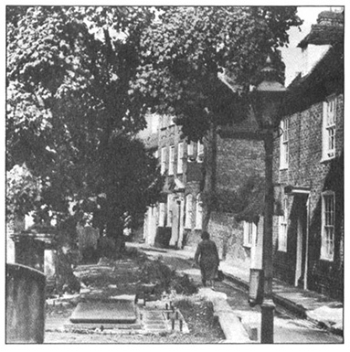
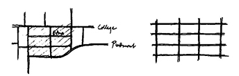
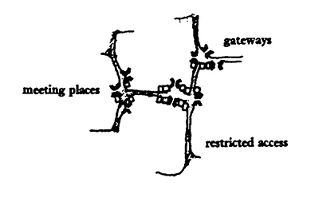

<section class="pattern-plate" aria-labelledby="t-neighborhood-boundary">
<a href="/patterns">A Pattern Language</a> · <a href="/patterns#towns">Towns</a> · Pattern 15 · p. 86 · *
<h1 class="pattern-title" id="t-neighborhood-boundary">Neighborhood Boundary</h1><figure class="pattern-figure pl-figure"></figure><nav class="pattern-links" aria-label="Connections"><h2>Links to</h2><ul><li><a href="/patterns/community-of-7000">12 Community Of 7000</a></li><li><a href="/patterns/subculture-boundary">13 Subculture Boundary</a></li><li><a href="/patterns/identifiable-neighborhood">14 Identifiable Neighborhood</a></li><li><a href="/patterns/web-of-public-transportation">16 Web Of Public Transportation</a></li><li><a href="/patterns/ring-roads">17 Ring Roads</a></li><li><a href="/patterns/network-of-learning">18 Network Of Learning</a></li><li><a href="/patterns/web-of-shopping">19 Web Of Shopping</a></li><li><a href="/patterns/mini-buses">20 Mini-Buses</a></li><li><a href="/patterns/parallel-roads">23 Parallel Roads</a></li><li><a href="/patterns/shopping-street">32 Shopping Street</a></li><li><a href="/patterns/work-community">41 Work Community</a></li><li><a href="/patterns/main-gateways">53 Main Gateways</a></li><li><a href="/patterns/quiet-backs">59 Quiet Backs</a></li><li><a href="/patterns/accessible-green">60 Accessible Green</a></li><li><a href="/patterns/pools-and-streams">64 Pools And Streams</a></li><li><a href="/patterns/public-outdoor-room">69 Public Outdoor Room</a></li><li><a href="/patterns/grave-sites">70 Grave Sites</a></li><li><a href="/patterns/local-sports">72 Local Sports</a></li><li><a href="/patterns/adventure-playground">73 Adventure Playground</a></li><li><a href="/patterns/street-cafe">88 Street Cafe</a></li><li><a href="/patterns/corner-grocery">89 Corner Grocery</a></li><li><a href="/patterns/shielded-parking">97 Shielded Parking</a></li><li><a href="/patterns/small-parking-lots">103 Small Parking Lots</a></li></ul><h2>Linked from</h2><ul><li><a href="/patterns/scattered-work">9 Scattered Work</a></li><li><a href="/patterns/local-transport-areas">11 Local Transport Areas</a></li><li><a href="/patterns/identifiable-neighborhood">14 Identifiable Neighborhood</a></li><li><a href="/patterns/parallel-roads">23 Parallel Roads</a></li><li><a href="/patterns/activity-nodes">30 Activity Nodes</a></li><li><a href="/patterns/work-community">41 Work Community</a></li><li><a href="/patterns/industrial-ribbon">42 Industrial Ribbon</a></li><li><a href="/patterns/housing-in-between">48 Housing In Between</a></li><li><a href="/patterns/accessible-green">60 Accessible Green</a></li><li><a href="/patterns/pools-and-streams">64 Pools And Streams</a></li><li><a href="/patterns/beer-hall">90 Beer Hall</a></li><li><a href="/patterns/ornament">249 Ornament</a></li></ul></nav></section><article class="pattern-text" aria-label="The text of Neighborhood Boundary">
87… the physical boundary needed to protect subcultures from one another, and to allow their ways of life to be unique and idiosyncratic, is guaranteed, for a <a class="pl-ref" href="/patterns/community-of-7000">COMMUNITY OF 7000 (12)</a>, by the pattern <a class="pl-ref" href="/patterns/subculture-boundary">SUBCULTURE BOUNDARY (13)</a>. But a second, smaller kind of boundary is needed to create the smaller <a class="pl-ref" href="/patterns/identifiable-neighborhood">IDENTIFIABLE NEIGHBORHOOD (14)</a>.

◆ ◆ ◆

<strong>The strength of the boundary is essential to a neighborhood. If the boundary is too weak the neighborhood will not be able to maintain its own identifiable charactcr.</strong>

The cell wall of an organic cell is, in most cases, as large as, or larger, than the cell interior. It is not a surface which divides inside from outside, but a coherent entity in its own right, which preserves the functional integrity of the cell and also provides for a multitude of transactions between the cell interior and the ambient fluids.

<figure class="pl-figure"><figcaption><em>Cell with cell wall: The cell wall is a place in its own right</em>.</figcaption></figure>

We have already argued, in <a class="pl-ref" href="/patterns/subculture-boundary">SUBCULTURE BOUNDARY (13)</a>, that a human group, with a specific life style, needs a boundary around it to protect its idiosyncrasies from encroachment and dilution by surrounding ways of life. This subculture boundary, 88then, functions just like a cell wall—it protects the subculture and creates space for its transactions with surrounding functions.

The argument applies as strongly to an individual neighborhood, which is a subculture in microcosm.

However, where the subculture boundaries require wide swaths of land and commercial and industrial activity, the neighborhood boundaries can be much more modest. Indeed it is not possible for a neighborhood of 500 or more to bound itself with shops and streets and community facilities; there simply aren’t enough to go around. Of course, the few neighborhood shops there are—the <a class="pl-ref" href="/patterns/street-cafe">STREET CAFE (88)</a>, the <a class="pl-ref" href="/patterns/corner-grocery">CORNER GROCERY (89)</a>—will help to form the edge of the neighborhood, but by and large the boundary of neighborhoods will have to come from a completely different morphological principle.

From observations of neighborhoods that succeed in being welldefined, both physically and in the minds of the townspeople, we have learned that the single most important feature of a neighborhood’s boundary is <em>restricted access into the neighborhood:</em> neighborhoods that are successfully defined have definite and relatively few paths and roads leading into them.

For example, here is a map of the Etna Street neighborhood in Berkeley.

<figure class="pl-figure"><figcaption><em>Our neighborhood, compared with a typical part of a grid system</em>.</figcaption></figure>

There are only seven roads into this neighborhood, compared with the fourteen which there would be in a typical part of the street grid. The other roads all dead end in T junctions immediately at the edge of the neighborhood. Thus, while the Etna Street neighborhood is not literally walled off from the community, access into it is subtly restricted. The result is that people do not come into the neighborhood by car unless they have 89business there; and when people are in the neighborhood, they recognize that they are <em>in</em> a distinct part of town. Of course, the neighborhood was not “created” deliberately. It was an area of Berkeley which has become an identifiable neighborhood because of this accident in the street system.

An extreme example of this principle is the Fuggerei in Augsburg, illustrated in <a class="pl-ref" href="/patterns/identifiable-neighborhood">IDENTIFIABLE NEIGHBORHOOD (14)</a>. The Fuggerei is entirely bounded by the backs of buildings and walls, and the paths into it are narrow, marked by gateways.

Indeed, if access is restricted, this means, <em>by definition</em>, that those few points where access is possible, will come to have special importance. In one way or another, subtly, or more obviously, they will be gateways, which mark the passage into the neighborhood. We discuss this more fully in <a class="pl-ref" href="/patterns/main-gateways">MAIN GATEWAYS (53)</a>. But the fact is that every successful neighborhood is identifiable because it has some kind of gateways which mark its boundaries: the boundary comes alive in peoples’ minds because they recognize the gateways.

In case the idea of gateways seems too closed, we remark at once that the boundary zone—and especially those parts of it around the gateways—must also form a kind of public meeting ground, where neighborhoods come together. If each neighborhood is a self-contained entity, then the community of 7000 which the neighborhoods belong to will not control any of the land internal to the neighborhoods. But it will control <em>all</em> of the land <em>between</em> the neighborhoods—the boundary land—because this boundary land is just where functions common to all 7000 people must find space. In this sense the boundaries not only serve to protect individual neighborhoods, but simultaneously function to unite them in their larger processes.

Therefore:

<strong>Encourage the formation of a boundary around each neighborhood, to separate it from the next door neighborhoods. Form this boundary by closing down streets and limiting access to the neighborhood—cut the normal number of streets at least in half. Place gateways at those points where the restricted access paths cross the boundary; and 90make the boundary zone wide enough to contain meeting places for the common functions shared by several neighborhoods.</strong>

<figure class="pl-figure"></figure>
◆ ◆ ◆

The easiest way of all to form a boundary around a neighborhood is by turning buildings inward, and by cutting off the paths which cross the boundary, except for one or two at special points which become gateways—<a class="pl-ref" href="/patterns/main-gateways">MAIN GATEWAYS (53)</a>; the public land of the boundary may include a park, collector roads, small parking lots, and work communities-anything which forms a natural edge—<a class="pl-ref" href="/patterns/parallel-roads">PARALLEL ROADS (23)</a>, <a class="pl-ref" href="/patterns/work-community">WORK COMMUNITY (41)</a>, <a class="pl-ref" href="/patterns/quiet-backs">QUIET BACKS (59)</a>, <a class="pl-ref" href="/patterns/accessible-green">ACCESSIBLE GREEN (60)</a>, <a class="pl-ref" href="/patterns/shielded-parking">SHIELDED PARKING (97)</a>, <a class="pl-ref" href="/patterns/small-parking-lots">SMALL PARKING LOTS (103)</a>. As for the meeting places in the boundary, they can be any of those neighborhood functions which invite gathering: a park, a shared garage, an outdoor room, a shopping street, a playground—<a class="pl-ref" href="/patterns/shopping-street">SHOPPING STREET (32)</a>, <a class="pl-ref" href="/patterns/pools-and-streams">POOLS AND STREAMS (64)</a>, <a class="pl-ref" href="/patterns/public-outdoor-room">PUBLIC OUTDOOR ROOM (69)</a>, <a class="pl-ref" href="/patterns/grave-sites">GRAVE SITES (70)</a>, <a class="pl-ref" href="/patterns/local-sports">LOCAL SPORTS (72)</a>, <a class="pl-ref" href="/patterns/adventure-playground">ADVENTURE PLAYGROUND (73)</a>….

<strong><em>91connect communities to one another by encouraging the growth of the following networks:</em></strong>

<a class="pl-ref" href="/patterns/web-of-public-transportation">16. WEB OF PUBLIC TRANSPORTATION</a>

<a class="pl-ref" href="/patterns/ring-roads">17. RING ROADS</a>

<a class="pl-ref" href="/patterns/network-of-learning">18. NETWORK OF LEARNING</a>

<a class="pl-ref" href="/patterns/web-of-shopping">19. WEB OF SHOPPING</a>

<a class="pl-ref" href="/patterns/mini-buses">20. MINI-BUSES</a>
</article>

Christopher Alexander, Sara Ishikawa and Murray Silverstein, with Max Jacobson, Ingrid Fiksdahl-King and Shlomo Angel, <cite>A Pattern Language</cite> (Oxford University Press, 1977), pattern 15, pp. 86–91. Text and illustrations from the <a href="https://github.com/natureoforder/sources">Nature of Order sources</a> reading edition, transcribed from the 1977 printing; report errors on <a href="https://github.com/natureoforder/alexander-wiki/issues">GitHub</a>.

<a href="/patterns/identifiable-neighborhood">← 14 Identifiable Neighborhood</a> · <a href="/patterns">All 253 patterns</a> · <a href="/patterns/web-of-public-transportation">16 Web Of Public Transportation →</a>

