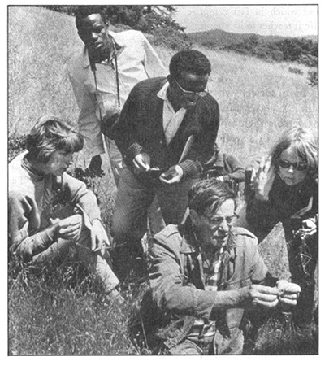
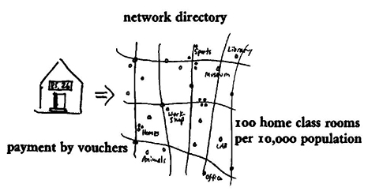

<section class="pattern-plate" aria-labelledby="t-network-of-learning">
<a href="/patterns">A Pattern Language</a> · <a href="/patterns#towns">Towns</a> · Pattern 18 · p. 99 · *
<h1 class="pattern-title" id="t-network-of-learning">Network Of Learning</h1><figure class="pattern-figure pl-figure"></figure><nav class="pattern-links" aria-label="Connections"><h2>Links to</h2><ul><li><a href="/patterns/children-in-the-city">57 Children In The City</a></li><li><a href="/patterns/master-and-apprentices">83 Master And Apprentices</a></li><li><a href="/patterns/teen-age-society">84 Teen-Age Society</a></li><li><a href="/patterns/shopfront-schools">85 Shopfront Schools</a></li><li><a href="/patterns/home-workshop">157 Home Workshop</a></li></ul><h2>Linked from</h2><ul><li><a href="/patterns/neighborhood-boundary">15 Neighborhood Boundary</a></li><li><a href="/patterns/university-as-a-marketplace">43 University As A Marketplace</a></li><li><a href="/patterns/children-in-the-city">57 Children In The City</a></li><li><a href="/patterns/master-and-apprentices">83 Master And Apprentices</a></li><li><a href="/patterns/teen-age-society">84 Teen-Age Society</a></li><li><a href="/patterns/shopfront-schools">85 Shopfront Schools</a></li><li><a href="/patterns/childrens-home">86 Children’s Home</a></li></ul></nav></section><article class="pattern-text" aria-label="The text of Network Of Learning">
100… another network, not physical like transportation, but conceptual, and equal in importance, is the network of learning: the thousands of interconnected situations that occur all <em>over</em> the city, and which in fact comprise the city’s “curriculum”: the way of life it teaches to its young.

◆ ◆ ◆

<strong>In a society which emphasizes teaching, children and students—and adults—become passive and unable to think or act for themselves. Creative, active individuals can only grow up in a society which emphasizes learning instead of teaching.</strong>

There is no need to add to the criticism of our public schools. The critique is extensive and can hardly be improved on. The processes of learning and teaching, too, have been exhaustively studied … The question now is what to do. (George Dennison, <em>Lives of Children</em>, New York: Vintage Books, 1969, p. 3.)

To date, the most penetrating analysis and proposal for an alternative framework for education comes from Ivan lllich in his book, <em>De-Schooling Society</em>, and his article, “Education without Schools: How It Can Be Done,” in the <em>New York Review of Books</em>, New York, 15 (12) : 25-31, special supplement, July 1971.

Illich describes a style of learning that is quite the opposite from schools. It is geared especially to the rich opportunities for learning that are natural to <em>every</em> metropolitan area:

The alternative to social control through the schools is the voluntary participation in society through <em>networks</em> which provide access to all its resources for learning. In fact these networks now exist, but they are rarely used for educational purposes. The crisis of schooling, if it is to have any positive consequence, will inevitably lead to their incorporation into the educational process….

Schools are designed on the assumption that there is a secret to everything in life; that the quality of life depends on knowing that secret; that secrets can be known only in orderly successions; and that only teachers can properly reveal these secrets. An individual with a schooled mind conceives of the world as a pyramid of classified packages accessible only to those who carry the proper tags.

101<em>New educational institutions would break apart this pyramid. Their purpose must be to facilitate access for the learner: to allow him to look into the windows of the control room or the parliament, if be cannot get in the door</em>. Moreover, such new institutions should be channels to which the learner would have access without credentials or pedigree—public spaces in which peers and elders outside his immediate horizon now become available….

While network administrators would concentrate primarily on the building and maintenance of roads providing access to resources, the pedagogue would help the student to find the path which for him could lead fastest to his goal. If a student wants to learn spoken Cantonese from a Chinese neighbor, the pedagogue would be available to judge their proficiency, and to help them select the textbook and methods most suitable to their talents, character, and the time available for study. He can counsel the would-be airplane mechanic on finding the best places for apprenticeship. He can recommend books to somebody who wants to find challenging peers to discuss African history. Like the network administrator, the pedagogical counselor conceives of himself as a professional educator. Access to either could be gained by individuals through the use of educational vouchers….

In addition to the tentative conclusions of the Carnegie Commission reports, the last year has brought forth a series of important documents which show that responsible people are becoming aware of the fact that schooling for certification cannot continue to be counted upon as the central educational device of a modern society. Julius Nyere of Tanzania has announced plans to integrate education with the life of the village. In Canada, the Wright Commission on post-secondary education has reported that no known system of formal education could provide equal opportunities for the citizens of Ontario. The president of Peru has accepted the recommendation of his commission on education, which proposes to abolish free schools in favor of free educational opportunities provided throughout life. In fact he is reported to have insisted that this program proceed slowly at first in order to keep teachers in school and out of the way of true educators. (Abridged from pp. 76 and 99 in <em>Deschooling Society</em> by Ivan Illich. Vol. 44 in World Perspectives Series, edited by Ruth Nanda Anshen, New York : Harper &amp; Row, 1971.)

In short, the educational system so radically decentralized becomes congruent with the urban structure itself. People of all walks of life come forth, and offer a class in the things they know and love: professionals and workgroups offer apprenticeships in their offices and workshops, old people offer to teach whatever their life work and interest has been, specialists offer tutoring in their special subjects. Living and learning are the 102same. It is not hard to imagine that eventually every third or fourth household will have at least one person in it who is offering a class or training of some kind.

Therefore:

<strong>Instead of the lock-step of compulsory schooling in a fixed place, work in piecemeal ways to decentralize the process of learning and enrich it through contact with many places and people all over the city: workshops, teachers at home or walking through the city, professionals willing to take on the young as helpers, older children teaching younger children, museums, youth groups traveling, scholarly seminars, industrial workshops, old people, and so on. Conceive of all these situations as forming the backbone of the learning process; survey all these situations, describe them, and publish them as the city’s “curriculum”; then let students, children, their families and neighborhoods weave together for themselves the situations that comprise their “school” paying as they go with standard vouchers, raised by community tax. Build new educational facilities in a way which extends and enriches this network.</strong>

<figure class="pl-figure"></figure>
◆ ◆ ◆

Above all, encourage the formation of seminars and workshops in people’s homes—<a class="pl-ref" href="/patterns/home-workshop">HOME WORKSHOP (157)</a>; make sure that 103each city has a “path” where young children can safely wander on their own—<a class="pl-ref" href="/patterns/children-in-the-city">CHILDREN IN THE CITY (57)</a>; build extra public “homes” for children, one to every neighborhood at least—CHILDREN’s HOME (86); create a large number of work-oriented small schools in those parts of town dominated by work and commercial activity—<a class="pl-ref" href="/patterns/shopfront-schools">SHOPFRONT SCHOOLS (85)</a>; encourage teenagers to work out a self-organized learning society of their own—<a class="pl-ref" href="/patterns/teen-age-society">TEENAGE SOCIETY (84)</a>; treat the university as scattered adult learning for all the adults in the region—UNIVERSITY As A MARKETPLACE (43); and use the real work of professionals and tradesmen as the basic nodes in the network—<a class="pl-ref" href="/patterns/master-and-apprentices">MASTER AND APPRENTICES (83)</a>….
</article>

Christopher Alexander, Sara Ishikawa and Murray Silverstein, with Max Jacobson, Ingrid Fiksdahl-King and Shlomo Angel, <cite>A Pattern Language</cite> (Oxford University Press, 1977), pattern 18, pp. 99–103. Text and illustrations from the <a href="https://github.com/natureoforder/sources">Nature of Order sources</a> reading edition, transcribed from the 1977 printing; report errors on <a href="https://github.com/natureoforder/alexander-wiki/issues">GitHub</a>.

<a href="/patterns/ring-roads">← 17 Ring Roads</a> · <a href="/patterns">All 253 patterns</a> · <a href="/patterns/web-of-shopping">19 Web Of Shopping →</a>

