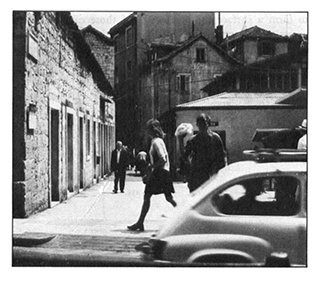
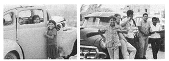
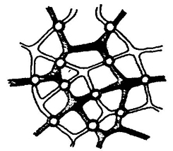
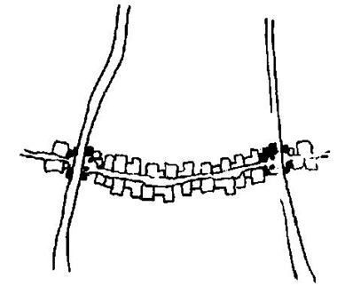
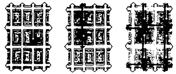
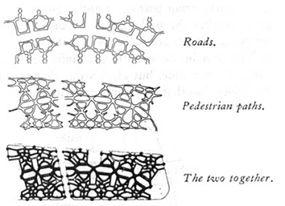
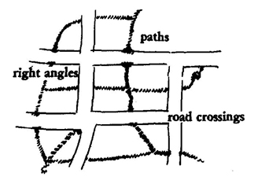

<section class="pattern-plate" aria-labelledby="t-network-of-paths-and-cars">
<a href="/patterns">A Pattern Language</a> · <a href="/patterns#towns">Towns</a> · Pattern 52 · p. 270 · **
<h1 class="pattern-title" id="t-network-of-paths-and-cars">Network Of Paths And Cars</h1><figure class="pattern-figure pl-figure"></figure><nav class="pattern-links" aria-label="Connections"><h2>Links to</h2><ul><li><a href="/patterns/parallel-roads">23 Parallel Roads</a></li><li><a href="/patterns/activity-nodes">30 Activity Nodes</a></li><li><a href="/patterns/promenade">31 Promenade</a></li><li><a href="/patterns/looped-local-roads">49 Looped Local Roads</a></li><li><a href="/patterns/green-streets">51 Green Streets</a></li><li><a href="/patterns/paths-and-goals">120 Paths And Goals</a></li><li><a href="/patterns/path-shape">121 Path Shape</a></li></ul><h2>Linked from</h2><ul><li><a href="/patterns/local-transport-areas">11 Local Transport Areas</a></li><li><a href="/patterns/parallel-roads">23 Parallel Roads</a></li><li><a href="/patterns/activity-nodes">30 Activity Nodes</a></li><li><a href="/patterns/shopping-street">32 Shopping Street</a></li><li><a href="/patterns/row-houses">38 Row Houses</a></li><li><a href="/patterns/housing-in-between">48 Housing In Between</a></li><li><a href="/patterns/green-streets">51 Green Streets</a></li><li><a href="/patterns/road-crossing">54 Road Crossing</a></li><li><a href="/patterns/raised-walk">55 Raised Walk</a></li><li><a href="/patterns/bike-paths-and-racks">56 Bike Paths And Racks</a></li><li><a href="/patterns/children-in-the-city">57 Children In The City</a></li><li><a href="/patterns/food-stands">93 Food Stands</a></li><li><a href="/patterns/pedestrian-street">100 Pedestrian Street</a></li><li><a href="/patterns/paths-and-goals">120 Paths And Goals</a></li><li><a href="/patterns/path-shape">121 Path Shape</a></li></ul></nav></section><article class="pattern-text" aria-label="The text of Network Of Paths And Cars">
271… roads may be governed by <a class="pl-ref" href="/patterns/parallel-roads">parallel roads (23)</a>, <a class="pl-ref" href="/patterns/looped-local-roads">looped local roads (49)</a>, <a class="pl-ref" href="/patterns/green-streets">GREEN streets (51)</a>; major paths by <a class="pl-ref" href="/patterns/activity-nodes">activity NODES (30)</a>, <a class="pl-ref" href="/patterns/promenade">PROMENADE (31)</a>, and <a class="pl-ref" href="/patterns/paths-and-goals">PATHS AND GOALS (120)</a> This pattern governs the interaction between the two.

<strong>Cars are dangerous to pedestrians; yet activities occur just where cars and pedestrians meet.</strong>

It is common planning practice to separate pedestrians and cars. This makes pedestrian areas more human and safer. However, this practice fails to take account of the fact that cars and pedestrians also need each other: and that, in fact, a great deal of urban life occurs at just the point where these two systems meet. Many of the greatest places in cities, Piccadilly Circus, Times Square, the Champs Elysées, are alive because they are at places where pedestrians and vehicles meet. New towns like Cumbernauld, in Scotland, where there is total separation between the two, seldom have the same sort of liveliness.

The same thing is true at the local residental scale. A great deal of everyday social life occurs where cars and pedestrians meet. In Lima, for example, the car is used as an extension of the house: men, especially, often sit in parked cars, near their houses, drinking beer and talking. And in one way or another, something like this happens everywhere. Conversation and discussion grow naturally around the lots where people wash their cars. Vendors set themselves up where cars and pedestrians meet; they need all the traffic they can get. Children play in parking lots—perhaps because they sense that this is the main point of arrival and departure; and of course because they like the cars. Yet, at the same time, it is essential to keep pedestrians separate from vehicles: to protect children and old people; to preserve the tranquility of pedestrian life.

<figure class="pl-figure"><figcaption><em>Children like cars</em>.</figcaption></figure>

272To resolve the conflict, it is necessary to find an arrangement of pedestrian paths and roads, so that the two are separate, but meet frequently, with the points where they meet recognized as focal points. In general, this requires two orthogonal networks, one for roads, one for paths, each connected and continuous, crossing at frequent intervals (our observations suggest that most points on the path network should be within 150 feet of the nearest road), meeting, when they meet, at right angles.

<figure class="pl-figure"><figcaption><em>Two orthogonal networks</em>.</figcaption></figure>

In practice, there are several possible ways of forming this relationship between the roads and paths.

It can be done within the system of fast one-way roads about 300 feet apart described in <a class="pl-ref" href="/patterns/parallel-roads">parallel roads (23)</a>. Between the roads there are pedestrian paths running at right angles to the roads, with buildings opening off the pedestrian paths. Where the paths intersect the roads there are small parking lots with space for kiosks and shops.

<figure class="pl-figure"><figcaption><em>Path between farallel roads</em>.</figcaption></figure>

273It can be applied to an existing neighborhood—as it is in the following sequence of plans drawn by the People’s Architects, Berkeley, California. This shows a beautiful and simple way of creating a path network in an existing grid of streets, by closing off alternate streets, in each direction. As the drawings show, it can be done gradually.

<figure class="pl-figure"><figcaption><em>The growth of a path network in a street grid</em>.</figcaption></figure>

Different again, is our project for housing in Lima. Here the two orthogonal systems are laid out as follows:

<figure class="pl-figure"></figure>
In all these cases, we see a global pattern, in which roads and paths are created more or less at the same time—and therefore brought into the proper relationship. However, it is essential to recognize that in most practical applications of this pattern, it is 274not necessary to locate the roads and paths together. Most typically of all, there is an existing road system: and the paths can be put in one by one, piecemeal, at right angles to the existing roads. Slowly, very slowly, a coherent path network will be created by the accumulation of these piecemeal acts.

Finally, note that this kind of separation of cars from pedestrians is only appropriate where traffic densities are medium or medium high. At low densities (for instance, a cul-de-sac gravel road serving half-a-dozen houses), the paths and roads can obviously be combined. There is no reason even to have sidewalks—green streets (51). At very high densities, like the Champs Elysees, or Piccadilly Circus, a great deal of the excitement is actually created by the fact that pedestrian paths are running <em>dong</em> the roads. In these cases the problem is best solved by extra wide sidewalks—raised walks (55)—which actually contain the resolution of the conflict in their width. The edge away from the road is safe—the edge near the road is the place where the activities happen.

Therefore:

<strong>Except where traffic densities are very high or very low, lay out pedestrian paths at right angles to roads, not along them, so that the paths gradually begin to form a second network, distinct from the road system, and orthogonal to it. This can be done quite gradually—even if you put in one path at a time, but always put them in the middle of the “block,” so that they run across the roads.</strong>

<figure class="pl-figure"></figure>
275

◆ ◆ ◆

Where paths have to run along major roads—as they do occasionally—build them 18 inches higher than the road, on one side of the road only, and twice the usual width—raised walk (55); on <a class="pl-ref" href="/patterns/green-streets">green streets (51)</a> the paths can be in the road since there is nothing but grass and paving stones there; but even then, occasional narrow paths at right angles to the green streets are very beautiful. Place the paths in detail according to <a class="pl-ref" href="/patterns/paths-and-goals">paths and goals (120)</a>; shape them according to <a class="pl-ref" href="/patterns/path-shape">path shape (121)</a>. Finally, treat the important street crossings as crosswalks, raised to the level of the pedestrian path—so cars have to slow down as they go over them—road crossing (54)….
</article>

Christopher Alexander, Sara Ishikawa and Murray Silverstein, with Max Jacobson, Ingrid Fiksdahl-King and Shlomo Angel, <cite>A Pattern Language</cite> (Oxford University Press, 1977), pattern 52, pp. 270–275. Text and illustrations from the <a href="https://github.com/natureoforder/sources">Nature of Order sources</a> reading edition, transcribed from the 1977 printing; report errors on <a href="https://github.com/natureoforder/alexander-wiki/issues">GitHub</a>.

<a href="/patterns/green-streets">← 51 Green Streets</a> · <a href="/patterns">All 253 patterns</a> · <a href="/patterns/main-gateways">53 Main Gateways →</a>

