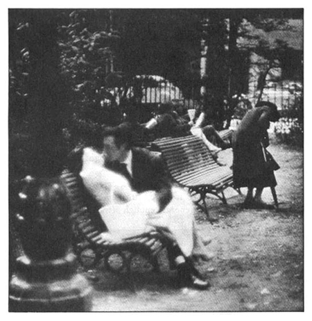
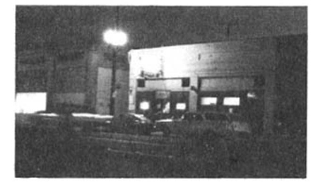
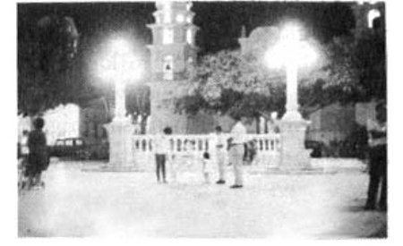
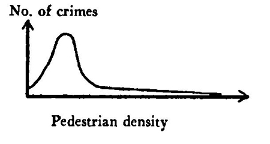
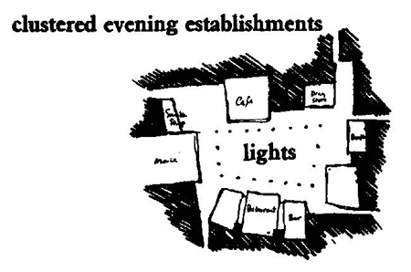

<section class="pattern-plate" aria-labelledby="t-night-life">
<a href="/patterns">A Pattern Language</a> · <a href="/patterns#towns">Towns</a> · Pattern 33 · p. 179 · *
<h1 class="pattern-title" id="t-night-life">Night Life</h1><figure class="pattern-figure pl-figure"></figure><nav class="pattern-links" aria-label="Connections"><h2>Links to</h2><ul><li><a href="/patterns/magic-of-the-city">10 Magic Of The City</a></li><li><a href="/patterns/community-of-7000">12 Community Of 7000</a></li><li><a href="/patterns/activity-nodes">30 Activity Nodes</a></li><li><a href="/patterns/promenade">31 Promenade</a></li><li><a href="/patterns/local-town-hall">44 Local Town Hall</a></li><li><a href="/patterns/carnival">58 Carnival</a></li><li><a href="/patterns/dancing-in-the-street">63 Dancing In The Street</a></li><li><a href="/patterns/street-cafe">88 Street Cafe</a></li><li><a href="/patterns/beer-hall">90 Beer Hall</a></li><li><a href="/patterns/travelers-inn">91 Traveler’s Inn</a></li></ul><h2>Linked from</h2><ul><li><a href="/patterns/magic-of-the-city">10 Magic Of The City</a></li><li><a href="/patterns/men-and-women">27 Men And Women</a></li><li><a href="/patterns/activity-nodes">30 Activity Nodes</a></li><li><a href="/patterns/promenade">31 Promenade</a></li><li><a href="/patterns/carnival">58 Carnival</a></li><li><a href="/patterns/dancing-in-the-street">63 Dancing In The Street</a></li><li><a href="/patterns/beer-hall">90 Beer Hall</a></li><li><a href="/patterns/travelers-inn">91 Traveler’s Inn</a></li></ul></nav></section><article class="pattern-text" aria-label="The text of Night Life">
180… every community has some kind of public night life—<a class="pl-ref" href="/patterns/magic-of-the-city">MAGIC OF THE CITY (10)</a>, <a class="pl-ref" href="/patterns/community-of-7000">COMMUNITY OF 7000 (12)</a>. If there is a promenade in the community, the night life is probably along the promenade, at least in part—<a class="pl-ref" href="/patterns/promenade">PROMENADE (31)</a>. This pattern describes the details of the concentration of night time activities.

◆ ◆ ◆

<strong>Most of the city’s activities close down at night; those which stay open won’t do much for the night life of the city unless they arc together.</strong>

This pattern is drawn from the following seven points:

1. People enjoy going out at night; a night on the town is something special.

2. If evening activities such as movies, cafes, ice cream parlors, gas stations, and bars are scattered throughout the community, each one by itself cannot generate enough attraction.

<figure class="pl-figure"><figcaption><em>One bar by itself is a lonely place at night</em>.</figcaption></figure>

3. Many people do <em>not</em> go out at night because they feel they have no place to go. They do not feel like going out to a specific establishment, <em>but they do feel like going out</em>. An evening center, particularly when it is full of light, functions as a focus for such people.

4. Fear of the dark, especially in those places far away from one’s own back yard, is a common experience, and quite simple to understand. Throughout our evolution night has been a time to stay quiet and protected, not a time to move about freely.

181

<figure class="pl-figure"><figcaption><em>A cluster of nig!U spou creates life in the street</em>.</figcaption></figure>

5. Nowadays this instinct is anchored in the fact that at night street crimes are most prevalent in places where there are too few pedestrians to provide natural surveillance, but enough pedestrians to make it worth a thief’s while, in other words, dark, isolated night spots invite crime. A paper by Shlomo Angel, “The Ecology of Night Life” (Center for Environmental Structure, Berkeley, 1968), shows the highest number of street crimes occurring in those areas where night spots are scattered. Areas of very low or very high night pedestrian density are subject to much Jess crime.

<figure class="pl-figure"><figcaption><em>lsolated night spots invite crime</em>.</figcaption></figure>

6. It is difficult to estimate the exact number of night spots that need to be grouped to create a sense of night life. From observation, we guess that it takes about six, minimum.

7. On the other hand, massive evening centers, combining evening services which a person could not possibly use on the same night, are alienating. For example, in New York the Lincoln Center for the Performing Arts makes a big splash at night, but it makes no sense. No one is going to the ballet and the theater and a concert during one night on the town. And centralizing these places robs the city as a whole of several centers of night life.

182All these arguments together suggest small, scattered centers of mutually enlivening night spots, the services grouped to form cheery squares, with lights and places to loiter, where people can spend several ·hours in an interesting way. Here are some examples of small groups of mutually sustaining night activities.

A movie theater, a restaurant and a bar, and a bookstore open till midnight; a smoke shop.

A laundromat, liquor store and cafe; and a meeting hall and beer hall.

Lodge hall, bowling alley, bar, playhouse.

A terminal, a diner, hotels, nightclubs, casinos.

Therefore:

<strong>Knit together shops, amusements, and services which are open at night, along with hotels, bars, and all-night diners to form centers of night life: well-lit, safe, and lively places that increase the intensity of pedestrian activity at night by drawing all the people who are out at night to the same few spots in the town. Encourage these evening centers to distribute themselves evenly across the town.</strong>

<figure class="pl-figure"></figure>
◆ ◆ ◆

Treat the physical layout of the night life area exactly like any other <a class="pl-ref" href="/patterns/activity-nodes">ACTIVITY NODE (30)</a>, except that <em>all</em> of its establishments are open at night. The evening establishments might include <a class="pl-ref" href="/patterns/local-town-hall">LOCAL TOWN HALL (44)</a>, <a class="pl-ref" href="/patterns/carnival">CARNIVAL (58)</a>, <a class="pl-ref" href="/patterns/dancing-in-the-street">DANCING IN THE STREET (63)</a>, <a class="pl-ref" href="/patterns/street-cafe">STREET CAFE (88)</a>, <a class="pl-ref" href="/patterns/beer-hall">BEER HALL (90)</a>, <a class="pl-ref" href="/patterns/travelers-inn">TRAVELER’ S INN (91)</a>….
</article>

Christopher Alexander, Sara Ishikawa and Murray Silverstein, with Max Jacobson, Ingrid Fiksdahl-King and Shlomo Angel, <cite>A Pattern Language</cite> (Oxford University Press, 1977), pattern 33, pp. 179–182. Text and illustrations from the <a href="https://github.com/natureoforder/sources">Nature of Order sources</a> reading edition, transcribed from the 1977 printing; report errors on <a href="https://github.com/natureoforder/alexander-wiki/issues">GitHub</a>.

<a href="/patterns/shopping-street">← 32 Shopping Street</a> · <a href="/patterns">All 253 patterns</a> · <a href="/patterns/interchange">34 Interchange →</a>

