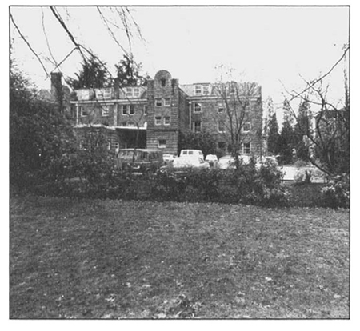
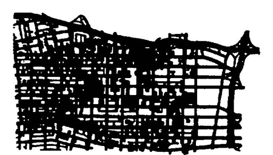
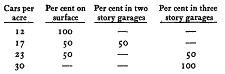
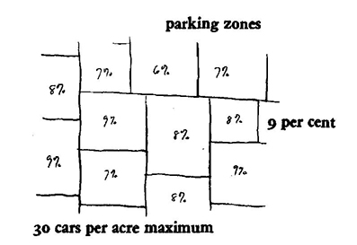

<section class="pattern-plate" aria-labelledby="t-nine-per-cent-parking">
<a href="/patterns">A Pattern Language</a> · <a href="/patterns#towns">Towns</a> · Pattern 22 · p. 120 · **
<h1 class="pattern-title" id="t-nine-per-cent-parking">Nine Per Cent Parking</h1><figure class="pattern-figure pl-figure"></figure><nav class="pattern-links" aria-label="Connections"><h2>Links to</h2><ul><li><a href="/patterns/scattered-work">9 Scattered Work</a></li><li><a href="/patterns/local-transport-areas">11 Local Transport Areas</a></li><li><a href="/patterns/community-of-7000">12 Community Of 7000</a></li><li><a href="/patterns/identifiable-neighborhood">14 Identifiable Neighborhood</a></li><li><a href="/patterns/web-of-public-transportation">16 Web Of Public Transportation</a></li><li><a href="/patterns/small-parking-lots">103 Small Parking Lots</a></li></ul><h2>Linked from</h2><ul><li><a href="/patterns/local-transport-areas">11 Local Transport Areas</a></li><li><a href="/patterns/mini-buses">20 Mini-Buses</a></li><li><a href="/patterns/food-stands">93 Food Stands</a></li><li><a href="/patterns/shielded-parking">97 Shielded Parking</a></li><li><a href="/patterns/small-parking-lots">103 Small Parking Lots</a></li></ul></nav></section><article class="pattern-text" aria-label="The text of Nine Per Cent Parking">
121… the integrity of local transport areas and the tranquility of local communities and neighborhoods depend very much on the amount of parking they provide. The more parking they provide, the less possible it will be to maintain these patterns, because the parking spaces will attract cars, which in turn violate the local transport areas and neighborhoods—<a class="pl-ref" href="/patterns/local-transport-areas">LOCAL TRANSPORT AREAS (11)</a>, <a class="pl-ref" href="/patterns/community-of-7000">COMMUNITY OF 7000 (12)</a>, <a class="pl-ref" href="/patterns/identifiable-neighborhood">IDENTIFIABLE NEIGHBORHOOD (14)</a>. This pattern proposes radical limits on the distribution of parking spaces, to protect communities.

◆ ◆ ◆

<strong>Very simply—when the area devoted to parking is too great, it destroys the land.</strong>

<figure class="pl-figure"><figcaption><em>In downtown Los Angeles over 60 per cent of the land is given over to the automobile</em>.</figcaption></figure>

Very rough empirical observations lead us to believe that it is not possible to make an environment fit for human use when more than 9 per cent of it is given to parking.

Our observations are very tentative. We have yet to perform systematic studies—our observations rely on our own subjective estimates of cases where “there are too many cars” and cases where “the cars are all right.” However, we have found in our preliminary observations, that different people agree to a remarkable extent about these estimates. This suggests that we are dealing with a phenomenon which, though obscure, is nonetheless substantial.

An example of an environment which has the threshold density of 9 per cent parking, is shown in our key photograph: a quadrant 122of the University of Oregon. Many people we have talked to feel intuitively that this area is beautiful now, but that if more cars were parked there it would be ruined.

What possible functional basis is there for this intuition? We conjecture as follows: people realize, subconsciously, that the physical environment is the medium for their social intercourse. It is the environment which, when it is working properly, creates the potential for all social communion, including even communion with the self.

We suspect that when the density of cars passes a certain limit, and people experience the feeling that there are too many cars, what is really happening is that subconsciously they feel that the cars are overwhelming the environment, that the environment is no longer “theirs,” that they have no right to be there, that it is not a place for people, and so on. After all, the effect of the cars reaches far beyond the mere presence of the cars themselves. They create a maze of driveways, garage doors, asphalt and concrete surfaces, and building elements which people cannot use. When the density goes beyond the limit, we suspect that people feel the social potential of the environment has disappeared. Instead of inviting them out, the environment starts giving them the message that the outdoors is not meant for them, that they should stay indoors, that they should stay in their own buildings, that social communion is no longer permitted or encouraged.

<em>We have not yet tested this suspicion. However, if it turns out to be true, it may be that this pattern, which seems to be based on such slender evidence, is in fact one of the most crucial patterns there is, and that it plays a key role in determining the difference between environments which are socially and psychologically healthy and those which are unhealthy</em>.

We conjecture, then, that environments which are human, and not destroyed socially or ecologically by the presence of parked cars, have less than 9 per cent of the ground area devoted to parking space; and that parking lots and garages must therefore never be allowed to cover more than 9 per cent of the land.

It is essential to interpret this pattern in the strictest possible way. The pattern becomes meaningless if we allow ourselves to place the parking generated by a piece of land A, on another adjacent piece of land B, thus keeping parking on A below 9 per 123cent, but raising the parking on B to more than 9 per cent. In other words, each piece of land must take care of itself; we must not allow ourselves to solve this problem on one piece of land at the expense of some other piece of land. A town or a community can only implement the pattern according to this strict interpretation by defining a grid of independent “parking zones”—each zone 1 to 10 acres in area—which cover the whole community, and then insisting that the rule be applied, independently, and strictly, inside every parking zone.

The 9 per cent rule has a clear and immediate implication for the balance between surface parking and parking in garages, at different parking densities. This follows from simple arithmetic. Suppose, for example, that an area requires 20 parking spaces per acre. Twenty parking spaces will consume about 7000 square feet, which would be 17 per cent of the land if it were all in surface parking. To keep 20 cars per acre in line with the 9 per cent rule, at least half of them will have to be parked in garages. The table below gives similar figures for different densities:

<figure class="pl-figure"></figure>
What about underground parking? May we consider it as an exception to this rule? Only if it does not violate or restrict the use of the land above. If, for example, a parking garage is under a piece of land which was previously used as open space, with great trees growing on it, then the garage will almost certainly change the nature of the space above, because it will no longer be possible to grow large trees there. Such a parking garage is a violation of the land. Similarly, if the structural grid of the garage—60 foot bays—constrains the structural grid of the building above, so that this building is not free to express its needs, this is a violation too. Underground parking may be allowed only in those rare cases where it does not constrain the land above at all: under a major road, perhaps, or under a tennis court.

We see then, that the 9 per cent rule has colossal implications. 124Since underground parking will only rarely satisfy the conditions we have stated, the pattern really says that almost no part of the urban area may have more than 30 parking spaces per acre. <em>This will create large changes in the central business district</em>. Consider a part of a typical downtown area. There may be several hundred commuters per acre working there; and, under today’s conditions, many of them park their cars in garages. But if it is true that there cannot be more than 30 parking spaces per acre, then either the work will be forced to decentralize, or the workers will have to rely on public transportation. It seems, in short, that this simple pattern, based on the social psychology of the environment, leads us to the same far reaching social conclusions as the patterns <a class="pl-ref" href="/patterns/web-of-public-transportation">WEB OF PUBLIC TRANSPORTATION (16)</a> and <a class="pl-ref" href="/patterns/scattered-work">SCATTERED WORK (9)</a>.

Therefore:

<strong>Do not allow more than 9 per cent of the land in any given area to be used for parking. In order to prevent the “bunching” of parking in huge neglected areas, it is necessary for a town or a community to subdivide its land into “parking zones” no larger than 10 acres each and to apply the same rule in each zone.</strong>

<figure class="pl-figure"></figure>
◆ ◆ ◆

Two later patterns say that parking must take one of two forms: tiny, surface parking lots, or shielded parking structures—SHIELDED PARKING 125(97), <a class="pl-ref" href="/patterns/small-parking-lots">SMALL PARKING LOTS (103)</a>. If you accept these patterns the 9 per cent rule will put an effective upper limit of 30 parking spaces per acre, on every part of the environment. Present-day on-street parking, with driveways, which provides spaces for about 3 5 cars per acre on the. ground is ruled out. And those present-day high density business developments which depend on the car are also ruled out….
</article>

Christopher Alexander, Sara Ishikawa and Murray Silverstein, with Max Jacobson, Ingrid Fiksdahl-King and Shlomo Angel, <cite>A Pattern Language</cite> (Oxford University Press, 1977), pattern 22, pp. 120–125. Text and illustrations from the <a href="https://github.com/natureoforder/sources">Nature of Order sources</a> reading edition, transcribed from the 1977 printing; report errors on <a href="https://github.com/natureoforder/alexander-wiki/issues">GitHub</a>.

<a href="/patterns/four-story-limit">← 21 Four-Story Limit</a> · <a href="/patterns">All 253 patterns</a> · <a href="/patterns/parallel-roads">23 Parallel Roads →</a>

