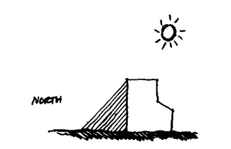
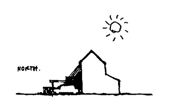
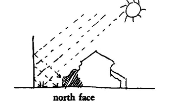

<section class="pattern-plate" aria-labelledby="t-north-face">
<a href="/patterns">A Pattern Language</a> · <a href="/patterns#buildings">Buildings</a> · Pattern 162 · p. 761
<h1 class="pattern-title" id="t-north-face">North Face</h1><nav class="pattern-links" aria-label="Connections"><h2>Links to</h2><ul><li><a href="/patterns/south-facing-outdoors">105 South Facing Outdoors</a></li><li><a href="/patterns/car-connection">113 Car Connection</a></li><li><a href="/patterns/indoor-sunlight">128 Indoor Sunlight</a></li><li><a href="/patterns/bulk-storage">145 Bulk Storage</a></li><li><a href="/patterns/light-on-two-sides-of-every-room">159 Light On Two Sides Of Every Room</a></li><li><a href="/patterns/sunny-place">161 Sunny Place</a></li><li><a href="/patterns/garden-wall">173 Garden Wall</a></li><li><a href="/patterns/compost">178 Compost</a></li><li><a href="/patterns/closets-between-rooms">198 Closets Between Rooms</a></li></ul><h2>Linked from</h2><ul><li><a href="/patterns/south-facing-outdoors">105 South Facing Outdoors</a></li><li><a href="/patterns/car-connection">113 Car Connection</a></li><li><a href="/patterns/indoor-sunlight">128 Indoor Sunlight</a></li><li><a href="/patterns/bulk-storage">145 Bulk Storage</a></li><li><a href="/patterns/open-stairs">158 Open Stairs</a></li><li><a href="/patterns/building-edge">160 Building Edge</a></li></ul></nav></section><article class="pattern-text" aria-label="The text of North Face">
… even if the building has been placed correctly according to <a class="pl-ref" href="/patterns/south-facing-outdoors">SOUTH-FACING OUTDOORS (105)</a> and there is little outdoor space toward the north, there is usually still some kind of area or volume on the north face of the building. It is necessary to take care of this north-facing place to supplement the work of <a class="pl-ref" href="/patterns/indoor-sunlight">INDOOR SUNLIGHT (128)</a> and <a class="pl-ref" href="/patterns/sunny-place">SUNNY PLACE (161)</a>.

◆ ◆ ◆

<strong>Look at the north sides of the buildings which you know. Almost everywhere you will find that these are the spots which are dead and dank, gloomy and useless. Yet there are hundreds of acres in a town On the north sides of buildings; and it is inevitable that there must always be land in this position, wherever there are buildings.</strong>

If a building has a sheer north face, during many months of the year it will cast a long shadow out behind it.

<figure class="pl-figure"><figcaption><em>North shadows</em>.</figcaption></figure>

These dead and gloomy north sides not only waste enormous areas of land; they also help to kill the larger environment, by 762cutting it up with shadow areas which no one wants to cross, and which therefore break up the various areas of the environment from one another. It is essential to find a way of making these north-facing areas alive, at least in their own terms, so that they help the land around them instead of breaking it apart.

The shadow cast by the north face is essentially triangular. To keep this triangle of shade from becoming a forlorn place, it is necessary to fill it up with things and places which do not need the sun. For example, the area to the north may form a gentle cascade which contains the car shelter, perhaps a bath suite, storage, garbage cans, a studio. If this cascade is properly made, then for most of the year the outdoors beyond it to the north will have enough sun for a garden, a greenhouse, a private garden seat, a workshop, paths.

<figure class="pl-figure"><figcaption><em>North cascade</em>.</figcaption></figure>

Furthermore, if there are north rooms that are inevitably gloomy, it helps enormously to make a reflecting wall: a wall standing some ways to the north of the building, painted white or yellow, and set in a position which gets the sun and reflects it back into the building. This wall might be the wall of a nearby building, a garden wall, etc.

Therefore:

<strong>Make the north face of the building a cascade which slopes down to the ground, so that the sun which normally casts a long shadow to the north strikes the ground immediately beside the building.</strong>

763

<figure class="pl-figure"></figure>
◆ ◆ ◆

Use the triangle inside this north cascade for car, garbage, storage, shed, a studio which requires north light, closets—those parts of the building which can do very well without interior sunlight <a class="pl-ref" href="/patterns/car-connection">CAR CONNECTION (113)</a>, <a class="pl-ref" href="/patterns/bulk-storage">BULK STORAGE (145)</a>, <a class="pl-ref" href="/patterns/compost">COMPOST (178)</a>, <a class="pl-ref" href="/patterns/closets-between-rooms">CLOSETS BETWEEN ROOMS (198)</a>. If it is at all practical, use a white or yellow wall to the north of the building to reflect sunlight into the north-facing rooms—<a class="pl-ref" href="/patterns/indoor-sunlight">INDOOR SUNLIGHT (128)</a>, <a class="pl-ref" href="/patterns/light-on-two-sides-of-every-room">LIGHT ON TWO SIDES OF EVERY ROOM (159)</a>, <a class="pl-ref" href="/patterns/garden-wall">GARDEN WALL (173)</a>….
</article>

Christopher Alexander, Sara Ishikawa and Murray Silverstein, with Max Jacobson, Ingrid Fiksdahl-King and Shlomo Angel, <cite>A Pattern Language</cite> (Oxford University Press, 1977), pattern 162, pp. 761–763. Text and illustrations from the <a href="https://github.com/natureoforder/sources">Nature of Order sources</a> reading edition, transcribed from the 1977 printing; report errors on <a href="https://github.com/natureoforder/alexander-wiki/issues">GitHub</a>.

<a href="/patterns/sunny-place">← 161 Sunny Place</a> · <a href="/patterns">All 253 patterns</a> · <a href="/patterns/outdoor-room">163 Outdoor Room →</a>

