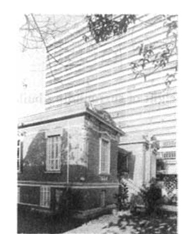
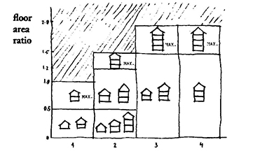

<section class="pattern-plate" aria-labelledby="t-number-of-stories">
<a href="/patterns">A Pattern Language</a> · <a href="/patterns#buildings">Buildings</a> · Pattern 96 · p. 473 · *
<h1 class="pattern-title" id="t-number-of-stories">Number Of Stories</h1><figure class="pattern-figure pl-figure"></figure><nav class="pattern-links" aria-label="Connections"><h2>Links to</h2><ul><li><a href="/patterns/four-story-limit">21 Four-Story Limit</a></li><li><a href="/patterns/building-complex">95 Building Complex</a></li><li><a href="/patterns/main-building">99 Main Building</a></li><li><a href="/patterns/site-repair">104 Site Repair</a></li><li><a href="/patterns/south-facing-outdoors">105 South Facing Outdoors</a></li><li><a href="/patterns/cascade-of-roofs">116 Cascade Of Roofs</a></li><li><a href="/patterns/sheltering-roof">117 Sheltering Roof</a></li><li><a href="/patterns/roof-garden">118 Roof Garden</a></li><li><a href="/patterns/tree-places">171 Tree Places</a></li><li><a href="/patterns/structure-follows-social-spaces">205 Structure Follows Social Spaces</a></li><li><a href="/patterns/final-column-distribution">213 Final Column Distribution</a></li></ul><h2>Linked from</h2><ul><li><a href="/patterns/four-story-limit">21 Four-Story Limit</a></li><li><a href="/patterns/building-complex">95 Building Complex</a></li><li><a href="/patterns/circulation-realms">98 Circulation Realms</a></li><li><a href="/patterns/main-building">99 Main Building</a></li><li><a href="/patterns/site-repair">104 Site Repair</a></li><li><a href="/patterns/cascade-of-roofs">116 Cascade Of Roofs</a></li><li><a href="/patterns/intimacy-gradient">127 Intimacy Gradient</a></li></ul></nav></section><article class="pattern-text" aria-label="The text of Number Of Stories">
474… assume now, that you know roughly how the parts of the building complex are to be articulated—<a class="pl-ref" href="/patterns/building-complex">BUILDING COMPLEX (95)</a>, and how large they are. Assume, also, that you have a site. In order to be sure that your building complex is workable within the limits of the site, you must decide how many stories its different parts will have. The height of each part must be constrained by the <a class="pl-ref" href="/patterns/four-story-limit">FOUR-STORY LIMIT (21)</a>. Beyond that, it depends on the area of your site, and the floor area which each part needs.

◆ ◆ ◆

<strong>Within the four-story height limit, just exactly how high should your buildings be?</strong>

To keep them small in scale, for human reasons, and to keep the costs down, they should be as low as possible. But to make the best use of land and to form a continuous fabric with surrounding buildings, they should perhaps be two or three or four stories instead of one. In this pattern we give rules for striking the balance.

<em>Rule 1: Set a four-story height limit on the site</em>. This rule comes directly from <a class="pl-ref" href="/patterns/four-story-limit">FOUR-STORY LIMIT (21)</a> and the reasons for establishing this limit are described there.

<em>Rule 2: For any given site, do not let the ground area covered by buildings exceed</em> 50 <em>fer cent of the site</em>. This rule requires that for any given site, where it belongs to a single household or a corporation, or whether it is a part of a larger site which contains several buildings, at least half of the site is left as open space. This is the limit of ground coverage within which reasonable site planning can take place. The rule therefore determines the maximum floor area that can be built with any given number of stories on a given site. The ratio of indoor area to site area (FAR—for floor area ratio) cannot thus exceed 0.5 in a single story building, 1.0 in a two story, 1.5 in a three story and 2.0 in a four story building.

If the total floor area you intend to build plus the built floor area that exists on the site is more than twice the area of the 475site itself, then you are exceeding this limit. In this case, we advise that you cut back your program; build less space; perhaps build some of your project on another site.

<em>Rule 3: Do not let the height of your building(s) vary too much from the predominant height of surrounding buildings.</em> A rule of thumb: do not let your buildings deviate more than one story from surrounding buildings. On the whole, adjacent buildings should be <em>roughly</em> the same height.

<figure class="pl-figure"><figcaption><em>Breaking the rule of thumb</em>.</figcaption></figure>

I live in a small one-story garden cottage at the back of a large house in Berkeley. All around the cottage there are two-story houses, some as close as thirty feet. I thought when I moved in, that a garden cottage would be secluded and I would have some private outdoor space. But instead I feel that I’m living in a goldfish bowl—every one of the second-story windows around me looks right down into my living room, or into my garden. The garden outside is useless, and I don’t sit near the window.

Therefore:

<strong>First, decide how many square feet of built space you need, and divide by the area of the site to get the floor area ratio. Then choose the height of your buildings according to the floor area ratio and the height of the surrounding buildings from the following table. In no case build on more than 50 per cent of the land.</strong>

476

<figure class="pl-figure"></figure>
height of surrounding buildings

◆ ◆ ◆

Once you have the number of stories and the area of each part clear, decide which building or which part of the building will be the <a class="pl-ref" href="/patterns/main-building">MAIN BUILDING (99)</a>. Vary the number of floors within the building—<a class="pl-ref" href="/patterns/cascade-of-roofs">CASCADE OF ROOFS (116)</a>. Place the buildings on the site, with special reverence for the land, and trees, and sun—<a class="pl-ref" href="/patterns/site-repair">SITE REPAIR (104)</a>, <a class="pl-ref" href="/patterns/south-facing-outdoors">SOUTH FACING OUTDOORS (105)</a>, <a class="pl-ref" href="/patterns/tree-places">TREE PLACES (171)</a>. In your calculations, remember that the effective area of the top story will be no more than three-quarters of the area of lower floors if it is in the roof, according to <a class="pl-ref" href="/patterns/sheltering-roof">SHELTERING ROOF (117)</a>.

If the density is so high all around, that it is quite impossible to leave 50 per cent of the site open (as might be true in central London or New York), then cover the ground floor completely, but devote at least 50 per cent of the upper floors to open gardens—<a class="pl-ref" href="/patterns/roof-garden">ROOF GARDEN (118)</a>.

Give each story a different ceiling height—bottom story biggest, top story smallest—and vary the column spacings accordingly—<a class="pl-ref" href="/patterns/final-column-distribution">FINAL COLUMN DISTRIBUTION (213)</a>. The same building system applies, whether there are 1, 2, 3 or 4 stories—<a class="pl-ref" href="/patterns/structure-follows-social-spaces">STRUCTURE FOLLOWS SOCIAL SPACES (205)</a>….
</article>

Christopher Alexander, Sara Ishikawa and Murray Silverstein, with Max Jacobson, Ingrid Fiksdahl-King and Shlomo Angel, <cite>A Pattern Language</cite> (Oxford University Press, 1977), pattern 96, pp. 473–476. Text and illustrations from the <a href="https://github.com/natureoforder/sources">Nature of Order sources</a> reading edition, transcribed from the 1977 printing; report errors on <a href="https://github.com/natureoforder/alexander-wiki/issues">GitHub</a>.

<a href="/patterns/building-complex">← 95 Building Complex</a> · <a href="/patterns">All 253 patterns</a> · <a href="/patterns/shielded-parking">97 Shielded Parking →</a>

