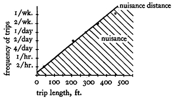
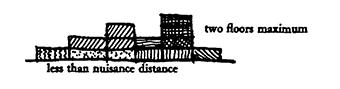

<section class="pattern-plate" aria-labelledby="t-office-connections">
<a href="/patterns">A Pattern Language</a> · <a href="/patterns#towns">Towns</a> · Pattern 82 · p. 408 · *
<h1 class="pattern-title" id="t-office-connections">Office Connections</h1><nav class="pattern-links" aria-label="Connections"><h2>Links to</h2><ul><li><a href="/patterns/four-story-limit">21 Four-Story Limit</a></li><li><a href="/patterns/work-community">41 Work Community</a></li><li><a href="/patterns/self-governing-workshops-and-offices">80 Self-Governing Workshops And Offices</a></li><li><a href="/patterns/small-services-without-red-tape">81 Small Services Without Red Tape</a></li><li><a href="/patterns/building-complex">95 Building Complex</a></li><li><a href="/patterns/pedestrian-street">100 Pedestrian Street</a></li><li><a href="/patterns/building-thoroughfare">101 Building Thoroughfare</a></li><li><a href="/patterns/family-of-entrances">102 Family Of Entrances</a></li><li><a href="/patterns/open-stairs">158 Open Stairs</a></li></ul><h2>Linked from</h2><ul><li><a href="/patterns/four-story-limit">21 Four-Story Limit</a></li><li><a href="/patterns/your-own-home">79 Your Own Home</a></li><li><a href="/patterns/small-services-without-red-tape">81 Small Services Without Red Tape</a></li><li><a href="/patterns/wings-of-light">107 Wings Of Light</a></li><li><a href="/patterns/flexible-office-space">146 Flexible Office Space</a></li><li><a href="/patterns/small-work-groups">148 Small Work Groups</a></li><li><a href="/patterns/a-place-to-wait">150 A Place To Wait</a></li></ul></nav></section><article class="pattern-text" aria-label="The text of Office Connections">
… in any work community or any office, there are always various human groups—and it is always important to decide how these groups shall be placed, in space. Which should be near each other, which ones further apart? This pattern gives the answer to this question, and in doing so, helps greatly to construct the inner layout of a <a class="pl-ref" href="/patterns/work-community">WORK COMMUNITY (41)</a> or of <a class="pl-ref" href="/patterns/self-governing-workshops-and-offices">SELF-GOVERNING WORKSHOPS AND OFFICES (80)</a> Or of <a class="pl-ref" href="/patterns/small-services-without-red-tape">SMALL SERVICES WITHOUT RED TAPE (81)</a>.

◆ ◆ ◆

<strong>If two parts of an office are too far apart, people will not move between them as often as they need to; and if they are more than one floor apart, there will be almost no communication between the two.</strong>

Current architectural methods often include a proximity matrix, which shows the amount of movement between different people and functions in an office or a hospital. These methods always make the tacit assumption that the functions which have the most movement between them should be closest together. <em>However, as usually stated, this conceft is comfletely invalid</em>.

The concept has been created by a kind of Taylorian quest for efficiency, in which it is assumed that the less people walk about, the less of their salary is spent on “wasteful” walking. The logical conclusion of this kind of analysis is that, if it were only possible, people should not have to walk at all, and should spend the day vegetating in their armchairs.

The fact is that people work best only when they are healthy in mind and body. A person who is forced to sit all day long behind a desk, without ever stretching his legs, will become restless and unable to work, and inefficient in this way. Some walking is very good for you. It is not only good for the body, but also gives people an opportunity for a change of scene, a way 409of thinking about something else, a chance to reflect on some detail of the morning’s work or one of the everyday human problems in the office.

On the other hand, if a person has to make the same trip, many times, there is a point at which the length of the trip becomes time-consuming and annoying, and then inefficient, because it makes the person irritable, and finally critical when a person starts avoiding trips because they are too long and too frequent.

<em>An office will junction efficiently so long as the people who work there do not feel that the Trips they have to take are a nuisance. Trips need to be short enough so they are not felt a nuisance—but they do not need to be any shorter</em>.

The nuisance of a trip depends on the relationship between length and frequency. You can walk 10 feet to a file many times a day without being annoyed by it; you can walk 400 feet occasionally without being annoyed. In the graph below we plot the nuisance threshold for various combinations of length and frequency.

The graph is based on 127 observations in the Berkeley City Hall. People were asked to define all the trips they had to make regularly during the work week, to state their frequency, and then to state whether they considered the trip to be a nuisance.

The line on the graph shows the median of the distances said to be a nuisance for each different frequency. We define distances to the right of this line as nuisance distances. The nuisance distance for any trip frequency is the distance at which we predict that at least 50 per cent of all people will begin to consider this distance a nuisance.

<figure class="pl-figure"><figcaption><em>Nuisance distances</em>.</figcaption></figure>

410So far, our discussion of proximity has been based on <em>horizontal</em> distances. How do stairs enter in? What part does vertical distance play in the experience of proximity? Or, to put it more precisely, what is the horizontal equivalent of one flight of stairs? Suppose two departments need to be within 100 feet of one another, according to the proximity graph—and suppose that they are for some reason on different stories, one floor apart. How much of the 100 feet does the stair eat up: with the stair between them, how far apart can they be horizontally?

We do not know the exact answer to this question. However, we do have some indirect evidence from an unpublished study by Marina Estabrook and Robert Sommer. As we shall see, this study shows that stairs play a much greater role, and eat up much more “distance” than you might imagine.

Estabrook and Sommer studied the formation of acquaintances in a three-story university building, where several different departments were housed. They asked people to name all the people they knew in departments other than their own. Their results were as follows:

<table style="width:71%;">
<colgroup>
<col style="width: 37%" />
<col style="width: 33%" />
</colgroup>
<tbody>
<tr>
<td style="text-align: left;">Percent of people known: 12.2</td>
<td style="text-align: left;">When departments are: on same floor</td>
</tr>
<tr>
<td style="text-align: left;">8.9 2.2</td>
<td style="text-align: left;">one floor apart two floors apart</td>
</tr>
</tbody>
</table>

People knew 12.2 per cent of the people from other departments on the <em>same</em> floor as their own, 8.9 per cent of the people from other departments <em>one</em> floor apart from their own floor, and only 2.2 per cent of the people from other departments <em>two</em> floors apart from their own. In short, by the time departments are separated by two floors or more, there is virtually no informal contact between the departments.

Unfortunately, our own study of proximity was done before we knew about these findings by Estabrook and Sommer; so we have not yet been able to define the relation between the two kinds of distance. It is clear, though, that one stair must be equivalent to a rather considerable horizontal distance; and that two flights of stairs have almost three times the effect of a single stair. On the basis of this evidence, we conjecture that one stair is equal to about 100 horizontal feet in its effect on interaction 411and feelings of distance; and that two flights of stairs are equal to about 300 horizontal feet.

Therefore:

<strong>To establish distances between departments, calculate the number of trips per day made between each two departments; get the “nuisance distance” from the graph above; then make sure that the physical distance between the two departments is less than the nuisance distance. Reckon one flight of stairs as about 100 feet, and two flights of stairs as about 300 feet.</strong>

<figure class="pl-figure"></figure>
◆ ◆ ◆

Keep the buildings which house the departments in line with the <a class="pl-ref" href="/patterns/four-story-limit">FOUR-STORY LIMIT (21)</a>, and get their shape from <a class="pl-ref" href="/patterns/building-complex">BUILDING COMPLEX (95)</a>. Give every working group on upper storys its own stair to connect it directly to the public world—<a class="pl-ref" href="/patterns/pedestrian-street">PEDESTRIAN STREET (100)</a>, <a class="pl-ref" href="/patterns/open-stairs">OPEN STAIRS (158)</a>; if there are internal corridors between groups, make them large enough to function as streets—<a class="pl-ref" href="/patterns/building-thoroughfare">BUILDING THOROUGHFARE(101)</a>; and identify each workgroup clearly, and give it a well-marked entrance, so that people easily find their way from one to another—<a class="pl-ref" href="/patterns/family-of-entrances">FAMILY OF ENTRANCES (102)</a>….
</article>

Christopher Alexander, Sara Ishikawa and Murray Silverstein, with Max Jacobson, Ingrid Fiksdahl-King and Shlomo Angel, <cite>A Pattern Language</cite> (Oxford University Press, 1977), pattern 82, pp. 408–411. Text and illustrations from the <a href="https://github.com/natureoforder/sources">Nature of Order sources</a> reading edition, transcribed from the 1977 printing; report errors on <a href="https://github.com/natureoforder/alexander-wiki/issues">GitHub</a>.

<a href="/patterns/small-services-without-red-tape">← 81 Small Services Without Red Tape</a> · <a href="/patterns">All 253 patterns</a> · <a href="/patterns/master-and-apprentices">83 Master And Apprentices →</a>

