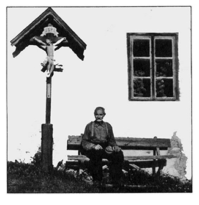
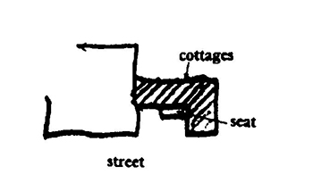

<section class="pattern-plate" aria-labelledby="t-old-age-cottage">
<a href="/patterns">A Pattern Language</a> · <a href="/patterns#buildings">Buildings</a> · Pattern 155 · p. 729 · **
<h1 class="pattern-title" id="t-old-age-cottage">Old Age Cottage</h1><figure class="pattern-figure pl-figure"></figure><nav class="pattern-links" aria-label="Connections"><h2>Links to</h2><ul><li><a href="/patterns/old-people-everywhere">40 Old People Everywhere</a></li><li><a href="/patterns/the-family">75 The Family</a></li><li><a href="/patterns/house-for-one-person">78 House For One Person</a></li><li><a href="/patterns/private-terrace-on-the-street">140 Private Terrace On The Street</a></li><li><a href="/patterns/rooms-to-rent">153 Rooms To Rent</a></li><li><a href="/patterns/teenagers-cottage">154 Teenager’s Cottage</a></li><li><a href="/patterns/settled-work">156 Settled Work</a></li><li><a href="/patterns/street-windows">164 Street Windows</a></li><li><a href="/patterns/the-shape-of-indoor-space">191 The Shape Of Indoor Space</a></li><li><a href="/patterns/structure-follows-social-spaces">205 Structure Follows Social Spaces</a></li><li><a href="/patterns/front-door-bench">242 Front Door Bench</a></li></ul><h2>Linked from</h2><ul><li><a href="/patterns/life-cycle">26 Life Cycle</a></li><li><a href="/patterns/house-for-one-person">78 House For One Person</a></li><li><a href="/patterns/a-room-of-ones-own">141 A Room Of One’s Own</a></li><li><a href="/patterns/half-private-office">152 Half-Private Office</a></li><li><a href="/patterns/rooms-to-rent">153 Rooms To Rent</a></li><li><a href="/patterns/settled-work">156 Settled Work</a></li><li><a href="/patterns/front-door-bench">242 Front Door Bench</a></li></ul></nav></section><article class="pattern-text" aria-label="The text of Old Age Cottage">
730… we have explained, in <a class="pl-ref" href="/patterns/old-people-everywhere">OLD PEOPLE EVERYWHERE (40)</a>, that it is essential to have a balanced number of old people in every neighborhood, partly centered around a communal place, but largely strung out among the other houses of the neighborhood. This pattern now defines the nature of the houses for old people in more detail: both those which are a part of clusters and those which are tucked, autonomously, between the larger houses. As we shall see, it seems desirable that every family should have a cottage like this, attached to it—<a class="pl-ref" href="/patterns/the-family">THE FAMILY (75)</a>. Like <a class="pl-ref" href="/patterns/rooms-to-rent">ROOMS TO RENT (133)</a> »nd <a class="pl-ref" href="/patterns/teenagers-cottage">TEENAGER’S COTTAGE (154)</a>, this cottage can be rented out or used for other purposes in time of trouble.

◆ ◆ ◆

<strong>Old people, especially when they are alone, face a terrible dilemma. On the one hand, there are inescapable forces pushing them toward independence: their children move away; the neighborhood changes; their friends and wives and husbands die. On the other hand, by the very nature of aging, old people become dependent on simple conveniences, simple connections to the society about them.</strong>

This conflict is reflected often in their children’s conflict. On the one hand, children feel responsible for their parents, because, of course, they sense their growing need for care and comfort. On the other hand, as families are whittled down, parent-child conflicts become more acute, and few people can imagine actually being able or willing to take care of their parents in their dotage.

The conflict can be partly resolved, if each house which houses a nuclear family has, somewhere near it, a small cottage where a grandparent can live, far enough away to be independent, and yet close enough to feel some tie and to be cared for in a time of trouble or approaching death.

But the conflict is more general. Even if we ignore, altogether, the complexities of parent-child relationships, the fact is that most old people face enormous difficulties as they grow older. The wel 731fare state tries to replace the comfort of the extended family with payments—social security or pensions. This income is always tiny; and inflation makes it worse. In the United States, one-quarter of the population over 65 lives on less than $4000 a year. Many of the old people in our society are forced to live in miserable tiny rooms, way in the back of some run-down old folks hotel. They cannnot have a decent house, because there are no decent tiny houses compatible with a small income and reduced activity.

This second conflict, between the need for someplace really small and modest and the need for social contact, a view of passing people, someone to nod to, a place in the sun, can also be resolved, like the first conflict, by cottages. It can be resolved, if there are many tiny cottages, dotted among the houses of communities and always strung along pedestrian paths—tiny enough to be really cheap.

Therefore:

<strong>Build small cottages specifically for old people. Build some of them on the land of larger houses, for a grandparent; build others on individual lots, much smaller than ordinary lots. In all cases, place these cottages at ground level, right on the street, where people are walking by, and close to neighborhood services and common land.</strong>

<figure class="pl-figure"></figure>
◆ ◆ ◆

732Perhaps the most important part of an old age cottage is the front porch and front door bench outside the door, right on the street—<a class="pl-ref" href="/patterns/private-terrace-on-the-street">PRIVATE TERRACE ON THE STREET (140)</a>, <a class="pl-ref" href="/patterns/front-door-bench">FRONT DOOR BENCH (242)</a>; for the rest, arrange the cottage pretty much according to the layout of any <a class="pl-ref" href="/patterns/house-for-one-person">HOUSE FOR ONE PERSON (78)</a>; make provisions for <a class="pl-ref" href="/patterns/settled-work">SETTLED WORK (156)</a>; and give the cottage a <a class="pl-ref" href="/patterns/street-windows">STREET WINDOW (164)</a>. And for the shape of the cottage start with <a class="pl-ref" href="/patterns/the-shape-of-indoor-space">THE SHAPE OF INDOOR SPACE (191)</a> and <a class="pl-ref" href="/patterns/structure-follows-social-spaces">STRUCTURE FOLLOWS SOCIAL SPACES (205)</a>….
</article>

Christopher Alexander, Sara Ishikawa and Murray Silverstein, with Max Jacobson, Ingrid Fiksdahl-King and Shlomo Angel, <cite>A Pattern Language</cite> (Oxford University Press, 1977), pattern 155, pp. 729–732. Text and illustrations from the <a href="https://github.com/natureoforder/sources">Nature of Order sources</a> reading edition, transcribed from the 1977 printing; report errors on <a href="https://github.com/natureoforder/alexander-wiki/issues">GitHub</a>.

<a href="/patterns/teenagers-cottage">← 154 Teenager’s Cottage</a> · <a href="/patterns">All 253 patterns</a> · <a href="/patterns/settled-work">156 Settled Work →</a>

