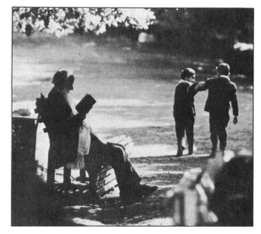
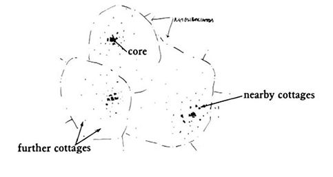

<section class="pattern-plate" aria-labelledby="t-old-people-everywhere">
<a href="/patterns">A Pattern Language</a> · <a href="/patterns#towns">Towns</a> · Pattern 40 · p. 215 · **
<h1 class="pattern-title" id="t-old-people-everywhere">Old People Everywhere</h1><figure class="pattern-figure pl-figure"></figure><nav class="pattern-links" aria-label="Connections"><h2>Links to</h2><ul><li><a href="/patterns/life-cycle">26 Life Cycle</a></li><li><a href="/patterns/household-mix">35 Household Mix</a></li><li><a href="/patterns/work-community">41 Work Community</a></li><li><a href="/patterns/industrial-ribbon">42 Industrial Ribbon</a></li><li><a href="/patterns/university-as-a-marketplace">43 University As A Marketplace</a></li><li><a href="/patterns/local-town-hall">44 Local Town Hall</a></li><li><a href="/patterns/necklace-of-community-projects">45 Necklace Of Community Projects</a></li><li><a href="/patterns/market-of-many-shops">46 Market Of Many Shops</a></li><li><a href="/patterns/health-center">47 Health Center</a></li><li><a href="/patterns/housing-in-between">48 Housing In Between</a></li><li><a href="/patterns/childrens-home">86 Children’s Home</a></li><li><a href="/patterns/settled-work">156 Settled Work</a></li><li><a href="/patterns/vegetable-garden">177 Vegetable Garden</a></li></ul><h2>Linked from</h2><ul><li><a href="/patterns/life-cycle">26 Life Cycle</a></li><li><a href="/patterns/interchange">34 Interchange</a></li><li><a href="/patterns/household-mix">35 Household Mix</a></li><li><a href="/patterns/old-age-cottage">155 Old Age Cottage</a></li></ul></nav></section><article class="pattern-text" aria-label="The text of Old People Everywhere">
216… when neighborhoods are properly formed they give the people there a cross section of ages and stages of development—identifiable NEIGHBORHOOD (14), <a class="pl-ref" href="/patterns/life-cycle">LIFE CYCLE (26)</a>, <a class="pl-ref" href="/patterns/household-mix">HOUSEHOLD mix (35)</a>; however, the old people are so often forgotten and left alone in modern society, that it is necessary to formulate a special pattern which underlines their needs.

◆ ◆ ◆

<strong>Old people need old people, but they also need the young, and young people need contact with the old.</strong>

There is a natural tendency for old people to gather together in clusters or communities. But when these elderly communities are too isolated or too large, they damage young and old alike. The young in other parts of town, have no chance of the benefit of older company, and the old people themselves are far too isolated.

Treated like outsiders, the aged have increasingly clustered together for mutual support or simply to enjoy themselves. A now familiar but still amazing phenomenon has sprung up in the past decade: dozens of good-sized new towns that exclude people under 65. Built on cheap, outlying land, such communities offer two-bedroom houses starting at $18,000 plus a refuge from urban violence … and generational pressures. (<em>Time</em>, August 3, 1970.)

But the choice the old people have made by moving to these communities and the remarks above are a serious and painful reflection of a very sad state of affairs in our culture. The fact is that contemporary society shunts away old people; and the more shunted away they are, the deeper the rift between the old and young. The old people have no choice but to segregate themselves—they, like anyone else, have pride; they would rather not be with younger people who do not appreciate them, and they feign satisfaction to justify their position.

And the segregation of the old causes the same rift inside each individual life: as old people pass into old age communities their ties with their own past become unacknowledged, lost, and therefore 217broken. Their youth is no longer alive in their old age—the two become dissociated; their lives are cut in two.

In contrast to the situation today, consider how the aged were respected and needed in traditional cultures:

Some degree of prestige for the aged seems to have been practically universal in all known societies. This is so general, in fact, that it cuts across many cultural factors that have appeared to determine trends in other topics related to age. (<em>The Role of Aged in Primitive Society</em>, Leo W. Simmons, New Haven: Yale University Press, 1946, p. 69.)

More specifically:

… Another family relationship of great significance for the aged has been the commonly observed intimate association between the very young and the very old. Frequently they have been left together at home while the able-bodied have gone forth to earn the family living. These oldsters, in their wisdom and experience, have protected and instructed the little ones, while the children, in turn, have acted as the “eyes, ears, hands, and feet” of their feeble old friends. Care of the young has thus very generally provided the aged with a useful occupation and a vivid interest in life during the long dull days of senescence. (Ibid. p. 199.)

Clearly, old people cannot be integrated socially as in traditional cultures unless they are first integrated physically—unless they share the same streets, shops, services, and common land with everyone else. But, at the same time, they obviously need other old people around them; and some old people who are infirm need special services.

And of course old people vary in their need or desire to be among their own age group. The more able-bodied and independent they are, the less they need to be among other old people, and the farther they can be from special medical services. The variation in the amount of care they need ranges from complete nursing care; to semi-nursing care involving house calls once a day or twice a week; to an old person getting some help with shopping, cooking, and cleaning; to an old person being completely independent. Right now, there is no such fine differentiation 218made in the care of old people—very often people who simply need a little help cooking and cleaning are put into rest homes which provide total nursing care, at huge expense to them, their families, and the community. It is a psychologically debilitating situation, and they turn frail and helpless because that is the way they are treated.

We therefore need a way of taking care of old people which provides for the full range of their needs:

1. It must allow them to stay in the neighborhood they know best—hence some old people in every neighborhood.

2. It must allow old people to be together, yet in groups small enough not to isolate them from the younger people in the neighborhood.

3. It must allow those old people who are independent to live independently, without losing the benefits of communality.

4. It must allow those who need nursing care or prepared meals, to get it, without having to go to nursing homes far from the neighborhood.

All these requirements can be solved together, very simply, if every neighborhood contains a small pocket of old people, not concentrated all in one place, but fuzzy at the edges like a swarm of bees. This will both preserve the symbiosis between young and old, <em>and</em> give the old people the mutual support they need within the pockets. Perhaps 20 might live in a central group house, another 10 or 15 in cottages close to this house, but interlaced with other houses, and another 10 to 15 also in cottages, still further from the core, in among the neighborhood, yet always within 100 or 200 yards of the core, so they can easily walk there to play chess, have a meal, or get help from the nurse.

The number 50 comes from Mumford’s argument:

The first thing to be determined is the number of aged people to be accommodated in a neighborhood unit; and the answer to this, I submit, is that the normal age distribution in the community as a whole should be maintained. This means that there should be from five to eight people over sixty-five in every hundred people; so that in a neighborhood unit of, say, six hundred people, there would be between thirty and fifty old people. (Lewis Mumford, <em>The Human Prospect</em>, New York, 1968, p. 49.)

As for the character of the group house, it might vary from 219case to case. In some cases it might be no more than a commune, where people cook together and have part-time help from young girls and boys, or professional nurses. However, about 5 per cent of the nation’s elderly need full-time care. This means that two or three people in every 50 will need complete nursing care. Since a nurse can typically work with six to eight people, this suggests that every second or third neighborhood group house might be equipped with complete nursing care.

Therefore:

<strong>Create dwellings for some 50 old people in every neighborhood. Place these dwellings in three rings …</strong>

<strong>1. A central core with cooking and nursing provided.</strong>

<strong>2. Cottages near the core.</strong>

<strong>3. Cottages further out from the core, mixed among the other houses of the neighborhood, but never more than 200 yards from the core.</strong>

<strong>… in such a way that the 50 houses together form a single coherent swarm, with its own clear center, but interlocked at its periphery with other ordinary houses of the neighborhood.</strong>

<figure class="pl-figure"></figure>
◆ ◆ ◆

Treat the core like any group house; make all the cottages, both those close to and those further away, small—old age cottage (155), 220some of them perhaps connected to the larger family houses in the neighborhood—the family (75); provide every second or third core with proper nursing facilities; somewhere in the orbit of the old age pocket, provide the kind of work which old people can manage best—especially teaching and looking after tiny children—network of learning (18), <a class="pl-ref" href="/patterns/childrens-home">children’s home (86)</a>,<a class="pl-ref" href="/patterns/settled-work">SETTLED WORK (156)</a>, <a class="pl-ref" href="/patterns/vegetable-garden">VEGETABLE GARDEN (177)</a>….

221<em>between the house clusters, around the centers, and especially in the boundaries between neighborhoods, encourage the formation of work communities;</em>

<a class="pl-ref" href="/patterns/work-community">41. WORK COMMUNITY</a>

<a class="pl-ref" href="/patterns/industrial-ribbon">42. INDUSTRIAL RIBBON</a>

<a class="pl-ref" href="/patterns/university-as-a-marketplace">43. UNIVERSITY AS A MARKETPLACE</a>

<a class="pl-ref" href="/patterns/local-town-hall">44. LOCAL TOWN HALL</a>

<a class="pl-ref" href="/patterns/necklace-of-community-projects">45. NECKLACE OF COMMUNITY PROJECTS</a>

<a class="pl-ref" href="/patterns/market-of-many-shops">46. MARKET OF MANY SHOPS</a>

<a class="pl-ref" href="/patterns/health-center">47. HEALTH CENTER</a>

<a class="pl-ref" href="/patterns/housing-in-between">48. HOUSING IN BETWEEN</a>
</article>

Christopher Alexander, Sara Ishikawa and Murray Silverstein, with Max Jacobson, Ingrid Fiksdahl-King and Shlomo Angel, <cite>A Pattern Language</cite> (Oxford University Press, 1977), pattern 40, pp. 215–221. Text and illustrations from the <a href="https://github.com/natureoforder/sources">Nature of Order sources</a> reading edition, transcribed from the 1977 printing; report errors on <a href="https://github.com/natureoforder/alexander-wiki/issues">GitHub</a>.

<a href="/patterns/housing-hill">← 39 Housing Hill</a> · <a href="/patterns">All 253 patterns</a> · <a href="/patterns/work-community">41 Work Community →</a>

