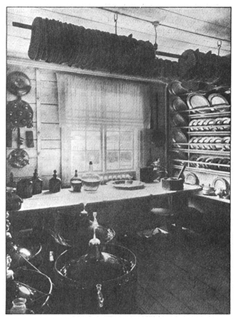
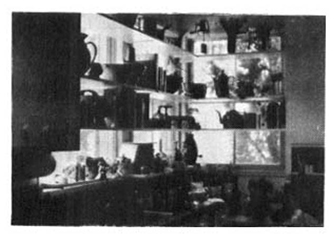
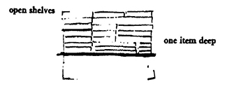

<section class="pattern-plate" aria-labelledby="t-open-shelves">
<a href="/patterns">A Pattern Language</a> · <a href="/patterns#buildings">Buildings</a> · Pattern 200 · p. 919 · *
<h1 class="pattern-title" id="t-open-shelves">Open Shelves</h1><figure class="pattern-figure pl-figure"></figure><nav class="pattern-links" aria-label="Connections"><h2>Links to</h2><ul><li><a href="/patterns/farmhouse-kitchen">139 Farmhouse Kitchen</a></li><li><a href="/patterns/bulk-storage">145 Bulk Storage</a></li><li><a href="/patterns/workspace-enclosure">183 Workspace Enclosure</a></li><li><a href="/patterns/thick-walls">197 Thick Walls</a></li><li><a href="/patterns/waist-high-shelf">201 Waist-High Shelf</a></li><li><a href="/patterns/thickening-the-outer-walls">211 Thickening The Outer Walls</a></li></ul><h2>Linked from</h2><ul><li><a href="/patterns/individually-owned-shops">87 Individually Owned Shops</a></li><li><a href="/patterns/corner-grocery">89 Corner Grocery</a></li><li><a href="/patterns/farmhouse-kitchen">139 Farmhouse Kitchen</a></li><li><a href="/patterns/eating-atmosphere">182 Eating Atmosphere</a></li><li><a href="/patterns/workspace-enclosure">183 Workspace Enclosure</a></li><li><a href="/patterns/cooking-layout">184 Cooking Layout</a></li><li><a href="/patterns/bed-alcove">188 Bed Alcove</a></li><li><a href="/patterns/dressing-rooms">189 Dressing Rooms</a></li><li><a href="/patterns/corner-doors">196 Corner Doors</a></li><li><a href="/patterns/thick-walls">197 Thick Walls</a></li><li><a href="/patterns/sunny-counter">199 Sunny Counter</a></li><li><a href="/patterns/waist-high-shelf">201 Waist-High Shelf</a></li></ul></nav></section><article class="pattern-text" aria-label="The text of Open Shelves">
920… within the <a class="pl-ref" href="/patterns/thick-walls">THICK WALLS (197)</a>, especially around the <a class="pl-ref" href="/patterns/farmhouse-kitchen">FARMHOUSE KITCHEN (139)</a> and <a class="pl-ref" href="/patterns/workspace-enclosure">WORKSPACE ENCLOSURE (183)</a>, but possibly throughout the building, there is a need for shelves. This pattern helps you decide exactly where you want them and how they shall be organized. Mary Louise Rogers first made the pattern explicit for us.

◆ ◆ ◆

<strong>Cupboards that are too deep waste valuable space, and it always seems that what you want is behind something else.</strong>

It is easy to think that you have good storage in a room or in a building just because you have enough closets, cupboards, and shelves. But the value of storage depends as much on the ease of access as on the amount. An enormous amount of cupboard space in a place where no one can get to it is not very useful. It is useful when you can find the things which you have put away at a glance.

This means, essentially, that except for <a class="pl-ref" href="/patterns/bulk-storage">bulk storage (145)</a>, things should be stored on open shelves, “one deep.” Then you can see them all. It means, in effect, that you are flattening out the total storage all over the walls—instead of having it in solid lumps, hidden, and hard to reach.

The need for open storage is most obvious in kitchens. In badly planned kitchens, the shelves are filled with things three or four items deep, sometimes stacked on top of each other, and something is always in the way of what you need. But in well-planned kitchens, all storage is one item deep. Shelves are one can deep, glasses are stored one row deep, pots and pans are hung one deep on the wall; for small jars and spices there are special spice shelves that hold the items just one deep.

We think this property is common to all convenient storage. A family’s most prized possessions, gifts, whether for the kitchen or any place else in the house, are hidden away when they are stored in cupboards and the back shelves of closets. Openly stored, one deep, these things are beautiful around the house.

921Many forms of storage can be one-deep: swinging cabinets that have shelves inside the doors; pegboards for pots and pans; tool racks. It is even possible to create narrow open shelves in front of windows. When things are just one deep, there is still enough light coming in to make the window useful.

<figure class="pl-figure"><figcaption><em>Open shelves across a window</em>.</figcaption></figure>

Therefore:

<strong>Cover the walls with narrow shelves of varying depth but always shallow enough so that things can be placed on them one deep—nothing hiding behind anything else.</strong>

<figure class="pl-figure"></figure>
◆ ◆ ◆

At waist height put in an extra deep shelf for plates, phonograph, TV, boxes, displays, treasures—<a class="pl-ref" href="/patterns/waist-high-shelf">WAIST-HIGH SHELF (201)</a>. Mark the open shelves along with all the other deep spaces in the walls—<a class="pl-ref" href="/patterns/thickening-the-outer-walls">THICKENING THE OUTER WALL (211)</a>….
</article>

Christopher Alexander, Sara Ishikawa and Murray Silverstein, with Max Jacobson, Ingrid Fiksdahl-King and Shlomo Angel, <cite>A Pattern Language</cite> (Oxford University Press, 1977), pattern 200, pp. 919–921. Text and illustrations from the <a href="https://github.com/natureoforder/sources">Nature of Order sources</a> reading edition, transcribed from the 1977 printing; report errors on <a href="https://github.com/natureoforder/alexander-wiki/issues">GitHub</a>.

<a href="/patterns/sunny-counter">← 199 Sunny Counter</a> · <a href="/patterns">All 253 patterns</a> · <a href="/patterns/waist-high-shelf">201 Waist-High Shelf →</a>

