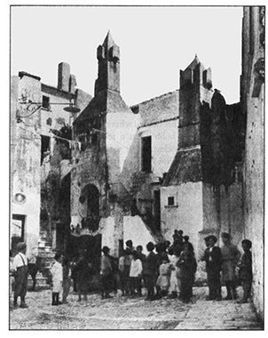
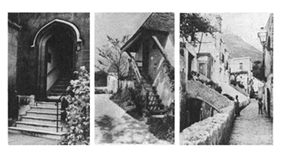
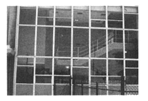
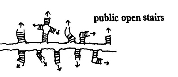

<section class="pattern-plate" aria-labelledby="t-open-stairs">
<a href="/patterns">A Pattern Language</a> · <a href="/patterns#buildings">Buildings</a> · Pattern 158 · p. 740 · *
<h1 class="pattern-title" id="t-open-stairs">Open Stairs</h1><figure class="pattern-figure pl-figure"></figure><nav class="pattern-links" aria-label="Connections"><h2>Links to</h2><ul><li><a href="/patterns/house-for-a-small-family">76 House For A Small Family</a></li><li><a href="/patterns/house-for-a-couple">77 House For A Couple</a></li><li><a href="/patterns/house-for-one-person">78 House For One Person</a></li><li><a href="/patterns/self-governing-workshops-and-offices">80 Self-Governing Workshops And Offices</a></li><li><a href="/patterns/pedestrian-street">100 Pedestrian Street</a></li><li><a href="/patterns/family-of-entrances">102 Family Of Entrances</a></li><li><a href="/patterns/roof-garden">118 Roof Garden</a></li><li><a href="/patterns/stair-seats">125 Stair Seats</a></li><li><a href="/patterns/small-work-groups">148 Small Work Groups</a></li><li><a href="/patterns/rooms-to-rent">153 Rooms To Rent</a></li><li><a href="/patterns/teenagers-cottage">154 Teenager’s Cottage</a></li><li><a href="/patterns/settled-work">156 Settled Work</a></li><li><a href="/patterns/home-workshop">157 Home Workshop</a></li><li><a href="/patterns/light-on-two-sides-of-every-room">159 Light On Two Sides Of Every Room</a></li><li><a href="/patterns/building-edge">160 Building Edge</a></li><li><a href="/patterns/sunny-place">161 Sunny Place</a></li><li><a href="/patterns/north-face">162 North Face</a></li><li><a href="/patterns/outdoor-room">163 Outdoor Room</a></li><li><a href="/patterns/street-windows">164 Street Windows</a></li><li><a href="/patterns/opening-to-the-street">165 Opening To The Street</a></li><li><a href="/patterns/gallery-surround">166 Gallery Surround</a></li><li><a href="/patterns/six-foot-balcony">167 Six-Foot Balcony</a></li><li><a href="/patterns/connection-to-the-earth">168 Connection To The Earth</a></li><li><a href="/patterns/staircase-volume">195 Staircase Volume</a></li></ul><h2>Linked from</h2><ul><li><a href="/patterns/university-as-a-marketplace">43 University As A Marketplace</a></li><li><a href="/patterns/high-places">62 High Places</a></li><li><a href="/patterns/office-connections">82 Office Connections</a></li><li><a href="/patterns/shielded-parking">97 Shielded Parking</a></li><li><a href="/patterns/pedestrian-street">100 Pedestrian Street</a></li><li><a href="/patterns/building-thoroughfare">101 Building Thoroughfare</a></li><li><a href="/patterns/building-fronts">122 Building Fronts</a></li><li><a href="/patterns/stair-seats">125 Stair Seats</a></li><li><a href="/patterns/small-work-groups">148 Small Work Groups</a></li><li><a href="/patterns/half-private-office">152 Half-Private Office</a></li><li><a href="/patterns/rooms-to-rent">153 Rooms To Rent</a></li><li><a href="/patterns/teenagers-cottage">154 Teenager’s Cottage</a></li><li><a href="/patterns/staircase-volume">195 Staircase Volume</a></li></ul></nav></section><article class="pattern-text" aria-label="The text of Open Stairs">
741… most of the last patterns—<a class="pl-ref" href="/patterns/rooms-to-rent">ROOMS TO RENT (153)</a>, <a class="pl-ref" href="/patterns/teenagers-cottage">TEENAGER’S COTTAGE (154)</a>, <a class="pl-ref" href="/patterns/settled-work">SETTLED WORK (156)</a>, <a class="pl-ref" href="/patterns/home-workshop">HOME WORKSHOP (157)</a>—can be upstairs, provided that they have direct connections to the street. Far more generally, it is true that many of the households, public services, and workgroups given by earlier patterns can be successful when they lie upstairs, only if they are given direct connections to the street. For instance, in a work community <a class="pl-ref" href="/patterns/self-governing-workshops-and-offices">SELF-GOVERNING WORKSHOPS AND OFFICES (80)</a>, SMALL SERVICES WITHOUT RED TAPE (8l), <a class="pl-ref" href="/patterns/small-work-groups">SMALL WORK GROUPS (148)</a> all require direct access to the public street when they are on the upper storys of a building. And in the individual households <a class="pl-ref" href="/patterns/house-for-a-small-family">HOUSE FOR A SMALL FAMILY (76)</a>, <a class="pl-ref" href="/patterns/house-for-a-couple">HOUSE FOR A COUPLE (77)</a>, <a class="pl-ref" href="/patterns/house-for-one-person">HOUSE FOR ONE PERSON (78)</a> also need direct connections to the street, so people do not need to go through lower floors to get to them. This pattern describes the open stairs which may be used to form these many individual connections to the street. They play a major role in helping to create <a class="pl-ref" href="/patterns/pedestrian-street">PEDESTRIAN STREETS (100)</a>.

◆ ◆ ◆

<strong>Internal staircases reduce the connection between upper stories and the life of the street to such an extent that they can do enormous social damage.</strong>

The simple fact of the matter is that an apartment on the second floor of a building is wonderful when it has a direct stair to the street, and much less wonderful when it is merely one of several apartments served by an internal stair. The following, perhaps rather laborious discussion, is our effort to explain this vital and commonplace intuition.

In a traditional culture where buildings are built incrementally, outdoor stairs leading to upper stories are common. And half “outdoor” stairs—protected by walls and roofs, but nonetheless open to the street—are also common.

742

<figure class="pl-figure"><figcaption><em>The beauty of open stairs</em>.</figcaption></figure>

By contrast, in industrialized, authoritarian societies most stairs are indoor stairs. The access to these stairs is from internal lobbies and corridors; the upper stories are cut off from direct access to the life of the street.

<figure class="pl-figure"></figure>
<em>This is not an open stair</em>—<em>don’t be fooled</em>.

This difference is not an incidental by-product of fire laws or construction techniques. It is fundamental to the difference between a free anarchical society, in which there is a voluntary exchange of ideas between equals, and a highly centralized authoritarian society, in which most individuals are subservient to large government and business organizations.

In effect we are saying that a centralized entrance, which funnels everyone in a building through it, has in its nature the trappings of control; while the pattern of many open stairs, leading off the public streets, direct to private doors, has in its nature the fact of independence, free comings and goings.

743We can see this most easily in the cases where the centralized door is, without question, a source of social control. In workplaces with a central entrance and a time-clock, workers punch in and out, and they have to make excuses when they are leaving at a time that is not normal. In some kinds of student housing, people are asked to sign in and out; and if they are not back by “lock-out” time, they are in trouble.

Then there are cases where the control is more subtle. In an apartment house or a workplace where everyone is free to come or go as he pleases it is not uncommon for the main door to be kept locked. Of course the residents have a key to the building; but their friends do not. When the front door is locked—after normal hours, say—they are effectively cut off from the spontaneous “dropping in” that can occur freely only where all paths are public right up to the thresholds of private territory.

Then there is the still more subtle fact that, even where the centralized entrance carries with it no explicit policy of social control—let us say that it is a door that is always open—it still has an uneasy feeling about it for people who cherish basic liberties. The single, centralized entrance is the precise pattern that a tyrant <em>would</em> propose who wanted to control people’s comings and goings. It makes one uneasy to live with such a form, even where the social policy is relatively free.

This may very easily sound paranoid. But the point is this: socially, a libertarian society tries to build for itself structures which cannot easily be controlled by one person or one group “at the helm.” It tries to decentralize social structures so that there are <em>many</em> centers, and no one group can come to have excessive control.

A physical environment which supports the same libertarian ideal will certainly put a premium on structures that allow people freedom to come and go as they please. And it will try to protect this right by building it into the very ground plan of buildings and cities. When we feel uneasy in a building that is spatially over-centralized and authoritarian, it is because we feel unprotected in this way; we feel that one of our basic rights is potentially vulnerable and is not being fully affirmed by the physical structure of the environment.

Open stairs which act as extensions of the public world and which reach up to the very threshold of each household’s and each

workgroup’s 744own space solve this problem. These spaces are then connected directly to the world at large. People on the street recognize each entry as the domain of real people—not the domain of corporations and institutions, which have the actual or potential power to tyrannize.

Therefore:

<strong>Do away, as far as possible, with internal staircases in institutions. Connect all autonomous households, public services, and workgroups on the upper floors of buildings directly to the ground. Do this by creating open stairs which are approached directly from the street. Keep the stair roofed or unroofed, according to climate, but at all events leave the stair open at ground level, without a door, so that the stair is functionally a continuation of the street. And build no upstairs corridors. Instead, make open landings or an open arcade where upstairs units share a single stair.</strong>

<figure class="pl-figure"></figure>
◆ ◆ ◆

Where the stair comes down to the ground, make an entrance which helps to repair the family of entrances that exist already on the street—<a class="pl-ref" href="/patterns/family-of-entrances">FAMILY OF ENTRANCES (102)</a>; make the landings and the top of the stair, where it reaches the roof, into gardens where things can grow and where people can sit in the sun—<a class="pl-ref" href="/patterns/roof-garden">ROOF GARDEN (118)</a>, <a class="pl-ref" href="/patterns/sunny-place">SUNNY PLACE (161)</a>. Remember <a class="pl-ref" href="/patterns/stair-seats">STAIR SEATS (125)</a>, and build the stair according to <a class="pl-ref" href="/patterns/staircase-volume">STAIRCASE VOLUME (195)</a>….

745<em>frefare to knit the inside of the building to the outside</em>, <em>by treating the edge between the two as a place in its own right, and making human details there;</em>

<a class="pl-ref" href="/patterns/light-on-two-sides-of-every-room">159. LIGHT ON TWO SIDES OF EVERY ROOM</a>

<a class="pl-ref" href="/patterns/building-edge">160. BUILDING EDGE</a>

<a class="pl-ref" href="/patterns/sunny-place">161. SUNNY PLACE</a>

<a class="pl-ref" href="/patterns/north-face">162. NORTH FACE</a>

<a class="pl-ref" href="/patterns/outdoor-room">163. OUTDOOR ROOM</a>

<a class="pl-ref" href="/patterns/street-windows">164. STREET WINDOWS</a>

<a class="pl-ref" href="/patterns/opening-to-the-street">165. OPENING TO THE STREET</a>

<a class="pl-ref" href="/patterns/gallery-surround">166. GALLERY SURROUND</a>

<a class="pl-ref" href="/patterns/six-foot-balcony">167. SIX-FOOT BALCONY</a>

<a class="pl-ref" href="/patterns/connection-to-the-earth">168. CONNECTION TO THE EARTH</a>
</article>

Christopher Alexander, Sara Ishikawa and Murray Silverstein, with Max Jacobson, Ingrid Fiksdahl-King and Shlomo Angel, <cite>A Pattern Language</cite> (Oxford University Press, 1977), pattern 158, pp. 740–745. Text and illustrations from the <a href="https://github.com/natureoforder/sources">Nature of Order sources</a> reading edition, transcribed from the 1977 printing; report errors on <a href="https://github.com/natureoforder/alexander-wiki/issues">GitHub</a>.

<a href="/patterns/home-workshop">← 157 Home Workshop</a> · <a href="/patterns">All 253 patterns</a> · <a href="/patterns/light-on-two-sides-of-every-room">159 Light On Two Sides Of Every Room →</a>

