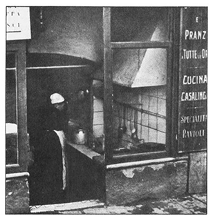
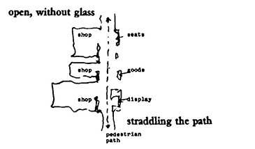

<section class="pattern-plate" aria-labelledby="t-opening-to-the-street">
<a href="/patterns">A Pattern Language</a> · <a href="/patterns#buildings">Buildings</a> · Pattern 165 · p. 773 · *
<h1 class="pattern-title" id="t-opening-to-the-street">Opening To The Street</h1><figure class="pattern-figure pl-figure"></figure><nav class="pattern-links" aria-label="Connections"><h2>Links to</h2><ul><li><a href="/patterns/university-as-a-marketplace">43 University As A Marketplace</a></li><li><a href="/patterns/local-town-hall">44 Local Town Hall</a></li><li><a href="/patterns/necklace-of-community-projects">45 Necklace Of Community Projects</a></li><li><a href="/patterns/market-of-many-shops">46 Market Of Many Shops</a></li><li><a href="/patterns/health-center">47 Health Center</a></li><li><a href="/patterns/street-cafe">88 Street Cafe</a></li><li><a href="/patterns/outdoor-room">163 Outdoor Room</a></li><li><a href="/patterns/street-windows">164 Street Windows</a></li><li><a href="/patterns/sitting-wall">243 Sitting Wall</a></li></ul><h2>Linked from</h2><ul><li><a href="/patterns/local-sports">72 Local Sports</a></li><li><a href="/patterns/shopfront-schools">85 Shopfront Schools</a></li><li><a href="/patterns/individually-owned-shops">87 Individually Owned Shops</a></li><li><a href="/patterns/street-cafe">88 Street Cafe</a></li><li><a href="/patterns/corner-grocery">89 Corner Grocery</a></li><li><a href="/patterns/pedestrian-street">100 Pedestrian Street</a></li><li><a href="/patterns/building-fronts">122 Building Fronts</a></li><li><a href="/patterns/pedestrian-density">123 Pedestrian Density</a></li><li><a href="/patterns/a-place-to-wait">150 A Place To Wait</a></li><li><a href="/patterns/settled-work">156 Settled Work</a></li><li><a href="/patterns/home-workshop">157 Home Workshop</a></li><li><a href="/patterns/open-stairs">158 Open Stairs</a></li><li><a href="/patterns/sitting-wall">243 Sitting Wall</a></li></ul></nav></section><article class="pattern-text" aria-label="The text of Opening To The Street">
774… many places in a town depend for their success on complete exposure to the people passing by—far more exposure than a <a class="pl-ref" href="/patterns/street-windows">STREET WINDOW (164)</a> can provide, <a class="pl-ref" href="/patterns/university-as-a-marketplace">UNIVERSITY AS A MARKETPLACE (43)</a>, <a class="pl-ref" href="/patterns/local-town-hall">LOCAL TOWN HALL (44)</a>, <a class="pl-ref" href="/patterns/necklace-of-community-projects">NECKLACE OF COMMUNITY PROJECTS (45)</a>, <a class="pl-ref" href="/patterns/market-of-many-shops">MARKET OF MANY SHOPS (46)</a>, <a class="pl-ref" href="/patterns/health-center">HEALTH CENTER (47)</a>, <a class="pl-ref" href="/patterns/street-cafe">STREET CAFE (88)</a>, BUILDING THOROUGHFARE (10l) are all examples. This pattern defines the form of the exposure.

◆ ◆ ◆

<strong>The sight of action is an incentive for action. When people can see into spaces from the street their world is enlarged and made richer, there is more understanding; and there is the possibility for communication, learning</strong>.

The service center is a storefront, with the windows all along the front. A man walks past the door. As he does so, he looks into the center, but only turns his head for a second—apparently unwilling to show too great a curiosity. He then sees a notice on die window, stops to read the notice. As he stands reading it, he looks past the notice to see what is going on inside. After a few seconds he retraces his steps, and comes into the center. (<em>A Pattern Language Which Generates Multi-Service Centers</em>, C.E.S., 1968, p. 351.)

There are many ways of establishing connection with the street.

1.First, the obvious case: the wall along the street is made essentially of glass, and the view in is of some inviting activity. A community center in Berkeley moved from a rennovated house which was away from the street, to a rennovated furniture showroom which was completely transparent to the street. The number of people dropping in soared after the move. It was partly because the new location was on a much busier pedestrian street. But transparency also played a role in bringing people in: of the people walking past the center about 66 per cent turned and looked in, and about 7 per cent stopped—either to read a notice or to look into the interior more carefully.

2.However, a glass connection creates relatively passive involvement. By comparison, a wall which is actually open—with a sliding wall or shutter—creates a far more valuable and involving 775connection. When the wall is open it is possible to hear what is going on inside, to smell the inside, to exchange words, and even to step in all along the opening. Street cafes, open food stalls, workshop with garage door openings are examples.

We passed the workshop every day on our way home from school. It was a furniture shop, and we would stand at the opening and watch men building chairs and tables, sawdust flying, forming legs on the lathe. There was a low wall, and the foreman told us to stay outside it; but he let us sit there, and we did, sometimes for hours.

3.The most involving case of all: activity is not only open to sight and sound on one side of the path, but some part of the activity actually crosses the path, so that people who walk down the sidewalk find themselves walking <em>through</em> the activity. The extreme version is the one where a shop is set up to straddle the path, with goods displayed on either side. A more modest version is the one where the roof of the space covers the path, the wall is entirely open, and the paving of the path is continuous with the “interior” of the space.

No matter how the opening is formed, it is essential that it expose the ordinary activity inside in a way that invites people passing to take it in and have some relationship, however modest, to it. The doctors of the Pioneer Health Center in Peckham believed this principle to be so essential that they deliberately built the center’s gymnasium, swimming pool, dance floor, cafeteria, and theater in such a way that people passing could not help but see others, often people they knew, inside:

… dancing goes on there and moving figures can be seen on the floor of the main building at night when the whole building is lit up attracting the attention of the passers by….

… it must be remembered that it is not the action of the skilled alone that is to be seen in the Centre, but <em>every degree</em> of proficiency in all that is going on. This point is crucial to an understanding of how vision can work as a stimulus engendering action in the company gathering there. In ordinary life the spectator of any activity is apt to be presented <em>only</em> with the exhibition of the specialist; and this trend has been gathering impetus year by year with alarming progression. Audiences swell in their thousands to watch the expert game, but as the “stars” grow in brilliance, the conviction of an ineptitude 776that makes trying not worth while, increasingly confirms the inactivity of the crowd. It is not then all forms of action that invite the attempt to action: it is the sight of action that is within the possible scope of the spectator that affords a temptation eventually irresistible to him. Short though the time of our experiment has been, this fact has been amply substantiated, as the growth of activities in the Centre demonstrates. (<em>The Peckham Experiment</em>, I. Pearse and L. Crocker, New Haven: Yale University Press, 1947, pp. 67–72.)

Therefore:

<strong>In any public space which depends for its success on its exposure to the street, open it up, with a fully opening wall which can be thrown wide open, and if it is possible, include some part of the activity on the far side of the pedestrian path, so that it actually straddles the path, and people walk through it as they walk along the path.</strong>

<strong>There are dozens of ways to build such an opening. For example, a wall can be made very cheaply with a simple plywood hanging shutter sliding on an overhead rail, which can be removed to open up completely, and locked in place at night.</strong>

<figure class="pl-figure"></figure>
Give the opening a boundary, when it is entirely open, with a low solid wall which people can sit on—<a class="pl-ref" href="/patterns/sitting-wall">SITTING WALL (243)</a>; and make an outdoor room out of the part of the path which runs past it PATH SHAPE (l2l), <a class="pl-ref" href="/patterns/outdoor-room">OUTDOOR ROOM (163)</a>….
</article>

Christopher Alexander, Sara Ishikawa and Murray Silverstein, with Max Jacobson, Ingrid Fiksdahl-King and Shlomo Angel, <cite>A Pattern Language</cite> (Oxford University Press, 1977), pattern 165, pp. 773–776. Text and illustrations from the <a href="https://github.com/natureoforder/sources">Nature of Order sources</a> reading edition, transcribed from the 1977 printing; report errors on <a href="https://github.com/natureoforder/alexander-wiki/issues">GitHub</a>.

<a href="/patterns/street-windows">← 164 Street Windows</a> · <a href="/patterns">All 253 patterns</a> · <a href="/patterns/gallery-surround">166 Gallery Surround →</a>

