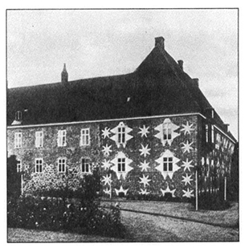
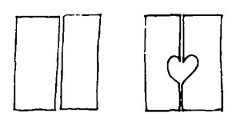
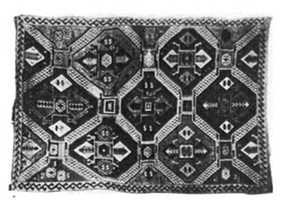
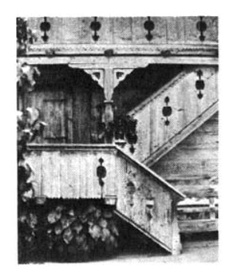
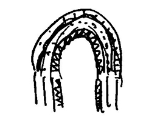
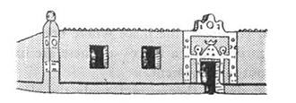
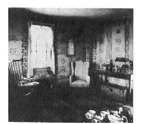
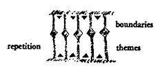

<section class="pattern-plate" aria-labelledby="t-ornament">
<a href="/patterns">A Pattern Language</a> · <a href="/patterns#construction">Construction</a> · Pattern 249 · p. 1146 · **
<h1 class="pattern-title" id="t-ornament">Ornament</h1><figure class="pattern-figure pl-figure"></figure><nav class="pattern-links" aria-label="Connections"><h2>Links to</h2><ul><li><a href="/patterns/subculture-boundary">13 Subculture Boundary</a></li><li><a href="/patterns/neighborhood-boundary">15 Neighborhood Boundary</a></li><li><a href="/patterns/main-entrance">110 Main Entrance</a></li><li><a href="/patterns/garden-wall">173 Garden Wall</a></li><li><a href="/patterns/corner-doors">196 Corner Doors</a></li><li><a href="/patterns/thick-walls">197 Thick Walls</a></li><li><a href="/patterns/wall-membrane">218 Wall Membrane</a></li><li><a href="/patterns/frames-as-thickened-edges">225 Frames As Thickened Edges</a></li><li><a href="/patterns/column-place">226 Column Place</a></li><li><a href="/patterns/column-connections">227 Column Connections</a></li><li><a href="/patterns/roof-caps">232 Roof Caps</a></li><li><a href="/patterns/lapped-outside-walls">234 Lapped Outside Walls</a></li><li><a href="/patterns/soft-inside-walls">235 Soft Inside Walls</a></li><li><a href="/patterns/half-inch-trim">240 Half-Inch Trim</a></li><li><a href="/patterns/sitting-wall">243 Sitting Wall</a></li><li><a href="/patterns/soft-tile-and-brick">248 Soft Tile And Brick</a></li><li><a href="/patterns/warm-colors">250 Warm Colors</a></li><li><a href="/patterns/things-from-your-life">253 Things From Your Life</a></li></ul><h2>Linked from</h2><ul><li><a href="/patterns/marriage-bed">187 Marriage Bed</a></li><li><a href="/patterns/half-open-wall">193 Half-Open Wall</a></li><li><a href="/patterns/corner-doors">196 Corner Doors</a></li><li><a href="/patterns/low-doorway">224 Low Doorway</a></li><li><a href="/patterns/column-connections">227 Column Connections</a></li><li><a href="/patterns/roof-caps">232 Roof Caps</a></li><li><a href="/patterns/floor-surface">233 Floor Surface</a></li><li><a href="/patterns/half-inch-trim">240 Half-Inch Trim</a></li><li><a href="/patterns/sitting-wall">243 Sitting Wall</a></li><li><a href="/patterns/canvas-roofs">244 Canvas Roofs</a></li><li><a href="/patterns/soft-tile-and-brick">248 Soft Tile And Brick</a></li><li><a href="/patterns/warm-colors">250 Warm Colors</a></li></ul></nav></section><article class="pattern-text" aria-label="The text of Ornament">
1147… once buildings and gardens are finished; walls, columns, windows, doors, and surfaces are in place; boundaries and edges and transitions are defined—<a class="pl-ref" href="/patterns/main-entrance">MAIN ENTRANCE (110)</a>, BUILDING EDGE (l60), CONNECTION TO THE EARTH (l68), <a class="pl-ref" href="/patterns/garden-wall">GARDEN WALL (173)</a>, WINDOW PLACE (l80), <a class="pl-ref" href="/patterns/corner-doors">CORNER DOORS (196)</a>, <a class="pl-ref" href="/patterns/frames-as-thickened-edges">FRAMES AS THICKENED EDGES (225)</a>, <a class="pl-ref" href="/patterns/column-place">COLUMN PLACE (226)</a>, <a class="pl-ref" href="/patterns/column-connections">COLUMN CONNECTION (227)</a>, <a class="pl-ref" href="/patterns/roof-caps">ROOF CAPS (232)</a>, <a class="pl-ref" href="/patterns/soft-inside-walls">SOFT INSIDE WALLS (235)</a>, <a class="pl-ref" href="/patterns/sitting-wall">SITTING WALL (243)</a>, and so on—it is time to put in the finishing touches, to fill the gaps, to mark the boundaries, by making ornament.

◆ ◆ ◆

<strong>All people have the instinct to decorate their surroundings.</strong>

But decorations and ornaments will only work when they are properly made: for ornaments and decorations are not only bom from the natural exuberance and lore for something happy in a building; they also have a function, which is as clear, and definite as any other function in a building. The joy and exuberance of carvings and color will only work, if they are made in harmony with this function. And, further, the function is a necessary one—the ornaments are not just optional additions which may, or may not be added to a building, according as the spirit moves you—a building needs them, just as much as it needs doors and windows.

In order to understand the function of ornament, we must begin by understanding the nature of space in general. Space, when properly formed, is whole. Every part of it, every part of a town, a neighborhood, a building, a garden, or a room, is whole, in the sense that it is both an integral entity, in itself, and at the same time, joined to some other entities to form a larger whole. This process hinges largely on the boundaries. It is no accident that so many of the patterns in this pattern language concern the importance of the boundaries between things, as places that are as important as the things themselves—for example, 1148<a class="pl-ref" href="/patterns/subculture-boundary">SUBCULTURE BOUNDARY (13)</a>, <a class="pl-ref" href="/patterns/neighborhood-boundary">NEIGHBORHOOD BOUNDARY (15)</a>, ARCADES (l19), BUILDING EDGE (l60), CALLERY SURROUND (l66), CONNECTION TO THE EARTH (l68), HALF-OPEN WALLS (l93), <a class="pl-ref" href="/patterns/thick-walls">THICK WALLS (197)</a>, <a class="pl-ref" href="/patterns/frames-as-thickened-edges">FRAMES AS THICKENED EDGES (225)</a>, <a class="pl-ref" href="/patterns/half-inch-trim">HALF-INCH TRIM (240)</a>, <a class="pl-ref" href="/patterns/sitting-wall">SITTING WALL (243)</a>.

A thing is whole only when it is itself entire and also joined to its outside to form a larger entity. But this can only happen when the boundary between the two is so thick, so fleshy, so ambiguous, that the two are not sharply separated, but can function either as separate entities or as one larger whole which has no inner cleavage in it.

<figure class="pl-figure"><figcaption><em>Split … and whole</em>.</figcaption></figure>

In the left-hand diagram where there is a cleavage that is sharp, the thing and its outside are distinct entities—they function individually as wholes—but they do not function together as a larger whole. In this case the world is split. In the right-hand diagram where there is ambiguous space between them, the two entities are individually entire, as before, but they are also entire together as a larger whole. In this case the world is whole.

This principle extends throughout the material universe, from the largest organic structures in our surroundings, to the very atoms and molecules.

Extreme examples of this principle at work in manmade objects are in the endless surfaces of objects from the so-called “dark ages” and in the carpets and tilework of Turkey and Persia. Leaving aside the profound meaning of these “ornaments,” it is a fact that they function mainly by creating surfaces in which each part is simultaneously figure and boundary and in which the design acts as boundary and figure at several different levels simultaneously.

1149

<figure class="pl-figure"><figcaption><em>A decoration which is whole, because it cannot be broken into farts</em>.</figcaption></figure>

Since none of the parts can be separated from their surroundings, because each part acts as figure and as boundary, at several levels, this ancient carpet is whole, to an extraordinary degree.

<em>The main purpose of ornament in the environment—in buildings, rooms, and public spaces—is to make the world more whole by knitting it together in precisely the same way this carfet does it</em>.

If the patterns in this language are used correctly, then these unifying boundaries will already come into existence without ornament at almost all the scales where they are necessary in spaces and materials. It will happen in the large spaces, like the entrance transition or the building edge. And, of course, it happens of its own accord, in those smaller structures which occur within the materials themselves—in the fibers of wood, in the grain of brick and stone. But there is an intermediate range of scales, a twilight zone, where it will not happen of its own accord. <em>It is in this range of scales that ornament fills the gaf</em>.

As far as specific ways of doing it are concerned, there are hundreds, of course. In this balustrade the ornament is made entirely of the boundary, of the space between the boards. The boards arc cut in such a way, that when they are joined together in the fence, they make something of the space between them.

1150

<figure class="pl-figure"><figcaption><em>… A balustrade</em>.</figcaption></figure>

Here is a more complicated case—the entrance to a Romanesque church.

<figure class="pl-figure"><figcaption><em>A doorway</em>.</figcaption></figure>

The ornament is built up around the edge of the entrance. It creates a unifying seam between the entrance <em>sface</em> and the stone. Without the ornament, there would be a gap between the arch of the entry and the passage itself: the ornament works on the seam, between the two, and holds them together. It is especially lavish and developed in this place, because just this seam—the boundary of the entrance to the church—is so important, symbolically, to the people who worship there.

In fact, doors and windows are always important for ornament, because they are places of connection between the elements of buildings and the life in and around them. It is very likely that we shall find a concentration of ornament at the edges of doors and windows, as people try to tie together these edges with the space around them.

1151

<figure class="pl-figure"><figcaption><em>Nubian door</em>.</figcaption></figure>

And exactly the same happens at hundreds of other places in the environment; in rooms, around our houses, in the kitchen, on a wall, along the surface of a path, on tops of roofs, around a column—in fact, anywhere at all where there are edges between things which are imperfectly knit together, where materials or objects meet, and where they change.

<figure class="pl-figure"><figcaption><em>Early American stencilling</em>.</figcaption></figure>

Most generally of all, the thing that makes the difference in the use of ornament is the eye for the significant gap in the continuum: the place where the continuous fabric of interlock and connectivity is broken. When ornament is applied badly it is always put into some place where these connections are not really missing, so it is superfluous, frivolous. When it is well used, it is always applied in a place where there is a genuine gap, a need for a little more structure, a need for what we may call metaphorically “some extra binding energy,” to knit the stuff together where it is too much apart.

Therefore:

<strong>Search around the building, and find those edges and transitions which need emphasis or extra binding energy. 1152Comers, places where materials meet, door frames, windows, main entrances, the place where one wall meets another, the garden gate, a fence—all these are natural places which call out for ornament.</strong>

<strong>Now find simple themes and apply the elements of the theme over and again to the edges and boundaries which you decide to mark. Make the ornaments work as seams along the boundaries and edges so that they knit the two sides together and make them one.</strong>

<figure class="pl-figure"></figure>
◆ ◆ ◆

Whenever it is possible, make the ornament while you are building—not after—from the planks and boards and tiles and surfaces of which the building is actually made—<a class="pl-ref" href="/patterns/wall-membrane">WALL MEMBRANE (218)</a>, <a class="pl-ref" href="/patterns/frames-as-thickened-edges">FRAMES AS THICKENED EDGES (225)</a>, <a class="pl-ref" href="/patterns/lapped-outside-walls">LAPPED OUTSIDE WALLS (234)</a>, <a class="pl-ref" href="/patterns/soft-inside-walls">SOFT INSIDE WALLS (235)</a>, <a class="pl-ref" href="/patterns/soft-tile-and-brick">SOFT TILE AND BRICK (248)</a>. Use color for ornament—<a class="pl-ref" href="/patterns/warm-colors">WARM COLORS (250)</a>; use the smaller trims which cover joints as ornament—<a class="pl-ref" href="/patterns/half-inch-trim">HALF-INCH TRIM (240)</a>; and embellish the rooms themselves with parts of your life which become the natural ornaments around you—<a class="pl-ref" href="/patterns/things-from-your-life">THINGS FROM YOUR LIFE (253)</a> ….
</article>

Christopher Alexander, Sara Ishikawa and Murray Silverstein, with Max Jacobson, Ingrid Fiksdahl-King and Shlomo Angel, <cite>A Pattern Language</cite> (Oxford University Press, 1977), pattern 249, pp. 1146–1152. Text and illustrations from the <a href="https://github.com/natureoforder/sources">Nature of Order sources</a> reading edition, transcribed from the 1977 printing; report errors on <a href="https://github.com/natureoforder/alexander-wiki/issues">GitHub</a>.

<a href="/patterns/soft-tile-and-brick">← 248 Soft Tile And Brick</a> · <a href="/patterns">All 253 patterns</a> · <a href="/patterns/warm-colors">250 Warm Colors →</a>

