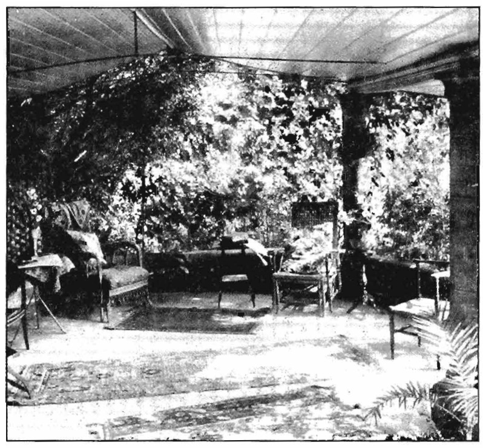
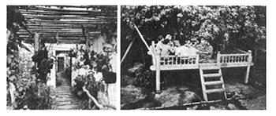
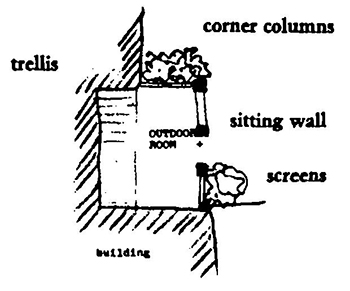

<section class="pattern-plate" aria-labelledby="t-outdoor-room">
<a href="/patterns">A Pattern Language</a> · <a href="/patterns#buildings">Buildings</a> · Pattern 163 · p. 764 · **
<h1 class="pattern-title" id="t-outdoor-room">Outdoor Room</h1><figure class="pattern-figure pl-figure"></figure><nav class="pattern-links" aria-label="Connections"><h2>Links to</h2><ul><li><a href="/patterns/public-outdoor-room">69 Public Outdoor Room</a></li><li><a href="/patterns/common-areas-at-the-heart">129 Common Areas At The Heart</a></li><li><a href="/patterns/farmhouse-kitchen">139 Farmhouse Kitchen</a></li><li><a href="/patterns/private-terrace-on-the-street">140 Private Terrace On The Street</a></li><li><a href="/patterns/sequence-of-sitting-spaces">142 Sequence Of Sitting Spaces</a></li><li><a href="/patterns/sunny-place">161 Sunny Place</a></li><li><a href="/patterns/connection-to-the-earth">168 Connection To The Earth</a></li><li><a href="/patterns/garden-wall">173 Garden Wall</a></li><li><a href="/patterns/trellised-walk">174 Trellised Walk</a></li><li><a href="/patterns/the-shape-of-indoor-space">191 The Shape Of Indoor Space</a></li><li><a href="/patterns/structure-follows-social-spaces">205 Structure Follows Social Spaces</a></li><li><a href="/patterns/column-place">226 Column Place</a></li><li><a href="/patterns/sitting-wall">243 Sitting Wall</a></li><li><a href="/patterns/canvas-roofs">244 Canvas Roofs</a></li></ul><h2>Linked from</h2><ul><li><a href="/patterns/positive-outdoor-space">106 Positive Outdoor Space</a></li><li><a href="/patterns/connected-buildings">108 Connected Buildings</a></li><li><a href="/patterns/car-connection">113 Car Connection</a></li><li><a href="/patterns/courtyards-which-live">115 Courtyards Which Live</a></li><li><a href="/patterns/roof-garden">118 Roof Garden</a></li><li><a href="/patterns/activity-pockets">124 Activity Pockets</a></li><li><a href="/patterns/indoor-sunlight">128 Indoor Sunlight</a></li><li><a href="/patterns/common-areas-at-the-heart">129 Common Areas At The Heart</a></li><li><a href="/patterns/short-passages">132 Short Passages</a></li><li><a href="/patterns/childrens-realm">137 Children’s Realm</a></li><li><a href="/patterns/private-terrace-on-the-street">140 Private Terrace On The Street</a></li><li><a href="/patterns/open-stairs">158 Open Stairs</a></li><li><a href="/patterns/building-edge">160 Building Edge</a></li><li><a href="/patterns/sunny-place">161 Sunny Place</a></li><li><a href="/patterns/opening-to-the-street">165 Opening To The Street</a></li><li><a href="/patterns/gallery-surround">166 Gallery Surround</a></li><li><a href="/patterns/six-foot-balcony">167 Six-Foot Balcony</a></li><li><a href="/patterns/connection-to-the-earth">168 Connection To The Earth</a></li><li><a href="/patterns/tree-places">171 Tree Places</a></li><li><a href="/patterns/trellised-walk">174 Trellised Walk</a></li><li><a href="/patterns/column-place">226 Column Place</a></li><li><a href="/patterns/seat-spots">241 Seat Spots</a></li><li><a href="/patterns/sitting-wall">243 Sitting Wall</a></li><li><a href="/patterns/canvas-roofs">244 Canvas Roofs</a></li><li><a href="/patterns/paving-with-cracks-between-the-stones">247 Paving With Cracks Between The Stones</a></li></ul></nav></section><article class="pattern-text" aria-label="The text of Outdoor Room">
765… every building has rooms where people stay and live and talk together—<a class="pl-ref" href="/patterns/common-areas-at-the-heart">COMMON AREAS AT THE HEART (129)</a>, <a class="pl-ref" href="/patterns/farmhouse-kitchen">FARMHOUSE KITCHEN (139)</a>, <a class="pl-ref" href="/patterns/sequence-of-sitting-spaces">SEQUENCE OF SITTING SPACES (142)</a>. Whenever possible, these rooms need to be embellished by a further “room” outdoors. This kind of outdoor room also helps to form a part of any <a class="pl-ref" href="/patterns/public-outdoor-room">PUBLIC OUTDOOR ROOM (69)</a>, HALF-HIDDEN GARDEN (HI), <a class="pl-ref" href="/patterns/private-terrace-on-the-street">PRIVATE TERRACE ON THE STEET (140)</a>, Or <a class="pl-ref" href="/patterns/sunny-place">SUNNY PLACE (161)</a>.

◆ ◆ ◆

<strong>A garden is the place for lying in the grass, swinging, croquet, growing flowers, throwing a ball for the dog. But there is another way of being outdoors: and its needs are not met by the garden at all.</strong>

For some moods, some times of day, some kinds of friendship, people need a place to eat, to sit in formal clothes, to drink, to talk together, to be still, and yet outdoors.

They need an outdoor room, a literal outdoor room—a partly enclosed space, outdoors, but enough like a room so that people behave there as they do in rooms, but with the added beauties of the sun, and wind, and smells, and rustling leaves, and crickets.

This need occurs everywhere. It is hardly too much to say that every building needs an outdoor room attached to it, between it and the garden; and more, that many of the special places in a garden—sunny places, terraces, gazebos—need to be made as outdoor rooms, as well.

The inspiration for this pattern comes from Bernard Rudofsky’s chapter, “The Conditioned Outdoor Room,” in <em>Behind the Picture Window</em> (New York: Oxford Press, 1955).

In a superbly layed out house-garden, one ought to be able to work and sleep, cook and eat, play and loaf. No doubt, this sounds specious to the confirmed indoor dweller and needs elaboration.

As a rule, the inhabitant of our climate makes no sallies into his immediate surroundings. His farthest outpost is the screened porch. The garden—if there is one—remains unoccupied between garden 766parties. Indeed, when he talks about the outdoors, he seldom means his garden. He does not think of gardens as potential living space…. Like the parlor of our grandmothers, the garden is an object of excessive care. Like the parlor, it is not meant to be lived in. In an age that puts a premium on usefulness this is most irregular. Paradoxical though it may sound, the use of glass walls in recent years alienated the garden. Even the “picture window,” as the domestic version of the show-window is called, has contributed to the estrangement between indoors and outdoors; the garden has become a spectator garden.

The historical concept of the house-garden is entirely different. Domestic gardens as we have known them through the centuries were valued mostly for their habitableness and privacy, two qualities that are conspicuously absent in contemporary gardens. Privacy, so little in demand these days, was indispensable to people with a taste for dignified living. The house-gardens of antiquity furnish us, even in their fragmentary and dilapidated state, perfect examples of how a diminutive and apparently negligible quantity of land can, with some ingenuity, be transformed into an oasis of delight. Miniature gardens though they were, they had all the ingredients of a happy environment.

These gardens were an essential part of the house; they were, mind you, contained <em>•within</em> the house. One can best describe them as rooms without ceilings. They were true outdoor living rooms, and invariably regarded as such by their inhabitants. The wall-and floor-materials of Roman gardens, for example, were no less lavish than those used in the interior part of the house. The combined use of stone mosaic, marble slabs, stucco reliefs, mural decorations from the simplest geometric patterns to the most elaborate murals established a mood particularly favorable to spiritual composure. As for the ceiling, there was always the sky in its hundred moods, (pp. 157–59)

An outdoor space becomes a special outdoor room when it is well enclosed with walls of the building, walls of foliage, columns, trellis, and sky; and when the outdoor room, together with an indoor space, forms a virtually continuous living area.

Here are several examples of outdoor rooms. Each one uses a different combination of elements to establish its enclosure; each one is related to its building in a slightly different way. Rudofsky gives many other examples in the book we have cited. For instance, he describes how a front lawn can be rebuilt to become an outdoor room.

<figure class="pl-figure"><figcaption><em>Two outdoor rooms</em>.</figcaption></figure>

Finally, a note. Since there is another pattern with a rather similar name—<a class="pl-ref" href="/patterns/public-outdoor-room">PUBLIC OUTDOOR ROOM (69)</a>—we want to remind you of the following distinction: in a certain sense, the two are opposites. An OUTDOOR ROOM has walls around it and is only partially roofed; while a PUBLIC OUTDOOR ROOM has a roof, but essentially no walls.

Therefore:

<strong>Build a place outdoors which has so much enclosure round it, that it takes on the feeling of a room, even though it is open to the sky. To do this, define it at the comers with columns, perhaps roof it partially with a trellis or a sliding canvas roof, and create “walls” around it, with fences, sitting walls, screens, hedges, or the exterior walls of the building itself.</strong>

767

<figure class="pl-figure"></figure>
◆ ◆ ◆

768This outdoor room is formed, most often, by free standing columns—<a class="pl-ref" href="/patterns/column-place">COLUMN PLACE (226)</a>, walls—<a class="pl-ref" href="/patterns/garden-wall">GARDEN WALL (173)</a>, low <a class="pl-ref" href="/patterns/sitting-wall">SITTING WALLS (243)</a>, perhaps a trellis overhead—<a class="pl-ref" href="/patterns/trellised-walk">TRELLISED WALK (174)</a>, or a translucent canvas awning—<a class="pl-ref" href="/patterns/canvas-roofs">CANVAS ROOFS (244)</a>, and a ground surface which helps to provide <a class="pl-ref" href="/patterns/connection-to-the-earth">CONNECTION TO THE EARTH (168)</a>. Like any other room, for its construction start with <a class="pl-ref" href="/patterns/the-shape-of-indoor-space">THE SHAPE OF INDOOR SPACE (191)</a> and <a class="pl-ref" href="/patterns/structure-follows-social-spaces">STRUCTURE FOLLOW SOCIAL SPACES (205)</a>….
</article>

Christopher Alexander, Sara Ishikawa and Murray Silverstein, with Max Jacobson, Ingrid Fiksdahl-King and Shlomo Angel, <cite>A Pattern Language</cite> (Oxford University Press, 1977), pattern 163, pp. 764–768. Text and illustrations from the <a href="https://github.com/natureoforder/sources">Nature of Order sources</a> reading edition, transcribed from the 1977 printing; report errors on <a href="https://github.com/natureoforder/alexander-wiki/issues">GitHub</a>.

<a href="/patterns/north-face">← 162 North Face</a> · <a href="/patterns">All 253 patterns</a> · <a href="/patterns/street-windows">164 Street Windows →</a>

