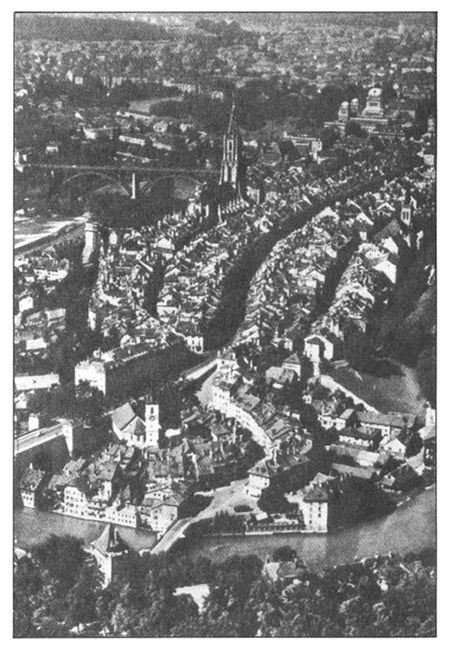
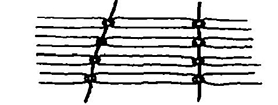
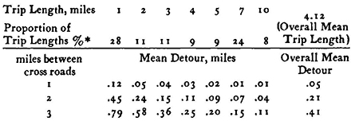
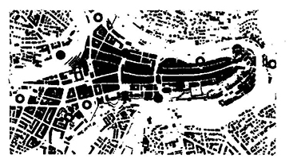
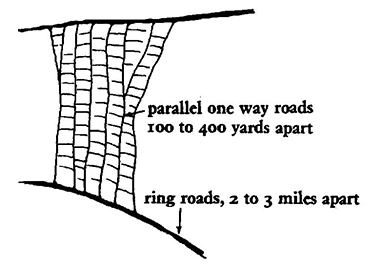

<section class="pattern-plate" aria-labelledby="t-parallel-roads">
<a href="/patterns">A Pattern Language</a> · <a href="/patterns#towns">Towns</a> · Pattern 23 · p. 126
<h1 class="pattern-title" id="t-parallel-roads">Parallel Roads</h1><figure class="pattern-figure pl-figure"></figure><nav class="pattern-links" aria-label="Connections"><h2>Links to</h2><ul><li><a href="/patterns/local-transport-areas">11 Local Transport Areas</a></li><li><a href="/patterns/subculture-boundary">13 Subculture Boundary</a></li><li><a href="/patterns/neighborhood-boundary">15 Neighborhood Boundary</a></li><li><a href="/patterns/ring-roads">17 Ring Roads</a></li><li><a href="/patterns/looped-local-roads">49 Looped Local Roads</a></li><li><a href="/patterns/t-junctions">50 T Junctions</a></li><li><a href="/patterns/green-streets">51 Green Streets</a></li><li><a href="/patterns/network-of-paths-and-cars">52 Network Of Paths And Cars</a></li><li><a href="/patterns/road-crossing">54 Road Crossing</a></li><li><a href="/patterns/raised-walk">55 Raised Walk</a></li></ul><h2>Linked from</h2><ul><li><a href="/patterns/local-transport-areas">11 Local Transport Areas</a></li><li><a href="/patterns/subculture-boundary">13 Subculture Boundary</a></li><li><a href="/patterns/identifiable-neighborhood">14 Identifiable Neighborhood</a></li><li><a href="/patterns/neighborhood-boundary">15 Neighborhood Boundary</a></li><li><a href="/patterns/mini-buses">20 Mini-Buses</a></li><li><a href="/patterns/access-to-water">25 Access To Water</a></li><li><a href="/patterns/shopping-street">32 Shopping Street</a></li><li><a href="/patterns/looped-local-roads">49 Looped Local Roads</a></li><li><a href="/patterns/network-of-paths-and-cars">52 Network Of Paths And Cars</a></li><li><a href="/patterns/road-crossing">54 Road Crossing</a></li><li><a href="/patterns/raised-walk">55 Raised Walk</a></li><li><a href="/patterns/children-in-the-city">57 Children In The City</a></li></ul></nav></section><article class="pattern-text" aria-label="The text of Parallel Roads">
127…in earlier patterns, we have proposed that cities should be subdivided into local transport areas, whose roads allow cars to move in and out from the ring roads, but strongly discourage internal movement across the area…<a class="pl-ref" href="/patterns/local-transport-areas">LOCAL TRANSPORT AREAS (11)</a>, <a class="pl-ref" href="/patterns/ring-roads">RING ROADS (17)</a>—and that these transport areas themselves be further subdivided into communities and neighborhoods, with the provision that all major roads are in the boundaries between communities and neighborhoods—<a class="pl-ref" href="/patterns/subculture-boundary">SUBCULTURE BOUNDARY (13)</a>, <a class="pl-ref" href="/patterns/neighborhood-boundary">NEIGHBORHOOD BOUNDARY (15)</a>. Now, what should the arrangement of these roads be like, to help the flow required by <a class="pl-ref" href="/patterns/local-transport-areas">LOCAL TRANSPORT AREAS (11)</a>, and to maintain the boundaries?

◆ ◆ ◆

<strong>The net-like pattern of streets is obsolete. Congestion is choking cities. Cars can average 6o miles per hour on free-ways, but trips across town have an average speed of only 10 to 15 miles per hour.</strong>

Certainly, in many cases, we want to get rid of can, not help them to go faster. This is fully discussed in <a class="pl-ref" href="/patterns/local-transport-areas">LOCAL TRANSPORT AREAS (11)</a>. But away from the areas where children play and people walk or use their bikes, there still need to be certain streets which carry can. The question is: How can these streets be designed to carry the can faster and without congestion?

It turns out that the loss of speed on present city streets is caused mainly by crossing movements: left-hand turns across traffic and four-way intersections. (G. F. Newell, “The Effect of Left Turns on the Capacity of Traffic Intersection,” <em>Quarterly of Applied Mathematics</em>, XVII, April 1959, pp. 67–76.)

To speed up traffic it is therefore necessary to create a network of major roads in which there are no four-way intersections, and no left-hand turns across traffic. This can easily be done if the major roads are alternating, one-way parallel roads, a few hundred feet apart, with smaller local roads opening off them, and the only connections between the parallel roads given by larger freeways crossing them at two- or three-mile intervals.

128

<figure class="pl-figure"><figcaption><em>Parallel roads</em>.</figcaption></figure>

This pattern has been discussed at considerable length in three papers (“The Pattern of Streets,” C. Alexander, <em>AIP Journal</em>, September 1966; Criticisms by D. Carson and P. Roosen-Runge, and Alexander’s reply, in <em>AIP Journal</em>, September 1967.) We refer the reader to these original papers for the full derivation of all the geometric details. Our present statement is a radically condensed version. Here we concentrate mainly on one puzzling question—that of detours—because this is for many people the most surprising aspect of the full analysis.

The pattern of parallel roads—since it contains no major cross streets—creates many detours not present in today’s net-like pattern. At first sight it seems likely that these detours will be impossibly large, However, in the papers mentioned above it is shown in detail that they are in fact perfectly reasonable. We summarize the argument below.

It is possible to calculate the probable detour for any trip of a given length through this proposed parallel road system as a function of the distance between the cross roads. Next, the probability of any given trip length may be obtained from actual studies of metropolitan auto trips. These two types of probabilities can finally be combined to yield an overall mean trip length and overall mean detours as shown below.

<figure class="pl-figure"></figure>
* Data for distribution of trip lengths was obtained from Ed-ward M. Hall, “Travel Characteristics of Two San Diego Suburban Developments,” <em>Highway Research Board Bulletin 2 039</em>, Washington, D. C., 1958, pp. 1–19, Figure 11. These data are typical for metropolitan areas all over the Western world.

129We see, therefore, that even with cross roads two miles apart, the lack of cross streets only increases trip lengths by 5 per cent. <em>At the same time, the average speed of trips will increase from 15 miles per kour to about 45 miles per !tour, a threefold increase</em>, The huge savings in time and fuel costs will more than offset the slight increase in distance.

Referring back for a moment to the table of detours, it will be noticed that the highest detours occur for the shortest trips. We have argued elsewhere—<a class="pl-ref" href="/patterns/local-transport-areas">LOCAL TRANSPORT AREAS (11)</a>—that to preserve the quality of the city’s environment it is necessary to discourage the use of the automobile for very short trips, and to encourage walking, bikes, buses, and horses instead. The pattern of parallel roads has precisely the feature which local transport areas need. It makes longer trips vastly more efficient, while discouraging the very short auto trips, and so provides the local transport area with just the internal structure which it needs to support its function.

Although this pattern seems strange at first sight, it is in fact already happening in many parts of the world and has already proved its worth. For example, Berne, Switzerland, is one of the few cities in Europe that does not suffer from acute traffic congestion. When one looks at a map of Berne, one can see that its old center is formed by five long parallel roads with almost no cross streets. We believe that it has little congestion in the old center precisely because it contains the pattern. In many large cities today, the same insight is being implemented piecemeal—in the form of more and more one-way streets: in New York the alternating one-way Avenues, in downtown San Francisco the one-way major streets.

<figure class="pl-figure"><figcaption><em>Berne’s five main parallel streets</em>.</figcaption></figure>

130Therefore:

<strong>Within a local transport area build no intersecting major roads at all; instead, build a system of parallel and alternating one-way roads to carry traffic to the <a class="pl-ref" href="/patterns/ring-roads">RING ROADS (17)</a>. In existing towns, create this structure piecemeal, by gradually making major streets one-way and closing cross streets. Keep parallel roads at least 100 yards apart (to make room for neighborhoods between them) and no more than 300 or 400 yards apart.</strong>

<figure class="pl-figure"></figure>
◆ ◆ ◆

The parallel roads are the only <em>through</em> roads in a <a class="pl-ref" href="/patterns/local-transport-areas">LOCAL TRANSPORT AREA (11)</a>. For access from the parallel roads to public buildings, house clusters, and individual houses use safe, slow, narrow roads which are not through roads—<a class="pl-ref" href="/patterns/looped-local-roads">LOOPED LOCAL ROADS (49)</a>, <a class="pl-ref" href="/patterns/green-streets">GREEN STREETS (51)</a>—and make their intersections with the parallel roads a “T”—<a class="pl-ref" href="/patterns/t-junctions">T JUNCTION (50)</a>. Keep the pedestrian path system at right angles to the parallel roads, and raised above them where the two must run parallel—<a class="pl-ref" href="/patterns/network-of-paths-and-cars">NETWORK OF PATHS AND CARS (52)</a>, <a class="pl-ref" href="/patterns/raised-walk">RAISED WALK (55)</a>. Provide a <a class="pl-ref" href="/patterns/road-crossing">ROAD CROSSING (54)</a> where paths cross the parallel roads.
</article>

Christopher Alexander, Sara Ishikawa and Murray Silverstein, with Max Jacobson, Ingrid Fiksdahl-King and Shlomo Angel, <cite>A Pattern Language</cite> (Oxford University Press, 1977), pattern 23, pp. 126–130. Text and illustrations from the <a href="https://github.com/natureoforder/sources">Nature of Order sources</a> reading edition, transcribed from the 1977 printing; report errors on <a href="https://github.com/natureoforder/alexander-wiki/issues">GitHub</a>.

<a href="/patterns/nine-per-cent-parking">← 22 Nine Per Cent Parking</a> · <a href="/patterns">All 253 patterns</a> · <a href="/patterns/sacred-sites">24 Sacred Sites →</a>

