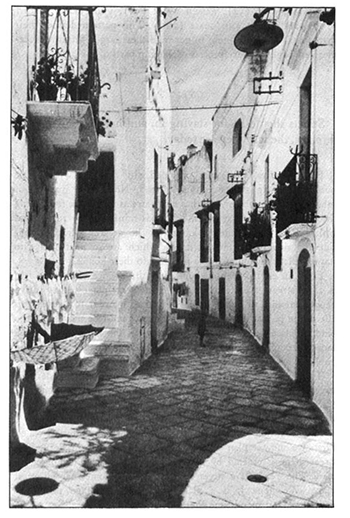
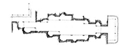
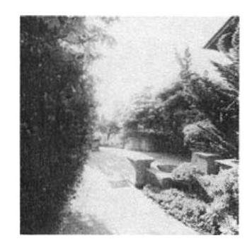
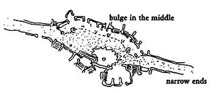

<section class="pattern-plate" aria-labelledby="t-path-shape">
<a href="/patterns">A Pattern Language</a> · <a href="/patterns#buildings">Buildings</a> · Pattern 121 · p. 589 · *
<h1 class="pattern-title" id="t-path-shape">Path Shape</h1><figure class="pattern-figure pl-figure"></figure><nav class="pattern-links" aria-label="Connections"><h2>Links to</h2><ul><li><a href="/patterns/promenade">31 Promenade</a></li><li><a href="/patterns/shopping-street">32 Shopping Street</a></li><li><a href="/patterns/network-of-paths-and-cars">52 Network Of Paths And Cars</a></li><li><a href="/patterns/raised-walk">55 Raised Walk</a></li><li><a href="/patterns/public-outdoor-room">69 Public Outdoor Room</a></li><li><a href="/patterns/pedestrian-street">100 Pedestrian Street</a></li><li><a href="/patterns/arcades">119 Arcades</a></li><li><a href="/patterns/paths-and-goals">120 Paths And Goals</a></li><li><a href="/patterns/building-fronts">122 Building Fronts</a></li><li><a href="/patterns/pedestrian-density">123 Pedestrian Density</a></li><li><a href="/patterns/activity-pockets">124 Activity Pockets</a></li><li><a href="/patterns/stair-seats">125 Stair Seats</a></li><li><a href="/patterns/street-windows">164 Street Windows</a></li></ul><h2>Linked from</h2><ul><li><a href="/patterns/promenade">31 Promenade</a></li><li><a href="/patterns/degrees-of-publicness">36 Degrees Of Publicness</a></li><li><a href="/patterns/network-of-paths-and-cars">52 Network Of Paths And Cars</a></li><li><a href="/patterns/bus-stop">92 Bus Stop</a></li><li><a href="/patterns/pedestrian-street">100 Pedestrian Street</a></li><li><a href="/patterns/roof-garden">118 Roof Garden</a></li><li><a href="/patterns/paths-and-goals">120 Paths And Goals</a></li><li><a href="/patterns/building-fronts">122 Building Fronts</a></li><li><a href="/patterns/activity-pockets">124 Activity Pockets</a></li><li><a href="/patterns/stair-seats">125 Stair Seats</a></li><li><a href="/patterns/something-roughly-in-the-middle">126 Something Roughly In The Middle</a></li><li><a href="/patterns/trellised-walk">174 Trellised Walk</a></li><li><a href="/patterns/seat-spots">241 Seat Spots</a></li><li><a href="/patterns/paving-with-cracks-between-the-stones">247 Paving With Cracks Between The Stones</a></li></ul></nav></section><article class="pattern-text" aria-label="The text of Path Shape">
590… paths of various kinds have been defined by larger patterns <a class="pl-ref" href="/patterns/promenade">PROMENADE (31)</a>, <a class="pl-ref" href="/patterns/shopping-street">SHOPPING STREET (32)</a>, <a class="pl-ref" href="/patterns/network-of-paths-and-cars">NETWORK OF PATHS AND CARS (52)</a>, <a class="pl-ref" href="/patterns/raised-walk">RAISED WALK (55)</a>, <a class="pl-ref" href="/patterns/pedestrian-street">PEDESTRIAN STREET (100)</a>, and <a class="pl-ref" href="/patterns/paths-and-goals">PATHS AND GOALS (120)</a>. This pattern defines their shape: and it can also help to generate these larger patterns piecemeal, through the very process of shaping parts of the path.

◆ ◆ ◆

<strong>Streets should be for staying in, and not just for moving through, the way they are today.</strong>

For centuries, the street provided city dwellers with usable public space right outside their houses. Now, in a number of subtle ways, the modern city has made streets which are for “going through,” not for “staying in.” This is reinforced by regulations which make it a crime to loiter, by the greater attractions inside the side itself, and by streets which are so unattractive to stay in, that they almost force people into their houses.

From an environmental standpoint, the essence of the problem is this: streets are “centrifugal” not “centripetal”: they drive people out instead of attracting them in. In order to combat this effect, the pedestrian world outside houses must be made into the kind of place where you stay, rather than the kind of place you move through. It must, in short, be made like a kind of outside public room, with a greater sense of enclosure than a street.

This can be accomplished if we make residential pedestrian streets subtly convex in plan with seats and galleries around the edges, and even sometimes roof the streets with beams or trellis-work.

Here are two examples of this pattern, at two different scales. First, we show a plan of ours for fourteen houses in Peru. The street shape is created by gradually stepping back the houses, in plan. The result is a street with a positive, somewhat elliptical shape. We hope it is a place that will encourage people to slow down and spend time there.

591

<figure class="pl-figure"><figcaption><em>The •path shape formed by fourteen houses</em>.</figcaption></figure>

The second example is a <em>very</em> small path, cutting through a neighborhood in the hills of Berkeley. Again, the shape swells out subtly, just in those places where it is good to pause and sit.

<figure class="pl-figure"><figcaption><em>A spot along a path in the hills of Berkeley</em>.</figcaption></figure>

Therefore:

<strong>Make a bulge in the middle of a public path, and make the ends narrower, so that the path forms an enclosure which is a place to stay, not just a place to pass through.</strong>

<figure class="pl-figure"></figure>
592

◆ ◆ ◆

Above all, to create the shape of the path, move the building fronts into the right positions, and on no acount allow a set-back between the building and the path—<a class="pl-ref" href="/patterns/building-fronts">BUILDING FRONTS (122)</a>; decide on the appropriate area for the “bulge” by using the arithmetic of <a class="pl-ref" href="/patterns/pedestrian-density">PEDESTRIAN DENSITY (123)</a>; then form the details of the bulge with <a class="pl-ref" href="/patterns/arcades">ARCADES (119)</a>, <a class="pl-ref" href="/patterns/activity-pockets">ACTIVITY POCKETS (124)</a> and <a class="pl-ref" href="/patterns/stair-seats">STAIR SEATS (125)</a>; perhaps even with a <a class="pl-ref" href="/patterns/public-outdoor-room">PUBLIC OUTDOOR ROOM (69)</a>; and give as much life as you can to the path all along its length with windows—<a class="pl-ref" href="/patterns/street-windows">STREET WINDOWS (164)</a>….
</article>

Christopher Alexander, Sara Ishikawa and Murray Silverstein, with Max Jacobson, Ingrid Fiksdahl-King and Shlomo Angel, <cite>A Pattern Language</cite> (Oxford University Press, 1977), pattern 121, pp. 589–592. Text and illustrations from the <a href="https://github.com/natureoforder/sources">Nature of Order sources</a> reading edition, transcribed from the 1977 printing; report errors on <a href="https://github.com/natureoforder/alexander-wiki/issues">GitHub</a>.

<a href="/patterns/paths-and-goals">← 120 Paths And Goals</a> · <a href="/patterns">All 253 patterns</a> · <a href="/patterns/building-fronts">122 Building Fronts →</a>

