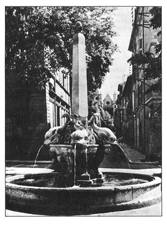
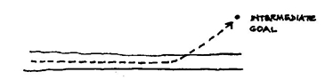
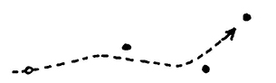
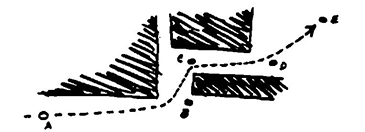
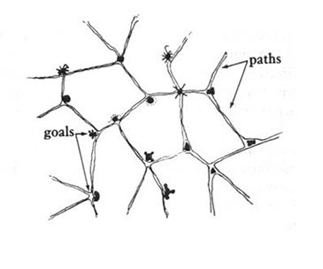

<section class="pattern-plate" aria-labelledby="t-paths-and-goals">
<a href="/patterns">A Pattern Language</a> · <a href="/patterns#buildings">Buildings</a> · Pattern 120 · p. 585 · *
<h1 class="pattern-title" id="t-paths-and-goals">Paths And Goals</h1><figure class="pattern-figure pl-figure"></figure><nav class="pattern-links" aria-label="Connections"><h2>Links to</h2><ul><li><a href="/patterns/degrees-of-publicness">36 Degrees Of Publicness</a></li><li><a href="/patterns/network-of-paths-and-cars">52 Network Of Paths And Cars</a></li><li><a href="/patterns/building-complex">95 Building Complex</a></li><li><a href="/patterns/circulation-realms">98 Circulation Realms</a></li><li><a href="/patterns/family-of-entrances">102 Family Of Entrances</a></li><li><a href="/patterns/positive-outdoor-space">106 Positive Outdoor Space</a></li><li><a href="/patterns/wings-of-light">107 Wings Of Light</a></li><li><a href="/patterns/main-entrance">110 Main Entrance</a></li><li><a href="/patterns/arcades">119 Arcades</a></li><li><a href="/patterns/path-shape">121 Path Shape</a></li><li><a href="/patterns/something-roughly-in-the-middle">126 Something Roughly In The Middle</a></li><li><a href="/patterns/tree-places">171 Tree Places</a></li><li><a href="/patterns/seat-spots">241 Seat Spots</a></li><li><a href="/patterns/raised-flowers">245 Raised Flowers</a></li><li><a href="/patterns/paving-with-cracks-between-the-stones">247 Paving With Cracks Between The Stones</a></li></ul><h2>Linked from</h2><ul><li><a href="/patterns/activity-nodes">30 Activity Nodes</a></li><li><a href="/patterns/network-of-paths-and-cars">52 Network Of Paths And Cars</a></li><li><a href="/patterns/public-outdoor-room">69 Public Outdoor Room</a></li><li><a href="/patterns/circulation-realms">98 Circulation Realms</a></li><li><a href="/patterns/roof-garden">118 Roof Garden</a></li><li><a href="/patterns/path-shape">121 Path Shape</a></li><li><a href="/patterns/activity-pockets">124 Activity Pockets</a></li><li><a href="/patterns/something-roughly-in-the-middle">126 Something Roughly In The Middle</a></li><li><a href="/patterns/zen-view">134 Zen View</a></li><li><a href="/patterns/fruit-trees">170 Fruit Trees</a></li><li><a href="/patterns/trellised-walk">174 Trellised Walk</a></li><li><a href="/patterns/raised-flowers">245 Raised Flowers</a></li></ul></nav></section><article class="pattern-text" aria-label="The text of Paths And Goals">
586… once buildings and arcades and open spaces have been roughly fixed by <a class="pl-ref" href="/patterns/building-complex">BUILDING COMPLEX (95)</a>, <a class="pl-ref" href="/patterns/wings-of-light">WINGS OF LIGHT (107)</a>, <a class="pl-ref" href="/patterns/positive-outdoor-space">POSITIVE OUTDOOR SPACE (106)</a>, <a class="pl-ref" href="/patterns/arcades">ARCADES (119)</a>—it is time to pay attention to the paths which run between the buildings. This pattern shapes these paths and also helps to give more detailed form to <a class="pl-ref" href="/patterns/degrees-of-publicness">DEGREES OF PUBLICNESS (36)</a>, <a class="pl-ref" href="/patterns/network-of-paths-and-cars">NETWORK OF PATHS AND CARS (52)</a>, and <a class="pl-ref" href="/patterns/circulation-realms">CIRCULATION REALMS (98)</a>.

◆ ◆ ◆

<strong>The layout of paths will seem right and comfortable only when it is compatible with the process of walking. And the process of walking is far more subtle than one might imagine.</strong>

Essentially there are three complementary processes:

1. As you walk along you scan the landscape for intermediate destinations—the furthest points along the path which you can see. You try, more or less, to walk in a straight line toward these points. This naturally has the effect that you will cut corners and take “diagonal” paths, since these are the ones which often form straight lines between your present position and the point which you are making for.

<figure class="pl-figure"><figcaption><em>Path to a goal</em>.</figcaption></figure>

2. These intermediate destinations keep changing. The further you walk, the more you can see around the corner. If you always walk straight toward this furthest point and the furthest point keeps changing, you will actually move in a slow curve, like a missile tracking a moving target.

587

<figure class="pl-figure"><figcaption><em>Series of goals</em>.</figcaption></figure>

3. Since you do not want to keep changing direction while you walk and do not want to spend your whole time re-calculating your best direction of travel, you arrange your walking process in such a way that you pick a temporary “goal”—some clearly visible landmark—which is more or less in the direction you want to take and then walk in a straight line toward it for a hundred yards, then, as you get close, pick another new goal, once more a hundred yards further on, and walk toward it…. You do this so that in between, you can talk, think, daydream, smell the spring, without having to think about your walking direction

<figure class="pl-figure"><figcaption><em>The actual path</em>.</figcaption></figure>

In the diagram above a person begins at A and heads for point E. Along the way, his intermediate goals are points B, C, and D. Since he is trying to walk in a roughly straight line toward E, his intermediate goal changes from B to C, as soon as C is visible; and from C to D, as soon as D is visible.

The proper arrangements of paths is one with enough intermediate goals, to make this process workable. If there aren’t enough intermediate goals, the process of walking becomes more difficult, and consumes unnecessary emotional energy.

Therefore:

<strong>To lay out paths, first place goals at natural points of interest Then connect the goals to one another to form the 588paths. The paths may be straight, or gently curving between goals; their paving should swell around the goal. The goals should never be more than a few hundred feet apart.</strong>

<figure class="pl-figure"></figure>
◆ ◆ ◆

All the ordinary things in the outdoors—trees, fountains, entrances, gateways, seats, statues, a swing, an outdoor room—can be the goals. See <a class="pl-ref" href="/patterns/family-of-entrances">FAMILY OF ENTRANCES (102)</a>, <a class="pl-ref" href="/patterns/main-entrance">MAIN ENTRANCE (110)</a>, <a class="pl-ref" href="/patterns/tree-places">TREE PLACES (171)</a>, <a class="pl-ref" href="/patterns/seat-spots">SEAT SPOTS (241)</a>, <a class="pl-ref" href="/patterns/raised-flowers">RAISED FLOWERS (245)</a>; build the “goals” according to the rules of <a class="pl-ref" href="/patterns/something-roughly-in-the-middle">SOMETHING ROUGHLY IN THE MIDDLE (126)</a>; and shape the paths according to <a class="pl-ref" href="/patterns/path-shape">PATH SHAPE (121)</a>. To pave the paths use <a class="pl-ref" href="/patterns/paving-with-cracks-between-the-stones">PAVING WITH CRACKS BETWEEN THE STONES (247)</a>….
</article>

Christopher Alexander, Sara Ishikawa and Murray Silverstein, with Max Jacobson, Ingrid Fiksdahl-King and Shlomo Angel, <cite>A Pattern Language</cite> (Oxford University Press, 1977), pattern 120, pp. 585–588. Text and illustrations from the <a href="https://github.com/natureoforder/sources">Nature of Order sources</a> reading edition, transcribed from the 1977 printing; report errors on <a href="https://github.com/natureoforder/alexander-wiki/issues">GitHub</a>.

<a href="/patterns/arcades">← 119 Arcades</a> · <a href="/patterns">All 253 patterns</a> · <a href="/patterns/path-shape">121 Path Shape →</a>

