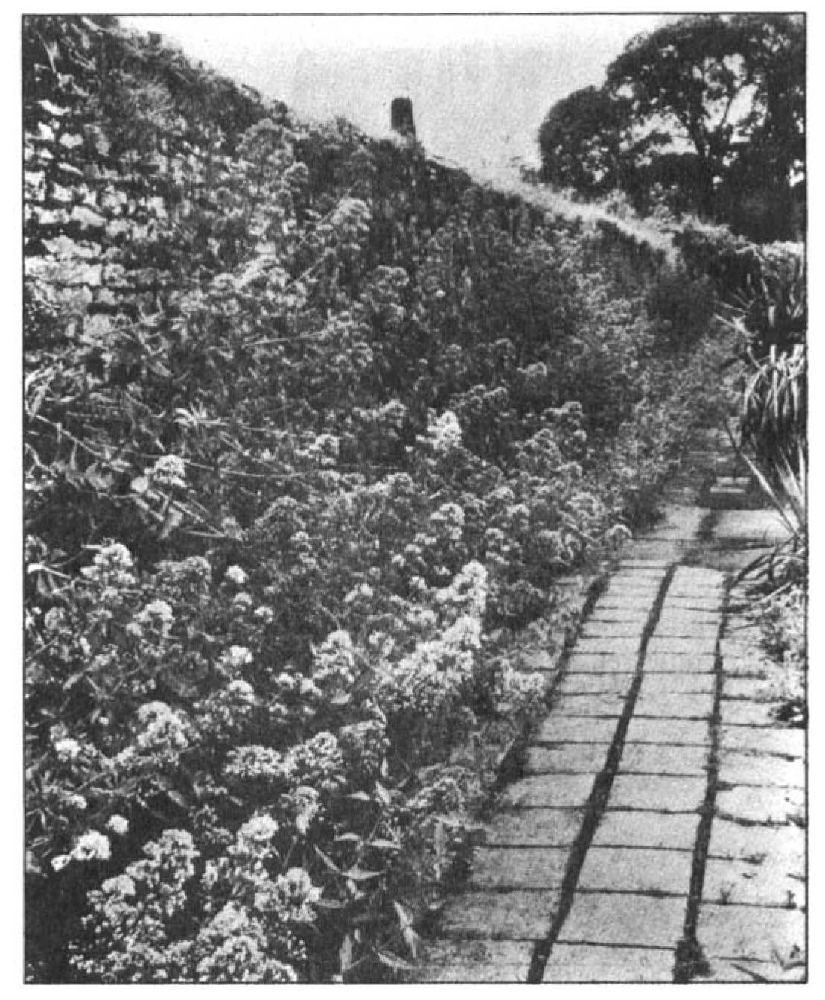
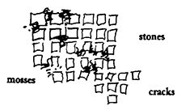

<section class="pattern-plate" aria-labelledby="t-paving-with-cracks-between-the-stones">
<a href="/patterns">A Pattern Language</a> · <a href="/patterns#construction">Construction</a> · Pattern 247 · p. 1138 · **
<h1 class="pattern-title" id="t-paving-with-cracks-between-the-stones">Paving With Cracks Between The Stones</h1><figure class="pattern-figure pl-figure"></figure><nav class="pattern-links" aria-label="Connections"><h2>Links to</h2><ul><li><a href="/patterns/green-streets">51 Green Streets</a></li><li><a href="/patterns/path-shape">121 Path Shape</a></li><li><a href="/patterns/private-terrace-on-the-street">140 Private Terrace On The Street</a></li><li><a href="/patterns/outdoor-room">163 Outdoor Room</a></li><li><a href="/patterns/connection-to-the-earth">168 Connection To The Earth</a></li><li><a href="/patterns/terraced-slope">169 Terraced Slope</a></li><li><a href="/patterns/soft-tile-and-brick">248 Soft Tile And Brick</a></li></ul><h2>Linked from</h2><ul><li><a href="/patterns/paths-and-goals">120 Paths And Goals</a></li><li><a href="/patterns/connection-to-the-earth">168 Connection To The Earth</a></li><li><a href="/patterns/trellised-walk">174 Trellised Walk</a></li><li><a href="/patterns/half-inch-trim">240 Half-Inch Trim</a></li><li><a href="/patterns/soft-tile-and-brick">248 Soft Tile And Brick</a></li></ul></nav></section><article class="pattern-text" aria-label="The text of Paving With Cracks Between The Stones">
1139… many patterns call for paths and terraces and places where the outdoor areas around a building feel connected to the earth—<a class="pl-ref" href="/patterns/green-streets">GREEN STREETS (51)</a>, <a class="pl-ref" href="/patterns/path-shape">PATH SHAPE (121)</a>, <a class="pl-ref" href="/patterns/private-terrace-on-the-street">PRIVATE TERRACE ON THE STREET (140)</a>, <a class="pl-ref" href="/patterns/outdoor-room">OUTDOOR ROOM (163)</a>, CONNECTION TO THE EARTH (l68), <a class="pl-ref" href="/patterns/terraced-slope">TERRACED SLOPE (169)</a>. This pattern provides a way of building the ground surface that makes these larger patterns come to life.

◆ ◆ ◆

<strong>Asphalt and concrete surfaces outdoors are easy to wash down, but they do nothing for us, nothing for the paths, and nothing for the rainwater and plants.</strong>

Look at a simple path, made by laying bricks or paving stones directly in the earth, with ample cracks between the stones. It is good to walk on, good for the plants, good for the passage of time, good for the rain. You walk from stone to stone, and feel the earth directly under foot. It does not crack, because as the earth settles, the stones move with the earth and gradually take on a rich uneven character. As time goes by, the very age and history of all the moments on that path are almost recorded in its slight unevenness. Plants and mosses and small flowers grow between the cracks. The cracks also help preserve the delicate ecology of worms and insects and beetles and the variety of plant species. And when it rains, the water goes directly to the ground; there is no concentrated run-off, no danger of erosion, no loss of water in the ground around the path.

All these are good reasons to set paving stones loosely. As for the flat, smooth, hard concrete and asphalt surfaces, they have almost nothing to recommend them. They are built when people forget these small advantages that come about when paving is made out of individual stones with cracks between the stones.

Therefore:

<strong>On paths and terraces, lay paving stones with a I inch crack between the stones, so that grass and mosses and 1140small (lowers can grow between the stones. Lay the stones directly into earth, not into mortar, and, of course, use no cement or mortar in between the stones.</strong>

<figure class="pl-figure"></figure>
◆ ◆ ◆

Use paving with cracks, to help make paths and terraces which change and show the passage of time and so help people feel the earth beneath their feet—<a class="pl-ref" href="/patterns/connection-to-the-earth">CONNECTION TO THE EARTH (168)</a>; the stones themselves are best if they are simple soft baked tiles—<a class="pl-ref" href="/patterns/soft-tile-and-brick">SOFT TILE AND BRICK (248)</a>….
</article>

Christopher Alexander, Sara Ishikawa and Murray Silverstein, with Max Jacobson, Ingrid Fiksdahl-King and Shlomo Angel, <cite>A Pattern Language</cite> (Oxford University Press, 1977), pattern 247, pp. 1138–1140. Text and illustrations from the <a href="https://github.com/natureoforder/sources">Nature of Order sources</a> reading edition, transcribed from the 1977 printing; report errors on <a href="https://github.com/natureoforder/alexander-wiki/issues">GitHub</a>.

<a href="/patterns/climbing-plants">← 246 Climbing Plants</a> · <a href="/patterns">All 253 patterns</a> · <a href="/patterns/soft-tile-and-brick">248 Soft Tile And Brick →</a>

