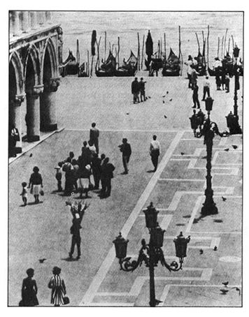
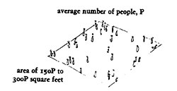

<section class="pattern-plate" aria-labelledby="t-pedestrian-density">
<a href="/patterns">A Pattern Language</a> · <a href="/patterns#buildings">Buildings</a> · Pattern 123 · p. 596 · *
<h1 class="pattern-title" id="t-pedestrian-density">Pedestrian Density</h1><figure class="pattern-figure pl-figure"></figure><nav class="pattern-links" aria-label="Connections"><h2>Links to</h2><ul><li><a href="/patterns/promenade">31 Promenade</a></li><li><a href="/patterns/street-cafe">88 Street Cafe</a></li><li><a href="/patterns/pedestrian-street">100 Pedestrian Street</a></li><li><a href="/patterns/building-thoroughfare">101 Building Thoroughfare</a></li><li><a href="/patterns/activity-pockets">124 Activity Pockets</a></li><li><a href="/patterns/stair-seats">125 Stair Seats</a></li><li><a href="/patterns/private-terrace-on-the-street">140 Private Terrace On The Street</a></li><li><a href="/patterns/street-windows">164 Street Windows</a></li><li><a href="/patterns/opening-to-the-street">165 Opening To The Street</a></li></ul><h2>Linked from</h2><ul><li><a href="/patterns/density-rings">29 Density Rings</a></li><li><a href="/patterns/promenade">31 Promenade</a></li><li><a href="/patterns/degrees-of-publicness">36 Degrees Of Publicness</a></li><li><a href="/patterns/local-town-hall">44 Local Town Hall</a></li><li><a href="/patterns/small-public-squares">61 Small Public Squares</a></li><li><a href="/patterns/pedestrian-street">100 Pedestrian Street</a></li><li><a href="/patterns/building-thoroughfare">101 Building Thoroughfare</a></li><li><a href="/patterns/roof-garden">118 Roof Garden</a></li><li><a href="/patterns/path-shape">121 Path Shape</a></li></ul></nav></section><article class="pattern-text" aria-label="The text of Pedestrian Density">
597… in various places there are pedestrian areas, paved so that people will congregate there or walk up and down—<a class="pl-ref" href="/patterns/promenade">PROMENADE (31)</a>, SMALL PUBLIC SQUARES (6l), <a class="pl-ref" href="/patterns/pedestrian-street">PEDESTRIAN STREET (100)</a>, <a class="pl-ref" href="/patterns/building-thoroughfare">BUILDING THOROUCGFARE (101)</a>, PATH SHAPE (l2l). It it essential to limit the sizes of these places very strictly, especially the size of areas which are paved, so that they stay alive.

◆ ◆ ◆

<strong>Many of our modern public squares, though intended as lively plazas, are in fact deserted and dead.</strong>

In this pattern, we call attention to the relationship between the number of people in a pedestrian area, the size of the area, and a subjective estimate of the extent to which the area is alive.

We do not say categorically that the number of people per square foot <em>controls</em> the apparent liveliness of a pedestrian area. Other factors—the nature of the land around the edge, the grouping of people, what the people are doing—obviously contribute greatly. People who are running, especially if they are making noise, add to the liveliness. A small group attracted to a couple of folk singers in a plaza give much more life to the place than the same number sunning on the grass.

However, the number of square feet per person does give a reasonably crude estimate of the liveliness of a space. Christie Coffin’s observations show the following figures for various public places in and around San Francisco. Her estimate of the liveliness of the places is given in the right-hand column.

<table>
<tbody>
<tr>
<td></td>
<td style="text-align: left;"><em>Sq. ft. per person</em></td>
<td></td>
</tr>
<tr>
<td>Golden Gate Plaza, noon:</td>
<td style="text-align: left;">1000</td>
<td>Dead</td>
</tr>
<tr>
<td>Fresno Mall:</td>
<td style="text-align: left;">100</td>
<td>Alive</td>
</tr>
<tr>
<td>Sproul Plaza, daytime:</td>
<td style="text-align: left;">150</td>
<td>Alive</td>
</tr>
<tr>
<td>Sproul Plaza, evening:</td>
<td style="text-align: left;">1000</td>
<td>Dead</td>
</tr>
<tr>
<td>Union Square, central part:</td>
<td style="text-align: left;">600</td>
<td>Half-dead</td>
</tr>
</tbody>
</table>

Although these subjective estimates are clearly open to question, they suggest the following rule of thumb: At 150 square feet per person, an area is lively. If there are more than 500 square feet per person, the area begins to be dead.

598Even if these figures are only correct to within an order of magnitude, we can use them to shape public pedestrian areas—squares, indoor streets, shopping streets, promenades.

To use the pattern it is essential to make a rough estimate of the number of people that are <em>typically</em> found in a given space at any moment of its use. In the front area of a market, for example, we might find that typically there are three people lingering and walking. Then we shall want the front of this market to form a little square, no larger than 450 square feet. If we estimate a pedestrian street will typically contain 35 people window shopping and walking, we shall want the street to form an enclosure of roughly 5000 square feet. (For an example of this calculation in a more complicated case—the case of a square in a public building that has yet to be built—see <em>A Pattern Language Which Generates Multi-Service Centers</em>, Alexander, Ishikawa, Silver-stein, Center for Environmental Structure, 1968, p. 148.)

Therefore:

<strong>For public squares, courts, pedestrian streets, any place where crowds are drawn together, estimate the mean number of people in the place at any given moment (P), and make the area of the place between 150P and 300P square feet</strong>

<figure class="pl-figure"></figure>
◆ ◆ ◆

Embellish the density and feeling of life with areas at the edge which are especially crowded—<a class="pl-ref" href="/patterns/street-cafe">STREET CAFE (88)</a>, <a class="pl-ref" href="/patterns/activity-pockets">ACTIVITY POCKETS (124)</a>, <a class="pl-ref" href="/patterns/stair-seats">STAIR SEATS (125)</a>, <a class="pl-ref" href="/patterns/private-terrace-on-the-street">PRIVATE TERRACE ON THE STREET (140)</a>, BUILDING EDGE (l60), <a class="pl-ref" href="/patterns/street-windows">STREET WINDOWS (164)</a>, <a class="pl-ref" href="/patterns/opening-to-the-street">OPENING TO THE STREET (165)</a>, GALLERY SURROUND (l66)….
</article>

Christopher Alexander, Sara Ishikawa and Murray Silverstein, with Max Jacobson, Ingrid Fiksdahl-King and Shlomo Angel, <cite>A Pattern Language</cite> (Oxford University Press, 1977), pattern 123, pp. 596–598. Text and illustrations from the <a href="https://github.com/natureoforder/sources">Nature of Order sources</a> reading edition, transcribed from the 1977 printing; report errors on <a href="https://github.com/natureoforder/alexander-wiki/issues">GitHub</a>.

<a href="/patterns/building-fronts">← 122 Building Fronts</a> · <a href="/patterns">All 253 patterns</a> · <a href="/patterns/activity-pockets">124 Activity Pockets →</a>

