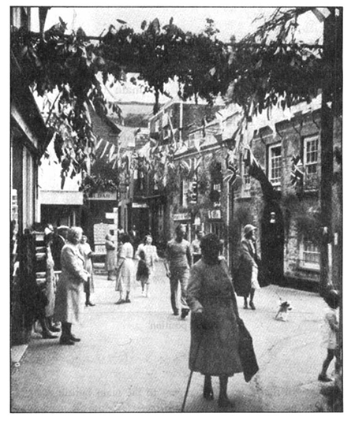
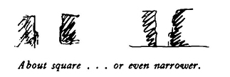
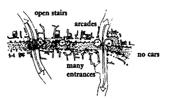

<section class="pattern-plate" aria-labelledby="t-pedestrian-street">
<a href="/patterns">A Pattern Language</a> · <a href="/patterns#buildings">Buildings</a> · Pattern 100 · p. 488 · **
<h1 class="pattern-title" id="t-pedestrian-street">Pedestrian Street</h1><figure class="pattern-figure pl-figure"></figure><nav class="pattern-links" aria-label="Connections"><h2>Links to</h2><ul><li><a href="/patterns/promenade">31 Promenade</a></li><li><a href="/patterns/shopping-street">32 Shopping Street</a></li><li><a href="/patterns/row-houses">38 Row Houses</a></li><li><a href="/patterns/housing-hill">39 Housing Hill</a></li><li><a href="/patterns/university-as-a-marketplace">43 University As A Marketplace</a></li><li><a href="/patterns/market-of-many-shops">46 Market Of Many Shops</a></li><li><a href="/patterns/network-of-paths-and-cars">52 Network Of Paths And Cars</a></li><li><a href="/patterns/raised-walk">55 Raised Walk</a></li><li><a href="/patterns/building-complex">95 Building Complex</a></li><li><a href="/patterns/circulation-realms">98 Circulation Realms</a></li><li><a href="/patterns/family-of-entrances">102 Family Of Entrances</a></li><li><a href="/patterns/arcades">119 Arcades</a></li><li><a href="/patterns/path-shape">121 Path Shape</a></li><li><a href="/patterns/pedestrian-density">123 Pedestrian Density</a></li><li><a href="/patterns/private-terrace-on-the-street">140 Private Terrace On The Street</a></li><li><a href="/patterns/open-stairs">158 Open Stairs</a></li><li><a href="/patterns/street-windows">164 Street Windows</a></li><li><a href="/patterns/opening-to-the-street">165 Opening To The Street</a></li><li><a href="/patterns/gallery-surround">166 Gallery Surround</a></li><li><a href="/patterns/six-foot-balcony">167 Six-Foot Balcony</a></li></ul><h2>Linked from</h2><ul><li><a href="/patterns/activity-nodes">30 Activity Nodes</a></li><li><a href="/patterns/promenade">31 Promenade</a></li><li><a href="/patterns/shopping-street">32 Shopping Street</a></li><li><a href="/patterns/degrees-of-publicness">36 Degrees Of Publicness</a></li><li><a href="/patterns/university-as-a-marketplace">43 University As A Marketplace</a></li><li><a href="/patterns/carnival">58 Carnival</a></li><li><a href="/patterns/office-connections">82 Office Connections</a></li><li><a href="/patterns/shopfront-schools">85 Shopfront Schools</a></li><li><a href="/patterns/sleeping-in-public">94 Sleeping In Public</a></li><li><a href="/patterns/circulation-realms">98 Circulation Realms</a></li><li><a href="/patterns/building-thoroughfare">101 Building Thoroughfare</a></li><li><a href="/patterns/arcades">119 Arcades</a></li><li><a href="/patterns/path-shape">121 Path Shape</a></li><li><a href="/patterns/pedestrian-density">123 Pedestrian Density</a></li><li><a href="/patterns/activity-pockets">124 Activity Pockets</a></li><li><a href="/patterns/private-terrace-on-the-street">140 Private Terrace On The Street</a></li><li><a href="/patterns/open-stairs">158 Open Stairs</a></li><li><a href="/patterns/gallery-surround">166 Gallery Surround</a></li><li><a href="/patterns/sitting-wall">243 Sitting Wall</a></li></ul></nav></section><article class="pattern-text" aria-label="The text of Pedestrian Street">
489… the earlier patterns—<a class="pl-ref" href="/patterns/promenade">PROMENADE (31)</a>, <a class="pl-ref" href="/patterns/shopping-street">SHOPPING STREET (32)</a> and <a class="pl-ref" href="/patterns/network-of-paths-and-cars">NETWORK OF PATHS AND CARS (52)</a>, all call for dense pedestrian streets; <a class="pl-ref" href="/patterns/row-houses">ROW HOUSES (38)</a>, <a class="pl-ref" href="/patterns/housing-hill">HOUSING HILL (39)</a>, <a class="pl-ref" href="/patterns/university-as-a-marketplace">UNIVERSITY AS A MARKETPLACE (43)</a>, <a class="pl-ref" href="/patterns/market-of-many-shops">MARKET OF MANY SHOPS (46)</a>, all do the same; and within the <a class="pl-ref" href="/patterns/building-complex">BUILDING COMPLEX (95)</a>, <a class="pl-ref" href="/patterns/circulation-realms">CIRCULATION REALMS (98)</a> calls for the same. As you build a pedestrian street, make sure you place it so that it helps to generate a <a class="pl-ref" href="/patterns/network-of-paths-and-cars">NETWORK OF PATHS AND CARS (52)</a>, <a class="pl-ref" href="/patterns/raised-walk">RAISED WALKS (55)</a>, and <a class="pl-ref" href="/patterns/circulation-realms">CIRCULATION REALMS (98)</a> in the town around it.

◆ ◆ ◆

<strong>The simple social intercourse created when people rub shoulders in public is one of the most essential kinds of social “glue” in society.</strong>

In today’s society this situation, and therefore this glue, is largely missing. It is missing in large part because so much of the actual process of movement is now taking place in indoor corridors and lobbies, instead of outdoors. This happens partly because the cars have taken over streets, and made them uninhabitable, and partly because the corridors, which have been built in response, encourage the same process. But it is doubly damaging in its effect.

It is damaging because it robs the streets of people. Most of the moving about which people do is indoors—hence lost to the street; the street becomes abandoned and dangerous.

And it is damaging because the indoor lobbies and corridors are most often dead. This happens partly because indoor space is not as public as outdoor space; and partly because, in a multi-story building each corridor carries a lower density of traffic than a public outdoor street. It is therefore unpleasant, even unnerving, to move through them; people in them are in no state to generate, or benefit from, social intercourse.

To recreate the social intercourse of public movement, as far as possible, the movement between rooms, offices, departments, buildings, must actually be outdoors, on sheltered walks, arcades, paths, 490streets, which are truly public and separate from cars. Individual wings, small buildings, departments must as often as possible have their own entrances—so that the number of entrances onto the street increases and life comes back to the street.

In short, the solution to these two problems we have mentioned—the streets infected by cars and the bland corridors—is the pedestrian street. Pedestrian streets are both places to walk along (from car, bus, or train to one’s destination) and places to pass through (between apartments, shops, offices, services, classes).

To function properly, pedestrian streets need two special properties. First, of course, no cars; but frequent crossings by streets with traffic, see <a class="pl-ref" href="/patterns/network-of-paths-and-cars">NETWORK OF PATHS AND CARS (52)</a> : deliveries and other activities which make it essential to bring cars and trucks onto the pedestrian street must be arranged at the early hours of the morning, when the streets are deserted. Second, the buildings along pedestrian streets must be planned in a way which as nearly as possible eliminates indoor staircases, corridors, and lobbies, and leaves most circulation outdoors. This creates a street lined with stairs, which lead from all upstairs offices and rooms directly to the street, and many many entrances, which help to increase the life of the street.

Finally it should be noted that the pedestrian streets which seem most comfortable are the ones where the width of the street does not exceed the height of the surrounding buildings. (See “Vehicle free zones in city centers,” <em>International Brief</em> #16, U.S. Department of Housing and Urban Development, Office of International Affairs, June 1972).

<figure class="pl-figure"><figcaption><em>About square … or even narrower</em>.</figcaption></figure>

Therefore:

<strong>Arrange buildings so that they form pedestrian streets with many entrances and open stairs directly from the upper storys to the street, so that even movement between rooms is outdoors, not just movement between buildings.</strong>

491

<figure class="pl-figure"></figure>
◆ ◆ ◆

The street absolutely will not work unless its total area is small enough to be well filled by the pedestrians in it—<a class="pl-ref" href="/patterns/pedestrian-density">PEDESTRIAN DENSITY (123)</a>. Make frequent entrances and open stairs along the street, instead of building indoor corridors, to bring the people out; and give these entrances a family resemblance so one sees them as a system—<a class="pl-ref" href="/patterns/family-of-entrances">FAMILY OF ENTRANCES (102)</a>, <a class="pl-ref" href="/patterns/open-stairs">OPEN STAIRS (158)</a>; give people indoor and outdoor spaces which look on the street—<a class="pl-ref" href="/patterns/private-terrace-on-the-street">PRIVATE TERRACE ON THE STREET (140)</a>, <a class="pl-ref" href="/patterns/street-windows">STREET WINDOWS (164)</a>, <a class="pl-ref" href="/patterns/opening-to-the-street">OPENING TO THE STREET (165)</a>, <a class="pl-ref" href="/patterns/gallery-surround">GALLERY SURROUND (166)</a>, <a class="pl-ref" href="/patterns/six-foot-balcony">SIX-FOOT BALCONY (167)</a>; and shape the street to make a space of it—<a class="pl-ref" href="/patterns/arcades">ARCADE (119)</a>, <a class="pl-ref" href="/patterns/path-shape">PATH SHAPE (121)</a>….
</article>

Christopher Alexander, Sara Ishikawa and Murray Silverstein, with Max Jacobson, Ingrid Fiksdahl-King and Shlomo Angel, <cite>A Pattern Language</cite> (Oxford University Press, 1977), pattern 100, pp. 488–491. Text and illustrations from the <a href="https://github.com/natureoforder/sources">Nature of Order sources</a> reading edition, transcribed from the 1977 printing; report errors on <a href="https://github.com/natureoforder/alexander-wiki/issues">GitHub</a>.

<a href="/patterns/main-building">← 99 Main Building</a> · <a href="/patterns">All 253 patterns</a> · <a href="/patterns/building-thoroughfare">101 Building Thoroughfare →</a>

