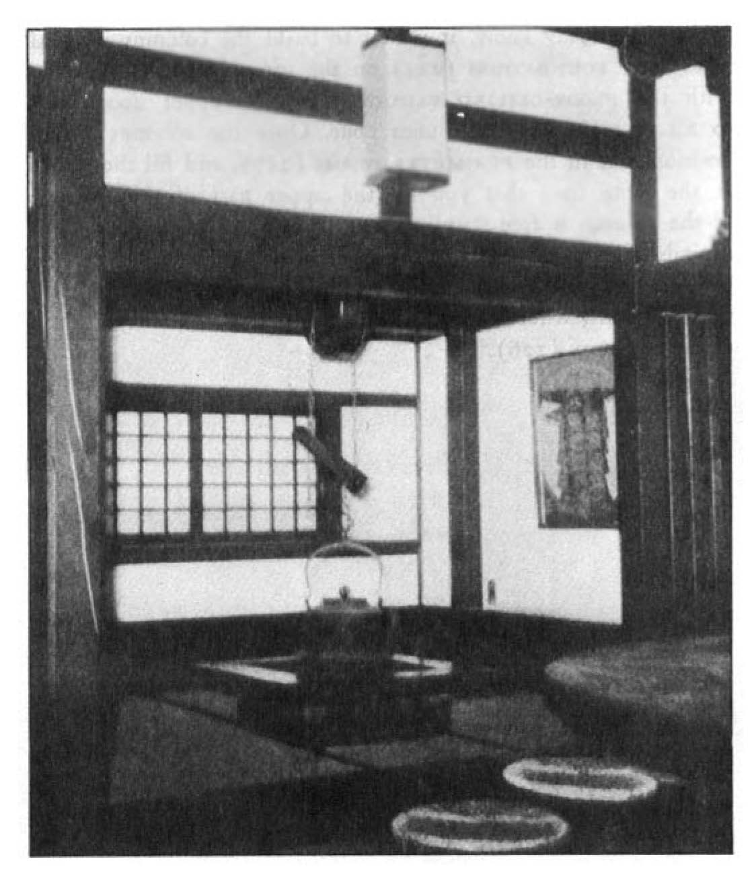
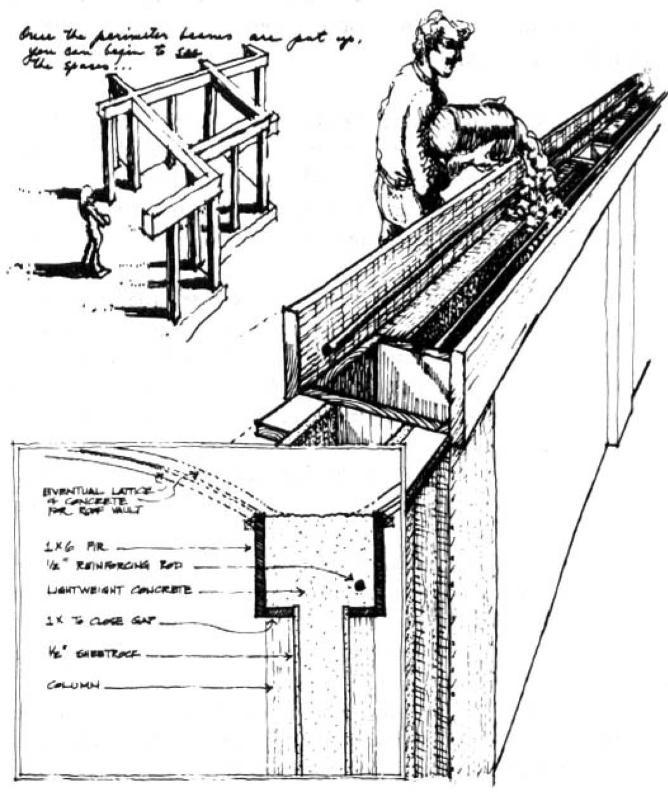
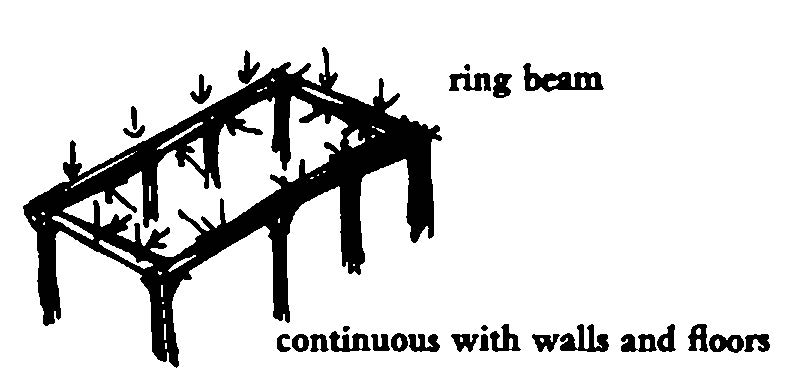

<section class="pattern-plate" aria-labelledby="t-perimeter-beams">
<a href="/patterns">A Pattern Language</a> · <a href="/patterns#construction">Construction</a> · Pattern 217 · p. 1018 · *
<h1 class="pattern-title" id="t-perimeter-beams">Perimeter Beams</h1><figure class="pattern-figure pl-figure"></figure><nav class="pattern-links" aria-label="Connections"><h2>Links to</h2><ul><li><a href="/patterns/efficient-structure">206 Efficient Structure</a></li><li><a href="/patterns/good-materials">207 Good Materials</a></li><li><a href="/patterns/floor-and-ceiling-layout">210 Floor And Ceiling Layout</a></li><li><a href="/patterns/box-columns">216 Box Columns</a></li><li><a href="/patterns/wall-membrane">218 Wall Membrane</a></li><li><a href="/patterns/floor-ceiling-vaults">219 Floor-Ceiling Vaults</a></li><li><a href="/patterns/column-connections">227 Column Connections</a></li></ul><h2>Linked from</h2><ul><li><a href="/patterns/efficient-structure">206 Efficient Structure</a></li><li><a href="/patterns/gradual-stiffening">208 Gradual Stiffening</a></li><li><a href="/patterns/floor-and-ceiling-layout">210 Floor And Ceiling Layout</a></li><li><a href="/patterns/thickening-the-outer-walls">211 Thickening The Outer Walls</a></li><li><a href="/patterns/columns-at-the-corners">212 Columns At The Corners</a></li><li><a href="/patterns/final-column-distribution">213 Final Column Distribution</a></li><li><a href="/patterns/box-columns">216 Box Columns</a></li><li><a href="/patterns/floor-ceiling-vaults">219 Floor-Ceiling Vaults</a></li><li><a href="/patterns/natural-doors-and-windows">221 Natural Doors And Windows</a></li><li><a href="/patterns/column-connections">227 Column Connections</a></li><li><a href="/patterns/dormer-windows">231 Dormer Windows</a></li><li><a href="/patterns/half-inch-trim">240 Half-Inch Trim</a></li></ul></nav></section><article class="pattern-text" aria-label="The text of Perimeter Beams">
1019… this pattern helps to complete <a class="pl-ref" href="/patterns/box-columns">BOX COLUMNS (216)</a>, by tying the tops of the columns together once they are in position. It also helps to form the bearing surface for the edge of the <a class="pl-ref" href="/patterns/floor-ceiling-vaults">FLOOR-CEILING VAULTS (219)</a>. For this reason, the positions of the perimeter beams must correspond exactly to the edges of the vaults laid out in <a class="pl-ref" href="/patterns/floor-and-ceiling-layout">FLOOR AND CEILINC LAYOUT (210)</a>.

◆ ◆ ◆

<strong>If you conceive and build a room by first placing columns at the corners, and then gradually weaving the walls and ceiling round them, the room needs a perimeter beam around its upper edge.</strong>

It is the beam, connecting the columns which creates a volume you can visualize, before it is complete; and when the columns are standing in the ground, you need the actual physical perimeter beam, to generate this volume before your eyes, to let you see the room as you are building it, and to tie the tops of the columns together, physically.

These reasons are conceptual. But of course, the conceptual simplicity and rightness of the beam around the room comes, in the end, from the more basic fact that this beam has a number of related structural functions, which make it an essential part of any room built as a natural structure. The perimeter beam has four structural functions:

1 It forms the natural thickening between the wall membrane and vault membrane, described in <a class="pl-ref" href="/patterns/efficient-structure">EFFICIENT STRUCTURE (206)</a>.

2 It resists the horizontal thrust of the ceiling vault, wherever there are no outside external buttresses to do it, and no other vaults to lean against.

3 It functions as a lintel, wherever doors and windows pierce the wall membrane.

4 It transfers loads from columns in upper storys to the columns and the wall membrane below it, and spreads these loads out to distribute them evenly between the columns and the membrane.

1020These functions of the perimeter beam show that the beam must be as continuous as possible with walls and columns above, the walls and columns below, and with the floor. If we follow <a class="pl-ref" href="/patterns/good-materials">GOOD MATERIALS (207)</a>, the beam must also be easy to make, and easy to cut to different lengths.

Available beams do not meet these requirements. Steel beams and precast or prestressed beams cannot easily be tied into the wall and floor to become continuous with these membranes. Far more important, they cannot easily be cut on site to conform to the exact dimensions of the different rooms which will occur in an organic plan.

<figure class="pl-figure"><figcaption><em>A version of the ferimeler beam consistent with the box column shown before</em>.</figcaption></figure>

1021Of course, wood beams meet both requirements: they are easy to cut and can be tied along their lengths to wall and floor membranes. However, as we have said in <a class="pl-ref" href="/patterns/good-materials">GOOD MATERIALS (207)</a>, wood is unavailable in many places, and even where it is available, it is becoming scarce and terribly expensive, especially in the large sizes needed for beams.

To avoid the use of wood, we have designed a perimeter beam—shown opposite—which is consistent with our box column, and designed to be used together with it. It is a beam made by first nailing up a channel made of wooden planks to the columns, before the wall membranes are made; then putting in reinforcing, and filling up with ultra-lightweight 60 pounds per cubic foot concrete, after the walls are made and filled. This beam is excellent for continuity. The wooden channel can first be made continuous with other skin elements by nailing, and the fill can then be made continuous by filling columns and beams and walls and vault in one continuous pour—see <a class="pl-ref" href="/patterns/wall-membrane">WALL MEMBRANES (218)</a> and <a class="pl-ref" href="/patterns/floor-ceiling-vaults">FLOOR-CEILING VAULTS (219)</a>.

Of course, there are many other ways of making a perimeter beam. First of all, there are several variants of our design: the U-shaped channel can be made of fiberboard, plywood, precast lightweight concrete, and, in every case, filled with lightweight concrete. Then there are various traditional perimeter beams—the Japanese version or the early American versions come to mind. And then there are a variety of structures which are not exactly even beams—but still act to spread vertical loads and counteract horizontal thrusts. A row of brick arches might function in this way, in a far fetched case so might a tension ring of jungle creeper.

Therefore:

<strong>Build a continuous perimeter beam around the room, strong enough to resist the horizontal thrust of the vault above, to spread the loads from upper stories onto columns, to tie the columns together, and to function as a lintel over openings in the wall. Make this beam continuous with columns, walls and floor above, and columns and walls below.</strong>

1022

<figure class="pl-figure"></figure>
◆ ◆ ◆

Remember to place reinforcing in such a way that the perimeter beam acts in a <em>horizontal</em> direction as well as vertical. When it forms the base for a <a class="pl-ref" href="/patterns/floor-ceiling-vaults">FLOOR-CEILING VAULT (219)</a> it must be able to act as a ring beam to resist all those residual horizontal outward thrusts not contained by the vault. Strengthen the connection between the columns and the perimeter beam with diagonal braces where the columns are free standing—<a class="pl-ref" href="/patterns/column-connections">COLUMN CONNECTION (227)</a>….
</article>

Christopher Alexander, Sara Ishikawa and Murray Silverstein, with Max Jacobson, Ingrid Fiksdahl-King and Shlomo Angel, <cite>A Pattern Language</cite> (Oxford University Press, 1977), pattern 217, pp. 1018–1022. Text and illustrations from the <a href="https://github.com/natureoforder/sources">Nature of Order sources</a> reading edition, transcribed from the 1977 printing; report errors on <a href="https://github.com/natureoforder/alexander-wiki/issues">GitHub</a>.

<a href="/patterns/box-columns">← 216 Box Columns</a> · <a href="/patterns">All 253 patterns</a> · <a href="/patterns/wall-membrane">218 Wall Membrane →</a>

