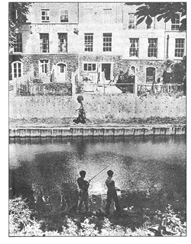
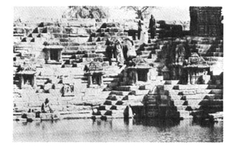
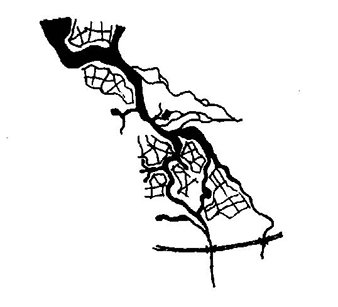
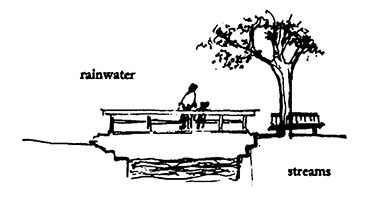

<section class="pattern-plate" aria-labelledby="t-pools-and-streams">
<a href="/patterns">A Pattern Language</a> · <a href="/patterns#towns">Towns</a> · Pattern 64 · p. 322 · *
<h1 class="pattern-title" id="t-pools-and-streams">Pools And Streams</h1><figure class="pattern-figure pl-figure"></figure><nav class="pattern-links" aria-label="Connections"><h2>Links to</h2><ul><li><a href="/patterns/neighborhood-boundary">15 Neighborhood Boundary</a></li><li><a href="/patterns/sacred-sites">24 Sacred Sites</a></li><li><a href="/patterns/access-to-water">25 Access To Water</a></li><li><a href="/patterns/quiet-backs">59 Quiet Backs</a></li><li><a href="/patterns/holy-ground">66 Holy Ground</a></li><li><a href="/patterns/arcades">119 Arcades</a></li></ul><h2>Linked from</h2><ul><li><a href="/patterns/subculture-boundary">13 Subculture Boundary</a></li><li><a href="/patterns/neighborhood-boundary">15 Neighborhood Boundary</a></li><li><a href="/patterns/children-in-the-city">57 Children In The City</a></li><li><a href="/patterns/quiet-backs">59 Quiet Backs</a></li><li><a href="/patterns/still-water">71 Still Water</a></li><li><a href="/patterns/something-roughly-in-the-middle">126 Something Roughly In The Middle</a></li></ul></nav></section><article class="pattern-text" aria-label="The text of Pools And Streams">
323… the land, in its natural state, is hardly ever flat, and was, in its most primitive condition, overrun with rills and streams which carried off the rainwater. There is no reason to destroy this natural feature of the land in a town—<a class="pl-ref" href="/patterns/sacred-sites">SACRED SITES (24)</a>, <a class="pl-ref" href="/patterns/access-to-water">ACCESS TO WATER (25)</a>—in fact, it is essential that it be preserved, or recreated. And in doing so it will be possible to deepen several larger patterns—boundaries between neighborhoods can easily be formed by streams—<a class="pl-ref" href="/patterns/neighborhood-boundary">NEIGHBORHOOD BOUNDARY (15)</a>, quiet backs can be made more tranquil—<a class="pl-ref" href="/patterns/quiet-backs">QUIET BACKS (59)</a>, pedestrian streets can be made more human and more natural—pedestrian street (100).

◆ ◆ ◆

<strong>We came from the water; our bodies are largely water; and water plays a fundamental role in our psychology. We need constant access to water, all around us; and we cannot have it without reverence for water in all its forms. But everywhere in cities water is out of reach.</strong>

Even in the temperate climates that are water rich, the natural sources of water are dried up, hidden, covered, lost. Rainwater runs underground in sewers; water reservoirs are covered and fenced off; swimming pools are saturated with chlorine and fenced off; ponds are so polluted that no one wants to go near them any more.

And especially in heavily populated areas water is scarce. We cannot possibly have the daily access to it which we and our children need, unless all water, in all its forms, is exposed, preserved, and nourished in an endless local texture of small pools, ponds, reservoirs, and streams in every neighborhood.

There are various ways of expressing the connection between people and water. The biologist, L. J. Henderson, observed that the saline content of human blood is essentially the same as that of the sea, because we came from the sea. Elaine Morgan, an anthropologist, speculates that during the drought of the Pliocene era, we went back to the sea and lived 10 million years as sea mammals 324in the shallow waters along the edge of the ocean. Apparently, this hypothesis explains a great deal about the human body, the way in which it is adapted to water, which is otherwise obscure (<em>The Descent of Woman</em>, New York: Bantam Books, 1973).

Furthermore, among psychoanalysts it is common to consider the bodies of water that appear in people’s dreams as loaded with meaning. Jung and the Jungian analysts take great bodies of water as representing the dreamer’s unconscious. We even speculate, in light of the psychoanalytic evidence, that going into the water may bring a person closer to the unconscious processes in his life. We guess that people who swim and dive often, in lakes and pools and in the ocean, may be closer to their dreams, more in contact with their unconscious, than people who swim rarely. Several studies have in fact demonstrated that water has a positive therapeutic effect; that it sets up growth experience. (For references, see Ruth Hartley et al., <em>Understanding Children’s Play</em>, Columbia University Press, New York: 1964, Chapter V).

All of this suggests that our lives are diminished if we cannot establish rich and abiding contact with water. But of course, in most cities we cannot. Swimming pools, lakes, and beaches are few in number and far away. And consider also the water supply. Our only contact with this water is to turn on the tap. We take the water for granted. But as marvelous as the high technology of water treatment and distribution has become, it does not satisfy the emotional need to make contact with the local reservoirs, and to understand the cycle of water: its limits and its mystery.

But it is possible to imagine a town where there are many hundreds of places near every home and workplace where there is water. Water to swim in, water to sit beside, water where you can dangle your feet. Consider, for example, the running water: the brooks and streams. Today they are paved over and forced underground. Instead of building with them, and alongside them, planners simply get them out of the way, as if to say: “the vagaries of nature have no place in a rational street grid.” But we can build in ways which maintain contact with water, in ponds and pools, in reservoirs, and in brooks and streams. We can 325even build details that connect people with the collection and run-off of rain water.

Think of the shallow ponds and pools that children need. It is possible for these pools and ponds to be available throughout the city, close enough for children to walk to. Some can be part of the larger pools. Others Can be bulges of streams that run through the city, where a balanced ecology is allowed to develop along their edges—ponds with ducks and carp, with edges safe enough for children to come close.

And consider the system of local and distribution reservoirs. We can locate local reservoirs and distribution reservoirs so that people can get at them; we might build them as kinds of shrines, where people can come to get in touch with the source of their water supply; the place immediately around the water an atmosphere inviting contemplation. These shrines could be set into the public space: perhaps as one end of a promenade, or as a boundary of common land between two communities.

<figure class="pl-figure"><figcaption><em>Indian staffed well</em>.</figcaption></figure>

And think of running water, in all its possible forms. People who have been deprived of it in their daily surroundings go to great lengths to get out of their towns into the countryside, where they can watch a river flow, or sit by a stream and gaze at the water. Children are fascinated by running water. They use it endlessly, to play in, to throw sticks and see them disappear, to run little paper boats along, to stir up mud and watch it clear gradually.

326Natural streams in their original streambeds, together with their surrounding vegetation, can be preserved and maintained. Rainwater can be allowed to assemble from rooftops into small pools and to run through channels along garden paths and public pedestrian paths, where it can be seen and enjoyed. Fountains can be built in public places. And in those cities where streams have been buried, it may even be possible to unravel them again.

<figure class="pl-figure"><figcaption><em>The buried streams</em>.</figcaption></figure>

In summary, we propose that every building project, at every scale, take stock of the distribution of water and the access to water in its neighborhood. Where there is a gap, where nourishing contact with water is missing, then each project should make some attempt, on its own and in combination with other projects, to bring some water into the environment. There is no other way to build up an adequate texture of water in cities: we need pools for swimming, ornamental and natural pools, streams of rain water, fountains, falls, natural brooks and streams running through towns, tiny garden pools, and reservoirs we can get to and appreciate.

Therefore:

<strong>Preserve natural pools and streams and allow them to run through the city; make paths for people to walk along them and footbridges to cross them. Let the streams form natural barriers in the city, with traffic crossing them only infrequently on bridges.</strong>

327<strong>Whenever possible, collect rainwater in open gutters and allow it to flow above ground, along pedestrian paths and in front of houses. In places without natural running water, create fountains in the streets.</strong>

<figure class="pl-figure"></figure>
◆ ◆ ◆

If at all possible, make all the pools and swimming holes part of the running water—not separate—since this is the only way that pools are able to keep alive and clean without the paraphernalia of pumps and chlorine—still water (71). Sometimes, here and there, give the place immediately around the water the atmosphere of contemplation; perhaps with arcades, perhaps some special common land, perhaps one end of a promenade—promenade (31), <a class="pl-ref" href="/patterns/holy-ground">holy ground (66)</a>, <a class="pl-ref" href="/patterns/arcades">arcades (119)</a>….
</article>

Christopher Alexander, Sara Ishikawa and Murray Silverstein, with Max Jacobson, Ingrid Fiksdahl-King and Shlomo Angel, <cite>A Pattern Language</cite> (Oxford University Press, 1977), pattern 64, pp. 322–327. Text and illustrations from the <a href="https://github.com/natureoforder/sources">Nature of Order sources</a> reading edition, transcribed from the 1977 printing; report errors on <a href="https://github.com/natureoforder/alexander-wiki/issues">GitHub</a>.

<a href="/patterns/dancing-in-the-street">← 63 Dancing In The Street</a> · <a href="/patterns">All 253 patterns</a> · <a href="/patterns/birth-places">65 Birth Places →</a>

