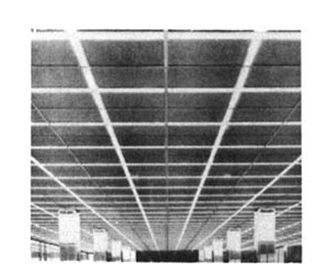
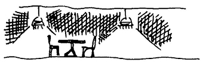
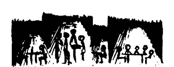

<section class="pattern-plate" aria-labelledby="t-pools-of-light">
<a href="/patterns">A Pattern Language</a> · <a href="/patterns#construction">Construction</a> · Pattern 252 · p. 1160 · **
<h1 class="pattern-title" id="t-pools-of-light">Pools Of Light</h1><nav class="pattern-links" aria-label="Connections"><h2>Links to</h2><ul><li><a href="/patterns/common-areas-at-the-heart">129 Common Areas At The Heart</a></li><li><a href="/patterns/flexible-office-space">146 Flexible Office Space</a></li><li><a href="/patterns/alcoves">179 Alcoves</a></li><li><a href="/patterns/eating-atmosphere">182 Eating Atmosphere</a></li><li><a href="/patterns/workspace-enclosure">183 Workspace Enclosure</a></li><li><a href="/patterns/sitting-circle">185 Sitting Circle</a></li><li><a href="/patterns/warm-colors">250 Warm Colors</a></li><li><a href="/patterns/different-chairs">251 Different Chairs</a></li></ul><h2>Linked from</h2><ul><li><a href="/patterns/tapestry-of-light-and-dark">135 Tapestry Of Light And Dark</a></li><li><a href="/patterns/small-meeting-rooms">151 Small Meeting Rooms</a></li><li><a href="/patterns/workspace-enclosure">183 Workspace Enclosure</a></li><li><a href="/patterns/sitting-circle">185 Sitting Circle</a></li><li><a href="/patterns/duct-space">229 Duct Space</a></li><li><a href="/patterns/soft-tile-and-brick">248 Soft Tile And Brick</a></li><li><a href="/patterns/warm-colors">250 Warm Colors</a></li><li><a href="/patterns/different-chairs">251 Different Chairs</a></li></ul></nav></section><article class="pattern-text" aria-label="The text of Pools Of Light">
… this pattern helps to finish small social spaces like <a class="pl-ref" href="/patterns/alcoves">ALCOVES (179)</a> and <a class="pl-ref" href="/patterns/workspace-enclosure">WORKSPACE ENCLOSURE (183)</a>, larger places like <a class="pl-ref" href="/patterns/common-areas-at-the-heart">COMMON AREAS AT THE HEART (129)</a>, ENTRANCE ROOM (13O), and <a class="pl-ref" href="/patterns/flexible-office-space">FLEXIBLE OFFICE SPACE (146)</a>, and the furnishing of rooms like <a class="pl-ref" href="/patterns/eating-atmosphere">EATING ATMOSPHERE (182)</a>, <a class="pl-ref" href="/patterns/sitting-circle">SITTING CIRCLE (185)</a>, and <a class="pl-ref" href="/patterns/different-chairs">DIFFERENT CHAIRS (251)</a>. It even helps to generate <a class="pl-ref" href="/patterns/warm-colors">WARM COLORS (250)</a>.

◆ ◆ ◆

<strong>Uniform illumination—the sweetheart of the lighting engineers—serves no useful purpose whatsoever. In fact, it destroys the social nature of space, and makes people feel disoriented and unbounded.</strong>

Look at this picture. It is an egg-crate ceiling, with dozens of evenly spaced fluorescent lights above it. It is meant to make the light as flat and even as possible, in a mistaken effort to imitate the sky.

<figure class="pl-figure"><figcaption><em>Flat, even light</em>.</figcaption></figure>

But it is based on two mistakes. First of all, the light outdoors is almost never even. Most natural places, and especially the 1161conditions under which the human organism evolved, have dappled light which varies continuously from minute to minute, and from place to place.

More serious, it is a fact of human nature that the space we use as social space is in part defined by light. When the light is perfectly even, the social function of the space gets utterly destroyed: it even becomes difficult for people to form natural human groups. If a group is in an area of uniform illumination, there are no light gradients corresponding to the boundary of the group, so the definition, cohesiveness, and “existence” of the group will be weakened. If the group is within a “pool” of light, whose size and boundaries correspond to those of the group, this enchances the definition, cohesiveness, and even the phenomenological existence of the group.

One possible explanation is suggested by the experiments of Hopkinson and Longmore, who showed that small bright light sources distract the attention less than large areas which are less bright. These authors conclude that local lighting over a work table allows the worker to pay more attention to his work than uniform background lighting does. It seems reasonable to infer that the high degree of person to person attention required to maintain the cohesiveness of a social group is more likely to be sustained if the group has local lighting, than if it has uniform background lighting. (See R. G. Hopkinson and J. Longmore, “Attention and Distraction in the Lighting of Workplaces,” <em>Ergonomics</em>, 2, 1959, p. 321 if. Also reprinted in R. G. Hopkinson, <em>Lighting,</em> London: HMSO, 1963, pp. 261–68.)

On-the-spot observation supports this conjecture. At the International House, University of California, Berkeley, there is a large room which is a general waiting and sitting lounge for guests and residents. There are 42 seats in the room, 12 of them are next to lamps. At the two times of observation we counted a total of 21 people sitting in the room; 13 of them chose to sit next to lamps. These figures show that people prefer sitting near lights (Xs =11.4, significant at the 0.1% level). Yet the overall light level in the room was high enough for reading. We conclude that people do seek “pools of light.”

Everyday experience bears out the same observation in hundreds of cases. Every good restaurant keeps each table as a 1162separate pool of light, knowing that this contributes to its privai and intimate ambience. In a house a truly comfortable old chaii “yours,” has its own light in dimmer surroundings—so that you retreat from the bustle of the family to read the paper ir, peace. Again, house dining tables often have a single lamp suspended over the table—the light seems almost to act like glue for all the people sitting round the table. In larger situations the same thing seems to be true. Think of the park bench, under a solitary light, and the privacy of the world which it creates for a pair of lovers. Or, in a trucking depot, the solidarity of the group of men sipping coffee around a brightly lit coffee stand.

One word of caution. This pattern is easy to understand; and perhaps it is easy to agree with. But it is quite a subtle matter to actually create functioning pools of light in the environment. We know of many failures: for example, places where small lights do break down even illumination, but do not correspond in any real way with the places where people tend to gather in the space.

<figure class="pl-figure"><figcaption><em>Light fools at odds with social space</em>.</figcaption></figure>

Therefore:

<strong>Place the lights low, and apart, to form individual pools of light which encompass chairs and tables like bubbles to reinforce the social character of the spaces which they form. Remember that you can’t have pools of light without the darker places in between.</strong>

<figure class="pl-figure"></figure>
pools of light

1163

◆ ◆ ◆

Color the lampshades and the hangings near the lights to make the light which bounces off them warm in color—<a class="pl-ref" href="/patterns/warm-colors">WARM COLORS (250)</a>….
</article>

Christopher Alexander, Sara Ishikawa and Murray Silverstein, with Max Jacobson, Ingrid Fiksdahl-King and Shlomo Angel, <cite>A Pattern Language</cite> (Oxford University Press, 1977), pattern 252, pp. 1160–1163. Text and illustrations from the <a href="https://github.com/natureoforder/sources">Nature of Order sources</a> reading edition, transcribed from the 1977 printing; report errors on <a href="https://github.com/natureoforder/alexander-wiki/issues">GitHub</a>.

<a href="/patterns/different-chairs">← 251 Different Chairs</a> · <a href="/patterns">All 253 patterns</a> · <a href="/patterns/things-from-your-life">253 Things From Your Life →</a>

