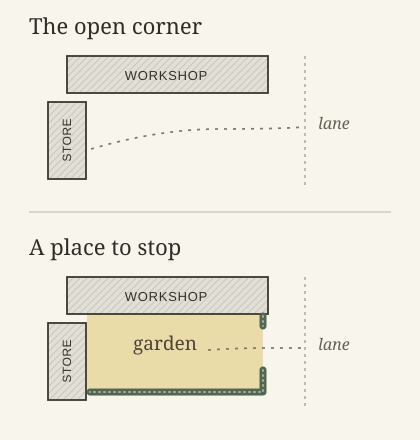

<nav class="pattern-trail" aria-label="Breadcrumb"><a href="/patterns">A Pattern Language</a> / 106</nav>

<section class="pattern-plate" aria-labelledby="pattern-106-title">
<h1 class="pattern-title" id="pattern-106-title">106 Positive Outdoor Space**</h1>
<figure class="pattern-figure"><figcaption>Original diagram. The buildings stay put. Follow the ground between them in each plan.</figcaption></figure>
</section>
<section class="pattern-commentary" aria-label="Reading the pattern">
<h2>Draw the garden first</h2>

Imagine a pair of workshops on a lane. Their plans show you exactly where each workshop ends. Where does the garden end? In the first drawing your pencil could wander out into the lane with little reason to turn. In the second, a short hedge gives it a line to follow. You can see the garden as a shape in its own right and still walk out of it.

Alexander and his co-authors call this shift in what you see a <em>figure-ground reversal</em>. On one reading the buildings stand out. On another, the outdoor room comes forward. They offer a second test on p. 519. Pick two points inside the space and join them with a straight line. If the line cuts through a building, you may have drawn two distinct places as one.

<h3>Walk its edge</h3>

Choose a patch of ground where you might wait for a friend. Walk what you take to be its perimeter. Where did a wall, canopy or change of ground turn you? Where did you have to invent the boundary? Ask your friend to walk it too. A stretch where you disagree is a good place to try a change.

Mark one possible edge with chairs, leaving an opening toward the next space. Stand inside, then approach from outside. Can you tell where you have arrived? Can you see where to go next? The authors discuss the pleasure of a beach or an open plain on p. 520. Their question here concerns the smaller places we make between buildings.

</section>

<section class="pattern-source" aria-label="Source and related reading">

Christopher Alexander, Sara Ishikawa, Murray Silverstein and collaborators, <cite>A Pattern Language</cite> (Oxford University Press, 1977), pattern 106, pp. 517–523. The figure-ground test is on pp. 518–519. The square at Nancy and two ways to change an existing space are on pp. 521–522.

A window seat offers a smaller example of a place taking shape within a larger one. <a href="/patterns/window-place">Read Window Place (180)</a> · <a href="/patterns">Browse all 253 patterns</a>

</section>

