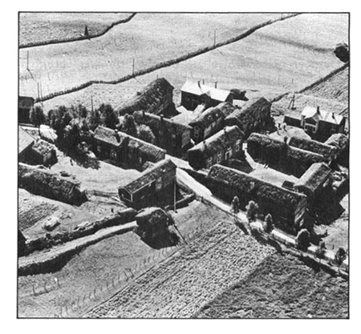
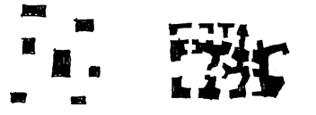
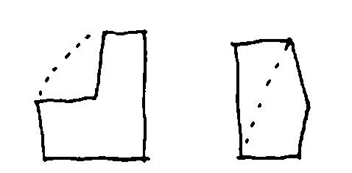
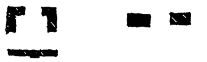
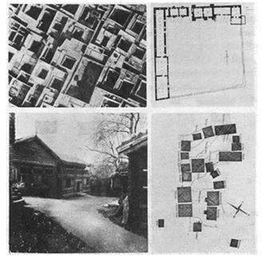
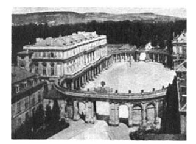
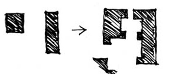
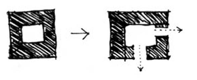
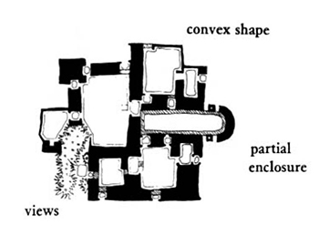

<section class="pattern-plate" aria-labelledby="pattern-106-title">

<a href="/patterns">A Pattern Language</a> · Pattern 106 · p. 517 · **

<h1 class="pattern-title" id="pattern-106-title">Positive Outdoor Space</h1>
<figure class="pattern-figure"><figcaption>Original diagram. The buildings stay put. Follow the ground between them in each plan.</figcaption></figure>
</section>
<section class="pattern-commentary" aria-label="Reading the pattern">
<h2>Draw the garden first</h2>

Imagine a pair of workshops on a lane. Their plans show you exactly where each workshop ends. Where does the garden end? In the first drawing your pencil could wander out into the lane with little reason to turn. In the second, a short hedge gives it a line to follow. You can see the garden as a shape in its own right and still walk out of it.

Alexander and his co-authors call this shift in what you see a <em>figure-ground reversal</em>. On one reading the buildings stand out. On another, the outdoor room comes forward. They offer a second test on p. 519. Pick two points inside the space and join them with a straight line. If the line cuts through a building, you may have drawn two distinct places as one.

<h3>Walk its edge</h3>

Choose a patch of ground where you might wait for a friend. Walk what you take to be its perimeter. Where did a wall, canopy or change of ground turn you? Where did you have to invent the boundary? Ask your friend to walk it too. A stretch where you disagree is a good place to try a change.

Mark one possible edge with chairs, leaving an opening toward the next space. Stand inside, then approach from outside. Can you tell where you have arrived? Can you see where to go next? The authors discuss the pleasure of a beach or an open plain on p. 520. Their question here concerns the smaller places we make between buildings.

</section>

<!-- GENERATED: full text below is rebuilt by scripts/build_patterns.py; edit above this line -->

<section class="pattern-plate">
The full pattern · p. 517
<figure class="pattern-figure pl-figure"><figcaption>Opening photograph, p. 517.</figcaption></figure><nav class="pattern-links" aria-label="Connections"><h2>Links to</h2><ul><li><a href="/patterns/south-facing-outdoors">105 South Facing Outdoors</a></li><li><a href="/patterns/wings-of-light">107 Wings Of Light</a></li><li><a href="/patterns/hierarchy-of-open-space">114 Hierarchy Of Open Space</a></li><li><a href="/patterns/courtyards-which-live">115 Courtyards Which Live</a></li><li><a href="/patterns/roof-garden">118 Roof Garden</a></li><li><a href="/patterns/building-edge">160 Building Edge</a></li><li><a href="/patterns/outdoor-room">163 Outdoor Room</a></li><li><a href="/patterns/tree-places">171 Tree Places</a></li><li><a href="/patterns/garden-growing-wild">172 Garden Growing Wild</a></li><li><a href="/patterns/garden-wall">173 Garden Wall</a></li><li><a href="/patterns/trellised-walk">174 Trellised Walk</a></li><li><a href="/patterns/workspace-enclosure">183 Workspace Enclosure</a></li></ul><h2>Linked from</h2><ul><li><a href="/patterns/common-land">67 Common Land</a></li><li><a href="/patterns/small-parking-lots">103 Small Parking Lots</a></li><li><a href="/patterns/site-repair">104 Site Repair</a></li><li><a href="/patterns/south-facing-outdoors">105 South Facing Outdoors</a></li><li><a href="/patterns/wings-of-light">107 Wings Of Light</a></li><li><a href="/patterns/long-thin-house">109 Long Thin House</a></li><li><a href="/patterns/hierarchy-of-open-space">114 Hierarchy Of Open Space</a></li><li><a href="/patterns/courtyards-which-live">115 Courtyards Which Live</a></li><li><a href="/patterns/paths-and-goals">120 Paths And Goals</a></li><li><a href="/patterns/building-fronts">122 Building Fronts</a></li><li><a href="/patterns/light-on-two-sides-of-every-room">159 Light On Two Sides Of Every Room</a></li><li><a href="/patterns/building-edge">160 Building Edge</a></li><li><a href="/patterns/garden-wall">173 Garden Wall</a></li><li><a href="/patterns/trellised-walk">174 Trellised Walk</a></li><li><a href="/patterns/the-shape-of-indoor-space">191 The Shape Of Indoor Space</a></li><li><a href="/patterns/sitting-wall">243 Sitting Wall</a></li></ul></nav></section><article class="pattern-text" aria-label="The text of Positive Outdoor Space">
518… in making <a class="pl-ref" href="/patterns/south-facing-outdoors">SOUTH FACING OUTDOORS (105)</a> you must both choose the place to build, and also choose the place for the outdoors. You cannot shape the one without the other. This pattern gives you the geometric character of the outdoors; the next one—<a class="pl-ref" href="/patterns/wings-of-light">WINGS OF LIGHT (107)</a>—gives you the complementary shape of the indoors.

◆ ◆ ◆

<strong>Outdoor spaces which are merely “left over” between buildings will, in general, not be used.</strong>

There are two fundamentally different kinds of outdoor space: negative space and positive space. Outdoor space is negative when it is shapeless, the residue left behind when buildings—which are generally viewed as positive—are placed on the land. An outdoor space is positive when it has a distinct and definite shape, as definite as the shape of a room, and when its shape is as important as the shapes of the buildings which surround it. These two kinds of space have entirely different plan geometries, which may be most easily distinguished by their figure-ground reversal.

<figure class="pl-figure"></figure>
<em>Buildings that create negative, leftover space</em> … <em>buildings that create positive outdoor space</em>.

If you look at the plan of an environment where outdoor spaces are negative, you see the buildings as figure, and the outdoor space as ground. There is no reversal. It is impossible to see the outdoor space as figure, and the buildings as ground. If you look at the plan of an environment where outdoor spaces are positive, you may see the buildings as figure, and outdoor spaces as ground—<em>and</em>, you may <em>also</em> see the outdoor spaces as 519figure against the ground of the buildings. The plans have figure-ground reversal.

Another way of defining the difference between “positive” and “negative” outdoor spaces is by their degree of enclosure and their degree of convexity.

In mathematics, a space is convex when a line joining any two points inside the space itself lies totally inside the space. It is nonconvex, when some lines joining two points lie at least partly outside the space. According to this definition, the following irregular squarish space is convex and therefore positive; but the L-shaped space is not convex or positive, because the line joining its two end points cuts across the corner and therefore goes outside the space.

<figure class="pl-figure"><figcaption><em>Convex and nonconvex</em>.</figcaption></figure>

Positive spaces are partly enclosed, at lent to the extent that their areas seem bounded (even though they are not, in fact, because there are always paths leading out, even whole sides open), and the “virtual” area which seems to exist is <em>convex.</em> Negative spaces are to poorly defined that you cannot really tell where their boundaries are, and to the extent that you can tell, the shapes are <em>nonconvex</em>.

<figure class="pl-figure"><figcaption><em>This if ace can be felt: it it distinct:—a place … and it it convex. This space is vague, amorphous, “nothing.’*</em></figcaption></figure>

Now, what is the functional relevance of the distinction between “positive” and “negative” outdoor spaces. We put forward the following hypothesis. <em>People feel comfortable in spaces which are “positive” and use these spaces; people feel relatively uncomfortable in spaces which are</em> “<em>negative</em>” <em>and such spaces tend to remain unused</em>.

520The case for this hypothesis has been most fully argued by Camillo Sitte, in <em>City Planning According to Artistic Principles</em> (republished by Random House in 1965). Sitte has analyzed a very large number of European city squares, distinguishing those which seem used and lively from those which don’t, trying to account for the success of the lively squares. He shows, with example after example, that the successful ones—those which are greatly used and enjoyed—have two properties. On the one hand, they are partly enclosed; on the other hand, they are also open to one another, so that each one leads into the next.

The fact that people feel more comfortable in a space which is at least partly enclosed is hard to explain. To begin with, it is obviously not <em>always</em> true. For example, people feel very comfortable indeed on an open beach, or on a rolling plain, where there may be no enclosure at all. But in the smaller outdoor spaces—gardens, parks, walks, plazas—enclosure does, for some reason, seem to create a feeling of security.

It seems likely that the need for enclosure goes back to our most primitive instincts. For example, when a person looks for a place to sit down outdoors, he rarely chooses to sit exposed in the middle of an open space—he usually looks for a tree to put his back against; a hollow in the ground, a natural cleft which will partly enclose and shelter him. Our studies of people’s space needs in workplaces show a similar phenomenon. To be comfortable, a person wants a certain amount of enclosure around him and his work—but not too much—see <a class="pl-ref" href="/patterns/workspace-enclosure">workspace enclosure (183)</a>. Clare Cooper has found the same thing in her study of parks: people seek areas which are partially enclosed and partly open—not too open, not too enclosed (Clare Cooper, Open Space Study, <em>San Francisco Urban Design Study</em>, San Francisco City Planning Dept., 1969).

<figure class="pl-figure"><figcaption><em>Four examples of positive outdoor space</em>.</figcaption></figure>

521Most often, positive outdoor space is created at the same time that other patterns are created. The following photograph shows one of the few places in the world where a considerable amount of building had no other purpose whatsoever except to create a positive outdoor space. It somehow underlines the pattern’s urgency.

<figure class="pl-figure"><figcaption><em>The square at Nancy</em>.</figcaption></figure>

When open space is negative, for example, L-shaped—it is always possible to place small buildings, or building projections, or walls in such a way as to break the space into positive pieces.

<figure class="pl-figure"></figure>
<em>Transform this</em>…..<em>to this</em>.

522And when an existing open space is too enclosed, it may be possible to break a hole through the building to open the space up.

<figure class="pl-figure"></figure>
<em>Transform this</em>…..<em>to this</em>.

Therefore:

<strong>Make all the outdoor spaces which surround and lie between your buildings positive. Give each one some degree of enclosure; surround each space with wings of buildings, trees, hedges, fences, arcades, and trellised walks, until it becomes an entity with a positive quality and does not spill out indefinitely around corners.</strong>

<figure class="pl-figure"></figure>
◆ ◆ ◆

Place <a class="pl-ref" href="/patterns/wings-of-light">WINGS OF LIGHT (107)</a> to form the spaces. Use open trellised walks, walls, and trees to close off spaces which are too exposed—<a class="pl-ref" href="/patterns/tree-places">TREE PLACES (171)</a>, <a class="pl-ref" href="/patterns/garden-wall">GARDEN WALL (173)</a>, <a class="pl-ref" href="/patterns/trellised-walk">TRELLISED WALK (174)</a>; but make sure that every space is always open to 523some larger space, so that it is not too enclosed—<a class="pl-ref" href="/patterns/hierarchy-of-open-space">HIERARCHY OF OPEN SPACE (114)</a>. Use BUILDING FRONTS (l22) to help create the shape of space. Complete the positive character of the outdoors <em>by</em> making places all around the edge of buildings, and so make the outdoors as much a focus of attention as the buildings—<a class="pl-ref" href="/patterns/building-edge">BUILDING EDGE (160)</a>. Apply this pattern to <a class="pl-ref" href="/patterns/courtyards-which-live">courtyards WHICH LIVE (115)</a>, <a class="pl-ref" href="/patterns/roof-garden">ROOF GARDENS (118)</a>, PATH SHAPE (l2l), <a class="pl-ref" href="/patterns/outdoor-room">OUTDOOR ROOM (163)</a>, <a class="pl-ref" href="/patterns/garden-growing-wild">GARDEN GROWING WILD (172)</a>.
</article>

Christopher Alexander, Sara Ishikawa and Murray Silverstein, with Max Jacobson, Ingrid Fiksdahl-King and Shlomo Angel, <cite>A Pattern Language</cite> (Oxford University Press, 1977), pattern 106, pp. 517–523. Text and illustrations from the <a href="https://github.com/natureoforder/sources">Nature of Order sources</a> reading edition, transcribed from the 1977 printing; report errors on <a href="https://github.com/natureoforder/alexander-wiki/issues">GitHub</a>.

<a href="/patterns/south-facing-outdoors">← 105 South Facing Outdoors</a> · <a href="/patterns">All 253 patterns</a> · <a href="/patterns/wings-of-light">107 Wings Of Light →</a>

