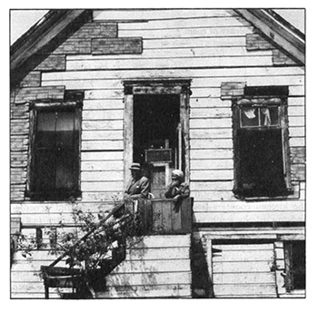
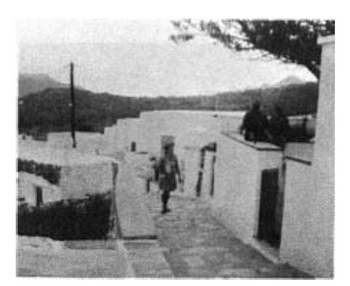
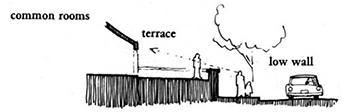

<section class="pattern-plate" aria-labelledby="t-private-terrace-on-the-street">
<a href="/patterns">A Pattern Language</a> · <a href="/patterns#buildings">Buildings</a> · Pattern 140 · p. 664 · **
<h1 class="pattern-title" id="t-private-terrace-on-the-street">Private Terrace On The Street</h1><figure class="pattern-figure pl-figure"></figure><nav class="pattern-links" aria-label="Connections"><h2>Links to</h2><ul><li><a href="/patterns/green-streets">51 Green Streets</a></li><li><a href="/patterns/pedestrian-street">100 Pedestrian Street</a></li><li><a href="/patterns/half-hidden-garden">111 Half-Hidden Garden</a></li><li><a href="/patterns/sequence-of-sitting-spaces">142 Sequence Of Sitting Spaces</a></li><li><a href="/patterns/outdoor-room">163 Outdoor Room</a></li><li><a href="/patterns/terraced-slope">169 Terraced Slope</a></li><li><a href="/patterns/garden-wall">173 Garden Wall</a></li><li><a href="/patterns/half-open-wall">193 Half-Open Wall</a></li><li><a href="/patterns/sitting-wall">243 Sitting Wall</a></li></ul><h2>Linked from</h2><ul><li><a href="/patterns/pedestrian-street">100 Pedestrian Street</a></li><li><a href="/patterns/half-hidden-garden">111 Half-Hidden Garden</a></li><li><a href="/patterns/hierarchy-of-open-space">114 Hierarchy Of Open Space</a></li><li><a href="/patterns/roof-garden">118 Roof Garden</a></li><li><a href="/patterns/building-fronts">122 Building Fronts</a></li><li><a href="/patterns/pedestrian-density">123 Pedestrian Density</a></li><li><a href="/patterns/entrance-room">130 Entrance Room</a></li><li><a href="/patterns/tapestry-of-light-and-dark">135 Tapestry Of Light And Dark</a></li><li><a href="/patterns/sequence-of-sitting-spaces">142 Sequence Of Sitting Spaces</a></li><li><a href="/patterns/old-age-cottage">155 Old Age Cottage</a></li><li><a href="/patterns/settled-work">156 Settled Work</a></li><li><a href="/patterns/sunny-place">161 Sunny Place</a></li><li><a href="/patterns/outdoor-room">163 Outdoor Room</a></li><li><a href="/patterns/gallery-surround">166 Gallery Surround</a></li><li><a href="/patterns/connection-to-the-earth">168 Connection To The Earth</a></li><li><a href="/patterns/garden-wall">173 Garden Wall</a></li><li><a href="/patterns/seat-spots">241 Seat Spots</a></li><li><a href="/patterns/sitting-wall">243 Sitting Wall</a></li><li><a href="/patterns/canvas-roofs">244 Canvas Roofs</a></li><li><a href="/patterns/paving-with-cracks-between-the-stones">247 Paving With Cracks Between The Stones</a></li></ul></nav></section><article class="pattern-text" aria-label="The text of Private Terrace On The Street">
665… among the common areas and sitting spaces—COMMON AREAS AT THE HEART (l29), <a class="pl-ref" href="/patterns/sequence-of-sitting-spaces">SEQUENCE OF SITTING SPACES (142)</a>—there is a need for one, at least, which puts the people in the house in touch with the world of the street outside the house. This pattern helps to create the <a class="pl-ref" href="/patterns/half-hidden-garden">HALF-HIDDEN GARDEN (111)</a> and gives life to the street—<a class="pl-ref" href="/patterns/green-streets">GREEN STREET (51)</a> or <a class="pl-ref" href="/patterns/pedestrian-street">PEDESTRIAN STREET (100)</a>.

◆ ◆ ◆

<strong>The relationship of a house to a street is often confused: either the house opens entirely to the street and there is no privacy; or the house turns its back on the street, and communion with street life is lost.</strong>

We have within our natures tendencies toward both communality and individuality. A good house supports <em>both</em> kinds of experience: the intimacy of a private haven <em>and</em> our participation with a public world.

But most homes fail to support these complementary needs. Most often they emphasize one, to the exclusion of the other: we have, for instance, the fishbowl scheme, where living areas face the street with picture windows and the “retreat,” where living areas turn away from the street into private gardens.

The old front porch, in traditional American society, solved this problem perfectly. Where the street is quiet enough, and the house near enough to the street, we cannot imagine a much better solution. But if the street is different, a slightly different solution will be necessary.

Early in his career, Frank Wright experimented with one possible solution. When he built beside lively streets he built a wide terrace between the living room and the street.

To our knowledge, Grant Hildebrand first pointed out this pattern in Wright’s work, in his paper, “Privacy and Participation: Frank Lloyd Wright and the City Street,” School of

666

<figure class="pl-figure"><figcaption><em>Section of private terrace and street</em>.</figcaption></figure>

Architecture, University of Washington, Seattle, Washington: 1970. Hildebrand gives an interesting account of the way this pattern works in the Cheney house:

As the pedestrian looks toward the house from the sidewalk, the masonry terrace wall is located so that his line of sight over its top falls at the lower edge of the elaborately leaded upper glass zone of the terrace doors. Vision into the living room from the sidewalk thus is carefully controlled. If the occupant within the house is standing near the doors only his head and shoulders are dimly visible through a diffusing surface. If the occupant is sitting he is, of course, completely hidden from the pedestrian’s view.

But whereas the pedestrian cannot effectively intrude on the privacy of the house, the inhabitant on the other hand has a number of options available at will. As he stands or sits on the terrace itself, well above the sidewalk, the effect is of easy participation in the full panorama of the street. From the elevated platform vision is unobstructed. Neighbors and friends can be waved at, greeted, invited in for a chat. Thus the terrace, projecting toward the street, linked—and still links—the Cheney house and its inhabitants to the community life of Oak Park. The configuration is so successful that; as in the Robie house, there has never been much need for curtains. The parapets and the leaded glass, carefully placed, do it all. Thus out of the decision to face the living room toward the street has come not a sacrifice of privacy, but a much richer range of alternative experiences for the occupant.

We believe that Wright’s use of this pattern was based on accurate intuitions about a fundamental human need. Indeed, there are empirical grounds for believing that the need for a house to be in touch with the street outside is a fundamental psychological necessity: and that its opposite—the tendency some people have to keep their houses away from the street, locked up, barred, and disconnected from the street—is a symptom of a serious emotional disorder—the autonomy-withdrawal syndrome. See Alexander, “The City as a Mechanism for Sustaining Human Contact,” W. Ewald, ed., <em>Environment for Man</em>, Indiana University Press, 1967, pp. 60–102.

Here is an example of this pattern from Greece. It is clear that he pattern can be expressed in many ways, so long as the relationship, the balance of privacy and street contact, is maintained.

667

<figure class="pl-figure"><figcaption><em>Private terrace on the street</em>.</figcaption></figure>

Therefore:

<strong>Let the common rooms open onto a wide terrace or a porch which looks into the street. Raise the terrace slightly above street level and protect it with a low wall, which you can see over if you sit near it, but which prevents people on the street from looking into the common rooms.</strong>

<figure class="pl-figure"></figure>
◆ ◆ ◆

If possible, place the terrace in a position which is also congruent with natural contours—<a class="pl-ref" href="/patterns/terraced-slope">TERRACED SLOPE (169)</a>. The wall, if low enough, can be a <a class="pl-ref" href="/patterns/sitting-wall">SITTING WALL (243)</a>; in other cases, where you want more privacy, you can build a full garden wall, with openings in it, almost like windows, which make the connection with the street—<a class="pl-ref" href="/patterns/garden-wall">GARDEN WALL (173)</a>, <a class="pl-ref" href="/patterns/half-open-wall">HALF-OPEN WALL (193)</a>. In any case, surround the terrace with enough things to give it at least the partial feeling of a room—<a class="pl-ref" href="/patterns/outdoor-room">OUTDOOR ROOM (163)</a>….
</article>

Christopher Alexander, Sara Ishikawa and Murray Silverstein, with Max Jacobson, Ingrid Fiksdahl-King and Shlomo Angel, <cite>A Pattern Language</cite> (Oxford University Press, 1977), pattern 140, pp. 664–667. Text and illustrations from the <a href="https://github.com/natureoforder/sources">Nature of Order sources</a> reading edition, transcribed from the 1977 printing; report errors on <a href="https://github.com/natureoforder/alexander-wiki/issues">GitHub</a>.

<a href="/patterns/farmhouse-kitchen">← 139 Farmhouse Kitchen</a> · <a href="/patterns">All 253 patterns</a> · <a href="/patterns/a-room-of-ones-own">141 A Room Of One’s Own →</a>

