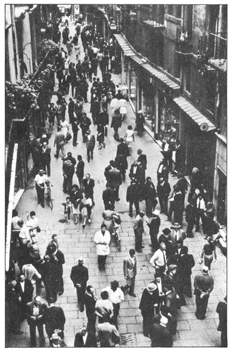
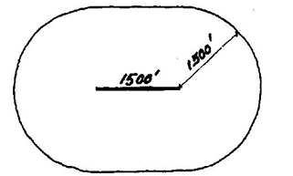
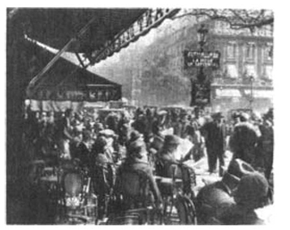
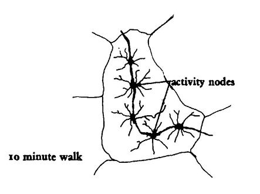

<section class="pattern-plate" aria-labelledby="t-promenade">
<a href="/patterns">A Pattern Language</a> · <a href="/patterns#towns">Towns</a> · Pattern 31 · p. 168 · **
<h1 class="pattern-title" id="t-promenade">Promenade</h1><figure class="pattern-figure pl-figure"></figure><nav class="pattern-links" aria-label="Connections"><h2>Links to</h2><ul><li><a href="/patterns/mosaic-of-subcultures">8 Mosaic Of Subcultures</a></li><li><a href="/patterns/community-of-7000">12 Community Of 7000</a></li><li><a href="/patterns/activity-nodes">30 Activity Nodes</a></li><li><a href="/patterns/shopping-street">32 Shopping Street</a></li><li><a href="/patterns/night-life">33 Night Life</a></li><li><a href="/patterns/carnival">58 Carnival</a></li><li><a href="/patterns/dancing-in-the-street">63 Dancing In The Street</a></li><li><a href="/patterns/pedestrian-street">100 Pedestrian Street</a></li><li><a href="/patterns/path-shape">121 Path Shape</a></li><li><a href="/patterns/pedestrian-density">123 Pedestrian Density</a></li></ul><h2>Linked from</h2><ul><li><a href="/patterns/magic-of-the-city">10 Magic Of The City</a></li><li><a href="/patterns/community-of-7000">12 Community Of 7000</a></li><li><a href="/patterns/web-of-shopping">19 Web Of Shopping</a></li><li><a href="/patterns/access-to-water">25 Access To Water</a></li><li><a href="/patterns/men-and-women">27 Men And Women</a></li><li><a href="/patterns/eccentric-nucleus">28 Eccentric Nucleus</a></li><li><a href="/patterns/density-rings">29 Density Rings</a></li><li><a href="/patterns/activity-nodes">30 Activity Nodes</a></li><li><a href="/patterns/shopping-street">32 Shopping Street</a></li><li><a href="/patterns/night-life">33 Night Life</a></li><li><a href="/patterns/university-as-a-marketplace">43 University As A Marketplace</a></li><li><a href="/patterns/network-of-paths-and-cars">52 Network Of Paths And Cars</a></li><li><a href="/patterns/children-in-the-city">57 Children In The City</a></li><li><a href="/patterns/small-public-squares">61 Small Public Squares</a></li><li><a href="/patterns/dancing-in-the-street">63 Dancing In The Street</a></li><li><a href="/patterns/beer-hall">90 Beer Hall</a></li><li><a href="/patterns/travelers-inn">91 Traveler’s Inn</a></li><li><a href="/patterns/pedestrian-street">100 Pedestrian Street</a></li><li><a href="/patterns/path-shape">121 Path Shape</a></li><li><a href="/patterns/pedestrian-density">123 Pedestrian Density</a></li><li><a href="/patterns/activity-pockets">124 Activity Pockets</a></li></ul></nav></section><article class="pattern-text" aria-label="The text of Promenade">
169… assume now that there is an urban area, subdivided into subcultures and communities each with its boundaries. Each subculture in the <a class="pl-ref" href="/patterns/mosaic-of-subcultures">MOSAIC OF SUBCULTURES (8)</a>, and each <a class="pl-ref" href="/patterns/community-of-7000">COMMUNITY OF 7000 (12)</a> has a promenade as its backbone. And each promenade helps to form <a class="pl-ref" href="/patterns/activity-nodes">ACTIVITY NODES (30)</a> along its length, by generating the How of people which the activity nodes need in order to survive.

◆ ◆ ◆

<strong>Each subculture needs a center for its public life: a place where you can go to sec people, and to be seen.</strong>

The promenade, “paseo,” “passegiata,” evening stroll, is common in the small towns of Italy, Spain, Mexico, Greece, Yugoslavia, Sicily, and South America. People go there to walk up and down, to meet their friends, to stare at strangers, and to let strangers stare at them.

Throughout history there have been places in the city where people who shared a set of values could go to get in touch with each other. These places have always been like street theaters: they invite people to watch others, to stroll and browse, and to loiter:

In Mexico, in any small town plaza every Thursday and Sunday night with the band playing and the weather mild, the boys walk this way, the girls walk that, around and around, and the mothers and fathers sit on iron-scrolled benches and watch. (Ray Bradbury, “The girls walk this wan the boys walk that way …” <em>West</em>, Los Angeles Times Sunday Magazine, April 5, 1970.)

In all these places the beauty of the promenade is simply this: people with a shared way of life gather together to rub shoulders and confirm their community.

Is the promenade in fact a purely Latin institution 1 Our experiments suggest that it is not. The fact is that the kinds of promenades where this strolling happens are not common in a city, and they are especially uncommon in a sprawling urban region. But experiments by Luis Racionero at the Department of 170Architecture at the University of California, Berkeley, have shown that wherever the possibility of this public contact <em>does</em> exist, people will seek it, as long as it is close enough. Racionero interviewed 37 people in several parts of San Francisco, living various distances from a promenade, and found that people who lived within 20 minutes used it, while people who lived more than 20 minutes away did not.

<table>
<tbody>
<tr>
<td></td>
<td style="text-align: left;">Use the promenade</td>
<td style="text-align: left;">Do not use the promenade</td>
</tr>
<tr>
<td>People who live less</td>
<td style="text-align: left;"></td>
<td style="text-align: left;"></td>
</tr>
<tr>
<td>than 20 minutes away</td>
<td style="text-align: left;">13</td>
<td style="text-align: left;">1</td>
</tr>
<tr>
<td>People who live more</td>
<td style="text-align: left;"></td>
<td style="text-align: left;"></td>
</tr>
<tr>
<td>than 20 minutes away</td>
<td style="text-align: left;">5</td>
<td style="text-align: left;">18</td>
</tr>
</tbody>
</table>

It seems that people, of all cultures, may have a general need for the kind of human mixing which the promenade makes possible; but that if it is too far, the effort to get there simply outweighs the importance of the need. I n short, to make sure that all the people in a city can satisfy this need, there must be promenades at frequent intervals.

Exactly how frequent should they be? Racionero establishes 20 minutes as the upper limit, but his survey does not investigate frequency of use. We know that the closer the promenade is, the more often people will use it. We guess that if the promenade is within 10 minutes or less, people will use it often—perhaps even once or twice a week.

The relation between the catch basin of the promenade, and the actual physical paved area of the promenade itself, is extremely critical. We show in <a class="pl-ref" href="/patterns/pedestrian-density">PEDESTRIAN DENSITY (123)</a>, that places with less than one person for every I 50 to 300 square feet of paved surface, will seem dead and uninviting. It is therefore essential to be certain that the number of people who might, typically, be out strolling on the promenade, is large enough to maintain this pedestrian density along its length. To check this relation, we calculate as follows:

A 10-minute walk amounts to roughly I 500 feet (I 50 feet per minute), which is probably also about the right length for the promenade itself. This means that the catch basin for a promenade has a shape roughly like this:

171

<figure class="pl-figure"><figcaption><em>A promenade and its catch basin</em>.</figcaption></figure>

This area contains 320 acres. If we assume an average density of 50 people per gross acre, then there are 16,000 people in the area. If one-fifth of this population uses the promenade once a week, for an hour between 6 and 10 p.m., then at any given moment between those hours, there are some 100 people on the promenade. If it is 1500 feet long, at 300 square feet per person, it can therefore be 20 feet wide, at the most, and would be better if it were closer to 10 feet wide. It is feasible, bat only just.

We see then, that a promenade 1500 feet long, with the catch basin we have defined and the population density stated, should be able to maintain a lively density of activity, provided that it is not more than about 20 feet wide. <em>We want to emphasize that a promenade will not work unless take pedestrian density is kigk enough, and that a calculation of tkis kind must always be made to ekeck its feasibility</em>.

The preceding figures are meant to be illustrative. They establish a rough order of magnitude for promenades and their catch basin populations. But we have also seen successful promenades for populations of 2000 (a fishing village in Peru); and we have seen a promenade for 2,000,000 (Las Ramblas in Barcelona). They both work, although they are very different in character. The small one with its catch basin of 2000 works, because the cultural habit of the paseo is so strong there, a higher percentage of the people use it more often, and the density of people on the promenade is less than we would imagine—it is so beautiful that people enjoy it even if it is not so crowded. The large one works as a citywide event. People are willing to drive a long distance to it—they may not come as often, but when they do, it is worth the ride—it is exciting-packed-teeming with people.

We imagine the pattern of promenades in a city to be just as varied—a continuum ranging from small local promenades serving 1722000 people to large intense ones serving the entire city-each different in character and density of action.

Finally, what are the characteristics of a successful promenade? Since people come to see people and to be seen, a promenade must have a high density of pedestrians using it. It must therefore be associated with places that in themselves attract people, for example, clusters of eating places and small shops.

<figure class="pl-figure"><figcaption><em>A promenade in Paris</em>.</figcaption></figure>

Further, even though the real reasons for coming might have to do with seeing people and being seen, people find it easier to take a walk if they have a “destination.” This destination may be real, like a coke shop or cafe, or it may be partly imaginary, “let’s walk round the block.” But the promenade must provide people with a strong goal.

It is also important that people do not have to walk too far between the most important points along the promenade. Informal observation suggests that any point which is more than 150 feet from activity becomes unsavory and unused. In short, good promenades are part of a path through the most active parts of the community; they are suitable as destinations for an evening walk; the walk is not too long, and nowhere on it desolate: no point of the stroll is more than 150 feet from a hub of activity.

A variety of facilities will function as destinations along the promenade: ice cream parlors, coke shops, churches, public gardens, movie houses, bars, volleyball courts. Their potential will depend on the extent to which it is possible to make provisions for people to stay: widening of pedestrian paths, planting of trees, walls to lean against, stairs and benches and niches for sitting, 173opening of street fronts to provide sidewalk cafcs, or displays of activities or goods where people might like to linger.

Therefore:

<strong>Encourage the gradual formation of a promenade at the heart of every community, linking the main activity nodes, and placed centrally, so that each point in the community is within 10 minutes’ walk of it. Put main points of attraction at the two ends, to keep a constant movement up and down.</strong>

<figure class="pl-figure"></figure>
◆ ◆ ◆

No matter how large the promenade is, there must be enough people coming to it to make it dense with action, and this can be precisely calculated by the formula of <a class="pl-ref" href="/patterns/pedestrian-density">PEDESTRIAN DENSITY (123)</a>. The promenade is mainly marked by concentrations of activity along its length—<a class="pl-ref" href="/patterns/activity-nodes">ACTIVITY NODES (30)</a>; naturally, some of these will be open at night—<a class="pl-ref" href="/patterns/night-life">NIGHT LIFE (33)</a>; and somewhere on the promenade there will be a concentration of shops—<a class="pl-ref" href="/patterns/shopping-street">SHOPPING STREET (32)</a>. It might also be appropriate to include <a class="pl-ref" href="/patterns/carnival">CARNIVAL(58)</a> and <a class="pl-ref" href="/patterns/dancing-in-the-street">DANCING IN THE STREET (63)</a> in very large promenades. The detailed physical character of the promenade is given by <a class="pl-ref" href="/patterns/pedestrian-street">PEDESTRIAN STREET (100)</a> and <a class="pl-ref" href="/patterns/path-shape">PATH SHAPE (121)</a>….
</article>

Christopher Alexander, Sara Ishikawa and Murray Silverstein, with Max Jacobson, Ingrid Fiksdahl-King and Shlomo Angel, <cite>A Pattern Language</cite> (Oxford University Press, 1977), pattern 31, pp. 168–173. Text and illustrations from the <a href="https://github.com/natureoforder/sources">Nature of Order sources</a> reading edition, transcribed from the 1977 printing; report errors on <a href="https://github.com/natureoforder/alexander-wiki/issues">GitHub</a>.

<a href="/patterns/activity-nodes">← 30 Activity Nodes</a> · <a href="/patterns">All 253 patterns</a> · <a href="/patterns/shopping-street">32 Shopping Street →</a>

