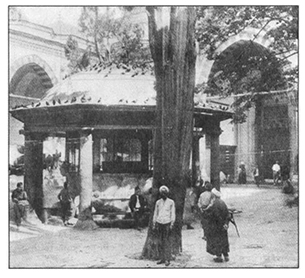
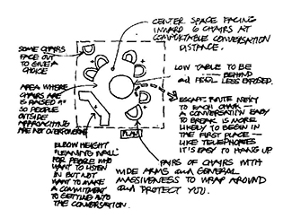
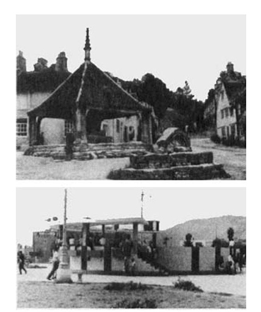
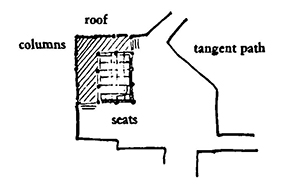

<section class="pattern-plate" aria-labelledby="t-public-outdoor-room">
<a href="/patterns">A Pattern Language</a> · <a href="/patterns#towns">Towns</a> · Pattern 69 · p. 348 · **
<h1 class="pattern-title" id="t-public-outdoor-room">Public Outdoor Room</h1><figure class="pattern-figure pl-figure"></figure><nav class="pattern-links" aria-label="Connections"><h2>Links to</h2><ul><li><a href="/patterns/main-gateways">53 Main Gateways</a></li><li><a href="/patterns/accessible-green">60 Accessible Green</a></li><li><a href="/patterns/small-public-squares">61 Small Public Squares</a></li><li><a href="/patterns/common-land">67 Common Land</a></li><li><a href="/patterns/paths-and-goals">120 Paths And Goals</a></li><li><a href="/patterns/seat-spots">241 Seat Spots</a></li></ul><h2>Linked from</h2><ul><li><a href="/patterns/neighborhood-boundary">15 Neighborhood Boundary</a></li><li><a href="/patterns/carnival">58 Carnival</a></li><li><a href="/patterns/holy-ground">66 Holy Ground</a></li><li><a href="/patterns/bus-stop">92 Bus Stop</a></li><li><a href="/patterns/sleeping-in-public">94 Sleeping In Public</a></li><li><a href="/patterns/path-shape">121 Path Shape</a></li><li><a href="/patterns/activity-pockets">124 Activity Pockets</a></li><li><a href="/patterns/something-roughly-in-the-middle">126 Something Roughly In The Middle</a></li><li><a href="/patterns/outdoor-room">163 Outdoor Room</a></li><li><a href="/patterns/column-place">226 Column Place</a></li></ul></nav></section><article class="pattern-text" aria-label="The text of Public Outdoor Room">
349… the common land in <a class="pl-ref" href="/patterns/main-gateways">main gateways (53)</a>, <a class="pl-ref" href="/patterns/accessible-green">accessible GREEN (60)</a>, <a class="pl-ref" href="/patterns/small-public-squares">SMALL PUBLIC SQUARES (61)</a>, <a class="pl-ref" href="/patterns/common-land">COMMON LAND (67)</a>, PEDESTRIAN STREET (lOO), <a class="pl-ref" href="/patterns/paths-and-goals">PATHS AND GOALS (120)</a> needs at least some place where hanging out and being “out” in public become possible. For this purpose it is necessary to distinguish one part of the common land and to define it with a little more elaboration. Also, if none of the larger patterns exist yet, this pattern can act as a nucleus, and help them to crystallize around it.

◆ ◆ ◆

<strong>There are very few spots along the streets of modern towns and neighborhoods where people can hang out, comfortably, for hours at a time.</strong>

Men seek corner beer shops, where they spend hours talking and drinking; teenagers, especially boys, choose special corners too, where they hang around, waiting for their friends. Old people like a special spot to go to, where they can expect to find others; small children need sand lots, mud, plants, and water to play with in the open; young mothers who go to watch their children often use the children’s play as an opportunity to meet and talk with other mothers.

Because of the diverse and casual nature of these activities, they require a space which has a subtle balance of being defined and yet not too defined, so that any activity which is natural to the neighborhood at any given time can develop freely and yet has something to start from.

For example, it would be possible to leave an outdoor room unfinished, with the understanding it can be finished by people who live nearby, to fill whatever needs seem most pressing. It may need sand, or water faucets, or play equipment for small children—adventure playground (73); it may have steps and seats, where teenagers can meet—teenage society (84); someone may build a small bar or coffee shop in a house that opens into the area, with an arcade, making the arcade a place to eat and 350drink—food stands (93); there may be games like chess and checkers for old people.

Modern housing projects especially suffer from the lack of this kind of space. When indoor community rooms are provided, they are rarely used. People don’t want to plunge into a situation which they don’t know; and the degree of involvement created in such an enclosed space is too intimate to allow a casual passing interest to build up gradually. On the other hand, vacant land is not enclosed enough. It takes years for anything to happen on vacant land; it provides too little shelter, and too little “reason to be there.”

What is needed is a framework which is just enough defined so that people naturally tend to stop there; and so that curiosity naturally takes people there, and invites them to stay. Then, once community groups begin to gravitate toward this framework, there is a good chance that they will themselves, if they are permitted, create an environment which is appropriate to their activities.

We conjecture that a small open space, roofed, with columns, but without walls at least in part, will just about provide the necessary balance of “openness” and “closedness.”

A beautiful example of the pattern was built by Dave Chapin and George Gordon with architecture students from Case Western Reserve in Cleveland, Ohio. They built a sequence of public out door rooms on the grounds and on the public land surrounding a local mental health clinic. According to staff reports, these places changed the life of the clinic dramatically: many more people than had been usual were drawn into the outdoors, public talk was more animated, outdoor space that had always been dominated by automobiles suddenly became human and the cars had to inch along.

<figure class="pl-figure"><figcaption><em>Public outdoor room built by Chafin and Gordon in Cleveland, Ohio</em>.</figcaption></figure>

351In all, Chapin and Gordon and their crew built seven public outdoor rooms in the neighborhood. Each one was slightly different, varying according to views, orientation, size.

We have also discovered a version of this pattern from medieval society. Apparently, in the twelfth and thirteenth centuries there were many such public structures dotted through the towns. They were the scene of auctions, open-air meetings, and market fairs. They are very much in the spirit of the places we are proposing for neighborhoods and work communities.

<figure class="pl-figure"><figcaption><em>Outdoor rooms in England and Peru</em>.</figcaption></figure>

Therefore:

<strong>In every neighborhood and work community, make a 352piece of the common land into an outdoor room—a partly enclosed place, with some roof, columns, without walls, perhaps with a trellis; place it beside an important path and within view of many homes and workshops.</strong>

<figure class="pl-figure"></figure>
◆ ◆ ◆

Place the outdoor room where several paths are tangent to it, like any other common area—common areas at the heart (129); in the bulge of a path—path shape (121); or around a square—activity pockets (124); use surrounding building edges (160) to define part of it; build it like any smaller outdoor room, with columns, and half-trellised roofs—outdoor room (163); perhaps put an open courtyard next to it—courtyards which live (115), an arcade (119) around the edge, or other simple cover—canvas roofs (244), and seats for casual sitting—stair seats(125), <a class="pl-ref" href="/patterns/seat-spots">seat spots (241)</a>….
</article>

Christopher Alexander, Sara Ishikawa and Murray Silverstein, with Max Jacobson, Ingrid Fiksdahl-King and Shlomo Angel, <cite>A Pattern Language</cite> (Oxford University Press, 1977), pattern 69, pp. 348–352. Text and illustrations from the <a href="https://github.com/natureoforder/sources">Nature of Order sources</a> reading edition, transcribed from the 1977 printing; report errors on <a href="https://github.com/natureoforder/alexander-wiki/issues">GitHub</a>.

<a href="/patterns/connected-play">← 68 Connected Play</a> · <a href="/patterns">All 253 patterns</a> · <a href="/patterns/grave-sites">70 Grave Sites →</a>

