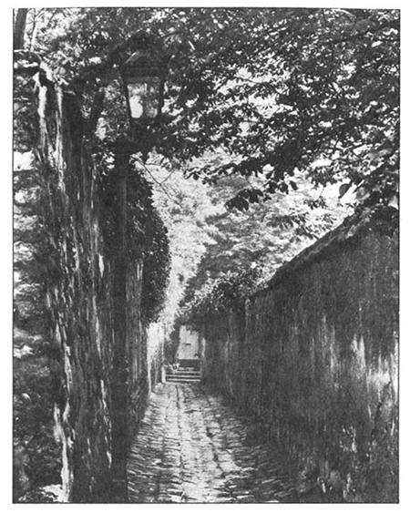
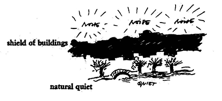

<section class="pattern-plate" aria-labelledby="t-quiet-backs">
<a href="/patterns">A Pattern Language</a> · <a href="/patterns#towns">Towns</a> · Pattern 59 · p. 301 · *
<h1 class="pattern-title" id="t-quiet-backs">Quiet Backs</h1><figure class="pattern-figure pl-figure"></figure><nav class="pattern-links" aria-label="Connections"><h2>Links to</h2><ul><li><a href="/patterns/scattered-work">9 Scattered Work</a></li><li><a href="/patterns/pools-and-streams">64 Pools And Streams</a></li><li><a href="/patterns/still-water">71 Still Water</a></li></ul><h2>Linked from</h2><ul><li><a href="/patterns/subculture-boundary">13 Subculture Boundary</a></li><li><a href="/patterns/neighborhood-boundary">15 Neighborhood Boundary</a></li><li><a href="/patterns/sacred-sites">24 Sacred Sites</a></li><li><a href="/patterns/eccentric-nucleus">28 Eccentric Nucleus</a></li><li><a href="/patterns/children-in-the-city">57 Children In The City</a></li><li><a href="/patterns/accessible-green">60 Accessible Green</a></li><li><a href="/patterns/pools-and-streams">64 Pools And Streams</a></li><li><a href="/patterns/garden-wall">173 Garden Wall</a></li><li><a href="/patterns/garden-seat">176 Garden Seat</a></li></ul></nav></section><article class="pattern-text" aria-label="The text of Quiet Backs">
302… the work places are given their general position by <a class="pl-ref" href="/patterns/scattered-work">scattered work (9)</a> and their detailed organization and distribution by work communities (41). It is essential though, that they be supported by some kind of quiet, which is complementary to the work. This pattern, and the next few patterns, gives the

◆ ◆ ◆

<strong>Any one who has to work in noise, in offices with people all around, needs to be able to pause and refresh himself with quiet in a more natural situation.</strong>

The walk along the Seine, through the middle of Paris, is a classic “quiet back” in the middle of a fast city. People drop down from the streets and the traffic and the commerce to stroll along the river, where the mood is slow and reflective.

The need for such places has often been recognized in universities, where there are quiet walks where people go to think, or pause, or have a private talk. A beautiful case is the University of Cambridge: each college has its “backs”—quiet courts stretching down to the River Cam. But the need for quiet backs goes far beyond the university. It exists everywhere where people work in densely populated, noisy areas.

To meet this need, we may conceive all buildings as having a front and a back. If the front is given over to the street life—cars, shopping paths, delivery—then the back can be reserved for quiet.

If the back is to be quiet, a place where you can hear only natural sounds—winds, birds, water—it is critical that it be protected. At the same time, it must be some way from the buildings which it serves. This suggests a walk, some distance behind the buildings, perhaps separated from them by their private small gardens, completely protected by substantial walls and dense planting along its length.

An example we know is the walk through the cathedral close in Chichester. There is a high brick wall on each side of this walk and flowers planted all along it. It leads away from the cathedral, 303parallel but set back from the town’s major road. On this path, less than a block from the major crossroads of the town, you can hear the bees buzzing.

If a number of these walks are connected, one to another, then slowly, there emerges a ribbon-like system of tiny backs, pleasant alleyways behind the commotion of the street. Since the sound of water plays such a powerful role in establishing the kind of quiet that is required, these paths should always connect up with the local <a class="pl-ref" href="/patterns/pools-and-streams">pools and streams (64)</a>. And the longer it can be, the better.

Therefore:

<strong>Give the buildings in the busy parts of town a quiet “back” behind them and away from the noise. Build a walk along this quiet back, far enough from the building so that it gets full sunlight, but protected from noise by walls and distance and buildings. Make certain that the path is not a natural shortcut for busy foot traffic, and connect it up with other walks, to form a long ribbon of quiet alleyways which converge on the local pools and streams and the local greens.</strong>

<figure class="pl-figure"></figure>
◆ ◆ ◆

If possible, place the backs where there is water—pools and streams (64), <a class="pl-ref" href="/patterns/still-water">still water (71)</a>, and where there are still great trees unharmed by traffic—tree places (171); connect them to accessible greens (60); and protect them from noise with walls or buildings—garden wall (173)….
</article>

Christopher Alexander, Sara Ishikawa and Murray Silverstein, with Max Jacobson, Ingrid Fiksdahl-King and Shlomo Angel, <cite>A Pattern Language</cite> (Oxford University Press, 1977), pattern 59, pp. 301–303. Text and illustrations from the <a href="https://github.com/natureoforder/sources">Nature of Order sources</a> reading edition, transcribed from the 1977 printing; report errors on <a href="https://github.com/natureoforder/alexander-wiki/issues">GitHub</a>.

<a href="/patterns/carnival">← 58 Carnival</a> · <a href="/patterns">All 253 patterns</a> · <a href="/patterns/accessible-green">60 Accessible Green →</a>

