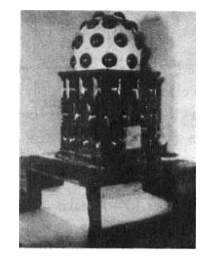
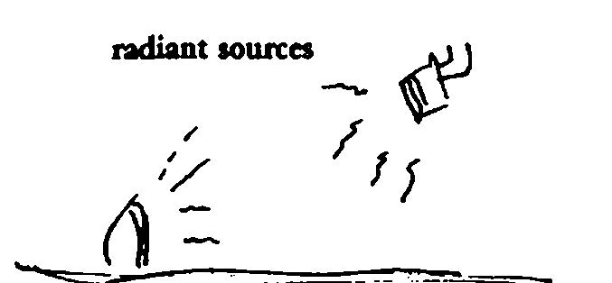

<section class="pattern-plate" aria-labelledby="t-radiant-heat">
<a href="/patterns">A Pattern Language</a> · <a href="/patterns#construction">Construction</a> · Pattern 230 · p. 1078 · *
<h1 class="pattern-title" id="t-radiant-heat">Radiant Heat</h1><nav class="pattern-links" aria-label="Connections"><h2>Links to</h2><ul><li><a href="/patterns/built-in-seats">202 Built-In Seats</a></li><li><a href="/patterns/wall-membrane">218 Wall Membrane</a></li><li><a href="/patterns/floor-ceiling-vaults">219 Floor-Ceiling Vaults</a></li><li><a href="/patterns/duct-space">229 Duct Space</a></li></ul><h2>Linked from</h2><ul><li><a href="/patterns/frames-as-thickened-edges">225 Frames As Thickened Edges</a></li><li><a href="/patterns/duct-space">229 Duct Space</a></li></ul></nav></section><article class="pattern-text" aria-label="The text of Radiant Heat">
… to complete <a class="pl-ref" href="/patterns/wall-membrane">WALL MEMBRANES (218)</a>, <a class="pl-ref" href="/patterns/floor-ceiling-vaults">FLOOR-CEILING VAULTS (219)</a> and <a class="pl-ref" href="/patterns/duct-space">DUCT SPACE (229)</a>, use a biologically sensible heating system.

◆ ◆ ◆

<strong>This pattern is a biologically precise formulation of the intuition that sunlight and a hot blazing fire are the best kinds of heat.</strong>

Heat can be transmitted by radiation (heat waves across empty space), convection (flow in air or liquids by mixing of molecules and hot air rising), and conduction (flow through a solid).

In most places, we get heat in all three ways from our environment: conducted heat from the solids we touch, converted heat in the air around us, and radiated heat from those sources of radiation in our line of sight.

Of the three, conducted heat is trivial, since any surface hot enough to conduct heat to us directly is too hot for comfort. As far as the other two are concerned—converted heat and radiant heat—we may ask whether there is any biological difference in their effects on human beings. In fact there is.

It turns out that people are most comfortable when they receive radiant heat at a slightly higher temperature than the temperature of the air around them. The two most primitive examples of this situation are: (1) Outdoors, on a spring day when the air is not too hot but the sun is shining. (2) Around an open fire, on a cool evening.

Most people will recognize intuitively that these are two unusually comfortable situations. And in view of the fact that we evolved as organisms in the open air, with plenty of sun, it is not surprising that this condition happens to be so comfortable for us. It is built into our systems, biologically.

<em>Unfortunately, it happens that many of the most widely used heating systems ignore this basic fact</em>.

1079Hot air systems, and baried pipes, and the so-called hot water “radiators” do transmit some of their heat to ns by means of radiation, but most of the heat we get from them comes from convection. The air gets heated and warms us as it swirls around us. But, as it does so it creates that very uncomfortable stuffy, over-heated, dry sensation. When convection heaters are warm enough to heat us we feel stifled. If we turn the heat down, it gets too cold.

The conditions in which people feel most comfortable require a subtle balance of convected heat and radiant heat. Experiments have established that the most comfortable balance between the two, occurs when the average radiant temperature is about two degrees higher than the ambient temperature. To get the average radiant temperature in a room, we measure the temperature of all the visible surfaces in a room, multiply the area of each surface by its temperature, add these up, and divide by the total area. For comfort, this average radiant temperature needs to be about two degrees higher than the air temperature.

Since some of the surfaces in a room (windows and outside walls), will usually be cooler than the indoor air temperature, this means that at least some surfaces must be considerably warmer to get the average up.

An open fire, which has a small area of very high temperature, creates this condition in a cool room. The beautiful Austrian and Swedish tiled stoves also do it very well. They are massive stoves, made of clay bricks or tiles, with a tiny furnace in the middle. A handful of twigs in the furnace give all their heat to the clay of the stove itself, and this clay, like the earth, keeps this heat and radiates it slowly over a period of many hours.

<figure class="pl-figure"><figcaption><em>Austrian tiled stove</em>.</figcaption></figure>

1080Radiant panels, with individual room control, and infrared heaters hung from walls and ceilings, are possible high technology sources of radiant heat. It is possible that sources of low-grade radiant heat—like a hot water tank—might also work to very much the same effect. Instead of insulating the tank, it might be an excellent source of radiant heat, right in the center of the house.

Therefore:

<strong>Choose a way of heating your space—especially those rooms where people are going to gather when it is cold—that is essentially a radiative process, where the heat comes more from radiation than convection.</strong>

<figure class="pl-figure"></figure>
◆ ◆ ◆

If you have followed earlier patterns, you may have rooms which have a vaulted ceiling, with a steeply sloping surface close to the wall, and with the major ducts behind that surface—<a class="pl-ref" href="/patterns/floor-ceiling-vaults">FLOOR-CEILING VAULTS (219)</a>, <a class="pl-ref" href="/patterns/duct-space">DUCT SPACE (229)</a>. In this case, it is natural to put the radiant heating panels on that sloping surface.

But it is also very wonderful to make at least some part of the radiant surfaces low enough so that seats can be built round them and against them; on a cold day there is nothing better than a seat against a warm stove—<a class="pl-ref" href="/patterns/built-in-seats">BUILT-IN SEATS (202)</a>….
</article>

Christopher Alexander, Sara Ishikawa and Murray Silverstein, with Max Jacobson, Ingrid Fiksdahl-King and Shlomo Angel, <cite>A Pattern Language</cite> (Oxford University Press, 1977), pattern 230, pp. 1078–1080. Text and illustrations from the <a href="https://github.com/natureoforder/sources">Nature of Order sources</a> reading edition, transcribed from the 1977 printing; report errors on <a href="https://github.com/natureoforder/alexander-wiki/issues">GitHub</a>.

<a href="/patterns/duct-space">← 229 Duct Space</a> · <a href="/patterns">All 253 patterns</a> · <a href="/patterns/dormer-windows">231 Dormer Windows →</a>

