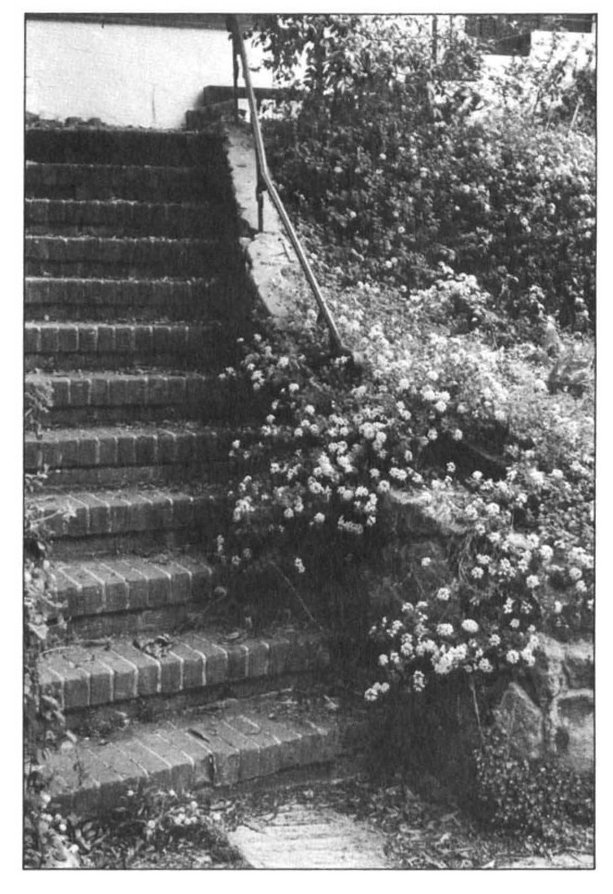
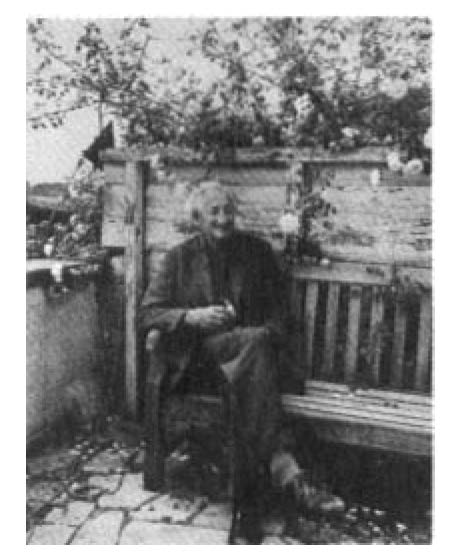
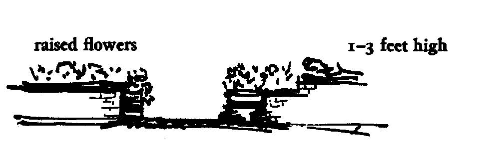

<section class="pattern-plate" aria-labelledby="t-raised-flowers">
<a href="/patterns">A Pattern Language</a> · <a href="/patterns#construction">Construction</a> · Pattern 245 · p. 1132 · *
<h1 class="pattern-title" id="t-raised-flowers">Raised Flowers</h1><figure class="pattern-figure pl-figure"></figure><nav class="pattern-links" aria-label="Connections"><h2>Links to</h2><ul><li><a href="/patterns/paths-and-goals">120 Paths And Goals</a></li><li><a href="/patterns/stair-seats">125 Stair Seats</a></li><li><a href="/patterns/terraced-slope">169 Terraced Slope</a></li><li><a href="/patterns/garden-wall">173 Garden Wall</a></li><li><a href="/patterns/sitting-wall">243 Sitting Wall</a></li></ul><h2>Linked from</h2><ul><li><a href="/patterns/green-streets">51 Green Streets</a></li><li><a href="/patterns/car-connection">113 Car Connection</a></li><li><a href="/patterns/roof-garden">118 Roof Garden</a></li><li><a href="/patterns/paths-and-goals">120 Paths And Goals</a></li><li><a href="/patterns/terraced-slope">169 Terraced Slope</a></li><li><a href="/patterns/garden-growing-wild">172 Garden Growing Wild</a></li><li><a href="/patterns/low-sill">222 Low Sill</a></li><li><a href="/patterns/column-place">226 Column Place</a></li><li><a href="/patterns/half-inch-trim">240 Half-Inch Trim</a></li><li><a href="/patterns/front-door-bench">242 Front Door Bench</a></li><li><a href="/patterns/sitting-wall">243 Sitting Wall</a></li></ul></nav></section><article class="pattern-text" aria-label="The text of Raised Flowers">
1133… outdoors there are various low walls at sitting height—<a class="pl-ref" href="/patterns/sitting-wall">SITTING WALL (243)</a>; terraced gardens, if the garden has a natural slope in it—<a class="pl-ref" href="/patterns/terraced-slope">TERRACED SLOPE (169)</a>; and paths and steps and crinkled building edges—<a class="pl-ref" href="/patterns/paths-and-goals">PATHS AND GOALS (120)</a>, <a class="pl-ref" href="/patterns/stair-seats">STAIR SEATS (125)</a>, BUILDING EDGE (l60), <a class="pl-ref" href="/patterns/garden-wall">GARDEN WALL (173)</a>. These are the best spots for flowers, and flowers help to make them beautiful.

◆ ◆ ◆

<strong>Flowers are beautiful along the edges of paths, buildings, outdoor rooms—but it is just in these places that they need the most protection from traffic. Without some protection they cannot easily survive.</strong>

Look at the positions that wildflowers take in nature. They are as a rule in protected places when they occur in massive quantities: places away from traffic—often on grassy banks, on corners of fields, against a wall. It is not natural for flowers to grow in bundles like flower beds; they need a place to nestle.

What are the issues?

1 The sun—they need plenty of sun.

2 A position where people can smell and touch them.

3 Protection from stray animals.

4 A position where people see them, either from inside a house or along the paths which they naturally pass coming and going.

Typical flower borders are often too deep and too exposed. And they are so low the flowers are out of reach. Concrete planter boxes made to protect flowers often go to the other extreme. They are so protected that people have no contact with them, except from a distance. This is next to useless. The flowers need to be close, where you can touch them, smell them.

Therefore, instead of putting the flowers in low borders, on the ground, where people walk, or in massive concrete tubs, build them up in low beds, with sitting walls beside them, along the sides of paths, around entrances and edges. Make quite certain 1134that the flowers are placed in positions where people really can enjoy them—and not simply as ornament: outside favorite windows, along traveled paths, near entrances and round doorways, by outdoor seats.

<figure class="pl-figure"><figcaption><em>Raised flowers</em>.</figcaption></figure>

Therefore:

<strong>Soften the edges of buildings, paths, and outdoor areas with flowers. Raise the flower beds so that people can touch the flowers, bend to smell them, and sit by them. And build the flower beds with solid edges, so that people can sit on them, among the flowers too.</strong>

<figure class="pl-figure"></figure>
◆ ◆ ◆
</article>

Christopher Alexander, Sara Ishikawa and Murray Silverstein, with Max Jacobson, Ingrid Fiksdahl-King and Shlomo Angel, <cite>A Pattern Language</cite> (Oxford University Press, 1977), pattern 245, pp. 1132–1134. Text and illustrations from the <a href="https://github.com/natureoforder/sources">Nature of Order sources</a> reading edition, transcribed from the 1977 printing; report errors on <a href="https://github.com/natureoforder/alexander-wiki/issues">GitHub</a>.

<a href="/patterns/canvas-roofs">← 244 Canvas Roofs</a> · <a href="/patterns">All 253 patterns</a> · <a href="/patterns/climbing-plants">246 Climbing Plants →</a>

