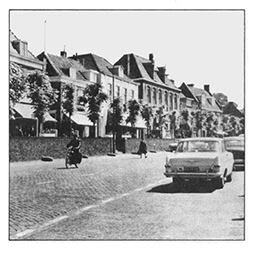
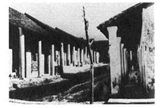
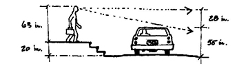
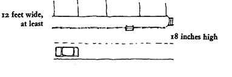

<section class="pattern-plate" aria-labelledby="t-raised-walk">
<a href="/patterns">A Pattern Language</a> · <a href="/patterns#towns">Towns</a> · Pattern 55 · p. 285 · *
<h1 class="pattern-title" id="t-raised-walk">Raised Walk</h1><figure class="pattern-figure pl-figure"></figure><nav class="pattern-links" aria-label="Connections"><h2>Links to</h2><ul><li><a href="/patterns/parallel-roads">23 Parallel Roads</a></li><li><a href="/patterns/network-of-paths-and-cars">52 Network Of Paths And Cars</a></li></ul><h2>Linked from</h2><ul><li><a href="/patterns/parallel-roads">23 Parallel Roads</a></li><li><a href="/patterns/degrees-of-publicness">36 Degrees Of Publicness</a></li><li><a href="/patterns/housing-in-between">48 Housing In Between</a></li><li><a href="/patterns/food-stands">93 Food Stands</a></li><li><a href="/patterns/pedestrian-street">100 Pedestrian Street</a></li><li><a href="/patterns/path-shape">121 Path Shape</a></li></ul></nav></section><article class="pattern-text" aria-label="The text of Raised Walk">
286… this pattern helps complete the <a class="pl-ref" href="/patterns/network-of-paths-and-cars">network of paths and cars (52)</a> and road crossings (54). It is true that in most cases, pedestrian paths which follow the path network will be running across roads, not next to them. But still, from time to time, especially along major <a class="pl-ref" href="/patterns/parallel-roads">parallel roads (23)</a>, between one road crossing and the next, there is a need for paths along the road This pattern gives these special paths their character.

◆ ◆ ◆

<strong>Where fast moving cars and pedestrians meet in cities, the cars overwhelm the pedestrians. The car is king, and people are made to feel small.</strong>

This cannot be solved by keeping pedestrians separate from cars; it is in their nature that they have to meet, at least occasionally—network of paths and cars (52). What can be done at those points where cars and pedestrians do meet?

On an ordinary street, cars make pedestrians feel small and vulnerable because the sidewalks are too narrow and too low. When the sidewalk is too narrow, you feel you are goipg to fall off, or get pushed off—and there is always a chance that you will step off just in front of a passing car. When the sidewalk is too low, you feel that cars can easily mount the sidewalk, if they go out of control, and crush you. It is clear, then, that pedestrians will feel comfortable, powerful, safe, and free in their movements when the walks they walk on are both wide enough to keep the people well away from the cars, and high enough to make it quite impossible for any car to drive up on them by accident.

<figure class="pl-figure"></figure>
<em>Traditional raised walk in Pichucalis</em>, <em>Mexico</em>.

287We first consider the width. What is the appropriate width for a raised walk? The famous example, of course, is the Champs Elysees, where the sidewalk is more than 30 feet wide, and very comfortable. In our own experience, a walk of half this width, along a typical shopping street with traffic, is still comfortable; but 12 feet or less, and a pedestrian begins to feel cramped and threatened by cars. A conventional sidewalk is often no more than 6 feet wide; and people really feel the presence of the cars. How can we alford the extra width which people need in order to be comfortable? One way: instead of putting sidewalks along both sides of a road, we can put a double width raised walk along one side of the road only, with road crossings at intervals of 200 to 300 feet. This means, of course, that there can only be shops along one side of the road.

What is the right height for a raised Walk? Our experiments suggest that pedestrians begin to feel secure when they are about 18 inches above the cars. There are a number of possible reasons for this finding.

One possible reason. When the car is down low and the pedestrian world physically higher, pedestrians feel, symbolically, that they are more important than the cars and therefore feel secure.

Another possible reason. It may be that the car overwhelms the pedestrian because of a constant, unspoken possibility that a runaway car might at any moment mount the curb and run him down. A car can climb an ordinary six inch curb easily. For the pedestrian to feel certain that a car could not climb the curb, the curb height would have to be greater than the radius of a car tire (10 to 15 inches).

Another possible reason. Most people’s eye level is between 51 and 63 inches. A typical car has an overall height of 5 5 inches. Although tall people can see over cars, even for them, the cars fill the landscape since a standing person’s normal line of sight is 10 degrees below the horizontal (Henry Dreyfus, <em>The Measure of Man</em>, New York, 1958, sheet F). To put a car 12 feet away completely below a pedestrian’s line of sight, it would have to be on a road some 18 to 30 inches below the pedestrian.

288

<figure class="pl-figure"><figcaption><em>Keep the cars belo’ui a ferson’s line of sight</em>.</figcaption></figure>

Therefore:

<strong>We conclude that any pedestrian path along a road carrying fast-moving cars should be about 18 inches above the road, with a low wall or railing, or balustrade along the edge, to mark the edge. Put the raised walk on only one side of the road—make it as wide as possible.</strong>

<figure class="pl-figure"></figure>
◆ ◆ ◆

Protect the raised walk from the road, by means of a low wall—sitting wall (243). An arcade built over the walk, will, with its columns, give an even greater sense of comfort and protection—arcades (119). At the end of blocks and at special points where a car might pull in to pick up or drop passengers, build steps into the raised walk, large enough so people can sit there and wait in comfort—stair seats (125)….
</article>

Christopher Alexander, Sara Ishikawa and Murray Silverstein, with Max Jacobson, Ingrid Fiksdahl-King and Shlomo Angel, <cite>A Pattern Language</cite> (Oxford University Press, 1977), pattern 55, pp. 285–288. Text and illustrations from the <a href="https://github.com/natureoforder/sources">Nature of Order sources</a> reading edition, transcribed from the 1977 printing; report errors on <a href="https://github.com/natureoforder/alexander-wiki/issues">GitHub</a>.

<a href="/patterns/road-crossing">← 54 Road Crossing</a> · <a href="/patterns">All 253 patterns</a> · <a href="/patterns/bike-paths-and-racks">56 Bike Paths And Racks →</a>

