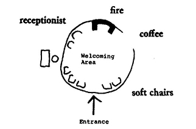

<section class="pattern-plate" aria-labelledby="t-reception-welcomes-you">
<a href="/patterns">A Pattern Language</a> · <a href="/patterns#buildings">Buildings</a> · Pattern 149 · p. 705
<h1 class="pattern-title" id="t-reception-welcomes-you">Reception Welcomes You</h1><nav class="pattern-links" aria-label="Connections"><h2>Links to</h2><ul><li><a href="/patterns/self-governing-workshops-and-offices">80 Self-Governing Workshops And Offices</a></li><li><a href="/patterns/travelers-inn">91 Traveler’s Inn</a></li><li><a href="/patterns/entrance-room">130 Entrance Room</a></li><li><a href="/patterns/tapestry-of-light-and-dark">135 Tapestry Of Light And Dark</a></li><li><a href="/patterns/flexible-office-space">146 Flexible Office Space</a></li><li><a href="/patterns/a-place-to-wait">150 A Place To Wait</a></li><li><a href="/patterns/light-on-two-sides-of-every-room">159 Light On Two Sides Of Every Room</a></li><li><a href="/patterns/alcoves">179 Alcoves</a></li><li><a href="/patterns/window-place">180 Window Place</a></li><li><a href="/patterns/the-fire">181 The Fire</a></li><li><a href="/patterns/workspace-enclosure">183 Workspace Enclosure</a></li><li><a href="/patterns/the-shape-of-indoor-space">191 The Shape Of Indoor Space</a></li></ul><h2>Linked from</h2><ul><li><a href="/patterns/building-thoroughfare">101 Building Thoroughfare</a></li><li><a href="/patterns/family-of-entrances">102 Family Of Entrances</a></li><li><a href="/patterns/intimacy-gradient">127 Intimacy Gradient</a></li><li><a href="/patterns/sequence-of-sitting-spaces">142 Sequence Of Sitting Spaces</a></li><li><a href="/patterns/bulk-storage">145 Bulk Storage</a></li><li><a href="/patterns/flexible-office-space">146 Flexible Office Space</a></li></ul></nav></section><article class="pattern-text" aria-label="The text of Reception Welcomes You">
… in a public building, or an office where there are many people coming in, <a class="pl-ref" href="/patterns/self-governing-workshops-and-offices">SELF-GOVERNING WORKSHOPS AND OFFICES (80)</a>, SMALL SERVICES WITHOUT RED TAPE (8l), <a class="pl-ref" href="/patterns/travelers-inn">TRAVELER’S INN (91)</a>, <a class="pl-ref" href="/patterns/flexible-office-space">FLEXIBLE OFFICE SPACE (146)</a>—the place inside the <a class="pl-ref" href="/patterns/entrance-room">ENTRANCE ROOM (130)</a> plays an essential role; it must be built from the very start with the right atmosphere. This pattern was originally proposed by Clyde Dorsett of the National Institute of Mental Health, in a program for community mental health clinics

◆ ◆ ◆

<strong>Have you ever walked into a public building and been processed by the receptionist as if you were a package?</strong>

To make a person feel at ease, you must do the same for him as you would do to welcome him to your home; go toward him, greet him, offer him a chair, offer him some food and drink, and take his coat.

In most institutions the person arriving has to go toward the receptionist; the receptionist remains passive and offers nothing. To be welcoming the receptionist must initiate the action—come forward and greet the person, offer a chair, food, a seat by the fire, coffee. Since it is first impressions which count, this whole atmosphere should be the first thing a person encounters.

A beautiful example we know is the reception desk at Browns Hotel in London. You pass into the hotel through a small, unassuming entrance, not unlike the entrance to a house. You pass through two or three rooms; then come to the central room in which there are two old writing desks. The receptionist comes forward from an inner office, invites you to sit down in a comfortable chair at one of these writing desks, and sits down with you while you fill out the hotel register.

706The reasons most reception areas fail completely to have this quality, is that the receptionist’s desk forms a barrier, so that the desk and equipment together help to create an institutional atmosphere, quite at odds with the feeling of welcome.

Therefore:

<strong>Arrange a series of welcoming things immediately inside the entrance—soft chairs, a fireplace, food, coffee. Place the reception desk so that it is not between the receptionist and the welcoming area, but to one side at an angle—so that she, or he, can get up and walk toward the people who come in, greet them, and then invite them to sit down.</strong>

<figure class="pl-figure"></figure>
◆ ◆ ◆

Place the fireplace most carefully, to be a focus—<a class="pl-ref" href="/patterns/the-fire">THE FIRE (181)</a> give the receptionist a workspace where she can be comfortable in her own work, and still make visitors feel welcome—<a class="pl-ref" href="/patterns/workspace-enclosure">WORKSPACE ENCLOSURE (183)</a>; give the space <a class="pl-ref" href="/patterns/light-on-two-sides-of-every-room">LIGHT ON TWO SIDES (159)</a>; perhap put in an alcove or a window seat for people who are waiting—<a class="pl-ref" href="/patterns/a-place-to-wait">A PLACE TO WAIT (150)</a>, <a class="pl-ref" href="/patterns/alcoves">ALCOVES (179)</a>, <a class="pl-ref" href="/patterns/window-place">WINDOW PLACE (180)</a>. Make sure that the reception point itself is lighter than surrounding areas—<a class="pl-ref" href="/patterns/tapestry-of-light-and-dark">TAPESTRY OF LIGHT AND DARK (135)</a>. And for the shape of the reception space start with <a class="pl-ref" href="/patterns/the-shape-of-indoor-space">THE SHAPE OF INDOOR SPACE (191)</a>….
</article>

Christopher Alexander, Sara Ishikawa and Murray Silverstein, with Max Jacobson, Ingrid Fiksdahl-King and Shlomo Angel, <cite>A Pattern Language</cite> (Oxford University Press, 1977), pattern 149, pp. 705–706. Text and illustrations from the <a href="https://github.com/natureoforder/sources">Nature of Order sources</a> reading edition, transcribed from the 1977 printing; report errors on <a href="https://github.com/natureoforder/alexander-wiki/issues">GitHub</a>.

<a href="/patterns/small-work-groups">← 148 Small Work Groups</a> · <a href="/patterns">All 253 patterns</a> · <a href="/patterns/a-place-to-wait">150 A Place To Wait →</a>

