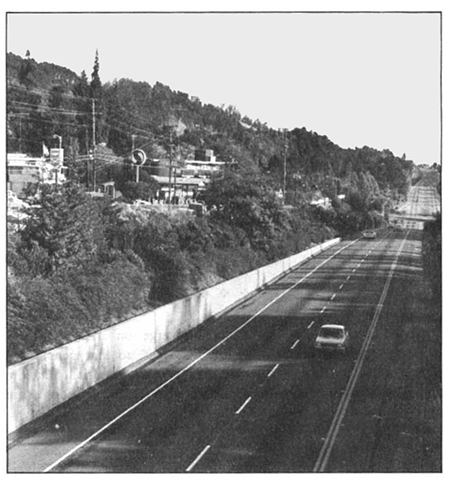
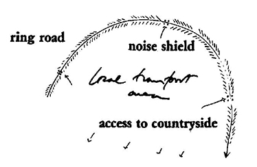

<section class="pattern-plate" aria-labelledby="t-ring-roads">
<a href="/patterns">A Pattern Language</a> · <a href="/patterns#towns">Towns</a> · Pattern 17 · p. 96
<h1 class="pattern-title" id="t-ring-roads">Ring Roads</h1><figure class="pattern-figure pl-figure"></figure><nav class="pattern-links" aria-label="Connections"><h2>Links to</h2><ul><li><a href="/patterns/city-country-fingers">3 City Country Fingers</a></li><li><a href="/patterns/local-transport-areas">11 Local Transport Areas</a></li><li><a href="/patterns/subculture-boundary">13 Subculture Boundary</a></li><li><a href="/patterns/web-of-public-transportation">16 Web Of Public Transportation</a></li><li><a href="/patterns/access-to-water">25 Access To Water</a></li><li><a href="/patterns/interchange">34 Interchange</a></li><li><a href="/patterns/industrial-ribbon">42 Industrial Ribbon</a></li><li><a href="/patterns/shielded-parking">97 Shielded Parking</a></li></ul><h2>Linked from</h2><ul><li><a href="/patterns/city-country-fingers">3 City Country Fingers</a></li><li><a href="/patterns/local-transport-areas">11 Local Transport Areas</a></li><li><a href="/patterns/subculture-boundary">13 Subculture Boundary</a></li><li><a href="/patterns/neighborhood-boundary">15 Neighborhood Boundary</a></li><li><a href="/patterns/parallel-roads">23 Parallel Roads</a></li><li><a href="/patterns/industrial-ribbon">42 Industrial Ribbon</a></li></ul></nav></section><article class="pattern-text" aria-label="The text of Ring Roads">
97… the ring roads which this pattern specifies, help to define and generate the <a class="pl-ref" href="/patterns/local-transport-areas">LOCAL TRANSPORT AREAS (11)</a>; if they are placed to make connections between <a class="pl-ref" href="/patterns/interchange">INTERCHANGES (34)</a>, they also help to form the <a class="pl-ref" href="/patterns/web-of-public-transportation">WEB OF PUBLIC TRANSPORTATION (16)</a>.

◆ ◆ ◆

<strong>It is not possible to avoid the need for high speed roads in modern society; but it is essential to place them and build them in such a way that they do not destroy communities or countryside.</strong>

Even though the rush of freeways and superhighways built in the 195o’s and 196o’s is slowing down, because of widespread local protest, we cannot avoid high speed roads altogether. There is, at present, no prospect for a viable alternative which can provide for the vast volume of movement of cars and trucks and buses which a modern city lives on economically and socially.

At the same time, however, high speed roads do enormous damage when they are badly placed. They slice communities in half; they cut off waterfronts; they cut off access to the countryside; and, above all, they create enormous noise. For hundreds of yards, even a mile or two, the noise of every superhighway roars in the background.

To resolve these obvious dilemmas that come with the location and construction of high speed roads, we must find ways of building and locating these roads, so that they do not destroy communities and shatter life with their noise. We can give three requirements that, we believe, go to the heart of this policy:

1. Every community that has coherence as an area of local transportation—<a class="pl-ref" href="/patterns/local-transport-areas">LOCAL TRANSPORT AREAS (11)</a>—is never split by a high speed road, but rather has at least one high speed road adjacent to it. This allows rapid auto travel from one such community out to other communities and to the region at large.

2. It must be possible for residents of each local transport area to reach the open countryside without crossing a high speed road—see <a class="pl-ref" href="/patterns/city-country-fingers">CITY COUNTRY FINGERS (3)</a>. This means, very roughly, 98that high speed roads must always be placed in such positions that at least one side of every local transport area has direct access to open country.

3. Most important of all, high speed roads must be shielded acoustically to protect the life around them. This means that they must either be sunken, or shielded by earth berms, parking structures, or warehouses, which will not be damaged by the noise.

Therefore:

<strong>Place high speed roads (freeways and other major arteries) so that:</strong>

<strong>1.  At least one high speed road lies tangent to each local transport area.</strong>

<strong>2.  Each local transport area has at least one side not bounded by a high speed road, but directly open to the countryside.</strong>

<strong>3.  The road is always sunken, or shielded along its length by berms, or earth, or industrial buildings, to protect the nearby neighborhoods from noise.</strong>

<figure class="pl-figure"></figure>
Always place the high speed roads on boundaries between subcultures—<a class="pl-ref" href="/patterns/subculture-boundary">SUBCULTURE BOUNDARY (13)</a> and never along waterfronts—<a class="pl-ref" href="/patterns/access-to-water">ACCESS TO WATER (25)</a>. Place industry and big parking garages next to the roads, and use them, whenever possible, as extra noise shields—<a class="pl-ref" href="/patterns/industrial-ribbon">INDUSTRIAL RIBBONS (42)</a>, <a class="pl-ref" href="/patterns/shielded-parking">SHIELDED PARKING (20)</a>….
</article>

Christopher Alexander, Sara Ishikawa and Murray Silverstein, with Max Jacobson, Ingrid Fiksdahl-King and Shlomo Angel, <cite>A Pattern Language</cite> (Oxford University Press, 1977), pattern 17, pp. 96–98. Text and illustrations from the <a href="https://github.com/natureoforder/sources">Nature of Order sources</a> reading edition, transcribed from the 1977 printing; report errors on <a href="https://github.com/natureoforder/alexander-wiki/issues">GitHub</a>.

<a href="/patterns/web-of-public-transportation">← 16 Web Of Public Transportation</a> · <a href="/patterns">All 253 patterns</a> · <a href="/patterns/network-of-learning">18 Network Of Learning →</a>

