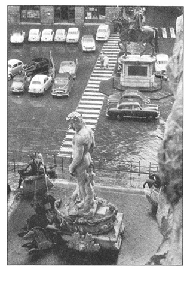
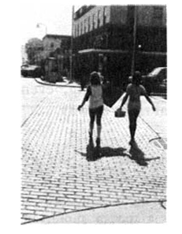
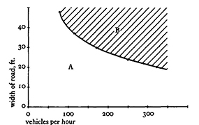
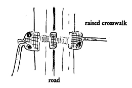

<section class="pattern-plate" aria-labelledby="t-road-crossing">
<a href="/patterns">A Pattern Language</a> · <a href="/patterns#towns">Towns</a> · Pattern 54 · p. 280
<h1 class="pattern-title" id="t-road-crossing">Road Crossing</h1><figure class="pattern-figure pl-figure"></figure><nav class="pattern-links" aria-label="Connections"><h2>Links to</h2><ul><li><a href="/patterns/parallel-roads">23 Parallel Roads</a></li><li><a href="/patterns/network-of-paths-and-cars">52 Network Of Paths And Cars</a></li><li><a href="/patterns/small-public-squares">61 Small Public Squares</a></li><li><a href="/patterns/bus-stop">92 Bus Stop</a></li><li><a href="/patterns/food-stands">93 Food Stands</a></li><li><a href="/patterns/canvas-roofs">244 Canvas Roofs</a></li></ul><h2>Linked from</h2><ul><li><a href="/patterns/parallel-roads">23 Parallel Roads</a></li><li><a href="/patterns/shopping-street">32 Shopping Street</a></li><li><a href="/patterns/housing-in-between">48 Housing In Between</a></li><li><a href="/patterns/food-stands">93 Food Stands</a></li></ul></nav></section><article class="pattern-text" aria-label="The text of Road Crossing">
281… under the impetus of <a class="pl-ref" href="/patterns/parallel-roads">parallel roads (23)</a> and <a class="pl-ref" href="/patterns/network-of-paths-and-cars">network of paths and cars (52)</a>, paths will gradually grow at right angles to major roads—not along them as they do now. This is an entirely new kind of situation, and requires an entirely new physical treatment to make it work.

◆ ◆ ◆

<strong>Where paths cross roads, the cars have power to frighten and subdue the people walking, even when the people walking have the legal right-of-way.</strong>

This will happen whenever the path and the road are at the same level. No amount of painted white lines, crosswalks, traffic lights, button operated signals, ever quite manage to change the fact that a car weighs a ton or more, and will run over any pedestrian, unless the driver brakes. Most often the driver does brake. But everyone knows of enough occasions when brakes have failed, or drivers gone to sleep, to be perpetually wary and afraid.

The people who cross a road will only feel comfortable and safe if the road crossing is a physical obstruction, which physically guarantees that the cars must slow down and give way to pedestrians. In many places it is recognized by law that pedestrians have the right-of-way over automobiles. Yet at the crucial points where paths cross roads, the <em>physical</em> arrangement gives priority to <em>cars</em>. The road is continuous, smooth, and fast, interrupting the pedestrian walkway at the junctions. This continuous road surface actually implies that the car has the right-of-way.

What should crossings be like to accommodate the needs of the pedestrians?

The fact that pedestrians feel less vulnerable to cars when they are about 18 inches above them, is discussed in the next pattern raised walk (5$). The same principle applies, even more powerfully, where pedestrians have to cross a road. The pedestrians who cross must be extremely visible from the road. Cars should also be forced to slow down when they approach the crossing. If the pedestrian way crosses 6 to 12 inches above the road-way, 282and the roadway slopes up to it, this satisfies both requirements. A slope of i in 6, or less, is safe for cars and solid enough to slow them down. To make the crossing even easier to see from a distance and to give weight to the pedestrian’s right to be there, the pedestrian path could be marked by a canopy at the edge of the road—canvas roofs (244).

<figure class="pl-figure"><figcaption><em>Almost a road crossing … but no bumf</em>.</figcaption></figure>

We know that this pattern is rather extraordinary. For this reason, we consider it quite essential that readers do not try to use it on every road, for formalistic reasons, but only on those roads where it is badly needed. We therefore complete the problem statement by defining a simple experiment which you can do to decide whether or not a given crossing needs this treatment.

Go to the road in question several times, at different times of day. Each time you go, count the number of seconds you have to wait before you can cross the road. If the average of these waiting times is more than two seconds, then we recommend you use the pattern. (On the basis of Buchanan’s statement that roads become threatening to pedestrians when the volume of traffic on them creates an average delay of two seconds or more, for people trying to cross on foot. See the extensive discussion, Colin Buchanan et al., <em>Traffic in Towns</em>, HMSO, London, 1963, pp. 203–13.) If you cannot do this experiment, or the road is not yet built, you may be able to guess, by using the chart below. It shows which combinations of volume and width will typically create more than a two-second average delay.

283

<figure class="pl-figure"><figcaption><em>Roads that jail in the shaded region require special crossings</em>.</figcaption></figure>

One final note. This pattern may be impossible to implement, in places where traffic engineers are still in control. Nevertheless the functional, issue is vital, and must not be ignored. A big wide road, with several lanes of heavy traffic can form an almost impenetrable barrier. In this case, you can solve the problem, at least partially, by creating islands—certainly one in the middle, and perhaps extra islands, between adjacent lanes. This has a huge effect on a person’s capacity to cross the road, for a very simple reason. If you are trying to cross a wide road, you have to wait for a gap to occur simultaneously in each of the lanes. It is the waiting for this coincidence of gaps that creates the problem. But if you can hop, from island to island, each time a gap occurs in any one lane, one lane at a time, you can get across in no time at all—because the gaps which occur in individual lanes are many many times more frequent, than the big gaps in all lanes at the same time. So, if you can’t raise the crossing, at least use islands, like stepping stones.

Therefore:

<strong>At any point where a pedestrian path crosses a road that has enough traffic to create more than a two second delay to people crossing, make a “knuckle” at the crossing: 284narrow the road to the width of the through lanes only; continue the pedestrian path through the crossing about a foot above the roadway; put in islands between lanes; slope the road up toward the crossing (i in 6 maximum); mark the path with a canopy or shelter to make it visible.</strong>

<figure class="pl-figure"></figure>
◆ ◆ ◆

On one side or the other of the road make the pedestrian path swell out to form a tiny square, where food stands cluster round a bus Stop <a class="pl-ref" href="/patterns/small-public-squares">SMALL PUBLIC SQUARES (61)</a>, <a class="pl-ref" href="/patterns/bus-stop">BUS STOP (92)</a>, <a class="pl-ref" href="/patterns/food-stands">food stands (93)</a>; provide one or two bays for standing space for buses and cars—small parking lots (103), and when a path must run from the road crossing along the side of the road, keep it to one side only, make it as wide as possible, and raised above the roadway—raised walk (55). Perhaps build the canopy as a trellis or canvas roof—trellised walk (174), <a class="pl-ref" href="/patterns/canvas-roofs">canvas roofs (244)</a>….
</article>

Christopher Alexander, Sara Ishikawa and Murray Silverstein, with Max Jacobson, Ingrid Fiksdahl-King and Shlomo Angel, <cite>A Pattern Language</cite> (Oxford University Press, 1977), pattern 54, pp. 280–284. Text and illustrations from the <a href="https://github.com/natureoforder/sources">Nature of Order sources</a> reading edition, transcribed from the 1977 printing; report errors on <a href="https://github.com/natureoforder/alexander-wiki/issues">GitHub</a>.

<a href="/patterns/main-gateways">← 53 Main Gateways</a> · <a href="/patterns">All 253 patterns</a> · <a href="/patterns/raised-walk">55 Raised Walk →</a>

