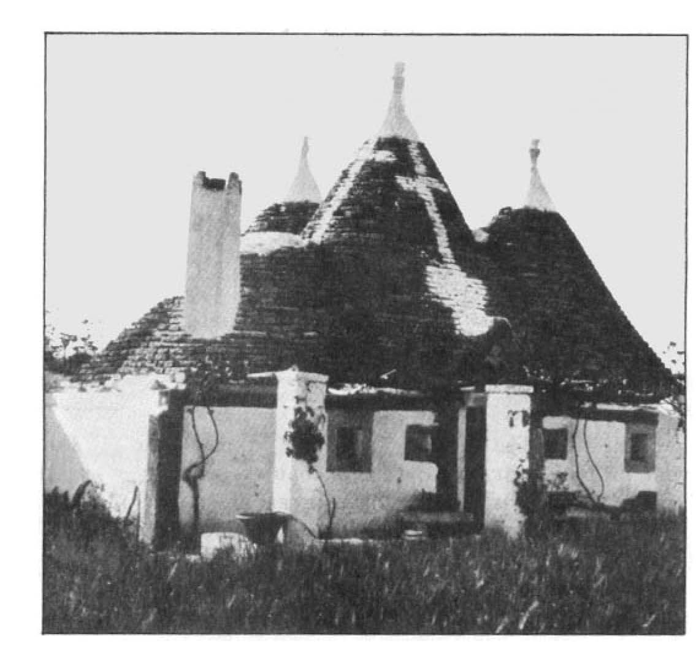
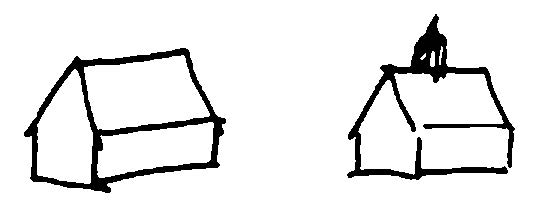
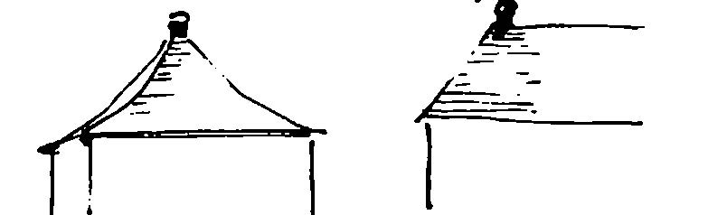

<section class="pattern-plate" aria-labelledby="t-roof-caps">
<a href="/patterns">A Pattern Language</a> · <a href="/patterns#construction">Construction</a> · Pattern 232 · p. 1084
<h1 class="pattern-title" id="t-roof-caps">Roof Caps</h1><figure class="pattern-figure pl-figure"></figure><nav class="pattern-links" aria-label="Connections"><h2>Links to</h2><ul><li><a href="/patterns/roof-garden">118 Roof Garden</a></li><li><a href="/patterns/connection-to-the-earth">168 Connection To The Earth</a></li><li><a href="/patterns/roof-vaults">220 Roof Vaults</a></li><li><a href="/patterns/floor-surface">233 Floor Surface</a></li><li><a href="/patterns/lapped-outside-walls">234 Lapped Outside Walls</a></li><li><a href="/patterns/soft-inside-walls">235 Soft Inside Walls</a></li><li><a href="/patterns/windows-which-open-wide">236 Windows Which Open Wide</a></li><li><a href="/patterns/solid-doors-with-glass">237 Solid Doors With Glass</a></li><li><a href="/patterns/filtered-light">238 Filtered Light</a></li><li><a href="/patterns/small-panes">239 Small Panes</a></li><li><a href="/patterns/half-inch-trim">240 Half-Inch Trim</a></li><li><a href="/patterns/ornament">249 Ornament</a></li></ul><h2>Linked from</h2><ul><li><a href="/patterns/roof-vaults">220 Roof Vaults</a></li><li><a href="/patterns/frames-as-thickened-edges">225 Frames As Thickened Edges</a></li><li><a href="/patterns/ornament">249 Ornament</a></li></ul></nav></section><article class="pattern-text" aria-label="The text of Roof Caps">
1085… and this pattern finishes the <a class="pl-ref" href="/patterns/roof-garden">ROOF GARDENS (118)</a> or the <a class="pl-ref" href="/patterns/roof-vaults">ROOF VAULTS (220)</a>. Assume that you have built the roof vaults—or at least that you have started to build up the splines which will support the cloth which forms the vault. Or assume that you have begun to build a roof garden, and have begun to fence it or surround it. In either case—how shall the roof be finished?

◆ ◆ ◆

<strong>There are few cases in traditional architecture where builders have not used some roof detail to cap the building with an ornament.</strong>

The pediments on Greek buildings; the caps on the trulli of Alberobello; the top of Japanese shrines; the venting caps on barns. In each of these examples there seems to be some issue of the building system that needs resolution, and the builder takes the opportunity to make a “cap.”

We suspect there is a reason for this which should be taken seriously. The roof cap helps to finish the building; it tops the building with a human touch. Yet, the power of the cap, its overall effect on the feeling of the building, is of much greater proportions than one would expect. Look at these sketches of a building, with and without a roof cap. They look like different buildings. The difference is enormous.

<figure class="pl-figure"><figcaption><em>With and viithout a roof cap</em>.</figcaption></figure>

Why is it that these caps are so important and have such a powerful effect on the building as a whole?

Here are some possible reasons.

1 They crown the roof. They give the roof the status that it deserves. The roof is important, and the caps emphasize this fact.

2 They add detail. They make the roof less homogeneous, and 1086they relieve the roof from being a single uninterrupted thing. The walls get this relief from windows, doors, balconies, which add scale and character; when a roof has many dormers, it seems to need the caps less.

3 The caps provide a connection to the sky, in a way that might have had religious overtones at one time. Just as the building needs a sense of connection to the earth—see <a class="pl-ref" href="/patterns/connection-to-the-earth">CONNECTION TO THE EARTH (168)</a>—perhaps the roof needs a connection to the sky.

In the building system we propose, the roof caps are weights we use at the ridge of the roof to make the slight curve in the pitched sides of the roof. They happen at regular intervals, at the ridges of the scallops. They need not be large—a small bag of sand or a stone will do, plastered with concrete and shaped so the bulge is obvious. It may be nice to paint them a different color from the roof.

Of course, there are hundreds of other possible kinds of roof caps. They can be brick chimneys, statues, vents, structural details, the pinnacles on a gothic buttress, weather vanes, or even windmills.

Therefore:

<strong>Choose a natural way to cap the roof—some way which is in keeping with the kind of construction, and the meaning of the building. The caps may be structural; but their main function is decorative—they mark the top—they mark the place where the roof penetrates the sky.</strong>

<figure class="pl-figure"></figure>
Finish the roof caps any way you want, but don’t forget them—<a class="pl-ref" href="/patterns/ornament">ORNAMENT (249)</a>….

1087<em>put in the surfaces and the indoor details;</em>

<a class="pl-ref" href="/patterns/floor-surface">233. FLOOR SURFACE</a>

<a class="pl-ref" href="/patterns/lapped-outside-walls">234. LAPPED OUTSIDE WALLS</a>

<a class="pl-ref" href="/patterns/soft-inside-walls">235. SOFT INSIDE WALLS</a>

<a class="pl-ref" href="/patterns/windows-which-open-wide">236. WINDOWS WHICH OPEN WIDE</a>

<a class="pl-ref" href="/patterns/solid-doors-with-glass">237. SOLID DOORS WITH GLASS</a>

<a class="pl-ref" href="/patterns/filtered-light">238. FILTERED LIGHT</a>

<a class="pl-ref" href="/patterns/small-panes">239. SMALL PANES</a>

<a class="pl-ref" href="/patterns/half-inch-trim">240. HALF-INCH TRIM</a>
</article>

Christopher Alexander, Sara Ishikawa and Murray Silverstein, with Max Jacobson, Ingrid Fiksdahl-King and Shlomo Angel, <cite>A Pattern Language</cite> (Oxford University Press, 1977), pattern 232, pp. 1084–1087. Text and illustrations from the <a href="https://github.com/natureoforder/sources">Nature of Order sources</a> reading edition, transcribed from the 1977 printing; report errors on <a href="https://github.com/natureoforder/alexander-wiki/issues">GitHub</a>.

<a href="/patterns/dormer-windows">← 231 Dormer Windows</a> · <a href="/patterns">All 253 patterns</a> · <a href="/patterns/floor-surface">233 Floor Surface →</a>

