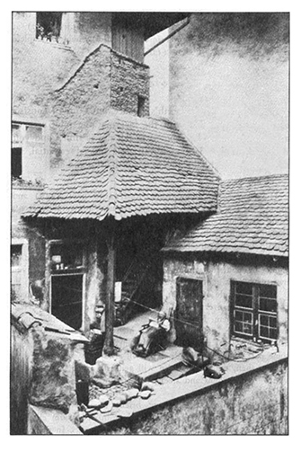
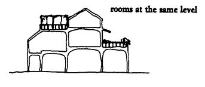

<section class="pattern-plate" aria-labelledby="t-roof-garden">
<a href="/patterns">A Pattern Language</a> · <a href="/patterns#buildings">Buildings</a> · Pattern 118 · p. 575 · *
<h1 class="pattern-title" id="t-roof-garden">Roof Garden</h1><figure class="pattern-figure pl-figure"></figure><nav class="pattern-links" aria-label="Connections"><h2>Links to</h2><ul><li><a href="/patterns/wings-of-light">107 Wings Of Light</a></li><li><a href="/patterns/cascade-of-roofs">116 Cascade Of Roofs</a></li><li><a href="/patterns/sheltering-roof">117 Sheltering Roof</a></li><li><a href="/patterns/arcades">119 Arcades</a></li><li><a href="/patterns/paths-and-goals">120 Paths And Goals</a></li><li><a href="/patterns/path-shape">121 Path Shape</a></li><li><a href="/patterns/building-fronts">122 Building Fronts</a></li><li><a href="/patterns/pedestrian-density">123 Pedestrian Density</a></li><li><a href="/patterns/activity-pockets">124 Activity Pockets</a></li><li><a href="/patterns/stair-seats">125 Stair Seats</a></li><li><a href="/patterns/something-roughly-in-the-middle">126 Something Roughly In The Middle</a></li><li><a href="/patterns/private-terrace-on-the-street">140 Private Terrace On The Street</a></li><li><a href="/patterns/sunny-place">161 Sunny Place</a></li><li><a href="/patterns/outdoor-room">163 Outdoor Room</a></li><li><a href="/patterns/gallery-surround">166 Gallery Surround</a></li><li><a href="/patterns/six-foot-balcony">167 Six-Foot Balcony</a></li><li><a href="/patterns/vegetable-garden">177 Vegetable Garden</a></li><li><a href="/patterns/roof-vaults">220 Roof Vaults</a></li><li><a href="/patterns/canvas-roofs">244 Canvas Roofs</a></li><li><a href="/patterns/raised-flowers">245 Raised Flowers</a></li><li><a href="/patterns/climbing-plants">246 Climbing Plants</a></li></ul><h2>Linked from</h2><ul><li><a href="/patterns/number-of-stories">96 Number Of Stories</a></li><li><a href="/patterns/positive-outdoor-space">106 Positive Outdoor Space</a></li><li><a href="/patterns/long-thin-house">109 Long Thin House</a></li><li><a href="/patterns/cascade-of-roofs">116 Cascade Of Roofs</a></li><li><a href="/patterns/sheltering-roof">117 Sheltering Roof</a></li><li><a href="/patterns/open-stairs">158 Open Stairs</a></li><li><a href="/patterns/gallery-surround">166 Gallery Surround</a></li><li><a href="/patterns/roof-layout">209 Roof Layout</a></li><li><a href="/patterns/roof-vaults">220 Roof Vaults</a></li><li><a href="/patterns/roof-caps">232 Roof Caps</a></li><li><a href="/patterns/canvas-roofs">244 Canvas Roofs</a></li></ul></nav></section><article class="pattern-text" aria-label="The text of Roof Garden">
576… in between the sloping roofs created by <a class="pl-ref" href="/patterns/sheltering-roof">SHELTERING ROOF (117)</a>, the roofs are flat where people can walk out on them. This pattern describes the best position for these roof gardens and specifies their character. If they are correctly placed, they will most often form the ends of <a class="pl-ref" href="/patterns/wings-of-light">WINGS OF LIGHT (107)</a> at different stories and will, therefore, automatically help to complete the overall <a class="pl-ref" href="/patterns/cascade-of-roofs">CASCADE OF ROOFS (116)</a>.

◆ ◆ ◆

<strong>A vast part of the earth’s surface, in a town, consists of roofs. Couple this with the fact that the total area of a town which can be exposed to the sun is finite, and you will realize that is is natural, and indeed essential, to make roofs which take advantage of the sun and air.</strong>

However, as we know from <a class="pl-ref" href="/patterns/sheltering-roof">SHELTERING ROOF (117)</a> and <a class="pl-ref" href="/patterns/roof-vaults">ROOF VAULTS (220)</a>, the flat shape is quite unnatural for roofs from psychological, structural, and climatic points of view. It is therefore sensible to use a flat roof only where the roof will actually become a garden or an outdoor room; to make as many of these “useful” roofs as possible; but to make all other roofs, which cannot be used, the sloping, vaulted, shell-like structures specified by <a class="pl-ref" href="/patterns/sheltering-roof">SHELTERING ROOF (117)</a> and <a class="pl-ref" href="/patterns/roof-vaults">ROOF VAULT (220)</a>.

Here is a rule of thumb: if possible, make at least one small roof garden in every building, more if you are sure people will actually use them. Make the remaining roofs steep roofs. Since, as we shall see, the roof gardens which work are almost always at the same level as some indoor rooms, this means that at least some part of the building’s roofs will always be steep. We shall expect, then, that this pattern will generate a roof landscape in which roof gardens and steep roofs are mixed in almost every building.

We now consider the flat roof, briefly, on its own terms. Flat roof gardens have always been prevalent in dry, warm climates, where they can be made into livable environments. In the dense parts of towns in Mediterranean climates, nearly every roof is 577habitable: they are full of green, private screens, with lovely views, places to cook out and eat and sleep. And even in temperate climates they are beautiful. They can be designed as rooms without ceilings, places that are protected from the wind, but open to the sky.

However, the flat roofs that have become architectural fads during the last 40 years are quite another matter. Gray gravel covered asphalt structures, these flat roofs are very rarely useful places; they are not gardens; and taken as a whole, they do not meet the psychological requirements that we have outlined in <a class="pl-ref" href="/patterns/sheltering-roof">SHELTERING ROOF (117)</a>. To make the flat parts of roofs truly useful, and compatible with the need for sloping roofs, it seems necessary to build flat roof gardens off the indoor parts of the buildings. In other words, do not make them the highest part of the roof; let the highest parts of the roof slope; and make it possible to walk out to the roof garden from an interior room, without climbing special stairs. We have found that roof gardens that have this relationship are used far more intensely than those rooftops which must be reached by climbing stairs. The explanation is obvious: it is far more comfortable to walk straight out onto a roof and feel the comfort of part of the building behind and to one side of you, then it is to climb up to a place you cannot see.

Therefore:

<strong>Make parts of almost every roof system usable as roof gardens. Make these parts flat, perhaps terraced for planting, with places to sit and sleep, private places. Place the roof gardens at various stories, and always make it possible to walk directly out onto the <em>tool</em> garden from some lived-in part of the building.</strong>

<figure class="pl-figure"></figure>
578

◆ ◆ ◆

Remember to try and put the roof gardens at the open ends of <a class="pl-ref" href="/patterns/wings-of-light">WINGS OF LIGHT (107)</a> so as not to take the daylight away from lower stories. Some roof gardens may be like balconys or galleries or terraces—<a class="pl-ref" href="/patterns/private-terrace-on-the-street">PRIVATE TERRACE ON THE STREET (140)</a>, <a class="pl-ref" href="/patterns/gallery-surround">GALLERY SURROUND (166)</a>, <a class="pl-ref" href="/patterns/six-foot-balcony">SIX-FOOT BALCONY (167)</a>. In any case, place the roof garden so that it is sheltered from the wind—<a class="pl-ref" href="/patterns/sunny-place">SUNNY PLACE (161)</a>, and give part of the roof some extra kind of shelter—perhaps a canvas awning—so that people can stay on the roof but keep out of the hot sun—<a class="pl-ref" href="/patterns/canvas-roofs">CANVAS ROOFS (244)</a>. Treat each individual garden much the way as any other garden, with flowers, vegetables, outdoor rooms, canvas awnings, climbing plants—<a class="pl-ref" href="/patterns/outdoor-room">OUTDOOR ROOMS (163)</a>, <a class="pl-ref" href="/patterns/vegetable-garden">VEGETABLE GARDEN (177)</a>, <a class="pl-ref" href="/patterns/raised-flowers">RAISED FLOWERS (245)</a>, <a class="pl-ref" href="/patterns/climbing-plants">CLIMBING PLANTS (246)</a>….

579<strong><em>when the major farts of buildings and the outdoor areas have been given their rough shape, it is the right time to give more detailed attention to the paths and squares between the buildings</em>.</strong>

<a class="pl-ref" href="/patterns/arcades">119. ARCADES</a>

<a class="pl-ref" href="/patterns/paths-and-goals">120. PATHS AND GOALS</a>

<a class="pl-ref" href="/patterns/path-shape">121. PATH SHAPE</a>

<a class="pl-ref" href="/patterns/building-fronts">122. BUILDING FRONTS</a>

<a class="pl-ref" href="/patterns/pedestrian-density">123. PEDESTRIAN DENSITY</a>

<a class="pl-ref" href="/patterns/activity-pockets">124. ACTIVITY POCKETS</a>

<a class="pl-ref" href="/patterns/stair-seats">125. STAIR SEATS</a>

<a class="pl-ref" href="/patterns/something-roughly-in-the-middle">126. SOMETHING ROUGHLY IN THE MIDDLE</a>
</article>

Christopher Alexander, Sara Ishikawa and Murray Silverstein, with Max Jacobson, Ingrid Fiksdahl-King and Shlomo Angel, <cite>A Pattern Language</cite> (Oxford University Press, 1977), pattern 118, pp. 575–579. Text and illustrations from the <a href="https://github.com/natureoforder/sources">Nature of Order sources</a> reading edition, transcribed from the 1977 printing; report errors on <a href="https://github.com/natureoforder/alexander-wiki/issues">GitHub</a>.

<a href="/patterns/sheltering-roof">← 117 Sheltering Roof</a> · <a href="/patterns">All 253 patterns</a> · <a href="/patterns/arcades">119 Arcades →</a>

