

<section class="pattern-plate" aria-labelledby="t-roof-layout">
<a href="/patterns">A Pattern Language</a> · <a href="/patterns#construction">Construction</a> · Pattern 209 · p. 970 · *
<h1 class="pattern-title" id="t-roof-layout">Roof Layout</h1><figure class="pattern-figure pl-figure">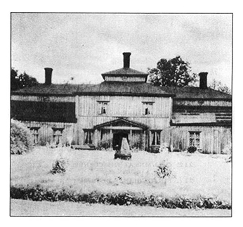</figure><nav class="pattern-links" aria-label="Connections"><h2>Links to</h2><ul><li><a href="/patterns/main-building">99 Main Building</a></li><li><a href="/patterns/courtyards-which-live">115 Courtyards Which Live</a></li><li><a href="/patterns/cascade-of-roofs">116 Cascade Of Roofs</a></li><li><a href="/patterns/sheltering-roof">117 Sheltering Roof</a></li><li><a href="/patterns/roof-garden">118 Roof Garden</a></li><li><a href="/patterns/ceiling-height-variety">190 Ceiling Height Variety</a></li><li><a href="/patterns/the-shape-of-indoor-space">191 The Shape Of Indoor Space</a></li><li><a href="/patterns/thickening-the-outer-walls">211 Thickening The Outer Walls</a></li><li><a href="/patterns/roof-vaults">220 Roof Vaults</a></li></ul><h2>Linked from</h2><ul><li><a href="/patterns/courtyards-which-live">115 Courtyards Which Live</a></li><li><a href="/patterns/cascade-of-roofs">116 Cascade Of Roofs</a></li><li><a href="/patterns/sheltering-roof">117 Sheltering Roof</a></li><li><a href="/patterns/light-on-two-sides-of-every-room">159 Light On Two Sides Of Every Room</a></li><li><a href="/patterns/efficient-structure">206 Efficient Structure</a></li><li><a href="/patterns/gradual-stiffening">208 Gradual Stiffening</a></li><li><a href="/patterns/floor-and-ceiling-layout">210 Floor And Ceiling Layout</a></li><li><a href="/patterns/thickening-the-outer-walls">211 Thickening The Outer Walls</a></li><li><a href="/patterns/columns-at-the-corners">212 Columns At The Corners</a></li><li><a href="/patterns/roof-vaults">220 Roof Vaults</a></li></ul></nav></section><article class="pattern-text" aria-label="The text of Roof Layout">
971… assume now that you have a rough plan, to scale, for each floor of the building. In this case you already know roughly how the roofs will go, from <a class="pl-ref" href="/patterns/cascade-of-roofs">CASCADE OF ROOFS (116)</a> and <a class="pl-ref" href="/patterns/sheltering-roof">SHELTERING ROOF (117)</a>; and you know exactly where the roof is flat to form ROOF GARDENSwill be made of very next to rooms at different floors—roof garden (118). This pattern shows you how to get a detailed roof plan for the building, which helps those patterns come to life, for any plan which you have drawn.

◆ ◆ ◆

<strong>What kind of roof plan is organically related to the nature of your building?</strong>

We know, from arguments presented in <a class="pl-ref" href="/patterns/the-shape-of-indoor-space">the shape of indoor space (191)</a>, that the majority of spaces in an organic building will have roughly—not necessarily perfectly—straight walls because it is only then that the space on <em>both</em> sides of the walls can be positive, or convex in shape.

And we know, from similar arguments, that the majority of the angles in the building will be roughly—again, not exactly—right angles, that is, in the general range of 80 to 100 degrees.

We know, therefore, that the class of natural plans may contain a variety of shapes like half circles, octagons, and so on—but that for the most part, it will be made of very rough, sloppy rectangles.

We also know, from <a class="pl-ref" href="/patterns/sheltering-roof">SHELTERING ROOF (117)</a>, that entire wings should be under one roof whenever possible and that the building is to be roofed with a mixture of flat roofs and sloping or domical roofs, with the accent on those which are <em>not</em> flat.

We may therefore state the problem of defining a roof layout as follows: <em>Given an arbitrary flan of the type described above, have can toe fit to it an arrangement of roofs which conforms to the</em> CASCADE OF ROOFS (rid) <em>and</em> <a class="pl-ref" href="/patterns/sheltering-roof">SHELTERING ROOF (117)</a> <em>and</em> <a class="pl-ref" href="/patterns/roof-garden">ROOF GARDENS (118)</a>?

Before explaining the procedure for laying out roofs in detail, we underline five assumptions which provide the basis for the procedure.

972

<ol type="1">
<li>The “pitched” roofs may actually be pitched, or they may be vaults with a curved pitch, or barrel vaults—as described in <a class="pl-ref" href="/patterns/roof-vaults">ROOF VAULTS (220)</a>. The general procedure, in all three cases, is the same. (For curved vaults, define slope as height-to-width ratio.)</li>
</ol>
<figure class="pl-figure">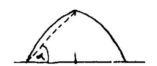<figcaption><em>The “fitch” of a vaulted roof</em>.</figcaption></figure>

2. Assume that all roofs in the building, which are not flat, have roughly the same slope. For a given climate and roof construction, one slope is usually best; and this greatly simplifies construction.

<figure class="pl-figure">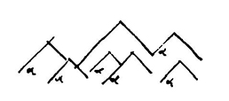<figcaption><em>The same slope throughout</em>.</figcaption></figure>

3. Since all roofs have the same slope, the roofs which cover the widest wings and/or rooms will have the highest peaks; those covering smaller wings and rooms will be relatively lower. This is consistent with <a class="pl-ref" href="/patterns/main-building">MAIN BUILDING (99)</a>, <a class="pl-ref" href="/patterns/cascade-of-roofs">CASCADE OF ROOFS (116)</a>, and <a class="pl-ref" href="/patterns/ceiling-height-variety">CEILING HEIGHT VARIETY (190)</a>.

<figure class="pl-figure">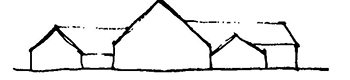<figcaption><em>Wide roofs are highest</em>.</figcaption></figure>

4. Any place where the building helps to enclose an outdoor room or courtyard needs an even eave line so that it has the space of a “room.” An irregular roof line, with gable ends, will usually destroy the space of a small courtyard. It is necessary, therefore, that roofs be hipped in these positions to make the roof edge horizontal.

973

<figure class="pl-figure">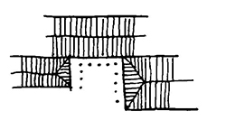<figcaption><em>Low roof edge round a courtyard</em>.</figcaption></figure>

5. In all other positions, leave the ends of buildings and wings as gable ends.

<figure class="pl-figure">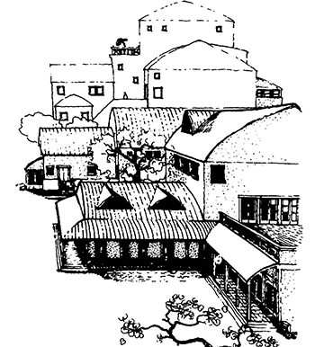<figcaption><em>one version of a roof layout, using ultra-lightweight concrete vaults as roofs</em>.</figcaption></figure>

974We shall now discuss the rules for roofing a building by using an example of a house designed by a layman using the pattern language. This building plan is shown below. It is a single-story house and it contains no roof gardens or balconies.

<figure class="pl-figure">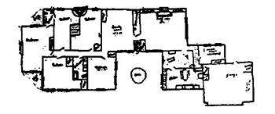</figure>
We first identify the largest rectangular cluster of rooms and roof it with a peaked roof, the ridge line of which runs the long direction:

<figure class="pl-figure">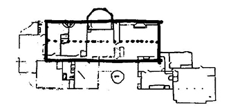</figure>
Then we do the same with smaller clusters, until all the major spaces are roofed.

<figure class="pl-figure">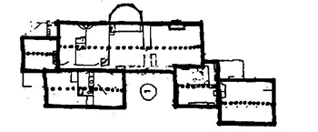</figure>
Then we roof remaining small rooms, alcoves, and thick walls with shed roofs sloping outward. These roofs should spring from the base of the main roofs to help relieve them of outward thrusts; their outside walls should be as low as possible.

<figure class="pl-figure">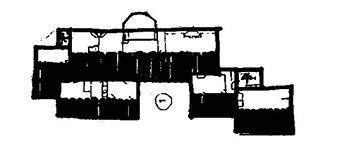</figure>
975Finally, we identify the outdoor spaces (shown as A, B, and C), and hip the roofs around them to preserve a more continuous eave line around the spaces.

<figure class="pl-figure">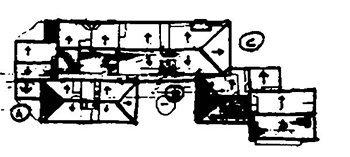</figure>
We shall now discuss a slightly more complicated example, a two story building.

<figure class="pl-figure">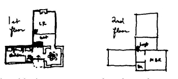</figure>
We begin with the top story, roofing the entire master bedroom and bath under one peaked roof with the ridge running lengthwise:

<figure class="pl-figure">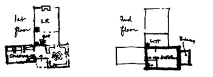</figure>
Next we move to the lower story, roofing the children’s wing under a flat roof to form a <a class="pl-ref" href="/patterns/roof-garden">ROOF GARDEN (118)</a> for the master bedroom, and the larger living room under a pitched roof, again with the ridge running lengthwise.

<figure class="pl-figure">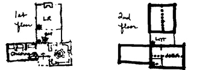</figure>
976Then we bring the roof over the master bedroom down over the interior loft.

<figure class="pl-figure">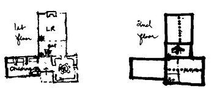</figure>
Finally, we smooth the living room roof ridge line into the side of the roof over the loft. This completes the roof layout.

<figure class="pl-figure">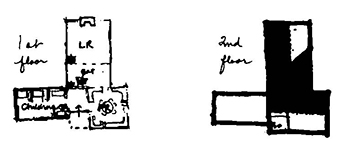</figure>
It is very helpful, when you are laying out roofs, to remember the structural principle outlined in <a class="pl-ref" href="/patterns/cascade-of-roofs">CASCADE OF ROOFS (116)</a>. When you have finished, the overall arrangement of the roofs should form a self-buttressing cascade in which each lower roof helps to take up the horizonal thrust generated by the higher roofs—and the overall section of the roofs, taken in very very general terms, tends toward a rough upside down catenary.

Therefore:

<strong>Arrange the roofs so that each distinct roof corresponds to an identifiable social entity in the building or building complex. Place the largest roofs—those which are highest and have the largest span—over the largest and most important and most communal spaces; build the lesser roofs off these largest and highest roofs; and build the smallest roofs of all off these lesser roofs, in the form of half-vaults and sheds over alcoves and thick walls.</strong>

977

<figure class="pl-figure">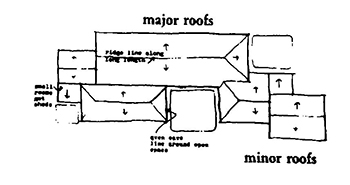</figure>
◆ ◆ ◆

You can build all these roofs, and the connections between them, by following the instructions for roof vaults—roof vaults (220). When a wing ends in the open, leave the gable end at full height^ when a wing ends in a courtyard, hip the gable, so that the horizontal roof edge makes the courtyard like a room—<a class="pl-ref" href="/patterns/courtyards-which-live">COURTYARDS WHICH LIVE (115)</a>.

Treat the smallest shed roofs, which cover thick walls and alcoves, as buttresses, and build them to help take the horizontal thrust from floor vaults and higher roof vaults—<a class="pl-ref" href="/patterns/thickening-the-outer-walls">THICKENING THE OUTER WALLS (211)</a>….
</article>

Christopher Alexander, Sara Ishikawa and Murray Silverstein, with Max Jacobson, Ingrid Fiksdahl-King and Shlomo Angel, <cite>A Pattern Language</cite> (Oxford University Press, 1977), pattern 209, pp. 970–977. Text and illustrations from the <a href="https://github.com/natureoforder/sources">Nature of Order sources</a> reading edition, transcribed from the 1977 printing; report errors on <a href="https://github.com/natureoforder/alexander-wiki/issues">GitHub</a>.

<a href="/patterns/gradual-stiffening">← 208 Gradual Stiffening</a> · <a href="/patterns">All 253 patterns</a> · <a href="/patterns/floor-and-ceiling-layout">210 Floor And Ceiling Layout →</a>

