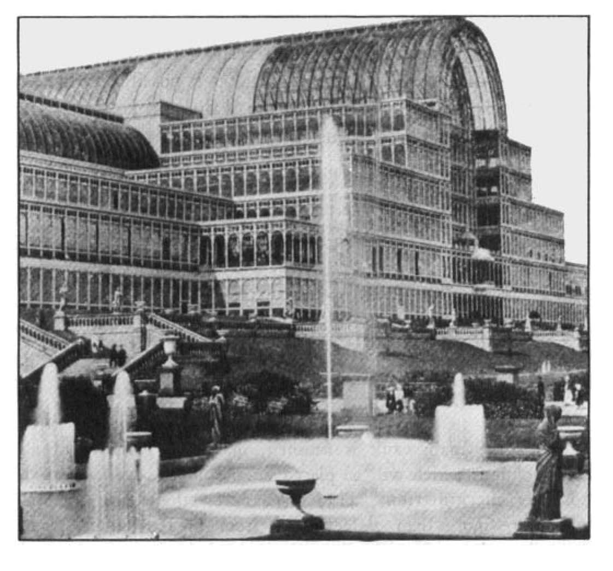
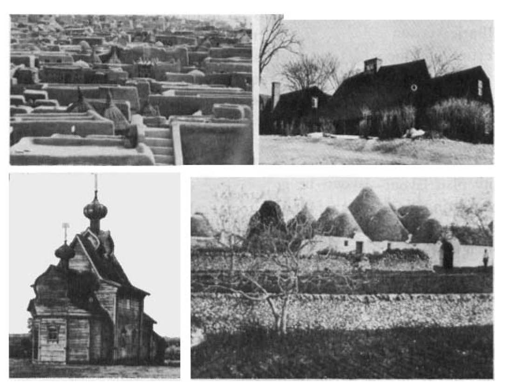
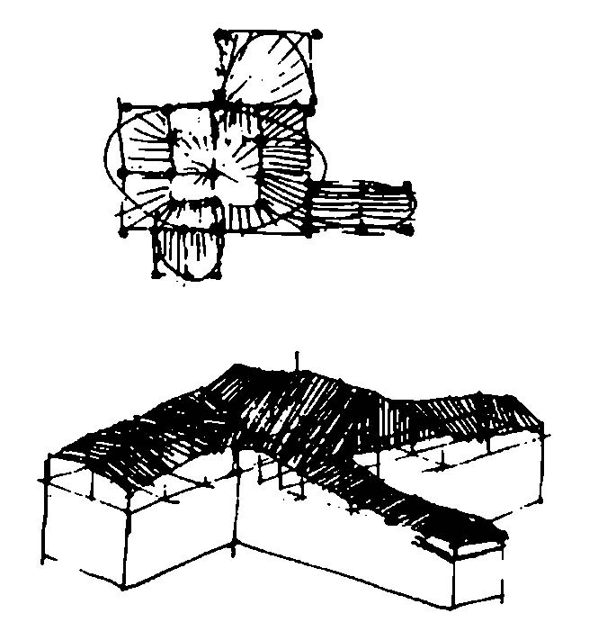
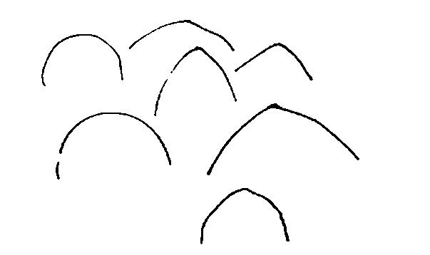
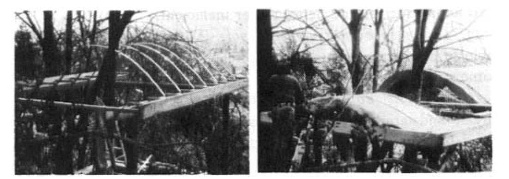
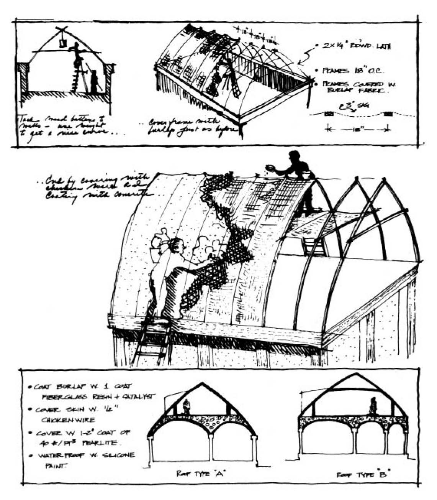
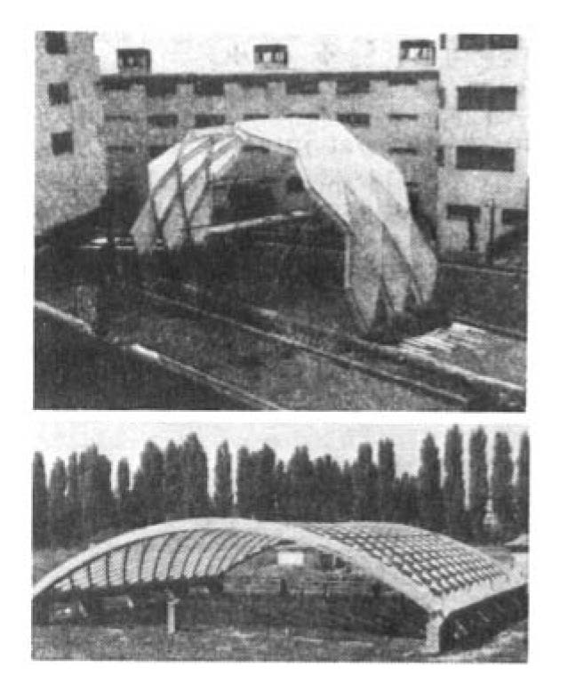
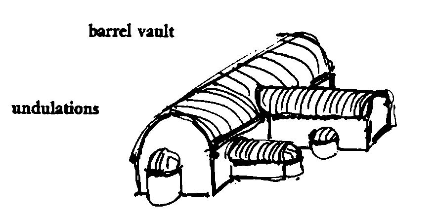

<section class="pattern-plate" aria-labelledby="t-roof-vaults">
<a href="/patterns">A Pattern Language</a> · <a href="/patterns#construction">Construction</a> · Pattern 220 · p. 1036 · *
<h1 class="pattern-title" id="t-roof-vaults">Roof Vaults</h1><figure class="pattern-figure pl-figure"></figure><nav class="pattern-links" aria-label="Connections"><h2>Links to</h2><ul><li><a href="/patterns/sheltering-roof">117 Sheltering Roof</a></li><li><a href="/patterns/roof-garden">118 Roof Garden</a></li><li><a href="/patterns/structure-follows-social-spaces">205 Structure Follows Social Spaces</a></li><li><a href="/patterns/efficient-structure">206 Efficient Structure</a></li><li><a href="/patterns/good-materials">207 Good Materials</a></li><li><a href="/patterns/roof-layout">209 Roof Layout</a></li><li><a href="/patterns/floor-ceiling-vaults">219 Floor-Ceiling Vaults</a></li><li><a href="/patterns/natural-doors-and-windows">221 Natural Doors And Windows</a></li><li><a href="/patterns/dormer-windows">231 Dormer Windows</a></li><li><a href="/patterns/roof-caps">232 Roof Caps</a></li><li><a href="/patterns/lapped-outside-walls">234 Lapped Outside Walls</a></li></ul><h2>Linked from</h2><ul><li><a href="/patterns/sheltering-roof">117 Sheltering Roof</a></li><li><a href="/patterns/roof-garden">118 Roof Garden</a></li><li><a href="/patterns/efficient-structure">206 Efficient Structure</a></li><li><a href="/patterns/gradual-stiffening">208 Gradual Stiffening</a></li><li><a href="/patterns/roof-layout">209 Roof Layout</a></li><li><a href="/patterns/floor-and-ceiling-layout">210 Floor And Ceiling Layout</a></li><li><a href="/patterns/columns-at-the-corners">212 Columns At The Corners</a></li><li><a href="/patterns/final-column-distribution">213 Final Column Distribution</a></li><li><a href="/patterns/dormer-windows">231 Dormer Windows</a></li><li><a href="/patterns/roof-caps">232 Roof Caps</a></li><li><a href="/patterns/lapped-outside-walls">234 Lapped Outside Walls</a></li></ul></nav></section><article class="pattern-text" aria-label="The text of Roof Vaults">
1037… if the roof is a flat <a class="pl-ref" href="/patterns/roof-garden">ROOF GARDEN (118)</a>, it can be built just like any <a class="pl-ref" href="/patterns/floor-ceiling-vaults">FLOOR-CEILING VAULT (219)</a>. But when it is a sloping roof, according to the character of <a class="pl-ref" href="/patterns/sheltering-roof">SHELTERING ROOF (117)</a>, it needs a new construction, specifically adapted to the shape which can enclose a volume.

◆ ◆ ◆

<strong>What is the best shape for a roof?</strong>

For some reason, this is the most loaded, the most emotional question, that can be asked about building construction. In all our investigations of patterns, we have not found any other pattern which generates so much discussion, so much disagreement, and so much emotion. Early childhood images play a vital role; so does cultural prejudice. It is hard to imagine an Arab building with a pitched roof; hard to imagine a New England farmhouse with a Russian onion roof over a tower; hard to imagine a person who has grown up among pitched steep wooden roofs, happy under the stone cones of the trulli.

<figure class="pl-figure"><figcaption><em>All over the world</em>.</figcaption></figure>

1038For this reason, in this pattern we make our discussion as fundamental as we can. We shall do everything we can to obtain the necessary features which we can treat as invariant for all roofs, regardless of people or culture—yet deep enough to allow a rich assortment of cultural variations.

We approach the problem with the assumption that there are no constraints created by techniques or availability of materials. We are merely concerned with the optimum shape and distribution of materials. Given a roughly rectangular plan, or plan composed of rectangular pieces connected, what is the best shape for the shell of the roof which covers them?

The requirements influencing the shape are these:

1 The feeling of shelter—<a class="pl-ref" href="/patterns/sheltering-roof">SHELTERING ROOF (117)</a>. This requires that the roof cover a whole wing (that is, not merely room by room). It requires that some of the roof be highly visible—hence, that it have a fairly steep slope—and that some of the roof be flat and usable for gardens or terraces.

2 The roof must definitely contain lived-in space—that is, not just sit on top of the rooms which are all below—see <a class="pl-ref" href="/patterns/sheltering-roof">SHELTERING ROOF (117)</a>. This means it needs rather a steep slope at the edge—because otherwise there is no headroom. This requires an elliptical section dome, or a barrel vault (which starts going up vertically at the edge), or a very steep slope.

3 In plan, each individual roof is a very rough rectangle, with occasional variations. This follows from the way the roofs of a building must, together, follow the social layout of the plan—<a class="pl-ref" href="/patterns/roof-layout">ROOF LAYOUT (209)</a>.

4 The roof shape must be relaxed—that is, it can be used in any plan layout—and can be generated very simply from a few generating lines which follow automatically from the plan—that is, it must not be a tricky or contrived shape which needs a lot of fiddling around to define it—<a class="pl-ref" href="/patterns/structure-follows-social-spaces">STRUCTURE FOLLOWS SOCIAI. SPACES (205)</a>.

5 Structural considerations require a curved shell, dome or vault to eliminate as much bending as possible—see <a class="pl-ref" href="/patterns/efficient-structure">EFFICIENT STRUCTURE (206)</a> and <a class="pl-ref" href="/patterns/good-materials">GOOD MATERIALS (207)</a>. Of course, to the extent that wood or steel or other tension materials are available, this requirement can be relaxed.

6 The roof is steep enough to shed rain and snow in climates where they occur. Obviously, this aspect of the roof will vary from climate to climate.

1039

<figure class="pl-figure"></figure>
…<em>relaxed</em>.

These requirements eliminate the following kinds of roofs:

1 <em>Flat roofs</em>. Flat roofs, except <a class="pl-ref" href="/patterns/roof-garden">ROOF GARDENS (118)</a>, are already eliminated by the psychological arguments of <a class="pl-ref" href="/patterns/sheltering-roof">SHELTERING ROOFS (117)</a> and, of course, by structural considerations. A flat roof is necessary where people are going to walk on it; but it is a very inefficient structural shape since it creates bending.

2 <em>Pitched Roofs</em>. Pitched roofs still require materials that can withstand bending moment. The most common material for pitched roofs—wood—is becoming scarce and expensive. As we have said in <a class="pl-ref" href="/patterns/good-materials">GOOD MATERIALS (207)</a>, we believe it is most sensible to keep wood for surfaces and not to use it as a structural material, except in wood rich areas. Pitched roofs also need to be very steep, indeed, to enclose habitable space as required by <a class="pl-ref" href="/patterns/sheltering-roof">SHELTERING ROOF (117)</a>—and hence rather inefficient.

3 <em>Dutch bam and mansard roofs</em>. These roofs enclose habitable space more efficiently than pitched roofs; but they have the same structural drawbacks.

4 <em>Geodesic domes</em>. These domes cover essentially circular areas, and are not therefore useful in their ordinary form—CASCADE OF ROOFS (tl6), <a class="pl-ref" href="/patterns/structure-follows-social-spaces">STRUCTURE FOLLOWS SOCIAL 8PACES (205)</a>. In the modified form, which comes when you stretch 1040the base into a rough rectangle, they become more or less congruent with the class of vaults defined by this pattern.

5. <em>Cable nets and. tents</em>. These roofs use tensile materials instead of compressive ones—they do not conform to the requirements of <a class="pl-ref" href="/patterns/good-materials">GOOD MATERIALS (207)</a>. They are also very inefficient when it comes to enclosing habitable space—and thus fail to meet the requirements of <a class="pl-ref" href="/patterns/structure-follows-social-spaces">STRUCTURE FOLLOWS SOCIAL SPACES (205)</a>.

The roofs which satisfy the requirements are all types of rectangular barrel vaults or shells, with or without a peak, gabled or hipped, and with a variety of possible cross sections. Almost any one of these shells will be further strengthened by additional undulations in the direction of the vault. Examples of possible cross sections are given below. (Remember that this does not include those flat <a class="pl-ref" href="/patterns/roof-garden">ROOF GARDENS (118)</a> built over <a class="pl-ref" href="/patterns/floor-ceiling-vaults">FLOOR-CEILING VAULTS (219)</a>.)

<figure class="pl-figure"><figcaption><em>Possible roof vaults</em>.</figcaption></figure>

We have developed a range of roof vaults which are rather similar to a pitched roof—but with a convex curve great enough to eliminate bending, in some cases actually approaching barrel vaults. One is shown in the drawing opposite; another is shown below.

<figure class="pl-figure"><figcaption><em>Another version of a roof vault, built by Bob Harris in Oregon</em>.</figcaption></figure>

1041We build the roof vault very much like the floor vaults:

1 First span the wing to be roofed with pairs of lattice strips which are securely nailed at their ends to the perimeter beam, and weighted at their apex so that the two pieces become slightly curved.

2 Make the frame for the ceiling under the roof frame at the same time according to <a class="pl-ref" href="/patterns/floor-ceiling-vaults">FLOOR-CEILINC VAULTS (219)</a>.

3 Repeat this frame every 18 inches, until the entire wing is framed. The outer one will be the same, while the inner frame for the ceiling may change according to the rooms under it.

<figure class="pl-figure"><figcaption><em>A type of roof vault, similar to the floor-ceiling vault, made from lattice strips, burlap, chicken-wire and ultralightweight concrete, but with an apex, and a pitch, and undulations for strength</em>.</figcaption></figure>

10424 Now lay burlap over the ceiling frame, then resin, then 1 l/2 inches of ultra-lightweight concrete—as for <a class="pl-ref" href="/patterns/floor-ceiling-vaults">FLOOR-CEILING VAULTS (219)</a>.

5 Now lay burlap over the roof frame, tacking it onto the lattice strips so that there is a 3-inch scallop in between the ribs—to form structural undulations in the skin. Again, paint the burlap with resin; lay chickenwire and put a layer of lightweight concrete over the entire roof.

We have analyzed a 48-foot roof of this type by means of a computerized finite element analysis similar to the one described for <a class="pl-ref" href="/patterns/floor-ceiling-vaults">FLOOR-CEILING VAULTS (219)</a>. The analysis shows that the maximum membrane compressive stress in the roof is 39.6 psi; the maximum membrane tensile stress is 2.3 psi, and the maximum diagonal membrane stress which develops from the maximum shear of 41.7 psi is 15.2 psi. These stresses are within the capacity of the material (See allowable stresses given in <a class="pl-ref" href="/patterns/floor-ceiling-vaults">FLOOR-CEILING VAULT (219)</a>). The maximum membrane bending moment is 46 inch pounds per inch which is higher than the capacity of the unrcin-forced section, but extrapolations from our data show that this will be comfortably taken care of by the reinforcing which is needed anyway for shrinkage. Roofs with smaller spans, for a typical WING OF LIGHT (106), will be even stronger.

Of course there are dozens of other ways to make a roof vault. Other versions include ordinary barrel vaults, lamella structures in the form of barrel vaults, elongated geodesic domes (built up from struts), vaults built up from plastic sheets, or fiberglass, or corrugated metal.

But, in one way or another, build your roofs according to the invariant defined below, remembering that it lies somewhere in between the Crystal Palace, the stone vaults of Alberobello, mud huts of the Congo, grass structures of the South Pacific, and the corrugated iron huts of our own time. This shape is required whenever you are working with materials which are in pure compression.

Obviously, if you have access to wood or steel and want to use it, you can modify this shape by adding tension members. However, we believe that these tension materials will become more and more rare as time goes on and that the pure compression shape will gradually become a universal.

1043

<figure class="pl-figure"><figcaption><em>Experimental roof vaults</em>.</figcaption></figure>

Therefore:

<strong>Build the roof vault either as a cylindrical barrel vault, or like a pitched roof with a slight convex curve in each of the two sloping sides. Put in undulations along the vault, to make the shell more effective. The curvature of the main shell, and of the undulations, can vary with the span; the bigger the span, the deeper the curvature and undulations need to be.</strong>

<figure class="pl-figure"></figure>
1044

◆ ◆ ◆

Leave space for dormers at intervals along the vault—<a class="pl-ref" href="/patterns/dormer-windows">DORMER WINDOWS (231)</a>, and build them integral with it. Finish the roof with <a class="pl-ref" href="/patterns/roof-caps">ROOF CAPS (232)</a>. And once the vault is complete, it needs a waterproof paint or skin applied to its outer surface—<a class="pl-ref" href="/patterns/lapped-outside-walls">LAPPED OUTSIDE WALLS (234)</a>. It can be painted white to protect it against the sun; the undulations will carry the rainwater….

1045<strong><em>within the mam frame of the building, fix the exact positions for openings—the doors and the windows—and frame these openings</em>.</strong>

<a class="pl-ref" href="/patterns/natural-doors-and-windows">221. NATURAL DOORS AND WINDOWS</a>

222.    222 LOW SILL

223.    223 DEEP REVEALS

224.    224 LOW DOORWAY

225.    225 FRAMES AS THICKENED EDGES
</article>

Christopher Alexander, Sara Ishikawa and Murray Silverstein, with Max Jacobson, Ingrid Fiksdahl-King and Shlomo Angel, <cite>A Pattern Language</cite> (Oxford University Press, 1977), pattern 220, pp. 1036–1045. Text and illustrations from the <a href="https://github.com/natureoforder/sources">Nature of Order sources</a> reading edition, transcribed from the 1977 printing; report errors on <a href="https://github.com/natureoforder/alexander-wiki/issues">GitHub</a>.

<a href="/patterns/floor-ceiling-vaults">← 219 Floor-Ceiling Vaults</a> · <a href="/patterns">All 253 patterns</a> · <a href="/patterns/natural-doors-and-windows">221 Natural Doors And Windows →</a>

