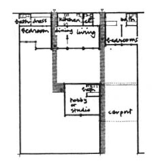
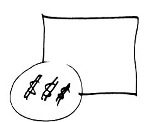

<section class="pattern-plate" aria-labelledby="t-rooms-to-rent">
<a href="/patterns">A Pattern Language</a> · <a href="/patterns#buildings">Buildings</a> · Pattern 153 · p. 720
<h1 class="pattern-title" id="t-rooms-to-rent">Rooms To Rent</h1><nav class="pattern-links" aria-label="Connections"><h2>Links to</h2><ul><li><a href="/patterns/necklace-of-community-projects">45 Necklace Of Community Projects</a></li><li><a href="/patterns/the-family">75 The Family</a></li><li><a href="/patterns/your-own-home">79 Your Own Home</a></li><li><a href="/patterns/self-governing-workshops-and-offices">80 Self-Governing Workshops And Offices</a></li><li><a href="/patterns/entrance-transition">112 Entrance Transition</a></li><li><a href="/patterns/flexible-office-space">146 Flexible Office Space</a></li><li><a href="/patterns/teenagers-cottage">154 Teenager’s Cottage</a></li><li><a href="/patterns/old-age-cottage">155 Old Age Cottage</a></li><li><a href="/patterns/home-workshop">157 Home Workshop</a></li><li><a href="/patterns/open-stairs">158 Open Stairs</a></li><li><a href="/patterns/the-shape-of-indoor-space">191 The Shape Of Indoor Space</a></li></ul><h2>Linked from</h2><ul><li><a href="/patterns/life-cycle">26 Life Cycle</a></li><li><a href="/patterns/bulk-storage">145 Bulk Storage</a></li><li><a href="/patterns/half-private-office">152 Half-Private Office</a></li><li><a href="/patterns/teenagers-cottage">154 Teenager’s Cottage</a></li><li><a href="/patterns/old-age-cottage">155 Old Age Cottage</a></li><li><a href="/patterns/open-stairs">158 Open Stairs</a></li></ul></nav></section><article class="pattern-text" aria-label="The text of Rooms To Rent">
… this pattern is the first which sets the framework for the outbuildings. Used properly, it can help to create <a class="pl-ref" href="/patterns/necklace-of-community-projects">NECKLACE OF COMMUNITY PROJECTS (45)</a>, <a class="pl-ref" href="/patterns/the-family">THE FAMILY (75)</a>, <a class="pl-ref" href="/patterns/self-governing-workshops-and-offices">SELF-GOVERNING WORKSHOPS AND OFFICES (80)</a>, SMALL SERVICES WITHOUT RED TAPE (8l), <a class="pl-ref" href="/patterns/flexible-office-space">FLEXIBLE OFFICE SPACE (146)</a>, <a class="pl-ref" href="/patterns/teenagers-cottage">TEENAGER’S COTTACE (154)</a>, <a class="pl-ref" href="/patterns/old-age-cottage">OLD AGE COTTAGE (155)</a>, <a class="pl-ref" href="/patterns/home-workshop">HOME WORKSHOP (157)</a>: in general it makes any building flexible, useful in a greater variety of circumstances.

◆ ◆ ◆

<strong>As the life in a building changes, the need for space shrinks and swells cyclically. The building must be able to adapt to this irregular increase and decrease in the need for space.</strong>

Very simply, when a family or a workgroup shrinks because one or two people leave, the space which becomes empty should be able to find a use. Otherwise, the people who stay behind will rattle around in a hollow shell which is too big for them. They may even be forced to sell their property and move because they cannot afford the upkeep of so big a place.

And by the same token, since swelling and shrinking is almost always unpredictable, this splitting off of space should be reversible. The rooms which are given to outside use or let out when they are not used, may one day be needed again when circumstances change and the workgroup or family swells in size again.

To give buildings this flexibility, it is essential that parts of them be relatively independent. In effect, some rooms should be conceived in advance as potential rooms to let if the size of the group should change. These rooms need a kind of connection to the rest of the house, which allows them to be closed off and separated, and then, just as easily, joined up again. Generally, 721this means a private entrance from the outside, either a private bath or direct access to a bathroom, and perhaps access to the kitchen.

In Denmark, Ole Dybbroe has developed a scheme for housing that takes this pattern as a crucial generator of the form of the house. The houses he shows in <em>Enfamiliehuset igjo</em> (Lands-bankernes Reallanefond, stiftedes den 9. maj 1959) grow slowly, and each part of them can either be united with the larger household or inhabited as an independent unit. Here is his plan for a “four part” house.

<figure class="pl-figure"><figcaption><em>Dybbroe’s four-part house</em>.</figcaption></figure>

Though renting in general has a devastating impact on the environment—see <a class="pl-ref" href="/patterns/your-own-home">YOUR OWN HOME (79)</a> our experience has been that face-to-face rental, with the owners occupying the main structure, is the one kind of rental relationship that is reasonably healthy. The landlord is actually there, so he is directly concerned with the well-being of the life around him and with the environment, unlike the absentee landlords, who own property only for the money which it makes. And the tenants are usually short-term tenants, who prefer to rent a room rather than take on burdens of ownership. Even here a more ideal situation would be for the owner to share out ownership over some part of the building, with certain options for taking back the space. However, in the absence of such subtle forms of legal ownership, face to face renting is, we believe, the only form of renting that is not socially and physically destructive.

722Therefore:

<strong>Make at least some part of the building rentable: give it a private entrance over and above its regular connection to the rest of the house. Make sure that the regular entrance can be easily closed off without destroying the circulation in the house, and make sure that a bathroom can be directly reached from this room without having to go through the main house.</strong>

<figure class="pl-figure"></figure>
◆ ◆ ◆

Place the rooms to rent in such a way that they can double as a <a class="pl-ref" href="/patterns/teenagers-cottage">TEENACER’S COTTAGE (154)</a>, or an <a class="pl-ref" href="/patterns/old-age-cottage">OLD ACE COTTAGE (155)</a>, or a <a class="pl-ref" href="/patterns/home-workshop">HOME WORKSHOP (157)</a>; give the private entrance an <a class="pl-ref" href="/patterns/entrance-transition">ENTRANCE TRANSITION (112)</a>, and if the space is on an upper floor, give it direct access to the street by means of <a class="pl-ref" href="/patterns/open-stairs">OPEN STAIRS (158)</a>. And give the <em>rooms</em> themselves LIGHT ON TWO SIDES (1 59) and <a class="pl-ref" href="/patterns/the-shape-of-indoor-space">THE SHAPE OF INDOOR SPACE (191)</a>….
</article>

Christopher Alexander, Sara Ishikawa and Murray Silverstein, with Max Jacobson, Ingrid Fiksdahl-King and Shlomo Angel, <cite>A Pattern Language</cite> (Oxford University Press, 1977), pattern 153, pp. 720–722. Text and illustrations from the <a href="https://github.com/natureoforder/sources">Nature of Order sources</a> reading edition, transcribed from the 1977 printing; report errors on <a href="https://github.com/natureoforder/alexander-wiki/issues">GitHub</a>.

<a href="/patterns/half-private-office">← 152 Half-Private Office</a> · <a href="/patterns">All 253 patterns</a> · <a href="/patterns/teenagers-cottage">154 Teenager’s Cottage →</a>

