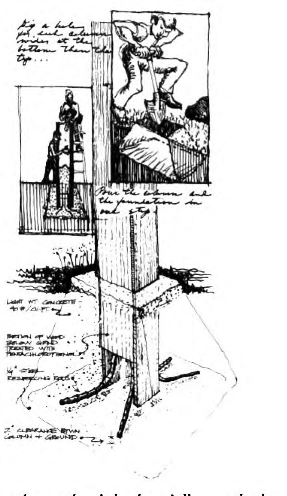
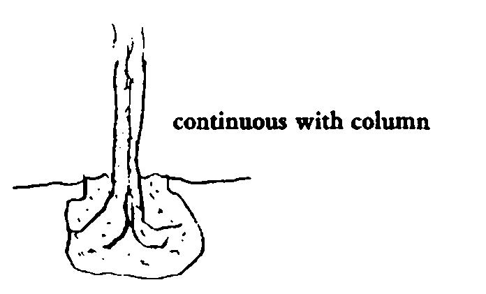

<section class="pattern-plate" aria-labelledby="t-root-foundations">
<a href="/patterns">A Pattern Language</a> · <a href="/patterns#construction">Construction</a> · Pattern 214 · p. 1006
<h1 class="pattern-title" id="t-root-foundations">Root Foundations</h1><nav class="pattern-links" aria-label="Connections"><h2>Links to</h2><ul><li><a href="/patterns/site-repair">104 Site Repair</a></li><li><a href="/patterns/connection-to-the-earth">168 Connection To The Earth</a></li><li><a href="/patterns/columns-at-the-corners">212 Columns At The Corners</a></li><li><a href="/patterns/final-column-distribution">213 Final Column Distribution</a></li><li><a href="/patterns/ground-floor-slab">215 Ground Floor Slab</a></li><li><a href="/patterns/box-columns">216 Box Columns</a></li></ul><h2>Linked from</h2><ul><li><a href="/patterns/columns-at-the-corners">212 Columns At The Corners</a></li><li><a href="/patterns/final-column-distribution">213 Final Column Distribution</a></li><li><a href="/patterns/ground-floor-slab">215 Ground Floor Slab</a></li><li><a href="/patterns/box-columns">216 Box Columns</a></li><li><a href="/patterns/floor-ceiling-vaults">219 Floor-Ceiling Vaults</a></li></ul></nav></section><article class="pattern-text" aria-label="The text of Root Foundations">
… once you have a rough column plan for the building—<a class="pl-ref" href="/patterns/columns-at-the-corners">COLUMNS AT THE CORNERS (212)</a>, <a class="pl-ref" href="/patterns/final-column-distribution">FINAL COLUMN DISTRIBUTION (213)</a>—you are ready to start the site work itself. First, stake out the positions of the ground floor columns, before you do any other earthwork, so that you can move the columns whenever necessary to leave rocks or plants intact—<a class="pl-ref" href="/patterns/site-repair">SITE REPAIR (104)</a>, <a class="pl-ref" href="/patterns/connection-to-the-earth">CONNECTION TO THE EARTH (168)</a>. Then dig the foundation pits and prepare to make the foundations.

◆ ◆ ◆

<strong>The best foundations of all are the kinds of foundations which a tree has—where the entire structure of the tree simply continues below ground level, and creates a system entirely integral with the ground, in tension and compression.</strong>

When the column and the foundations are separate elements which have to be connected, the connection becomes a difficult and critical joint. Both bending and shear stresses are extremely high just at the joint. If a connector is introduced as a third element, there are even more joints to worry about, and each member works less effectively to resist these stresses.

We suspect that it would be better to build the foundations and the columns in such a way that the columns get rooted in the foundation and become integral and continuous with the ground.

In the realization of this pattern which we illustrate, the root foundation takes a very simple form. Since columns start out hollow, <a class="pl-ref" href="/patterns/box-columns">BOX COLUMNS (216)</a>, we can form a root foundation by setting the hollow column into the foundation pit, and then pouring the lower part of the column and the foundation, integrally, in a single pour.

As far as the wood version is concerned, the problem of placing 1007wood in contact with wet underground concrete is very serious. The wood of the column can be protected from dry rot and termites by pressure dipping in pentachlorophenol. We also believe that painting with thick asphalt or dampproof mastic might work; but the problem isn’t really solved. Of course, masonry versions in which columns are made of terracotta pipe or concrete pipe and filled with dense concrete, ought to work alright. But even in these cases, we are doubtful about the exact structural validity of the pattern. We believe that some kind of structure which is continuous with the ground is needed: but we quite haven’t been able to work it out. Meanwhile, we state this pattern as a kind of challenge.

<figure class="pl-figure"><figcaption><em>One version of a root foundation for a hollow wooden box column which we have built</em>.</figcaption></figure>

1008Namely:

<strong>Try to find a way of making foundations in which the columns themselves go right into the earth, and spread out there—so that the footing is continuous with the material of the column, and the column, with its footing, like a tree root, can resist tension and horizontal shear as well as compression.</strong>

<figure class="pl-figure"></figure>
◆ ◆ ◆

To make foundations like this for hollow concrete, filled box columns, start with a pit for each foundation, place the hollow column in the pit, and pour the column and the foundation integrally, in one continuous pour—<a class="pl-ref" href="/patterns/box-columns">BOX COLUMNS (216)</a>. Later, when you build the ground floor slab, tie the concrete into the foundations—<a class="pl-ref" href="/patterns/ground-floor-slab">CROUNIJ FLOOR SLAB (215)</a>.
</article>

Christopher Alexander, Sara Ishikawa and Murray Silverstein, with Max Jacobson, Ingrid Fiksdahl-King and Shlomo Angel, <cite>A Pattern Language</cite> (Oxford University Press, 1977), pattern 214, pp. 1006–1008. Text and illustrations from the <a href="https://github.com/natureoforder/sources">Nature of Order sources</a> reading edition, transcribed from the 1977 printing; report errors on <a href="https://github.com/natureoforder/alexander-wiki/issues">GitHub</a>.

<a href="/patterns/final-column-distribution">← 213 Final Column Distribution</a> · <a href="/patterns">All 253 patterns</a> · <a href="/patterns/ground-floor-slab">215 Ground Floor Slab →</a>

