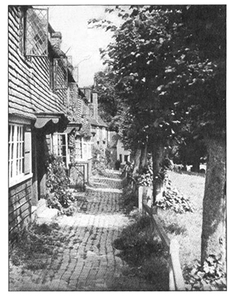
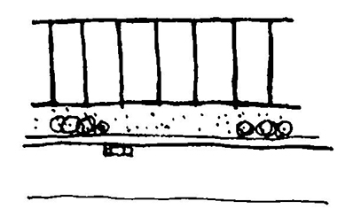
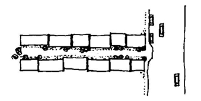
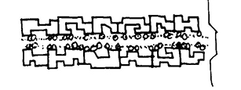
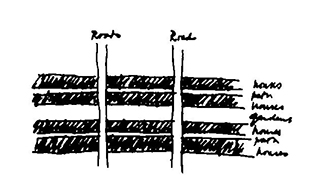
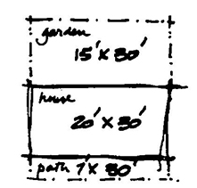
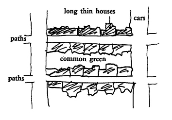

<section class="pattern-plate" aria-labelledby="t-row-houses">
<a href="/patterns">A Pattern Language</a> · <a href="/patterns#towns">Towns</a> · Pattern 38 · p. 204 · *
<h1 class="pattern-title" id="t-row-houses">Row Houses</h1><figure class="pattern-figure pl-figure"></figure><nav class="pattern-links" aria-label="Connections"><h2>Links to</h2><ul><li><a href="/patterns/network-of-paths-and-cars">52 Network Of Paths And Cars</a></li><li><a href="/patterns/house-for-a-small-family">76 House For A Small Family</a></li><li><a href="/patterns/house-for-a-couple">77 House For A Couple</a></li><li><a href="/patterns/house-for-one-person">78 House For One Person</a></li><li><a href="/patterns/building-complex">95 Building Complex</a></li></ul><h2>Linked from</h2><ul><li><a href="/patterns/density-rings">29 Density Rings</a></li><li><a href="/patterns/interchange">34 Interchange</a></li><li><a href="/patterns/degrees-of-publicness">36 Degrees Of Publicness</a></li><li><a href="/patterns/housing-in-between">48 Housing In Between</a></li><li><a href="/patterns/common-land">67 Common Land</a></li><li><a href="/patterns/the-family">75 The Family</a></li><li><a href="/patterns/your-own-home">79 Your Own Home</a></li><li><a href="/patterns/pedestrian-street">100 Pedestrian Street</a></li><li><a href="/patterns/half-hidden-garden">111 Half-Hidden Garden</a></li></ul></nav></section><article class="pattern-text" aria-label="The text of Row Houses">
205… in certain parts of a community, the detached homes and gardens of a <strong>house cluster</strong> (37) will not work, because they are not dense enough to generate the denser parts of <strong>density rincs</strong> (29) and <strong>decrees of publicness</strong> (36). To help create these larger patterns, it is necessary to build row houses instead.

◆ ◆ ◆

<strong>At densities of 15 to 30 houses per acre, row houses are essential. But typical row houses are dark inside, and stamped from an identical mould.</strong>

Above 15 houses per acre, it is almost impossible to make houses freestanding without destroying the open space around them; the open space which is left gets reduced to nothing more than shallow rings around the houses. And apartments do not solve the problem of higher densities; they keep people off the ground and they have no private gardens.

Row houses solve these problems. But row houses, in their conventional form, have problems of their own. Conventional row houses all conform, approximately, to the following diagram. The houses have a short frontage and a long depth, and share the party wall along their long side.

<figure class="pl-figure"><figcaption><em>Typical row house pattern</em>.</figcaption></figure>

Because of the long party walls, many of the rooms are poorly lit. The houses lack privacy—there is nowhere in the houses or their yards that is very far from a party wall. The small yards are made even worse by the fact that they are at the short ends of the house, so that only a small part of the indoor space can be 206adjacent to the garden. And there is almost no scope for individual variation in the houses, with the result that terraces of row houses are often rather sterile.

These four problems of row houses can easily be solved by making the houses long and thin, along the paths, like cottages. In this case, there is plenty of room for subtle variations from house to house—each plan can be quite different; and it is easy to arrange the plan to let the light in.

<figure class="pl-figure"><figcaption><em>Houses long and thin along the fath</em>.</figcaption></figure>

This kind of house has 30 per cent of its perimeter fixed and 70 per cent free for individual variations. A house in a conventional terrace of row houses has 70 per cent of its perimeter fixed and only 30 per cent open to individual variations. So the house can take on a variety of shapes, with a guarantee of a reasonable amount of privacy for its garden and for most of the house, an increase in the amount of light into the house, and an increase in the amount of indoor space that can be next to outdoor areas.

<figure class="pl-figure"><figcaption><em>Crinkling and variation</em>.</figcaption></figure>

These advantages of the long thin row house are so obvious, it is natural to wonder why they aren’t used more often. The reason is, of course, that roads do not permit it. So long as houses front directly onto roads, it is imperative that they have 207the shortest frontage possible, so as to save the cost of roads and services—the cost of roads is a large part of any housing budget. But in the pattern we propose, we have been able to avoid this difficulty altogether, by making the houses front only onto paths—which don’t cost much—and it is then these paths which connect to the roads, at right angles, in the way prescribed by <a class="pl-ref" href="/patterns/network-of-paths-and-cars">NETWORK OF PATHS AND CARS (52)</a>.

<figure class="pl-figure"><figcaption><em>Roads away from houses</em>.</figcaption></figure>

Finally, a word on density. As we see from the sketch below, it is possible to build a two-story house of 1200 square feet on an area 30 x 20, using a total area (path, house, garden) of about 1300 square feet, and it is even possible to manage with an <em>absolute</em> minimum <em>of</em> 1000 square feet.

<figure class="pl-figure"></figure>
1300 square feet of land fer house.

It is therefore possible to build row houses at a density of 30 per net acre. Without parking, or with less parking, this figure could conceivably be even higher.

Therefore:

208<strong>For row houses, place houses along pedestrian paths that run at right angles to local roads and parking lots, and give each house a long frontage and a shallow depth.</strong>

<figure class="pl-figure"></figure>
◆ ◆ ◆

Make the individual houses and cottages as long and thin along the paths as possible—long thin house (109); vary the houses according to the different household types—the family (75),<a class="pl-ref" href="/patterns/house-for-a-small-family">HOUSE FOR A SMALL FAMILY (76)</a>, <a class="pl-ref" href="/patterns/house-for-a-couple">HOUSE FOR A COUPLE (77)</a>, <a class="pl-ref" href="/patterns/house-for-one-person">house for one person (78)</a>; build roads across the paths, at right angles to them—parallel roads (23), <a class="pl-ref" href="/patterns/network-of-paths-and-cars">network of paths and cars (52)</a>, with small parking lots off the roads—small parking lots (103). In other respects build row houses in clusters—house cluster (37), <a class="pl-ref" href="/patterns/building-complex">building complex (95)</a>….
</article>

Christopher Alexander, Sara Ishikawa and Murray Silverstein, with Max Jacobson, Ingrid Fiksdahl-King and Shlomo Angel, <cite>A Pattern Language</cite> (Oxford University Press, 1977), pattern 38, pp. 204–208. Text and illustrations from the <a href="https://github.com/natureoforder/sources">Nature of Order sources</a> reading edition, transcribed from the 1977 printing; report errors on <a href="https://github.com/natureoforder/alexander-wiki/issues">GitHub</a>.

<a href="/patterns/house-cluster">← 37 House Cluster</a> · <a href="/patterns">All 253 patterns</a> · <a href="/patterns/housing-hill">39 Housing Hill →</a>

