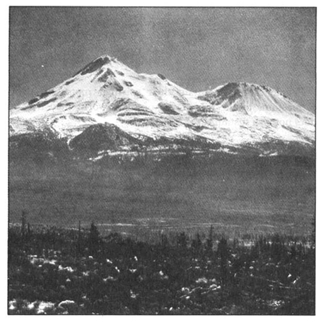
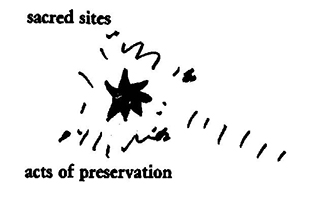

<section class="pattern-plate" aria-labelledby="t-sacred-sites">
<a href="/patterns">A Pattern Language</a> · <a href="/patterns#towns">Towns</a> · Pattern 24 · p. 131 · *
<h1 class="pattern-title" id="t-sacred-sites">Sacred Sites</h1><figure class="pattern-figure pl-figure"></figure><nav class="pattern-links" aria-label="Connections"><h2>Links to</h2><ul><li><a href="/patterns/quiet-backs">59 Quiet Backs</a></li><li><a href="/patterns/holy-ground">66 Holy Ground</a></li><li><a href="/patterns/zen-view">134 Zen View</a></li><li><a href="/patterns/tree-places">171 Tree Places</a></li><li><a href="/patterns/garden-seat">176 Garden Seat</a></li></ul><h2>Linked from</h2><ul><li><a href="/patterns/subculture-boundary">13 Subculture Boundary</a></li><li><a href="/patterns/mini-buses">20 Mini-Buses</a></li><li><a href="/patterns/access-to-water">25 Access To Water</a></li><li><a href="/patterns/eccentric-nucleus">28 Eccentric Nucleus</a></li><li><a href="/patterns/pools-and-streams">64 Pools And Streams</a></li></ul></nav></section><article class="pattern-text" aria-label="The text of Sacred Sites">
132… in every region and every town, indeed in every neighborhood, there are special places which have come to symbolize the area, and the people’s roots there. These places may be natural beauties or historic landmarks left by ages past. But in some form they are essential.

◆ ◆ ◆

<strong>People cannot maintain their spiritual roots and their connections to the past if the physical world they live in does not also sustain these roots.</strong>

Informal experiments in our communities have led us to believe that people agree, to an astonishing extent, about the sites which do embody people’s relation to the land and to the past. It seems, in other words, as though “the” sacred sites for an area exist as objective communal realities.

If this is so, it is then of course essential that these specific sites be preserved and made important. Destruction of sites which have become part of the communal consciousness, in an agreed and widespread sense, must inevitably create gaping wounds in the communal body.

Traditional societies have always recognized the importance of these sites. Mountains are marked as places of special pilgrimage; rivers and bridges become holy; a building or a tree, or rock or stone, takes on the power through which people can connect themselves to their own past.

But modern society often ignores the psychological importance of these sites. They are bulldozed, developed, changed, for political and economic reasons, without regard for these simple but fundamental emotional matters; or they are simply ignored.

We suggest the following two steps.

1. In any geographic area—large or small—ask a large number of people which sites and which places make them feel the most contact with the area; which sites stand most for the important values of the past, and which ones embody their connection to the land. Then insist that these sites be actively preserved.

2. Once the sites are chosen and preserved, embellish them in 133a way which intensifies their public meaning. We believe that the best way to intensify a site is through a progression of areas which people pass through as they approach the site. This is the principle of “nested precincts,” discussed in detail under the pattern <a class="pl-ref" href="/patterns/holy-ground">HOLY GROUND (66)</a>.

A garden which can be reached only by passing through a series of outer gardens keeps its secrecy. A temple which can be reached only by passing through a sequence of approach courts is able to be a special thing in a man’s heart. The magnificence of a mountain peak is increased by the difficulty of reaching the upper valleys from which it can be seen; the beauty of a woman is intensified by the slowness of her unveiling; the great beauty of a river bank—its rushes, water rats, small fish, wild flowers—are violated by a too direct approach; even the ecology cannot stand up to the too direct approach-the thing will simply be devoured.

We must therefore build around a sacred site a series of spaces which gradually intensify and converge on the site. The site itself becomes a kind of inner sanctum, at the core. And if the site is very large—a mountain—the same approach can be taken with special places from which it can be seen—an inner sanctum, reached past many levels, which is not the mountain, but a garden, say, from which the mountain can be seen in special beauty.

Therefore:

<strong>Whether the sacred sites are large or small, whether they are at the center of the towns, in neighborhoods, or in the deepest countryside, establish ordinances which will protect them absolutely-so that our roots in the visible surroundings cannot be violated.</strong>

<figure class="pl-figure"></figure>
134

◆ ◆ ◆

Give every sacred site a place, or a sequence of places, where people can relax, enjoy themselves, and feel the presence of the place—<a class="pl-ref" href="/patterns/quiet-backs">QUIET BACKS (59)</a>, <a class="pl-ref" href="/patterns/zen-view">ZEN VIEW (134)</a>, <a class="pl-ref" href="/patterns/tree-places">TREE PLACES (171)</a>, <a class="pl-ref" href="/patterns/garden-seat">GARDEN SEAT (176)</a>. And above all, shield the approach to the site, so that it can only be approached on foot, and through a series of gateways and thresholds which reveal it gradually—<a class="pl-ref" href="/patterns/holy-ground">HOLY GROUND (66)</a>….
</article>

Christopher Alexander, Sara Ishikawa and Murray Silverstein, with Max Jacobson, Ingrid Fiksdahl-King and Shlomo Angel, <cite>A Pattern Language</cite> (Oxford University Press, 1977), pattern 24, pp. 131–134. Text and illustrations from the <a href="https://github.com/natureoforder/sources">Nature of Order sources</a> reading edition, transcribed from the 1977 printing; report errors on <a href="https://github.com/natureoforder/alexander-wiki/issues">GitHub</a>.

<a href="/patterns/parallel-roads">← 23 Parallel Roads</a> · <a href="/patterns">All 253 patterns</a> · <a href="/patterns/access-to-water">25 Access To Water →</a>

